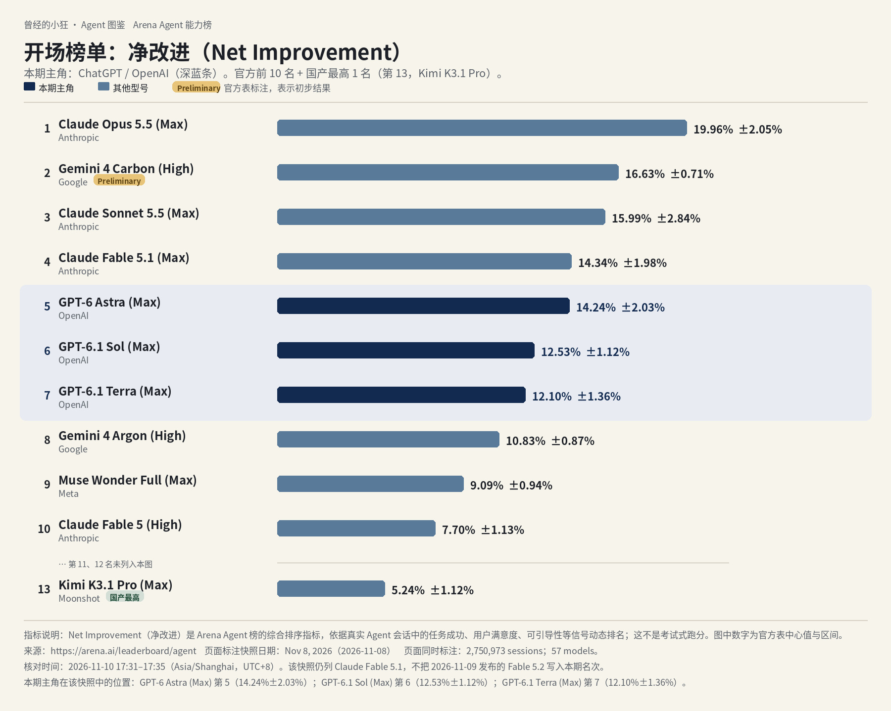
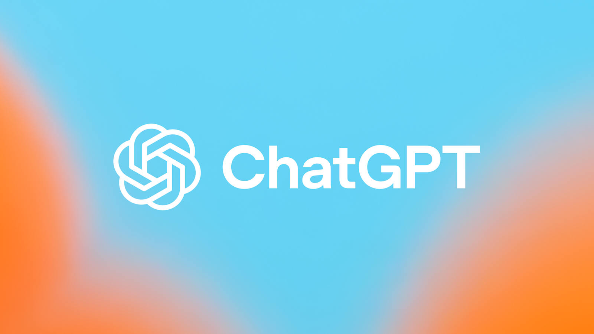
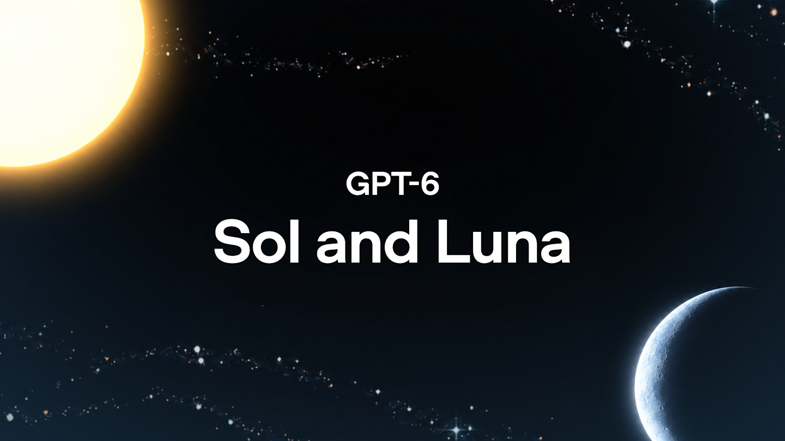
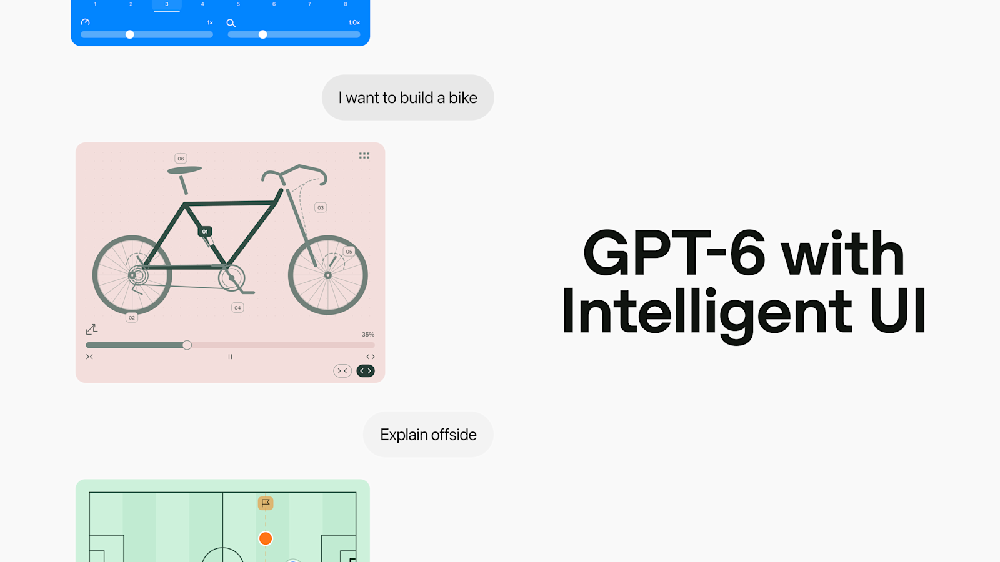

# 成稿包：《Agent 图鉴》第 2 篇 · ChatGPT（OpenAI）（小白向重写）

> 按 2026-11-10 23:32 用户口令重写，替换原文件夹成稿。写作单 #003 与所称 #003-R2 的写法要求作废。事实沿用 R1 定稿与已核来源，不退回已被改掉的错误说法。  
> 核对日期：2026-11-10（Asia/Shanghai，UTC+8）  
> 口径：据官方资料整理；无实测口吻。按刀哥视角，像本人在给小白讲。  
> 榜图数据来自 [Arena Agent 榜](https://arena.ai/leaderboard/agent)，快照日期 2026-11-08。署名：刀哥。合集：Agent 与大模型。

---

## 1. 标题备选（3 个）

1. **【建议主标题】先看这张全球 Agent 前十，再认识今天的主角 ChatGPT**
2. 前十里有三个 GPT：完全没接触过也能看懂 ChatGPT 现在是什么
3. 从一张榜说起：GPT-6 怎么选，Work、Codex 和 dots 怎么进

---

## 2. 作者

刀哥

---

## 3. 一句摘要

先看全球 Agent 前十：第五到第七都是 GPT。再把 ChatGPT 是谁、GPT-6 怎么选、Work 和 Codex 干什么、怎么起步、要花多少钱，讲给没接触过的人听。

---

## 4. 完整正文（可直接发表）

曾经的小狂 · Agent 图鉴 第 2 篇

# 先看这张全球 Agent 前十，再认识今天的主角 ChatGPT

刀哥

你先别急着记名字。先看这张图。

这张不是传统那种刷题跑分榜。Arena 的 Agent 榜，看的是真实会话里，一个助手把事情做完之后，综合表现到底好了多少，指标叫「净改进」。图上是 2026 年 11 月 8 日那一版快照，一共记了 2,750,973 场会话、57 个模型。核对时间是 2026 年 11 月 10 日 17:31–17:35（Asia/Shanghai，UTC+8）。数据来自 [arena.ai/leaderboard/agent](https://arena.ai/leaderboard/agent)。

你把深蓝那几条扫一眼：第五名是 GPT-6 Astra，净改进 14.24%±2.03%；第六名是 GPT-6.1 Sol，12.53%±1.12%；第七名是 GPT-6.1 Terra，12.10%±1.36%。前十里，有三个席位都是 OpenAI 的 GPT。第 2 名 Gemini 4 Carbon (High) 带官方 Preliminary 标注，表示初步结果。这份快照是 11 月 8 日的，Claude Fable 5.2 第二天才发布，没有进这期名次，图里也不写。

今天要讲的主角，就是这三条背后的那一个产品：ChatGPT。公司叫 OpenAI。

这个名字你大概听过。不过现在的产品线，已经不只是一个对话框——后面要讲的 Work、Codex、dots，都是在聊天之外，让它连续把事情做完的入口。这篇按 2026 年 11 月 10 日的官方页面整理。

## 先把产品和脑子分开

说白了，ChatGPT 是 OpenAI 做的 AI 助手。免费就可以在网页或手机上跟它聊天、问问题、让它写点东西。付了费，思考可以更用力，也可以让它做完一份文档或幻灯，或者帮你写程序。

后面这种「你说目标，它自己拆步骤、连续做下去」的能力，行业里叫 Agent。写程序、交一份完整的材料，靠的往往就是这个。

它的「脑子」是 OpenAI 自己做的 GPT 系模型，不是借别人家的。后面你会听到 Astra、Sol、Terra、Luna，都是同一家族里不同的型号：有的更强、更贵，有的更快、更省。ChatGPT 是产品的名字，GPT-6 是现在这代脑子的家族名，两者不是同一回事。

这篇是介绍，不是评测。版本、价格、能不能用，都对过 2026 年 11 月 10 日的官方页面。我没上手用过的，不会写成我的体验。官方页说法不一致的地方，我会把两处都写出来，并标「待核」。

## 做它的那家公司，你只需知道这些

下面只写核对日打开的官方页里能对上的节点，没打开专页的创立年份、融资轮次不补。

官方 [About](https://openai.com/about/) 页写：OpenAI 是一家 AI 研究与部署公司，使命是确保通用人工智能（AGI）——官方把它解释为普遍比人更聪明的 AI 系统——造福全人类。同一页还写现行结构：非营利的 **OpenAI Foundation**，治理作为公共受益公司运营的 **OpenAI Group**，使命由这两个组织一起推进。

和本期直接相关的产品节点是：2026 年 9 月 22 日发布 **GPT-6 Sol** 和 **GPT-6 Luna**；9 月 29 日发布 **GPT-6.1 Sol**，同一天介绍 **dots**；10 月 7 日把 GPT-6 与 **Intelligent UI** 推向 Chat。**GPT-6 Astra** 的发布页在核对日仍在线，页顶更新指向了 9 月 22 日和 9 月 29 日；最初发布日该页抓取文本里没有稳定读出，我标了待核，不把某一个日期写成已核事实。**GPT-6.1 Terra** 的发布页同样已打开，精确发布日也标待核；dots 介绍页在 2026 年 11 月 3 日的更新里写，已把 Terra 纳入 dots 所用的模型家族。

## 选模型时，先分清两个使用面

官方多次写明：日常聊天的 **Chat**，和交成品、写代码的 **Work / Codex**，两边能选的型号并不完全一样。

怎么选，我按官方自己的说法整理，不是我用过之后的判断。

| 型号 | 官方怎么说 | 主要出现在哪 |
|------|------------|--------------|
| **GPT-6 Astra** | 官方模型指南写成最智能的一档，用于最吃推理、编码和专业工作的场合。API 调用名 `gpt-6-astra`。在 Chat 里，Pro 推理档由它驱动，产品名是 GPT-6 Pro。Plus 在 Chat 里不含这一档，但 Plus 在 Work 和 Codex 里含 Astra。 | Chat（符合条件的 Pro 等）；Work / Codex（Pro 全含；Plus 含，但是限量） |
| **GPT-6 Sol** | 针对日常对话调优。2026-10-07 的 Chat 更新写：Plus / Pro / Business / Enterprise 的 Chat，由它驱动。帮助中心写：选 GPT-6 时，Instant、Medium、High、Extra High 由它驱动。API 调用名 `gpt-6-sol`。 | Chat（付费档滚动推出）；Work / Codex 也列有 |
| **GPT-6.1 Sol** | 接近 Astra 的智能，标准输入 / 输出价是 Astra 的五分之一。发布页写：在 ChatGPT Work 和 Codex 向 Plus、Pro、Business、Enterprise、Edu 推出，**当时尚未进入 Chat**。默认上下文在 Work / Codex 里是 50 万 token。API 调用名 `gpt-6.1-sol`。 | 只在 Work / Codex，不在普通 Chat |
| **GPT-6.1 Terra** | 更快、更省的一档，强调视觉推理、精确的电脑操作，以及更清楚、更自然的写作。发布页写：向 Plus、Pro、Enterprise、Edu 的 Work 和 Codex 推出，API 调用名 `gpt-6.1-terra`。该句没有点名 Business，和帮助中心「Work / Codex 的可选模型」如何对应，我标了待核。 | 只在 Work / Codex，不在普通 Chat |
| **GPT-6 Luna** | 官方模型指南：最快、最省成本，适合目标明确、量大的日常任务。2026-10-07 的 Chat 更新写：Free / Go 的 GPT-6 由 Luna 驱动。API 调用名 `gpt-6-luna`。 | 见下方「Free / Go 用哪一款」 |
| **GPT-5.6 家族** | 帮助中心写：GPT-6 这次滚动推出，**并不退役**仍可选择的旧型号。GPT-5.6 Sol 面向复杂的编码、知识工作与研究等；GPT-5.6 Sol Pro 是这一家里最高能力的一档。Terra / Luna 在普通 Chat 里不可选，按计划出现在 Work、Codex 或 API。 | Chat 里仍可选 GPT-5.6 Sol；Work / Codex / API 另有 Terra、Luna |

如果只先记两句：在 Chat 里选 GPT-6 时，Instant、Medium、High、Extra High 由 **GPT-6 Sol** 驱动；Pro 推理档的产品名是 **GPT-6 Pro**，由 **GPT-6 Astra** 驱动。这两句的出处是帮助中心 [GPT-6 and other models in ChatGPT](https://help.openai.com/en/articles/20001354-gpt-6-and-other-models-in-chatgpt)（文号 20001354）。2026 年 11 月 10 日 19:27 重抓时，页面原话仍在：“When GPT-6 is selected, GPT-6 Sol powers Instant, Medium, High, and Extra High; Pro uses GPT-6 Pro, powered by GPT-6 Astra.”

所谓 Instant 到 Extra High，可以先理解成「这次思考要多用力」。用力越大，通常越慢、也越吃用量。Plus 含 Medium 和 High，不含 Extra High，也不含 Chat 里的 Pro 推理档。

**Free / Go 在 Chat 里用哪一款：两处官方说法不一致，并陈，待核。**

- 2026 年 10 月 7 日的公告 [GPT-6 and Intelligent UI for everyone](https://openai.com/index/gpt-6-for-everyone/) 写：付费档由 **GPT-6 Sol** 驱动，Free 与 Go 由 **GPT-6 Luna** 驱动；当日先向 Plus / Pro / Business / Enterprise 的 Chat 滚动，次日扩到 Free / Go。同日的 October 系统卡也按 Chat 中的 GPT-6 Sol / Luna 来写。
- 帮助中心同一篇 20001354（R1 重抓时页头显示 Updated 11 days ago）写：Free 与 Go **没有** GPT-5.6 Sol，默认是 **GPT-5.6 Luna**，Think 也由 GPT-5.6 Luna 驱动。Go 的专文（核对日显示 Updated 4 hours ago）同样写：Think 用 GPT-5.6 Luna，Go 不含 GPT-5.6 Sol。

我不在这两套说法里替你裁定哪一页已经过时。你在产品里看到的，以当时账号里的模型菜单为准。

**Intelligent UI。** 官方的说法是：GPT-6 在 Chat 里可以把文字、视觉和可交互组件组合在一起，不必写特殊提示；回答也可以边想边出现。帮助中心写：这些能力在 Web 和已更新的应用上，于 GPT-6 的 Instant 到 Extra High 滚动推出；**Pro 推理档（由 Astra 驱动）没有这项能力**。旧版 macOS / Windows 桌面应用也不支持，官方建议改用网页。它没有单独的用量配额，仍走各档已有的模型和工具额度。

token 是计费和容量的单位，你可以先把它理解成「用了多少文字量」。比如 GPT-6.1 Sol 在 Work / Codex 里的默认上下文是 50 万 token，意思是一次能「看进去」的内容可以非常长。

开发者如果走 API，按每百万 token 计费。大概量级是：Luna 最便宜，Terra 居中，Sol 与 6.1 Sol 再往上，Astra 最高。下表是标准输入 / 输出，以及已写明的缓存命中价，来源是 2026-09-22 的 Sol / Luna 发布页、GPT-6.1 Sol 发布页、GPT-6.1 Terra 发布页，以及 2026-10-02 的 [GPT-6 家族模型指南](https://openai.com/index/practical-guide-building-gpt-6/)，核对日期 2026-11-10。

| 模型 | 输入 | 输出 | 缓存命中 |
|------|------|------|----------|
| GPT-6 Astra | $10 | $50 | $1.00 |
| GPT-6.1 Sol | $2 | $10 | $0.10 |
| GPT-6 Sol | $2 | $10 | 发布页未在同一张价表里给出缓存命中价；6.1 Sol 发布页写，它的缓存输入价比 GPT-6 Sol 的缓存价低 50% |
| GPT-6.1 Terra | $1 | $5 | $0.05 |
| GPT-6 Luna | $0.10 | $0.50 | $0.01 |

另外几笔也按官方页写：**Fast mode**（API）在 Astra 的发布页写，最高大约是 Standard 的 2 倍速度，按标准价 **2 倍**计。**Ultrafast** 在 Codex / 部分 API 场景提供；个人档里，帮助中心写：在 Pro 各档中，只有 **Pro 500** 含 Ultrafast；计入套餐内用量时，按该模型 Standard 的 **8 倍**消耗，之后用积分则按 Standard 积分价的 **6 倍**。列表价是否含税、能否随账户所在地变化，以 API 定价页和结账页为准。官方声明，价格可以调整。

## 聊天、交成品、写代码：你可能用到的几样

先从最简单的开始：**聊天。** 打开网页 [chatgpt.com](https://chatgpt.com)，或装官方的 iOS、Android、桌面应用，就可以对话。免费档也能聊。官方把 Chat 写成偏快的对话：提问、搜索、头脑风暴、日常问题。付费档在 GPT-6 滚动到位后，还可以用上面说的 Intelligent UI。Free 与 Go 的日常文字聊天，帮助中心写是不限条数的，但仍受防滥用限制；上传、作图、语音、数据分析等另有额度。

**ChatGPT Work，用来把一件更长的事做完。** 官方帮助中心把它写成一个 Agent：面向更长、多步的工作，以及做完的成品，例如研究一个题目、分析材料，或做出文档、表格、演示、报告、Site。可以在网页和手机上用（须是符合条件的付费档），桌面端在计划和空间允许时也可以用；桌面端经你允许后，还能用本地文件和桌面应用。云端的 Work 对话可以在网页、手机、桌面之间接着看。也可以设定时任务，或在符合条件时用事件触发（例如授权后的 Gmail、Slack、GitHub 动态）。帮助中心还写：Voice 可以在网页和手机的 Work 里用，桌面端的 Work 与 Codex 也可以用语音。

你如果还在找旧的「Agent 模式」，帮助中心专文 [ChatGPT agent](https://help.openai.com/en/articles/11752874-chatgpt-agent)（文号 11752874）开篇已经写：**ChatGPT agent is no longer available.** 官方要你改用 Work 做更长的多步任务和成品；需要浏览网页的，另看云端浏览器说明。2026 年 11 月 10 日 19:27 重抓时，Overview 第一句仍是这句；但同一页的副标题还是旧版 “Learn about the features of ChatGPT agent mode and how to get started.”，后面也还留着「如何开启 agent mode」和按月条数（Plus 40、Pro 400 等）的旧段落；Pro 介绍页也还出现 “agent mode” 字样。这是官方页面自身的不一致，我标了待核——介绍时以该文开篇的「已不可用、改走 Work」为准，不把旧条数当成当前规则来推荐。发表前须再重抓这一页。

**Codex，给写程序的人用。** 这是官方的编程 Agent：写代码、改代码、跑测试和命令、做代码评审，以及和仓库一起工作。产品页写：包含在 ChatGPT 套餐里；可以在 ChatGPT 里、编辑器和终端使用，账号打通。入口包括 ChatGPT 桌面应用的 Codex 模式、Codex CLI、IDE 扩展、网页，以及 **Codex Cloud**（在 OpenAI 托管的电脑上跑，电脑休眠也可以继续）。帮助中心写：Codex 包含在各档，**含 Free 与 Go**；Codex Cloud 只给符合条件的 Plus、各档 Pro、Business、Enterprise、Healthcare、Education，**不含 Free 与 Go**。Astra 要用 Codex CLI **0.153.0** 或更高，同一篇帮助中心 20001354 有原话：“Astra requires Codex CLI version 0.153.0 or newer.” 桌面应用也需要更新到最新版。

**dots，常驻的云端助手。** 官方把它写成 always-on 的 Agent：有自己的云端电脑和浏览器，能在对话之间继续推进项目，也可经你允许连接本机。2026 年 9 月 29 日的介绍页写，由 GPT-6 Astra 驱动；2026 年 11 月 3 日的更新写，已把 **GPT-6.1 Terra** 纳入，不同部分的工作可以调用不同模型。官方举例包括准备演示、根据反馈改应用、根据新证据更新分析等。入口在 ChatGPT 的桌面、网页和手机；也可以在 Slack、Teams 里对话，短信能力当时还在有限预览。帮助中心写：和 dot 的对话 **不计** 入 ChatGPT 的用量；但若它把任务交给 Work 或 Codex，那些任务仍按原规则计。第一枚 dot，介绍页写含在符合条件的 Pro 或 Business Premium 套餐里，不另收费。官方也提醒：dots 仍可能出错，重要结果需要你自己看过。

dots 还有额外限制。帮助中心写：个人 Pro 向 **18 岁及以上**、且市场 **不包括欧洲经济区、瑞士和英国** 的用户滚动推出；Business Premium 在 ChatGPT 支持地区，还要满足工作区条件；Enterprise / Edu / Healthcare 当时处于管理员预览（2026-11-04 至 11-18），之后默认打开、除非管理员退出。带阿联酋数据或推理驻留的工作区不可用。个人和 Business Premium 是逐步放开，可能要几天才看到。创建可在桌面应用、桌面网页或已更新的手机应用里完成，**不支持手机网页**。

**云端浏览器、深度研究、定时任务、语音。** 浏览类工作，官方在 agent 专文里指向云端浏览器说明。Deep research、定时任务、自定义 GPT、Projects，出现在定价对照和各档说明里，具体哪一档有、额度多少，以定价页现网为准。Voice 在 Chat 与 Work / Codex 里的计量规则不同，帮助中心写：常规 Chat Voice 有单独额度，不会消耗 Codex 用量。

用一张表，把「你想干什么，该走哪条路」收一下：

| 你想做的 | 走哪条路 | 要不要付钱 |
|----------|----------|------------|
| 聊天、写点东西、问问题 | 网页 chatgpt.com，或官方手机、桌面 App 里的 Chat | 免费就能开始 |
| 先说一个目标，让它做出文档、表格、演示或报告 | ChatGPT Work | 要付费 |
| 写程序、改代码、跑测试，或和仓库一起工作 | Codex（桌面、终端、编程软件或网页） | 各档含 Codex；Codex Cloud 不含 Free / Go |
| 要一个常驻的云端助手，能在对话之间继续推进项目 | dots | 符合条件的 Pro 或 Business Premium 等；另有地区和年龄限制 |

## 什么都没接触过，第一步怎么走

1. **先看你所在的地方能不能用。** 官方帮助中心有一篇 [ChatGPT Supported Countries](https://help.openai.com/en/articles/7947663-chatgpt-supported-countries)。我在 2026 年 11 月 10 日打开时，名单里 **没有中国大陆，也没有见到香港、澳门**；**台湾在列**。页头显示 Updated 19 days ago。官方写：在名单以外的地方访问或提供访问，账户可能被阻止或暂停。能不能真正注册、扣款成功，以当时该名单和结账页为准，我这里不打包票。这篇名单在「Updated 19 days ago」所覆盖范围之外，有没有未写进该页的变更，标待核。
2. **如果打得开，就去 chatgpt.com 注册**，或下载官方 App，用官方登录方式注册。可以先用免费档，看能不能登录、能不能聊天。
3. **确认免费档够不够用，再决定要不要付钱。** 要用 GPT-6 的更高思考档位、Work、扩大后的 Codex，或 Pro 推理档（Astra），再按定价对照升到对应的付费档。不必一上来就订最高档。Plus 在 Settings 里走 Upgrade Plan → Get Plus。
4. **要用 Work：** 在网页或手机上选择 Work，说明要交的成果，补上需要的文件和限制。在桌面端，先选 ChatGPT，再用开关切到 Work；要用本地文件夹，须在桌面应用里授权。
5. **写程序的人，再用 Codex。** 用 ChatGPT 账号登录所选客户端。终端里，进入项目目录后运行 `codex`，按提示登录。Cloud 要先在桌面或网页创建并发布环境，再在手机上选用。CLI 要用 Astra，先确认版本不低于 0.153.0。不要从非官方来源复制安装命令。
6. **用量在账户的 Settings → Usage 查看**（Codex 里是 Usage & Billing 或 `/status`）。触顶之后，可以等重置、换一档可用模型，或在符合条件时购买 credits。官方写明：客服不能帮你重置额度。

账号上，个人套餐和 Business / Enterprise 工作区是分开的。Codex 也可以改用自己的 API 密钥，那时按 API 计价，不再走 ChatGPT 套餐用量。

模型能不能用中文对话，我打开的官方页没有写成一条单独的语言限制，我也不额外打包票。

## 各档多少钱，以及国内能不能订

价格一律按官方 **美元标价** 写。[chatgpt.com/pricing](https://chatgpt.com/pricing) 在核对日可以打开功能对照，但是动态组件，部分价签在抓取时没有稳定读出；**发表前请再打开定价页看一眼当前展示价**，建议随手截一帧含各档价签的现网界面，并注明截图日期。标价是否含税，以结账页为准；官方声明，价格可以调整。个人档（Go / Plus / Pro）帮助中心写：**不提供年付**，也不能提前一次付好几个月。人民币多少钱、你那边能不能扣款，官方页没有现成价目，我不猜。

个人档在 2026 年 11 月 10 日是这样的：

| 档位 | 官方标价 | 你大概能得到什么 |
|------|----------|------------------|
| **免费** | 0 美元 | 可在网页、桌面、手机聊天。含 Codex，但没有 Codex Cloud，也没有 Work 的付费向能力。日常文字聊天帮助中心写不限条数，仍受防滥用限制。 |
| **Go** | 2026-01-16 全球推出博文写：在美国是 **$8**/月，部分市场本地化计价。帮助中心（核对日刚更新）写：价格以定价页为准，美元结算，有限国家可用本地货币。我未能从定价页动态组件稳定读出当前展示数字，**待核**。 | 比 Free 更高的工具额度（作图、上传、数据分析等）。含 Think；Go 专文写 Think 用 GPT-5.6 Luna，不含 GPT-5.6 Sol。不含 Codex Cloud。有的地区正在测试广告。 |
| **Plus** | **$20**/月（只有月付） | 含 GPT-6 的 Medium / High，**不含 Extra High，也不含 Chat 里的 Pro 推理档**。Work、扩大后的 Codex、定时任务等在定价说明里列入。Plus **在 Work 和 Codex 含 Astra**（有限量，之后可用积分），Chat 里的 GPT-6 Pro / Astra 不在 Plus。 |
| **Pro 100** | **$100**/月（只有月付） | 含 Chat、Work、Codex 中的 GPT-6 Pro（Astra）。在 Chat 里含 Extra High 与 Pro。Work / Codex 的套餐内用量，帮助中心写已比此前提高。不含 Ultrafast。 |
| **Pro 200** | **$200**/月（只有月付） | 用量高于 Pro 100。帮助中心写：新订阅重新开放，Work / Codex 额度已与较高档对齐。不含 Ultrafast。 |
| **Pro 500** | **$500**/月（只有月付） | 三档里套餐内用量最高，并含 **GPT-6 Astra / GPT-6.1 Sol 的 Ultrafast**。 |

「不限量」要读官方限制。Pro 介绍页有 “Unlimited messages and uploads” 这类写法；同一套帮助中心又写：Pro 含的任何不限量访问都受防滥用限制；**GPT-6 Pro 本身有用量上限，订阅不等于可以无限用 Astra**。高峰期、模型、任务长度和速度档（Fast 按套餐内用量 2.5 倍计，Ultrafast 8 倍计）都会改变实际能做完的量。

Plus 在 Work 和 Codex 含 Astra，但是限量。来源是 Codex 定价页 [developers.openai.com/codex/pricing](https://developers.openai.com/codex/pricing)（308 跳转至 [learn.chatgpt.com/docs/pricing](https://learn.chatgpt.com/docs/pricing)），2026 年 11 月 10 日 19:28 读取：表格写 Plus 每 5 小时本地消息估算 5–45 条，页面注明这些估算不是固定上限。

Pricing 页还写 Pro 含每月 API credits，用于自建应用和 Agent；抓取时具体额度数字没有稳定读出，**待核**，以定价页现网为准。

如果是团队，据 [ChatGPT Business overview](https://help.openai.com/en/articles/8792828-chatgpt-business-overview)：Business Standard 月付 **$25**/座/月，年付 **$20**/座/月，至少 2 座，含 ChatGPT、Work 和 Codex，可用灵活积分在套餐额度之外续用。Business Premium 月付 **$125**/座/月，年付 **$100**/座/月，Work 与 Codex 用量更高，官方写没有 5 小时用量限制，可与 Standard 混配；dots 对 Business，官方写的是 Premium。Enterprise 联系销售。面向院校的 Edu、教师计划、非营利折扣，官方单列，这里不展开价目。

订阅费 **不含** 默认的全部 API 用量。Work / Codex 在用完套餐内额度后，符合条件的个人档可以买 credits，企业和教育另有 Rate Card。

个人档支付方式，定价页 FAQ 写可用主流信用卡；Enterprise 可联系销售谈发票等。能不能用别的方式，以结账页为准，没有写明的渠道我不补。

官方支持地区名单（帮助中心，核对于 2026-11-10）**没有列入中国大陆，也没有见到香港、澳门**。**中国大陆能不能订阅、人民币税后价是多少：以官方结账页和地区说明为准。** 我所用的官方页里，没有中国大陆的人民币税后价目表，这里不猜。

## 什么样的人值得试，什么样的人先别急

更对得上官方描述的，大概是这些人：在官方支持地区，用网页或 App 日常对话，并且接受付费使用 GPT-6 更高思考档位的个人（Plus 或以上）；主要工作是编程、排错、和仓库一起改代码，愿意用 Codex（免费档可以入门；要 Cloud、更高用量，需 Plus 或以上）；想先说一个目标，让它做出文档、表格、演示或报告，也愿意付费用 Work；人在 dots 开放的市场、已满 18 岁、已经是 Pro（或 Business Premium / 已开启的 Enterprise），也接受它仍可能出错、重要步骤要你确认，可以看一看 dots；要在自己产品里调用 GPT-6 家族，能接受按 token 计费的开发者（API）。

先别急着付钱的，大概是这些情况：所在地不在支持名单里，包括名单未列入的中国大陆等，不要假定一定能完成注册或扣款；只想用免费档跑 Work，或用 Codex Cloud——Work 的完整能力在付费档，Codex Cloud 不含 Free / Go；在 Plus 里就要用 Chat 的 GPT-6 Pro / Astra，或 Extra High——官方对照表写这两项不在 Plus，Astra 在 Plus 里出现在 Work 和 Codex，而且是限量；在 Pro 100 / Pro 200 里就要 Ultrafast——官方写，在 Pro 各档中只有 Pro 500 含；在欧洲经济区、瑞士、英国的个人 Pro 用户，现在就想用 dots——帮助中心写明这些市场暂不在个人 Pro 的开放范围；还想找到「Agent 模式」那个旧入口，并按旧的每月 40 / 400 条来规划——帮助中心开篇已写该产品不可用，改走 Work；旧段落是否仍残留在界面里，待核，不要按旧表下单。

同类产品里，大家常听到的还有 Anthropic 的 Claude（本连载第 1 篇）、Google 的 Gemini、Grok（下一篇）、月之暗面的 Kimi。都是「自己有模型，再做成能聊天或能干活的产品」。这里只点名，不评哪个更好。

## 你先记住这几句就够了

先看那张榜：前十里有三个 GPT，分别排在第五到第七。ChatGPT 是 OpenAI 做的 AI 助手，脑子是自家的 GPT-6 家族。免费可以聊天；要把一件更长的事做完，走 Work；写代码走 Codex。在 Chat 里，Instant 到 Extra High 由 Sol 驱动，Pro 推理档由 Astra 驱动。旧的 Agent 模式已改走 Work。钱按美元官方标价来。国内能不能订，以官方名单和结账页为准，我这里不保证。

产品会改价、改规则、改默认模型。你要下单或安装前，再打开 chatgpt.com/pricing 和对应帮助中心看一眼。

---

## 5. 配图清单

开场榜单图沿用已核实的浅色图（米白底、钢蓝条、本期主角深蓝条），未重绘。新增三张对照表图，配色与榜图同一套浅色语言。已有官方 OG 全部保留在 `images/`。Arena 官方榜 OG 核对日下载仍为 HTTP 403，未采用。定价页含完整档位价签的现网截图建议发表前补。

| 序号 | 文件 | 用在 | 来源 |
|------|------|------|------|
| 01 | `images/01-arena-agent-top10-chatgpt.jpg`（旁有 png 与 `SOURCES-arena-chart.md`） | 开篇全球 Agent 前十图 | 按官方 Arena Agent 榜 2026-11-08 快照自制；核对 2026-11-10 17:31–17:35 |
| 02 | `images/og-chatgpt-share.png` | 介绍 ChatGPT 时 | 官方 Open Graph 图，下载 2026-11-10 |
| 03 | `images/02-table-models.jpg`（旁有 png） | 型号对照表（微信正文用图；本稿上面另有可校订的 Markdown 表） | 自制，整理自帮助中心与发布页，见 `images/SOURCES-tables.md` |
| 04 | `images/og-gpt6-astra.png` | 讲 Astra 时 | 官方发布页 OG，下载 2026-11-10 |
| 05 | `images/og-gpt6-sol-luna.png` | 讲 Sol / Luna 时 | 官方发布页 OG，下载 2026-11-10 |
| 06 | `images/og-gpt6-intelligent-ui.png` | 讲 Intelligent UI 时 | 官方公告 OG，下载 2026-11-10 |
| 07 | `images/og-codex.png` | 讲 Codex 时 | openai.com/codex OG，下载 2026-11-10 |
| 08 | `images/og-dots.png` | 讲 dots 时 | 官方介绍页 OG，下载 2026-11-10 |
| 09 | `images/03-table-paths.jpg`（旁有 png） | 使用路径对照表 | 自制，见 `SOURCES-tables.md` |
| 10 | `images/04-table-prices.jpg`（旁有 png） | 个人档价目表 | 自制，见 `SOURCES-tables.md` |

`images/` 中其余官方 OG（`og-gpt6-1-sol.png`、`og-gpt6-1-terra.png`、`og-dots-product.png`、`og-chatgpt-go.png`、`og-pricing.png`、`og-openai-about.png`）均保留，本稿正文未全部插入，以免配图过密。

---

## 6. 完整来源清单

| # | 关键事实 | 链接 | 信息日期 | 核对日期 |
|---|----------|------|----------|----------|
| 1 | GPT-6 + Intelligent UI 推向 Chat；付费档 Sol、Free/Go Luna 的公告口径 | https://openai.com/index/gpt-6-for-everyone/ | 2026-10-07 | 2026-11-10 |
| 2 | Chat 中的型号、思考档位（Instant 至 Extra High 由 GPT-6 Sol 驱动；Pro 为 GPT-6 Pro，由 GPT-6 Astra 驱动）、Intelligent UI 边界、Free/Go 写 GPT-5.6 Luna；Astra 须 Codex CLI 0.153.0 或更新 | https://help.openai.com/en/articles/20001354-gpt-6-and-other-models-in-chatgpt | 页头 Updated 10 days ago（R1 重抓时显示 Updated 11 days ago） | 2026-11-10；R1 重抓 2026-11-10 19:27（Asia/Shanghai，UTC+8） |
| 3 | Work / Codex 定位、入口、Astra / 6.1 Sol / Terra、Voice、Ultrafast 规则 | https://help.openai.com/en/articles/20001275-chatgpt-work-and-codex | 页头 Updated 4 days ago | 2026-11-10 |
| 4 | ChatGPT agent 已不可用，改走 Work；文内仍残留旧说明 | https://help.openai.com/en/articles/11752874-chatgpt-agent | 页头 Updated 14 days ago | 2026-11-10；R1 重抓 2026-11-10 19:27（Asia/Shanghai，UTC+8），Overview 开头仍为 “ChatGPT agent is no longer available.” |
| 5 | Codex 产品定位与套餐入口价签 | https://openai.com/codex/ | 核对日读取 | 2026-11-10 |
| 6 | Codex 各档可用性、Cloud 不含 Free/Go、CLI 登录 | https://help.openai.com/en/articles/11369540-using-codex-with-your-chatgpt-plan | 页头 Updated 5 days ago | 2026-11-10 |
| 7 | Pro 100 / 200 / 500 标价、月付、Ultrafast、用量口径 | https://help.openai.com/en/articles/9793128-about-chatgpt-pro-tiers | 页头 Updated 7 days ago | 2026-11-10 |
| 8 | Plus $20/月、仅月付 | https://help.openai.com/en/articles/6950777-what-is-chatgpt-plus | 页头 Updated 21 days ago | 2026-11-10 |
| 9 | Go 的功能、以定价页为准、Think 用 GPT-5.6 Luna | https://help.openai.com/en/articles/11989085-what-is-chatgpt-go | 页头 Updated 4 hours ago | 2026-11-10 |
| 10 | Go 全球推出时美国 $8/月、部分市场本地化；当时 Plus $20、Pro $200 | https://openai.com/index/introducing-chatgpt-go/ | 2026-01-16 | 2026-11-10 |
| 11 | 定价页功能对照（动态价签未稳定读出） | https://chatgpt.com/pricing/ | 动态页；核对日读取 | 2026-11-10 |
| 12 | Business Standard / Premium 标价与座位规则 | https://help.openai.com/en/articles/8792828-chatgpt-business-overview | 核对日读取 | 2026-11-10 |
| 13 | GPT-6 Astra 定位、API 价、Fast mode、可用性 | https://openai.com/index/gpt-6-astra/ | 页顶更新 2026-09-22 / 09-29；最初发布日待核 | 2026-11-10 |
| 14 | GPT-6 Sol / Luna 发布、API 价、当时尚未进 Chat | https://openai.com/index/introducing-gpt-6-sol-and-luna/ | 2026-09-22 | 2026-11-10 |
| 15 | GPT-6.1 Sol 发布、价、Work/Codex 可用性、当时未进 Chat | https://openai.com/index/introducing-gpt-6-1-sol/ | 2026-09-29 | 2026-11-10 |
| 16 | GPT-6.1 Terra 定位、API 价、Work/Codex 可用性 | https://openai.com/index/introducing-gpt-6-1-terra/ | 精确发布日待核 | 2026-11-10 |
| 17 | GPT-6 家族选型与 Astra / 6.1 Sol / Luna 价签 | https://openai.com/index/practical-guide-building-gpt-6/ | 2026-10-02 | 2026-11-10 |
| 18 | dots 定位、档位、安全与 11-03 Terra 更新 | https://openai.com/index/introducing-dots/ | 2026-09-29；更新 2026-11-03 | 2026-11-10 |
| 19 | dots 产品页与档位 | https://chatgpt.com/features/dots/ | 核对日读取 | 2026-11-10 |
| 20 | dots 设置步骤、地区限制、计费预览窗口 | https://help.openai.com/en/articles/20001530-getting-started-with-your-dot | 页头 Updated 7 hours ago | 2026-11-10 |
| 21 | 支持地区名单 | https://help.openai.com/en/articles/7947663-chatgpt-supported-countries | 页头 Updated 19 days ago | 2026-11-10 |
| 22 | 公司定位与现行治理结构 | https://openai.com/about/ | 核对日读取 | 2026-11-10 |
| 23 | Arena Agent 榜快照（与 003 数据文件同一笔） | https://arena.ai/leaderboard/agent | 页面标注 Nov 8, 2026 | 2026-11-10 17:31–17:35（Asia/Shanghai，UTC+8） |
| 24 | Plus 在 Work / Codex 含 Astra 且限量：Plus 每 5 小时本地消息估算 5–45 条（页面注明是估算，不是固定上限） | https://developers.openai.com/codex/pricing（308 跳转至 https://learn.chatgpt.com/docs/pricing） | 核对日读取 | 2026-11-10 19:28（Asia/Shanghai，UTC+8） |

配图来源见第 5 节及 `images/SOURCES-arena-chart.md`、`images/SOURCES-tables.md`。官方 OG 下载日期 2026-11-10。

---

## 7. 待核项与自检

### 待核项

1. **Free / Go 在 Chat 中的驱动型号**：2026-10-07 公告与系统卡写 GPT-6 Luna；帮助中心（含核对日刚更新的 Go 专文）写 GPT-5.6 Luna。正文已并陈。
2. **ChatGPT agent 专文开篇「已不可用」与文内旧步骤 / Pro 介绍页仍写 agent mode**：以开篇为准，界面是否仍残留旧入口，待核。发表前须重抓 https://help.openai.com/en/articles/11752874-chatgpt-agent 。
3. **Go 当前展示价**：2026-01-16 博文写美国 $8/月；帮助中心要看定价页。定价页动态价签本次未稳定读出。
4. **Pro 的每月 API credits 额度**：定价页有这项，具体数字抓取未稳定读出。
5. **GPT-6 Astra、GPT-6.1 Terra 的精确发布日**：专页已打开，抓取文本未稳定读出日期。
6. **GPT-6.1 Terra 是否包含 Business**：发布页该句只写 Plus / Pro / Enterprise / Edu；帮助中心把它列为 Work / Codex 可选模型。
7. **中国大陆（及名单未列的香港、澳门）可用性与人民币税后价**：官方未给专表。
8. **支持地区名单是否在「Updated 19 days ago」所覆盖范围之外还有未体现在该页的变更**。
9. **各档绝对额度数字**（多少请求 / 多少 token）：公开页多为相对描述，精确值以账户 Usage 为准。
10. **Arena Agent 榜若在发表前刷新**：须重抓，不能沿用 2026-11-08 快照。
11. **定价页现网价签界面截图**：OG 已存，含完整档位价签的界面截图建议发表前补。

### 自检

- **来源是否齐**：是。模型名、API 价、订阅档位、Work / Codex / dots 限制、地区名单、Agent 榜名次，均回源至核对日已打开的官方页；R1 换注（Sol/Astra 档位、CLI 0.153.0、agent 停用抓取时间、Plus 限量 Astra 的 Codex 定价页）已保留。无凭空步骤，无编造实测。官方不一致处已并陈并标待核。
- **待核剩几条**：**11** 条（见上）。
- **配图**：开场榜单图沿用未重绘；新增型号 / 路径 / 价目三张对照表图；正文插入已有官方 OG（ChatGPT 介绍、Astra、Sol-Luna、Intelligent UI、Codex、dots）。仍缺：Arena Agent 榜 OG（下载 403）、定价页现网价签界面截图。按要求不自制假 UI。
- **去味自检：已过（改动 6 处）**。按附则检查正文散文：删了无来源的概括句、纯预告句和套话过渡；压缩了篇首承诺句；归因、待核、表格中的数字、URL、模型名与价格未改。
