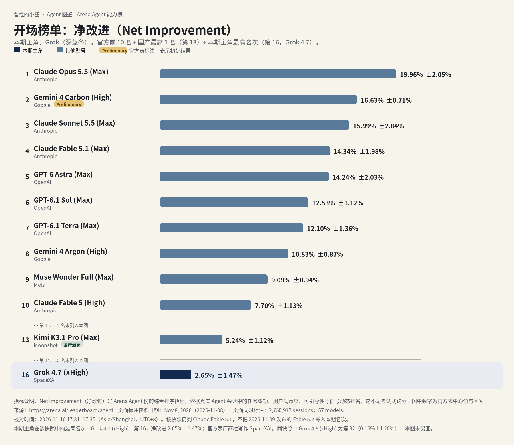
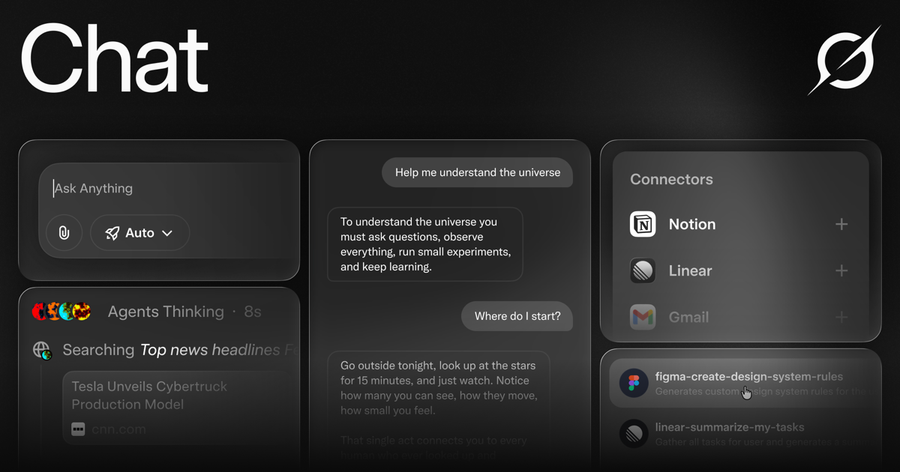
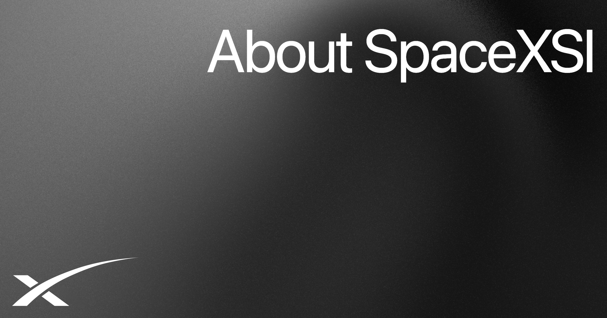
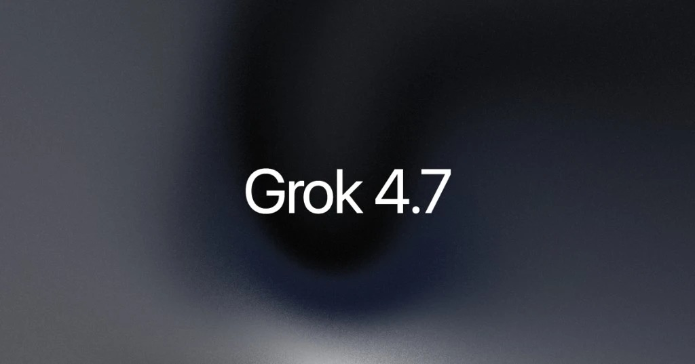
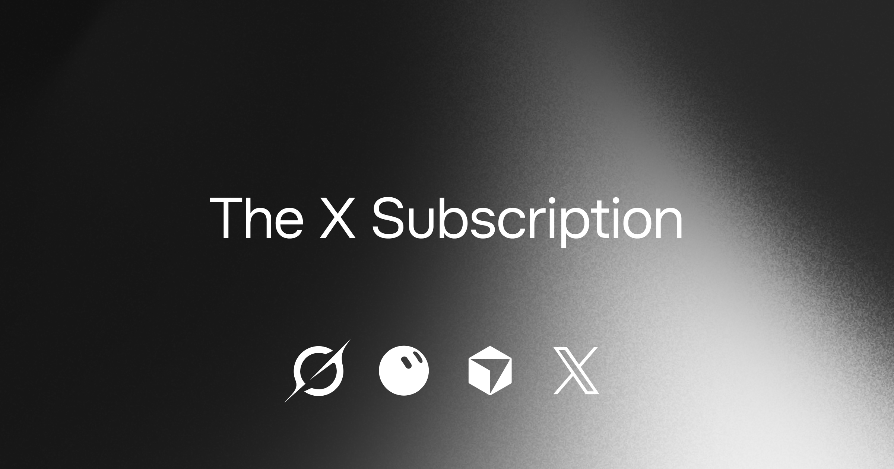

# 成稿包：《Agent 图鉴》第 3 篇 · Grok（SpaceXSI，原 xAI）（小白向重写）

> 按 2026-11-10 23:32 用户口令重写，替换原文件夹成稿。写作单 #003 与所称 #003-R2 的写法要求作废。事实沿用 R1 定稿与已核来源，不退回已被改掉的错误说法。  
> 核对日期：2026-11-10（Asia/Shanghai，UTC+8）  
> 口径：据官方资料整理；无实测口吻。按刀哥视角，像本人在给小白讲。  
> 榜图数据来自 [Arena Agent 榜](https://arena.ai/leaderboard/agent)，快照日期 2026-11-08。署名：刀哥。合集：Agent 与大模型。

---

## 1. 标题备选（3 个）

1. **【建议主标题】先看这张全球 Agent 前十，再认识今天的主角 Grok**
2. 同一张榜上它排第 16：完全没接触过也能看懂 Grok 是什么
3. 从一张榜说起：Grok 4.7 是什么，Bot 怎么用，订阅怎么算

---

## 2. 作者

刀哥

---

## 3. 一句摘要

先看同一张全球 Agent 前十：Grok 不在前十，最高排第 16。再把 Grok 是谁、4.7 怎么理解、Bot 和订阅怎么用、要花多少钱，讲给没接触过的人听。

---

## 4. 完整正文（可直接发表）

曾经的小狂 · Agent 图鉴 第 3 篇

# 先看这张全球 Agent 前十，再认识今天的主角 Grok

刀哥

你先别急着记名字。先看这张图。

同一张 Arena 的 Agent 榜，同一份 2026 年 11 月 8 日快照。它看的不是传统那种刷题跑分，而是真实会话里，一个助手把事情做完之后，综合表现到底好了多少，指标叫「净改进」。一共记了 2,750,973 场会话、57 个模型。核对时间是 2026 年 11 月 10 日 17:31–17:35（Asia/Shanghai，UTC+8）。数据来自 [arena.ai/leaderboard/agent](https://arena.ai/leaderboard/agent)。第 2 名 Gemini 4 Carbon (High) 带官方 Preliminary 标注，表示初步结果。这份快照是 11 月 8 日的，Claude Fable 5.2 第二天才发布，没有进这期名次，图里也不写。

前十里没有 Grok。因为不在前十，这张图在前十名和国产最高（第 13 名，Kimi K3.1 Pro，5.24%±1.12%）之后，另画出第 16 名，避免你误以为榜上没有它：**Grok 4.7 (xHigh)**，净改进 **2.65%±1.47%**。同快照里还有 Grok 4.6 (xHigh)，排第 32（0.16%±1.20%），图里没另画这一条。榜上的厂商栏原文写作 **SpaceXAI**。

第 16 名只是这份快照里的净改进名次，不是购买资格，也不是考试分数。

今天要讲的主角，就是这条深蓝背后的产品：Grok。

公司怎么署名，先说清楚。写作里常被叫做 xAI。核对日打开的官网（域名仍是 `x.ai`）页眉和新闻都署名 **SpaceXSI**；面向消费者的 FAQ 写作 **SpaceX Super Intelligence LLC（“SpaceXSI”）**，并写明它和 X Corp. 是两家公司。官方公司时间线写：2023 年 7 月 12 日是公司公告，2026 年 2 月 2 日是「xAI joins SpaceX」。Arena 榜的厂商栏则仍写作 **SpaceXAI**。这三处我都按原文写，不擅自改成一个「唯一正式名」。

## Grok 到底是个什么

说白了，Grok 是这家公司做的 AI 助手。你可以在网页 [grok.com](https://grok.com)、官方手机应用，或者 X 上跟它聊天、搜索、生成图像或视频。免费可以试用；付了费，额度更高。要把一件多步的事做完，走的是 **Grok Bot**——官方把它写成有云端电脑的 AI 队友。写代码还可以走 **Grok Build**，以及订阅里捆绑的 Cursor。Cursor 本身会在本连载后面单独写，这里只交代它和 Grok 用量池的关系，不展开成另一篇产品介绍。

它的「脑子」是这家公司自己做的 Grok 系模型，不是借别人家的。当前主力，开发者文档写成 **Grok 4.7**。

这篇是介绍，不是评测。版本、价格、能不能用，都对过 2026 年 11 月 10 日的官方页面。我没上手用过的，不会写成我的体验。官方页说法不一致的地方，我会把两处都写出来，并标「待核」。

## 这家公司的时间线，你只需看这几笔

下面只写官方公司页、时间线和 FAQ 里能对上的节点，没有打开专页的融资金额不补。

官方 [Company](https://x.ai/company) 页把使命写成：加速人类的科学发现，建造用于理解宇宙的 AI。时间线把 **2023 年 7 月 12 日** 标为 Company announcement，把 **2023 年 11 月 3 日** 标为 Announcing Grok，**2023 年 12 月 7 日** 标为 Grok on X。2026 年 2 月 2 日这一条是「xAI joins SpaceX」；该新闻页的机器可读字段把发布日期写成 **2026-02-02**（UTC 零点，换算为北京时间仍是 2 月 2 日）。

面向消费者的 [FAQ](https://x.ai/legal/faq) 现网写：SpaceX Super Intelligence LLC（“SpaceXSI”）是一家美国公司，和 X Corp.（此前的 Twitter）是分开的。Grok 在 X 上的使用，另受 X 的条款约束。该页页上日期仍写 May 12, 2025；现网正文已用 SpaceXSI 署名，这个日期是首次发布日还是未改页脚，待核。年龄与「视所在地而定」等条款，以现网正文为准。

和本期直接相关的产品节点，公司时间线里还有：2026 年 8 月 11 日 Introducing Grok Bot；8 月 12 日 Introducing Grok 4.6；8 月 19 日 Grok Build 登陆网页和手机；8 月 29 日 Grok Bot now works with X；9 月 21 日 Introducing Grok 4.7；10 月 12 日 Introducing The X Subscription。这些日期以时间线页为准；细节以对应新闻和文档为准。

公司页时间线还列有 Grok for Excel / Word / PowerPoint / Outlook 等条目。本篇没有逐页打开这些办公插件的产品说明，不展开用法。

## 当前主力是 4.7

开发者文档 [Models](https://docs.x.ai/developers/models) 写：除了音频、图像、视频要走专用接口，其余事情——包括写代码——用 **Grok 4.7**，并称它是目前最强的一款。发布说明 [Introducing Grok 4.7](https://x.ai/news/grok-4-7) 把它写成面向编码和知识工作的最强型号，价格和速度与 4.6 相同。

怎么选，我按官方自己的说法整理，不是我用过之后的判断。

| 型号 | 官方怎么说 | 调用名 / 要点 |
|------|------------|----------------|
| **Grok 4.7** | 面向编码、Agent 任务和知识工作的主力。文档：上下文 50 万 token；知识截止日期 2026 年 5 月；输入可为文字和图像，输出为文字；推理档位 low / medium / **high（默认）** / xhigh；工具包括函数调用、网页搜索、X 搜索、代码执行。 | `grok-4.7`。标准价：输入 $2 / 百万 token，输出 $6；提示达到 20 万 token 时，整单按更高档计（输入 $4，输出 $12）。缓存命中：短上下文 $0.50，长上下文 $1.00。 |
| **Grok 4.7 Fast** | 同一模型，跑在更快的基础设施上。文档写：标准价的 2 倍，长上下文请求为 1.5 倍。只在 Cursor 和 Grok Build 里提供，走那边的套餐计费；**不在公开的 xAI API 里**，也不含在 Grok Build 的免费档。 | 见定价页；公开 API 没有这一档。 |
| **Grok 4.6** | 仍列在模型价目表，价与 4.7 相同（含 20 万 token 的长上下文分档）。Arena 快照里另有 Grok 4.6 (xHigh)，第 32 名。 | `grok-4.6` |
| **Grok 4.5 及更早列出的 4.3、4.20** | 价目表仍列出。4.3 与 4.20 推理 / 非推理档的上下文是 100 万 token，价低于 4.7。不是文档推荐的日常首选。 | 用时再查模型页，不把它们当成当前主力 |
| **grok-4.20-multi-agent** | 官方 Multi Agent 文档（Beta）：用于实时、多步的深度研究，由多个 Agent 协作，由一个 leader Agent 汇总。可选 4 个或 16 个 Agent。不支持客户端自定义函数调用，也不走 Chat Completions，要用 xAI SDK 或 Responses API。 | `grok-4.20-multi-agent`（价目表中的具体名含日期后缀 `0309`）。上下文 100 万 token；短上下文输入 $1.25 / 输出 $2.50，长上下文加倍。 |
| **grok-build-0.1** | 价目表单列，上下文 25.6 万 token，价低于 4.7。Grok Build 产品本身，4.7 文档把它写成编码 Agent 的默认模型。 | 以模型页为准 |
| **Imagine / Voice** | 图像、视频、语音走专用接口和价目，不与 4.7 的文本价混算。产品页写：图像最高 2K，视频最高 15 秒（定价页 Ultra 还写可做 1080p、15 秒视频，以现网档位说明为准）。 | 见开发者价目表 |

官方还写：Grok 没有训练截止日期之后的实时知识；要把当下事件算进去，须启用服务端的 Web Search 或 X Search。token 是计费和容量的单位，你可以先把它理解成「用了多少文字量」。4.7 的 50 万 token 上下文，意思是一次能「看进去」的内容可以非常长。

开发者如果走 API，按每百万 token 计费。来源：[docs.x.ai/developers/models](https://docs.x.ai/developers/models) 与 [Grok 4.7 文档](https://docs.x.ai/developers/grok-4-7)，核对于 2026-11-10。达到长上下文阈值的请求，官方写：整单按更高价计，不是只对超出的部分加价。

| 模型（提示 < 20 万 token） | 输入 | 缓存命中 | 输出 |
|----------------------------|------|----------|------|
| grok-4.7 | $2.00 | $0.50 | $6.00 |
| grok-4.6 | $2.00 | $0.50 | $6.00 |
| grok-4.20-multi-agent-0309 | $1.25 | $0.20 | $2.50 |

提示 ≥ 20 万 token 时，上表三款都是输入、缓存命中、输出各加倍（例如 4.7 为 $4 / $1 / $12）。美国区域端点 `https://us.api.x.ai/v1` 官方写：把推理留在美国，token 价再加 **10%**。列表价是否含税，以结账页为准。官方声明，价格可以调整。团队的实时价和速率限制，以控制台为准。Grok 4.7、Grok 4.20-multi-agent 在 Grok 消费应用里的展示名称，是否与 API 调用名完全一致，待核。

## 聊天、Bot、写代码，各走哪条路

这里只讲官方产品里，和「模型 + Agent」直接相关的部分。

**Grok 聊天、搜索、生成。** 产品页把它写成一个助手：聊天、搜索、推理和创作放在一起。可以按步骤显示推理；同一条对话里生成图像、视频和代码；也可以用低延迟语音对话。搜索官方写会查网页和 X 的实时内容，并给出引用。Imagine 可以从文本或参考图生成、再改。还可以上传文件（文档写：PDF、图像、表格、代码、音频等）做分析。产品页还列出 30 多种语言、跨对话记忆、可分享的公开链接等。免费可以在网页和 App 里试用。

**Multi-agent（产品里的多 Agent）。** 产品页写：多个 Agent 并行处理更难的问题，各自展示推理过程，再合并成一个带引用的答案。页脚仍写：升级到 **SuperGrok**，可得到更高额度、优先访问和 multi-agent。这和定价页上的 The X Subscription 名称不完全一致，我在「多少钱」一节并陈，不在这里替你裁定「SuperGrok」四个字是不是已经全部换成新套餐名。新套餐里 multi-agent 精确对应哪一档，待核，以定价页和产品内实际开关为准。

**Grok 在 X 里。** 公司时间线从 2023 年 12 月就把 Grok on X 列为节点。The X Subscription 公告写：共享用量池覆盖 Grok 应用、**X 上的 Grok 标签页**，以及 Cursor 里的 Grok 模型。付费档在连接个人 X 账号后，还带上对应的 X 权益（Plus 是勾号、创作者工具、更少广告；Premium 及以上官方写含完整的 X Premium+ 权益）。在 X 上使用 Grok，FAQ 提醒要看 X 帮助中心和 X 的条款。

**Grok Bot。** 官方文档把它写成主动的 AI 队友：有一台云端的真实电脑，能做你在电脑上能做的事，例如做演示、跑活动、订餐、同步日历。多个 Bot 可以分工，共用这台云端电脑（浏览器、文件系统、终端）。可以聊天，也可以语音通话或发语音条。官方举例连接的工具包括 Google Drive、日历、Gmail、Slack、Notion 等，并支持 MCP 或 API 的自定义工具。入口：桌面、手机、Slack，以及 X。The X Subscription 文档写：Bot 含在 **Premium、Super、Ultra**，Plus 不含；Bot 的用量从该座位的每周共享池里扣，不是另给一池。官方写，重要动作仍要你确认。

**Grok Build。** 4.7 文档把它写成编码 Agent，并且 4.7 是默认模型。公司时间线写：2026 年 5 月 25 日推出，7 月 15 日开源，8 月 19 日登陆网页和手机。Fast 变体只在 Cursor 和 Grok Build 里提供，不含在 Build 免费档。本篇没有把 Build 的每一份安装说明逐页展开；要用，以当时的官方文档为准。

**API 里的 Agent 能力。** 4.7 支持函数调用、网页搜索、X 搜索和代码执行。若要做「一组 Agent 一起做深度研究」，官方走 `grok-4.20-multi-agent`（Beta），规则见上一节。The X Subscription 的 Plus 说明里写含 Grok API access，具体额度以账单和文档为准。

用一张表，把「你想干什么，该走哪条路」收一下：

| 你想做的 | 走哪条路 | 要不要付钱 |
|----------|----------|------------|
| 聊天、搜索、生成图像或视频 | grok.com、官方 App，或 X 上的 Grok 标签页 | 免费可试用；付费提高额度 |
| 把一件多步的事交给云端电脑去做 | Grok Bot | 新订阅须 Premium 或以上；Plus 不含 |
| 写代码 | Grok Build，或订阅里捆绑的 Cursor | Build 有免费档，但 Fast 变体不含在免费档 |
| 在自己的产品里调用 Grok | 官方 API | 按 token 计费；是否含在某档的 API access 里，以控制台和账单为准 |

## 什么都没接触过，第一步怎么走

产品页写的起步就这三步，我不加自己的路径。

1. 打开 `grok.com`，或安装 iOS / Android 官方应用。
2. 用 X 账号或邮箱登录，以便在各设备接上同一份对话和订阅。
3. 开始聊天；按需要切换搜索、推理、语音或图像等模式。

若要用 Grok Bot：先确认你的档位含 Bot（新订阅须 Premium 及以上），再按 [Grok Bot 文档](https://docs.x.ai/grok-bot/overview) 和入门页连接要用的应用，把任务交给它。官方写，重要动作仍要你确认。老用户也可能通过仍在继续的 SuperGrok 等套餐获得 Bot，以账户为准。

若要用 API：在控制台申请密钥，按 Quickstart 调用；4.7 示例走 Responses API，模型名 `grok-4.7`。文档建议设置 `prompt_cache_key`，以便缓存命中更稳定。

若已经有 SuperGrok、Cursor 或 X Premium：可以继续留在旧套餐；若要并到 The X Subscription，按官方 Unify / 账单入口走。[订阅条款](https://x.ai/legal/bundled-subscription-terms)写：订阅由 X Subscription Corp. 出售；条款同时写明可经应用商店或其他分销方购买。走官方入口办理，别从非官方渠道买。

**地区、年龄、语言。** Consumer FAQ 写：Grok 可在 iOS、Android 和 grok.com 使用；「视所在地而定」，可能有有限的免费使用和付费完整功能。该页 **没有** 给出一份像 ChatGPT 那样的国家名单。中国大陆能不能注册、能不能完成扣款，我不以这份 FAQ 自行推断，标待核，以结账页和当时的地区说明为准。我所用的官方页里，也没有中国大陆的人民币税后价目表，这里不猜。

年龄：FAQ 写 Grok 不面向 13 岁以下；13 到 17 岁须有家长或监护人同意，并同意服务条款。

语言：产品页写原生支持 30 多种语言。我没有在该页看到「不含中文」的限制，也不把「一定支持某种中文界面」写成保证。

在 X 上使用时，访问与隐私以 X 的条款和帮助中心为准。

## 五档怎么分，Bot 从哪一档才有

个人档以 [The X Subscription 公告](https://x.ai/news/x-subscription)（新闻列表标注 2026-10-12）、[定价文档](https://docs.x.ai/x-subscription/pricing)（文档写 Last updated October 11, 2026；R1 于 2026-11-10 19:27 重抓）为准。列表价 **不含适用税**；需要时，税可能在结账时另加。官方声明，价格可以调整。

新用户的主路径是 **The X Subscription**。

| 档位 | 月付（USD） | 年付（文档表） | 含用量（相对 Plus） | 跟 Grok / Agent 相关的要点（据官方） |
|------|-------------|----------------|---------------------|--------------------------------------|
| **Free** | $0 | $0 | Limited | 每日可使用 Grok；Cursor 的 coding agents 有起步额度；标准 X。定价页还写有限的 Chat 和 agent 请求。 |
| **Plus** | $8/月 | $80/年（约合 $7/月） | Base（1×） | 更多 Grok / Cursor 用量；含 Grok Chat、Voice、Imagine、Build，以及文档所列的 Grok API access 与 Cursor。X：勾号、创作者工具、更少广告。**不含 Grok Bot**。 |
| **Premium** | $30/月 | $300/年（约合 $25/月） | **4×** | 公告写：含原先 SuperGrok + Cursor Pro + X Premium+ 的权益，并称此前合计约 **$90**/月。**含 Grok Bot**。定价页还列有最新 Grok 模型、更快回复、云端 Agent 与自动化等。Cursor 里的第三方模型另计。 |
| **Super** | $100/月 | $1000/年（约合 $84/月） | **15×** | 在 Premium 之上，更大的共享池；定价页写高峰期优先访问等。含 Grok Bot。 |
| **Ultra** | $200/月 | $2000/年（约合 $167/月） | **50×** | 再上一级。含 Grok Bot。定价页写可创建 1080p、15 秒视频等，以现网说明为准。 |

用量官方口径：每一档有一份 **按周刷新** 的 AI 用量池，在 Grok 与 Cursor 之间共享；在 Grok 里覆盖 Chat、Imagine、Voice 和 Bot。用超了可以 top-up，或等下周刷新。第三方模型在 Cursor 里从一开始就不走这份含用量，按 API 列表价另计，可以用消费上限管理。各档每周多少 token、多少请求，公开页只给 Limited / 相对倍数，精确值以账户 Usage 为准，标待核。

团队档：公告写，Team 用户的 Premium / Super / Ultra 是和人档相同的每座价格，并含 SSO、管理员控制等。Enterprise 走销售，可把 Grok 与 Cursor 放在同一个用量池里。定价页 FAQ 的建议是：新 AI 用户看 Premium，每日用 Agent 的人看 Super，重度用户看 Ultra；Plus 更偏社交创作者、AI 用量有限的人。

**和 SuperGrok 的关系（官方页说法不完全一样）。**

- 定价与订阅文档：新的自助用户走 The X Subscription；已有的 Cursor、SuperGrok、X Premium **可以不切**，旧价旧权益继续。切的话，旧订阅在结账时取消，并按比例退未用完的周期（苹果、谷歌应用店另有规则）。并账（unify）一旦完成，官方写不可撤销。
- 产品页 `x.ai/grok`：核对日仍写「免费试用，升级到 SuperGrok 以获得更高额度和 multi-agent」。

两处我都保留。下单时看 `x.ai/pricing` 和结账页当时展示的方案名，不要只根据产品页上的「SuperGrok」四个字去对价。含完整五档价签的定价页现网截图，建议发表前补一张，并注明截图日期。

订阅里的含用量，覆盖的是 Grok 模型在应用和 Cursor 中的使用；公开 API 的账单、速率和是否包含在某一档的「Grok API access」里，以控制台和账单为准，我不把订阅月费理解成「无限 API」。

标价是美元，不含适用税。支付方式和所在地是否可订，以结账页为准，没有写明的渠道我不补。走官方入口办理，别从非官方渠道买。

**中国大陆能不能订阅、人民币税后价是多少：以官方结账页和地区说明为准。** 我所用的官方页里，没有中国大陆的人民币税后价目表，也没有一份可逐行核对的国家开放名单，这里不猜。

## 什么样的人值得试，什么样的人先别急

更对得上官方描述的，大概是这些人：想在一个入口里聊天、查网页和 X、生成图像或视频，并接受从免费试用起跳的人；已经在用 X，希望聊天和勾号、广告权益走同一份订阅，也愿意把个人 X 账号连上 The X Subscription；要把一件多步的事交给云端电脑去做，并接受付费到 **Premium 或以上** 来用 **Grok Bot**；写代码时想用 Grok 4.7，走 Grok Build，或走订阅里捆绑的 Cursor（Cursor 的完整用法，本连载后面单独写）；要在自己产品里调 Grok，能接受按 token 计费，也清楚没有搜索工具时模型没有截止日期之后的实时知识。

先别急着付钱的，大概是这些情况：只订 Plus，却想用 Grok Bot——官方写 Plus 不含，须 Premium 或以上；假定免费档或 Plus 就有完整的多 Agent 与最高额度——产品页把 multi-agent 写在 SuperGrok 的升级说明里，新套餐里对应到哪一档，以定价页和产品内实际开关为准，待核；所在地或支付方式在结账页过不去——官方 FAQ 没有给出完整国家名单，不要假定一定能完成注册或扣款；13 岁以下，或 13–17 岁尚未得到家长同意——FAQ 写明了这条门槛；把 Arena 第 16 名读成「不能用」——那只是 2026-11-08 这份 Agent 榜快照里的净改进名次，不是购买资格，也不是考试分数；还想继续分别付 SuperGrok、Cursor、X Premium 三笔，又以为必须立刻切到新订阅——官方写可以不切，切不切由你自己选。

同类产品里，大家常听到的还有 Anthropic 的 Claude（本连载第 1 篇）、OpenAI 的 ChatGPT（第 2 篇）、Google 的 Gemini、月之暗面的 Kimi。都是「自己有模型，再做成能聊天或能干活的产品」。这里只点名，不评哪个更好。

## 你先记住这几句就够了

先看那张榜：前十里没有 Grok，这份快照里最高排第 16。Grok 是 SpaceXSI（域名 x.ai，原 xAI）做的 AI 助手，脑子是自家的，当前主力是 4.7。免费可以试用聊天；要把一件多步的事交给云端电脑，新订阅须 Premium 或以上才含 Grok Bot。新用户主路径是 The X Subscription。钱按美元官方标价来。国内能不能订，官方没有完整国家名单，以结账页为准，我这里不猜。

产品会改价、改规则、改默认模型。你要下单或安装前，再打开 x.ai/pricing 和对应文档看一眼。

---

## 5. 配图清单

开场榜单图沿用已核实的浅色图（米白底、钢蓝条、本期主角深蓝条；前十和 Kimi 之后补了第 16，缺口已标注），未重绘。新增三张对照表图，配色与榜图同一套浅色语言。已有官方 OG 全部保留在 `images/`。Arena 官方榜 OG 核对日下载仍为 HTTP 403，未采用。定价页含完整五档价签的现网截图建议发表前补。

| 序号 | 文件 | 用在 | 来源 |
|------|------|------|------|
| 01 | `images/01-arena-agent-top10-grok.jpg`（旁有 png 与 `SOURCES-arena-chart.md`） | 开篇全球 Agent 前十图（含第 16 名） | 按官方 Arena Agent 榜 2026-11-08 快照自制；核对 2026-11-10 17:31–17:35 |
| 02 | `images/og-grok-product.png` | 介绍 Grok 时 | 产品页 x.ai/grok OG，下载 2026-11-10 |
| 03 | `images/og-company.jpg` | 讲公司署名与时间线时 | 公司页 OG，下载 2026-11-10 |
| 04 | `images/02-table-models.jpg`（旁有 png） | 型号对照表（微信正文用图；本稿上面另有可校订的 Markdown 表） | 自制，整理自开发者文档与发布页，见 `images/SOURCES-tables.md` |
| 05 | `images/og-grok-4-7.jpg`（旁有 png / 原 webp） | 讲 Grok 4.7 时 | 发布页 x.ai/news/grok-4-7 OG，下载 2026-11-10 |
| 06 | `images/03-table-paths.jpg`（旁有 png） | 使用路径对照表 | 自制，见 `SOURCES-tables.md` |
| 07 | `images/og-x-subscription.png` | 讲 The X Subscription 时 | 公告页 OG，下载 2026-11-10 |
| 08 | `images/04-table-prices.jpg`（旁有 png） | 个人档价目表 | 自制，见 `SOURCES-tables.md` |

`images/` 中其余官方 OG（`og-pricing.jpg`、`og-faq.jpg`）均保留，本稿正文未全部插入，以免配图过密。价目表图「含用量」列将 Plus 写作 `1×`，与文档 Base（1×）同一口径，为排版在图中省去 “Base” 二字；正文 Markdown 表仍写 Base（1×）。

---

## 6. 完整来源清单

| # | 关键事实 | 链接 | 信息日期 | 核对日期 |
|---|----------|------|----------|----------|
| 1 | 公司使命、办公地、产品时间线（含创立公告、Grok on X、加入 SpaceX、4.7、X Subscription 等日期） | https://x.ai/company | 核对日读取；「xAI joins SpaceX」JSON-LD 为 2026-02-02 | 2026-11-10 |
| 2 | 法定名称 SpaceXSI、与 X Corp. 分开、入口、年龄门槛、无完整国家名单 | https://x.ai/legal/faq | 页上标注 May 12, 2025（现网已用 SpaceXSI 署名） | 2026-11-10 |
| 3 | Grok 产品能力、多 Agent、起步三步、页脚仍写 SuperGrok | https://x.ai/grok | 核对日读取 | 2026-11-10 |
| 4 | Grok 应用概述、计划与 Bot 入口 | https://docs.x.ai/grok/overview | 文档 Last updated October 10, 2026 | 2026-11-10 |
| 5 | Grok 4.7 发布、定位、API 起步价 $2 / $6、Fast 变体 | https://x.ai/news/grok-4-7 | 时间线标注 2026-09-21 | 2026-11-10 |
| 6 | 4.7 上下文、知识截止日期、工具、Fast 变体限制、区域端点 | https://docs.x.ai/developers/grok-4-7 | 文档 Last updated October 10, 2026 | 2026-11-10 |
| 7 | 全模型 API 价、长上下文分档、选型建议 | https://docs.x.ai/developers/models | 核对日读取 | 2026-11-10 |
| 8 | 多 Agent API（Beta）、4 / 16 Agent、限制 | https://docs.x.ai/developers/model-capabilities/text/multi-agent | 文档 Last updated October 10, 2026 | 2026-11-10 |
| 9 | Grok Bot 定位、云端电脑、入口（桌面 / 手机 / Slack / X） | https://docs.x.ai/grok-bot/overview | 核对日读取 | 2026-11-10 |
| 10 | The X Subscription 公告、五档月价、Premium 对标约 $90、Bot / Cursor / X | https://x.ai/news/x-subscription | 时间线标注 2026-10-12 | 2026-11-10 |
| 11 | 年付、Bot 仅 Premium/Super/Ultra、税、旧套餐可保留 | https://docs.x.ai/x-subscription/pricing | 文档 Last updated October 11, 2026 | 2026-11-10 |
| 12 | 定价页现网档位、共享周池 | https://docs.x.ai/x-subscription/pricing | 核对日读取 | 2026-11-10；R1 重抓 2026-11-10 19:27（Asia/Shanghai，UTC+8） |
| 13 | Bot 与新订阅的档位关系、SuperGrok 切换 | https://docs.x.ai/x-subscription/grok-bot | 核对日读取 | 2026-11-10 |
| 14 | Arena Agent 榜快照（与 003 数据文件同一笔） | https://arena.ai/leaderboard/agent | 页面标注 Nov 8, 2026 | 2026-11-10 17:31–17:35（Asia/Shanghai，UTC+8） |
| 15 | 订阅由 X Subscription Corp. 出售；可经应用商店或其他分销方购买 | https://x.ai/legal/bundled-subscription-terms | Last Updated: October 7, 2026 | 2026-11-10；R1 重抓 2026-11-10 19:29（Asia/Shanghai，UTC+8） |

配图来源见第 5 节及 `images/SOURCES-arena-chart.md`、`images/SOURCES-tables.md`。官方 OG 下载日期 2026-11-10。

---

## 7. 待核项与自检

### 待核项

1. **官网署名 SpaceXSI、FAQ 法定名称、Arena 厂商栏 SpaceXAI、写作习惯中的 xAI**：正文已并陈，不裁定唯一正式名。
2. **产品页仍写 SuperGrok，定价页以 The X Subscription 为主**：下单以定价页和结账页为准；multi-agent 在新套餐里精确对应哪一档，待核。
3. **中国大陆（及其他未列明地区）可用性与人民币税后价**：官方未给专表和完整国家名单。
4. **Consumer FAQ 页上日期仍写 2025-05-12**：现网正文已用 SpaceXSI 署名，该日期是首次发布日还是未改页脚，待核；年龄与「视所在地而定」等条款以现网正文为准。
5. **各档绝对额度数字**（每周多少 token / 多少请求）：公开页只给 Limited / 相对倍数，精确值以账户 Usage 为准。
6. **Grok for Excel / Word / PowerPoint / Outlook 等**：时间线已列，本篇未打开专页，不写用法。
7. **Grok 4.7、Grok 4.20-multi-agent 在 Grok 消费应用里的展示名称是否与 API 调用名完全一致**。
8. **Arena Agent 榜若在发表前刷新**：须重抓，不能沿用 2026-11-08 快照。
9. **定价页现网价签界面截图**：OG 已存，含完整五档价签的界面截图建议发表前补。

### 自检

- **来源是否齐**：是。模型名、API 价、订阅档位、Grok Bot 门槛、X 生态入口、Agent 榜名次、R1 裁定的出售方与渠道写法，均回源至核对日已打开的官方页。无凭空步骤，无编造实测。官方不一致处已并陈并标待核。
- **待核剩几条**：**9** 条（见上）。
- **配图**：开场榜单图沿用未重绘；新增型号 / 路径 / 价目三张对照表图；正文插入已有官方 OG（产品页、公司页、4.7、X Subscription）。仍缺：Arena Agent 榜 OG（下载 403）、定价页现网价签界面截图。按要求不自制假 UI。
- **去味自检：已过（无命中）**。按附则检查正文散文：未见需删的空话或预告句；归因、待核、表格中的数字、URL、模型名与价格未改。不为显得改过而强行修改。
