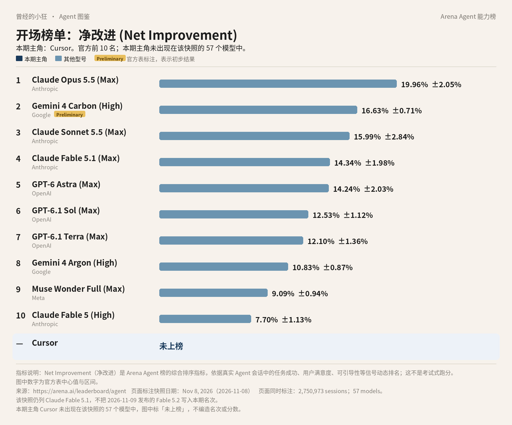
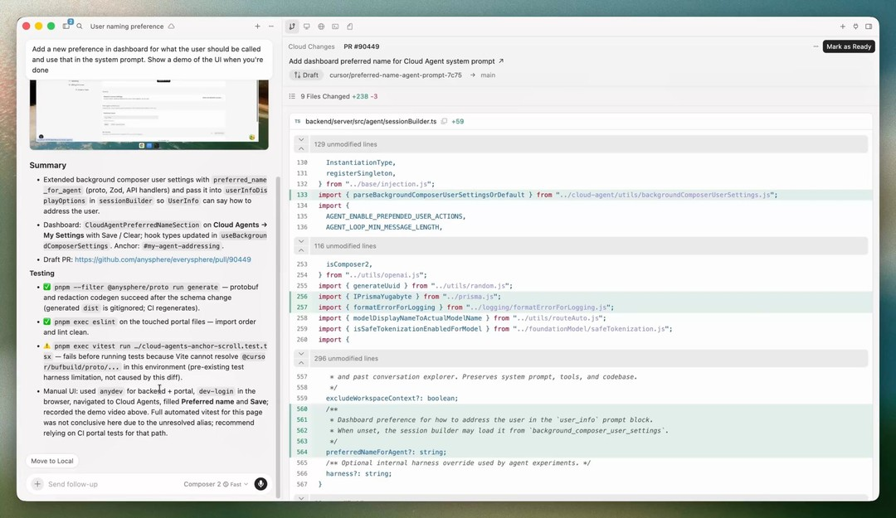
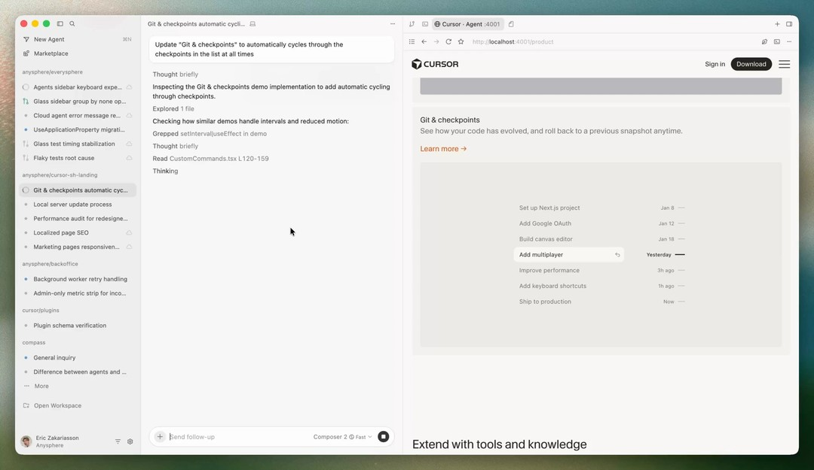
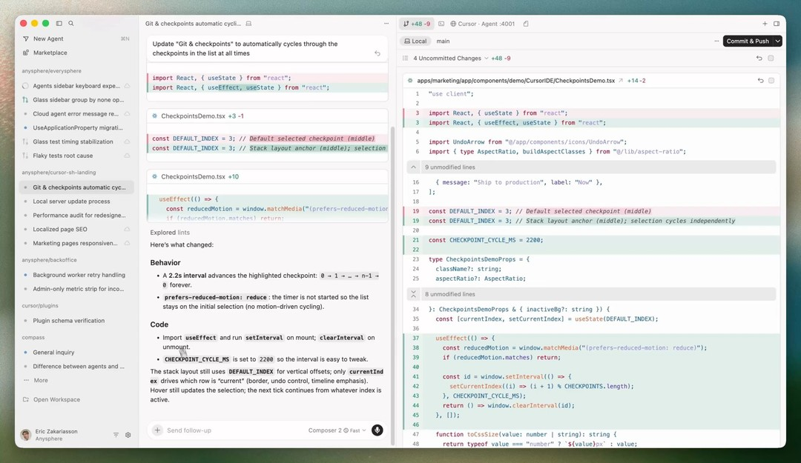

# 成稿包：《Agent 图鉴》第 4 篇 · Cursor（Anysphere）

> 据官方资料与 Arena Agent 榜 2026 年 11 月 8 日快照整理。署名：刀哥。合集：Agent 与大模型。

---

## 标题备选

1. 【建议主标题】榜上没有它，并不奇怪：Cursor 是写代码的工位
2. Cursor 不上 Arena 模型榜，是因为它是写代码的工位
3. 从一张没有它的榜说起：Cursor 怎么用，订阅怎么选

---

## 作者

刀哥

---

## 一句摘要

Arena 这张模型榜上没有 Cursor，因为 Cursor 是 Anysphere 做的编程 Agent，不是榜上的那颗脑子。再把本地和云端怎么用、The X Subscription 各档怎么选、限制在哪里，讲给没接触过的人听。

---

## 完整正文

曾经的小狂  ·  Agent 图鉴 第 4 篇

# 榜上没有它，并不奇怪：Cursor 是写代码的工位

这张全球 Agent 前十，今天的主角不在上面。这不是疏漏，先把图看完，我再告诉你原因。

*全球 Agent 前十（Arena Agent 榜 · 净改进，2026 年 11 月 8 日快照）。本期主角 Cursor 未上榜，图下已单独标出。数据来源：arena.ai/leaderboard/agent。Fable 5.2 未进入本期快照。*

这张图来自 Arena 的 Agent 综合榜。它看的不是传统那种刷题跑分，也不是大家更熟悉的 Elo 评分，更不是成功率。它看的是真实会话里，一个助手把事情做完之后，综合表现到底好了多少，指标叫「净改进」。图上是 2026 年 11 月 8 日那一版快照，一共记了 2,750,973 场会话、57 个模型。第 2 名 Gemini 4 Carbon (High) 带官方 Preliminary 标注，表示初步结果。Claude Fable 5.2 是快照次日才发布的，没有进这期名次，图里也不写。数据在 arena.ai/leaderboard/agent。

你把前十扫一遍，会看到 Claude、Gemini、GPT、Muse。你看不到 Cursor。图下那一行写的是：未上榜。

未上榜，不是给它编一个名次，也不是说它不好用。这 57 行记的是模型，也就是「脑子」。Cursor 是 Anysphere 做的编程 Agent，是写代码时坐下来干活的工位。它可以调用榜上那些公司的模型，也可以用自己的型号。工位不会因为用了别人的脑子，就变成榜上的一行。所以它不在这张表上，是意料之中的事，不是被谁忽略了。

今天要讲的，就是这个工位。

## 它是写代码的工位，不是榜上的那颗脑子

官方主页和文档把 Cursor 写成一句话：用来做大型软件开发的编程 Agent。出品公司叫 Anysphere, Inc.，服务条款里的地址在旧金山，联系邮箱是 hi@cursor.com。条款最近一次更新是 2026 年 9 月 3 日。公司在条款里对自己的说法是：一家做编程自动化的应用研究公司。

这里先把两个词说清楚。Agent，说白了就是会动手的 AI：它不只陪你聊天，还能读代码、改文件、跑命令、调用工具，一步一步把事情做完。IDE，可以先理解成写程序用的编辑器。Cursor 把这两者放在同一个界面里。2026 年 4 月 2 日的官方博客《Meet the new Cursor》介绍了 Cursor 3：一个面向 Agent 的统一工作区。它从 VS Code 分支再往前走了一步，界面围绕 Agent 重做，支持多个代码仓库，本地 Agent 和云端 Agent 可以一起跑，会话还能在两边移交，也可以从提交做到合并拉取请求。你随时可以切回 Cursor IDE。

*Cursor 3 官方博客配图：本地和云端的 Agent 都列在同一个侧边栏里。图片来源：cursor.com/blog/cursor-3（演示视频封面）*

它底下用的「脑子」，分两层。一层是官方称为 Cursor models 的自有型号：Grok 4.7、Grok 4.6、Grok 4.5，以及 Composer 2.5。文档写明，Grok 系列由 Cursor 与 SpaceXAI 联合训练。Cursor 3 的博客里，曾把 Composer 2 称作自有的前沿编程模型；当前定价页列出的是 Composer 2.5。另一层是第三方模型。官方文档列出可在 Cursor 里选用的 OpenAI、Anthropic、Google、Moonshot、Meta、DeepSeek、Z.ai 等公司的型号，其中包括 Gemini 4 Argon / Carbon、Muse Wonder、Kimi K3。首页演示里还出现过 GPT-5.6 Sol、Fable 5.2、Opus 5.5 这些名字。具体哪一档账号能选哪些，以编辑器里的列表和 Models & Pricing 页为准。

所以你会在 Cursor 里见到榜上那些名字。那仍然是模型在干活，不是 Cursor 自己变成了第几名。

若把官方写过的能力连起来看，一个常见的工作过程大概是这样：先让它读你的代码库，用 Plan Mode 把要做的功能规划清楚，再在本地改文件、找缺陷、审查改动；需要看页面效果时，用集成浏览器打开本地网站并提问；改完可以走完暂存、提交，并管理拉取请求。插件、skills、MCP、子 Agent 和规则，用来按你的仓库习惯定制。以上能力都出自官方文档和 Cursor 3 博客。MCP 可以先简单理解成：让 Agent 按统一方式接上外部工具。具体能接到哪一步，仍以产品里实际可装的插件为准。

*Cursor 3 官方博客「Integrated browser」一节的演示画面：用内置浏览器打开本地网站并提问。图片来源：cursor.com/blog/cursor-3（演示视频封面）*

## 本地、云端、终端，三条路可以一起走

普通人怎么开始，官方给的入口并不绕。

桌面端提供 macOS、Windows、Linux 安装包，下载页显示最新版本是 3.29，主打面向 Agent 的编辑体验。不想离开终端的人，可以用 CLI 在终端或脚本里跑 Agent，也可以接到常用的 IDE。人如果不在电脑旁，还可以从浏览器、手机，或者 Slack、GitHub、Linear 发起云端 Agent，页面在 cursor.com/agents。

工作流方面，文档写可以连接 GitHub、GitLab、Azure DevOps、Bitbucket、JetBrains、Slack、Linear。能力概述里写的是：理解代码库，用 Plan Mode 规划并做功能，找缺陷，审查改动，再用插件、skills、MCP、规则来定制。Cursor 3 的博客还提到集成浏览器，可以打开、导航，并针对本地网站提问，以及插件市场。

官方特别强调的，是本地和云端可以并行。云端 Agent 用「自己的电脑」去构建、测试并演示功能，产出演示和截图供人审。会话还能移交：云端拉回本地继续改；本地推到云端，关了电脑也能继续跑。官网文案还写，Bots「可以登录你的工具，像你一样使用，再带着完成的工作回来」。具体能登录到哪一步，以产品里的授权设置为准，这不等于可以无限制接管账号。

*Cursor 3 官方博客「本地与云端之间移交」一节的演示画面：把会话从本地推到云端继续跑。图片来源：cursor.com/blog/cursor-3（演示视频封面）*

这和只在网页对话框里问一句、等一句回答，不是同一件事。Cursor 的主场是代码仓库和编辑器。云端那条路的意义在于：任务可以放到「自己的电脑」上继续跑，人不必一直守着。但云端 Agent、自动化、第三方模型，并不是每一档订阅都开。真正决定你能不能用上它们的，往往不是技术开关，而是档位。

## 这份订阅，和 Grok、X 是绑在一起的

官方文档写得很明确：Cursor 作为 The X Subscription 的一部分售卖，一份订阅覆盖 Grok、Cursor 和 X。价格未含税。标价是美元，下面列的都是官方美元价，没有换算成人民币。

个人计划在 cursor.com/docs/models-and-pricing 与 cursor.com/pricing 上是一致的。

Free 是 0 美元，用量为 Limited，第三方模型不可用。

Plus 月付 8 美元，年付 80 美元，用量是 Base，第三方模型同样不可用。这一档只能用 Cursor 自有模型，也就是 Grok 4.7、4.6、4.5 和 Composer 2.5，而且设置是固定的：Fast 关闭，effort 为 medium，Grok 4.7 用 256k 窗口。256k 是这一档给 Grok 4.7 固定下来的上下文长度，不能在 Plus 里自行调高。它不含 Auto、Cloud Agents、Automations、Bugbot、Origin，也不能用第三方模型或自带 API 密钥。

这里要解释一下 API。API 可以先理解成程序调用模型的接口。自带 API 密钥，意思是用你自己在其他公司开的开发者账号去调模型，费用按那边的账单走。Plus 没有这项。

Premium 月付 30 美元，年付 300 美元，用量是 Plus 的 4 倍。从这一档起，才有 Cloud Agents 和 Automations、Origin 代码托管、Bugbot 代码审查、第三方模型和 Grok Bot。第三方模型按 API 标价，从预付费额度里扣。

Super 月付 100 美元，年付 1,000 美元，用量是 Plus 的 15 倍。Ultra 月付 200 美元，年付 2,000 美元，用量是 Plus 的 50 倍。这两档的第三方计费规则，和 Premium 一样。

团队档是每席位每月 30、100 或 200 美元，用量对应个人同档。Enterprise 定制，用量可以池化。

付费计划有一份按周刷新的用量池，给 Cursor 自有模型用，在编辑器 Agent、CLI、Cloud Agents、Grok Bot 和 Grok 应用之间共享。用超了可以另行充值（官方称为 top-up），也可以打开自动充值，或者等下周刷新。文档写，请求不会被降质或降速。

官方自己的建议是：Premium 适合新接触 Agent 的人，Super 适合每天都用 Agent 的人，Ultra 适合同时跑多个 Agent 或 Automations 的人。

另外几笔也按官方页写。Teams 和 Enterprise 对符合条件的第三方模型，另收 Cursor Token Rate：每百万 tokens 0.25 美元。个人计划不收这项；部分低价缓存模型可以豁免。token 是计费和容量的单位，你可以先把它理解成「用了多少文字量」。自有模型如果超额，定价表示例是：Composer 2.5 输入 0.50 美元、缓存读 0.20 美元、输出 2.50 美元；Grok 4.7 输入 2 美元、缓存读 0.50 美元、输出 6 美元。长上下文和 Fast 还有更高档，以官方表为准。

定价页还捆绑展示了 Grok 的 Chat、Imagine、Voice、Build、Grok Bot，以及 X 的权益。Plus「只含 Grok 模型」是订阅规则，不是说 Cursor 编辑器在 Plus 上能把所有第三方模型都打开。以前的遗留计划，比如 Hobby、Start、Pro、Pro+、旧 Ultra、旧 Teams，对现有用户仍然有效，只是计费方式不同。

选档时不妨把门先看清楚。只想在编辑器里用 Grok 或 Composer 写代码，官方把 Plus 写成可用自有模型的一档，但它打不开第三方模型，也没有云端 Agent。要用 Claude、Gemini、GPT 这些第三方模型，或要把任务推到云端继续跑，按官方对照须从 Premium 看起。每天都把 Agent 当作主力，官方建议看 Super；要同时跑多个 Agent 或 Automations，再看 Ultra。上一篇写过的 Grok，和 Cursor、X 是同一份 The X Subscription。付费计划那份按周刷新的用量池，也在编辑器、CLI、云端 Agent、Grok Bot 和 Grok 应用之间共享，不是再单独买互不相干的三份额度。

中国大陆能不能完整订阅或使用，官方页没有写明。这里不猜能，也不猜不能，以当时的结账页和地区说明为准。

## 第一次打开，可以先做这几步

先到 cursor.com/download 下载对应系统的桌面端，按官方安装包走，不要从非官方来源复制安装命令。定价页写，订阅只通过官方渠道出售，由 X Subscription Corp. 直销，不授权经销商。

装好以后，先用免费档看能不能登录、能不能在编辑器里让 Agent 读一读你的项目。如果只想用自有模型写代码，Plus 可能就够入门。如果你需要云端 Agent、第三方模型，或者要把会话推到云端继续跑，再看 Premium 或以上。官方建议也可以当作选档时的参考，不必一上来就订最高档。

要用 CLI，按官方文档在终端里跑。要从手机或 Slack、GitHub、Linear 发起云端任务，先确认你的档位含 Cloud Agents，再走 cursor.com/agents。连接 GitHub 这些工作流时，权限以你授权的范围为限。如果在设置里打开隐私模式，官方保证代码数据不会被 Anysphere 或其模型提供商用于训练；团队也可以由管理员统一打开。这一条不必等到出问题再找。

## 这几条限制，比价目更先看

设置里可以打开隐私模式，团队也可以由管理员打开。开启后，官方保证代码数据不会被 Anysphere 或其模型提供商用于训练。服务条款还写：除非用户明确同意，Anysphere 不会用内容训练模型，也不允许第三方用内容训练。但这不等于所有第三方模型都没有自己的数据保留要求，文档举例提到部分 Claude Fable 型号。打开第三方模型前，值得在产品说明里再看一眼。

Cursor 会出错，重要的合并、发布和权限变更，还是要你自己看过。官网把 Bots 写得很能干活，我只按原文介绍，不把它说成可以代替你做所有决定。

有几种情况，不必急着付钱。如果你要的只是一个聊天助手，并不在代码仓库里干活，Cursor 并不是为此准备的入口。如果你订 Plus，却默认能在模型列表里打开 Claude、Gemini 或 GPT，按官方对照，这些第三方模型从 Premium 才提供。如果你还没有确认结账页能否完成付款，也不要假定一定能订上。官方页没有写出完整的国家开放名单。能不能订，以当时的结账页为准。

同类产品里，大家常听到的还有 Anthropic 的 Claude、OpenAI 的 Codex、Google 的 Antigravity。下一篇会讲月之暗面的 Kimi。这里只点名，不评哪个更好。

如果你只先记住三句：Cursor 是 Anysphere 做的编程 Agent，不是 Arena 这张模型榜上的一行，未上榜是正常的。免费和 Plus 用自有模型；云端 Agent 和第三方模型，要从 Premium 看起。订阅和 Grok、X 是绑在一起的，钱按美元官方标价来，下单走官方渠道。

产品会改价、改规则、改默认可选模型。你要下单或安装前，再打开 cursor.com/pricing 和文档看一眼。

---

## 配图清单（本轮新增正文配图，2026-11-11）

- `images/02-cursor3-agents-sidebar.jpg`（官方图）：放在正文「这里先把两个词说清楚。Agent，说白了就是会动手的 AI：它不只陪你聊天，还能读代码…」一段之后。图注：Cursor 3 官方博客配图：本地和云端的 Agent 都列在同一个侧边栏里。图片来源：cursor.com/blog/cursor-3（演示视频封面） 来源：页面 https://cursor.com/blog/cursor-3；原图 https://image.mux.com/MbzkSlxi00401DojnK02hRv5KvvG02gefbAVqlyXPrq02dUY/thumbnail.jpg?time=0。
- `images/03-cursor3-integrated-browser.jpg`（官方图）：放在正文「若把官方写过的能力连起来看…」一段之后。图注：Cursor 3 官方博客「Integrated browser」一节的演示画面：用内置浏览器打开本地网站并提问。图片来源：cursor.com/blog/cursor-3（演示视频封面） 来源：页面 https://cursor.com/blog/cursor-3；原图 https://image.mux.com/SUtXsaFq4FV5xh5014P5wAU163tGojX4zoHQH009jWAbI/thumbnail.jpg?time=0。
- `images/04-cursor3-local-cloud-handoff.jpg`（官方图）：放在正文「官方特别强调的，是本地和云端可以并行…」一段之后。图注：Cursor 3 官方博客「本地与云端之间移交」一节的演示画面：把会话从本地推到云端继续跑。图片来源：cursor.com/blog/cursor-3（演示视频封面） 来源：页面 https://cursor.com/blog/cursor-3；原图 https://image.mux.com/FLecyOH6DuHcjjhp4o0100yRg9Btlb5M7Y1nJAQzrPJf8/thumbnail.jpg?time=0。

## 来源清单

- https://arena.ai/leaderboard/agent
- https://arena.ai/blog/agent-arena-methodology
- https://cursor.com/
- https://cursor.com/docs
- https://cursor.com/docs/models-and-pricing
- https://cursor.com/pricing
- https://cursor.com/blog/cursor-3
- https://cursor.com/download
- https://cursor.com/terms-of-service

---

## 事实空缺（审稿用，不进入公众号正文）

- 中国大陆能否完整订阅或使用：官方页未写明，正文已标明不推断。
- 各档每周绝对用量（多少 token / 多少请求）：公开页只给 Limited / 相对倍数，正文未编造绝对数字。

## 本轮改动记录（2026-11-11，补图单 + 修改单）

- 删除署名：article.html 末尾「署名：刀哥」一行已删；md 完整正文标题下的署名行「刀哥」与正文末尾「署名：刀哥」已删（文件头元信息与「作者」一节保留）。
- 新增正文配图 3 张，位置与图注见配图清单；文中对应位置以 Markdown 图片加斜体图注标出。
- 过程话 #4-1（口径句改写）：原句「这些都是官方文档和 Cursor 3 博客里已经写下的能力，不是我额外推演出来的用法。」→ 新句「以上能力都出自官方文档和 Cursor 3 博客。」。
- 过程话 #4-2（口径句改写）：原句「以产品里的授权设置为准，我不会把它写成可以无限制接管账号。」→ 新句「以产品里的授权设置为准，这不等于可以无限制接管账号。」。
- 过程话 #4-3（整句删除「我不会替它补一张。」）：原句「官方页没有写出完整的国家开放名单，我不会替它补一张。」→ 新句「官方页没有写出完整的国家开放名单。」。
- 过程话 #4-4（口径句改写）：原句「标价是美元，我按官方印出的数字写，不擅自换成人民币。」→ 新句「标价是美元，下面列的都是官方美元价，没有换算成人民币。」。
