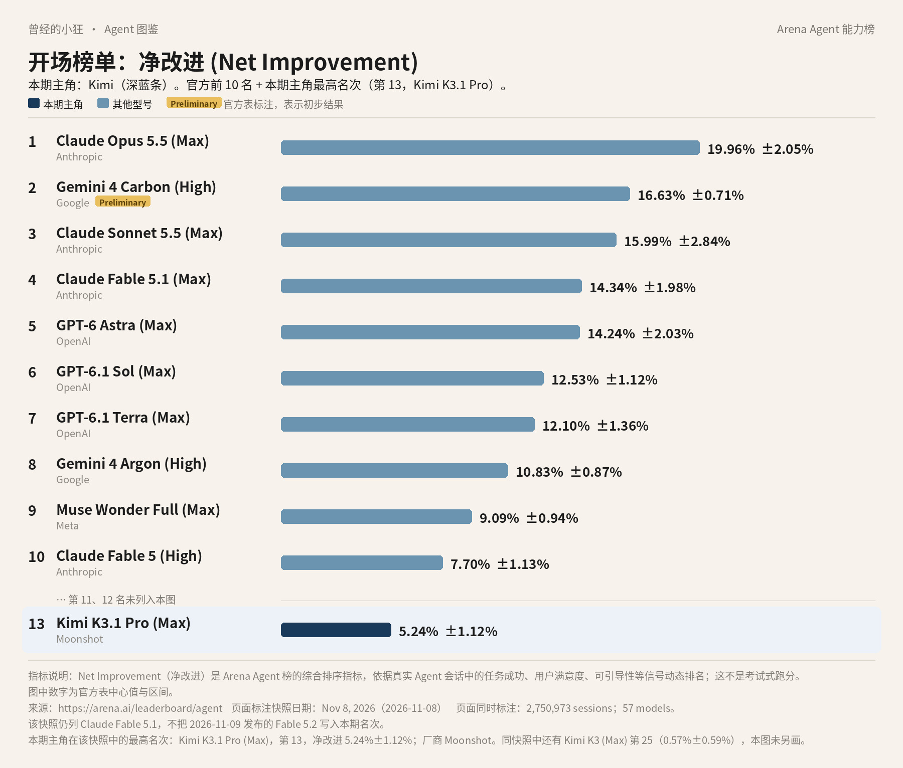
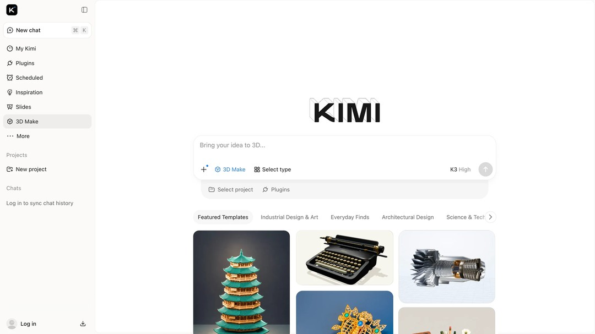
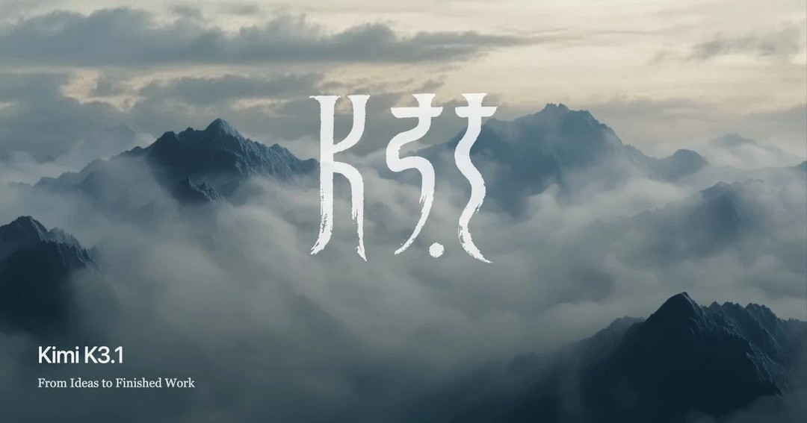
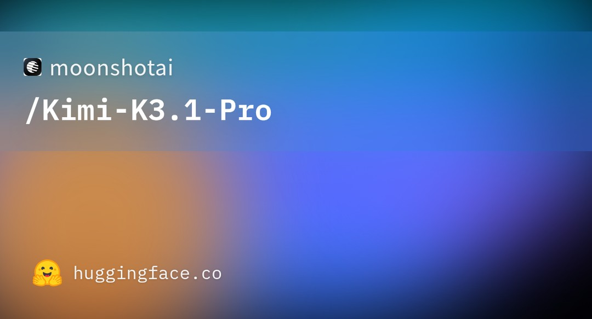

# 成稿包：《Agent 图鉴》第 5 篇 · Kimi（月之暗面 / Moonshot）

> 据官方资料与 Arena Agent 榜 2026 年 11 月 8 日快照整理。署名：刀哥。合集：Agent 与大模型。

---

## 标题备选

1. 【建议主标题】前十门口的那一行：先认识 Kimi
2. Kimi 在这份榜上排第 13：入口、型号和两本账怎么分开看
3. 月之暗面的 Kimi：K3 和 K3.1 Pro 不要混，会员和 API 也不要混

---

## 作者

刀哥

---

## 一句摘要

Arena 这份快照里，Kimi 最高是第 13 名的 K3.1 Pro，K3 在第 25。再把网页与 App、Kimi Work、Kimi Code 和 API 这几扇门，以及国际会员和 API 两本账，讲给没系统了解过的人听。

---

## 完整正文

曾经的小狂  ·  Agent 图鉴 第 5 篇

# 前十门口的那一行：先认识 Kimi

你要是用过国内的 AI 助手，Kimi 这个名字大概不陌生。不过今天不从 App 图标讲起，而从前十后面那一行讲起。

*全球 Agent 前十，并补出第 13 名 Kimi K3.1 Pro（Arena Agent 榜 · 净改进，2026 年 11 月 8 日快照）。深蓝条为本期主角。数据来源：arena.ai/leaderboard/agent。Fable 5.2 未进入本期快照。*

Arena 的 Agent 综合榜，看的是真实会话里，助手把事情做完之后，综合表现到底好了多少。这个指标叫「净改进」，它不是成功率，也不是 Elo。图上是 2026 年 11 月 8 日的快照，一共 2,750,973 场会话、57 个模型。第 2 名 Gemini 4 Carbon (High) 带官方 Preliminary 标注，表示初步结果。Claude Fable 5.2 是快照次日才发布的，没有进这期名次。数据在 arena.ai/leaderboard/agent。

前十里没有 Kimi。因为不在前十，这张图在前十之后另画出一行，避免你误以为榜上没有它：Kimi K3.1 Pro (Max)，净改进 5.24%±1.12%，排在第 13。同一份快照里，还有 Kimi K3 (Max)，排在第 25，净改进 0.57%±0.59%，图里没有另画这一条。这两行的厂商栏都写作 Moonshot。

第 13 名只是这份快照里的净改进名次，不是购买资格，也不是考试分数。今天的主角，就是这两行背后的产品：Kimi。做它的公司，对外常用英文名 Moonshot AI，中文名是月之暗面。官方产品域包括 kimi.ai、kimi.com 和 platform.kimi.ai。

## 先认入口，再认型号

Kimi 不是只有一个对话框。官方现在至少有这几扇门，门不同，干的活也不完全一样。

普通人可以打开 kimi.ai，或者在应用商店下载 Kimi App，系统包括 iOS、Android 和 HarmonyOS。要把知识工作做完，比如研究一个题目、做可视化、用 Widgets 或 Dashboard，官方指向 Kimi Work 桌面端。它支持 Windows，也支持搭载 Apple 芯片的 Mac，版本要求 3.1.0 或更高。写程序的人可以走 Kimi Code，这是一个终端里的编程 Agent，用 /model 切换型号。开发者还可以走 Kimi API，站点是 platform.kimi.ai，文档里的接口地址是 https://api.moonshot.ai/v1，环境变量示例是 MOONSHOT_API_KEY，并提供与 OpenAI、Anthropic 兼容的调用方式。

这里先把两个词说清楚。Agent，说白了就是会动手的 AI：你说目标，它自己拆步骤、调用工具，连续把事情做完。API，可以先理解成程序调用模型的接口，不是给普通人点来点去的那个 App。Kimi 把干活的能力拆到了聊天、Work、Code 和 API 几扇门里，而不是只放在一个开关后面。

面向组织的，是 Kimi Business 或 Kimi Enterprise。K3 的博客用过 Enterprise 这个名字，K3.1 Pro 的博客用的是 Business。两种叫法目前并存，以当前产品页上的名称为准。官方说明里有两点比较要紧：个人账号和组织账号是隔离的；K3.1 Pro 对企业默认关闭，要管理员打开才会出现。

官网还提到 3D Make：可以在 kimi.ai 和 App 上预览、编辑 3D 模型，下载用于 3D 打印，或导出视频、Live Photos。K3 的博客把 Kimi Work 写成做知识工作、研究、可视化和 Widgets、Dashboard 的桌面入口。帮助中心还出现过 Kimi Claw，官方的说法是云端的 OpenClaw 部署，能执行代码、操作浏览器、调用工具。这一条我只按帮助中心写，不往外延伸成尚未记载的能力。

*Kimi K3.1 Pro 官方博客配图：kimi.com 上的 3D Make 界面。图片来源：kimi.ai/blog/kimi-k3-1-pro*

## 两个型号，不要混成一个

当前要分清的，主要是 Kimi K3 和 Kimi K3.1 Pro。名字只差一个小数点和一个 Pro，能力和账单并不一样。

K3 大约在 2026 年 7 月发布，权重和技术报告的开放日写明是 2026 年 7 月 27 日。官方描述是 2.8 万亿参数的混合专家模型，激活大约 16 个专家（总共 896 个），原生具备视觉能力，上下文窗口是 100 万 token。混合专家可以先这样理解：模型体量很大，但每次只唤醒其中一部分专家来工作。上下文窗口，是一次能「看进去」的内容有多长。token 是计费和容量的单位，也可以先把它理解成「用了多少文字量」。100 万 token，意思是一次能放进去的材料可以非常长。

K3 的技术博客里，公司自称它是「世界上第一个开放的 3T 级模型」。这是公司自己的表述，不是第三方榜单的结论。同一篇博客也写：在评估套件上，它仍落后于当时最强的闭源模型 Claude Fable 5 与 GPT 5.6 Sol。公司愿意把短板写在发布文里，介绍时就应该一并读到，而不是只截取那句「第一个」。

K3.1 Pro 是 K3 的后训练版本，也是 K3.1 系列的第一个模型。后训练，可以先理解成：底座已经训好之后，再专门花算力打磨它更会干活的那一层。官方称加大了后训练算力，在编码、3D 创作、金融研究及其他 Agent 能力上有提升，并把它写成该公司迄今最强的 3T 级开放权重模型，上下文窗口同样是 100 万 token。另外还有 Kimi K3.1 Pro Highspeed，官方称速度大约是 K3.1 Pro 的 2 到 3 倍。

*Kimi K3.1 官方博客题图。图片来源：kimi.ai/blog/kimi-k3-1-pro*

K3.1 Pro 的博客把完整权重的发布日定在 2026 年 11 月 4 日，权重在这个日子之前就已放出。现在可以到 Hugging Face 的 moonshotai/Kimi-K3.1-Pro 仓库下载，README、config、LICENSE 和分成多片的 safetensors 权重文件都在。模型卡上写着 2.8 万亿参数、1040 亿激活、1,048,576 上下文这些架构细节。

*Hugging Face 上 moonshotai/Kimi-K3.1-Pro 模型仓库的分享图。图片来源：huggingface.co/moonshotai/Kimi-K3.1-Pro*

若只先记选用上的差别：要看当前这代里官方称为最强的开放权重型号，看 K3.1 Pro；要速度，官方另给了 Highspeed 这一档，称大约快 2 到 3 倍；K3 仍在榜上，也仍在 API 里，但它是更早的底座，不是同一代里被写成「最强」的那一款。Arena 这份快照也和这个分层大致同向：K3.1 Pro 在第 13，K3 在第 25。名次仍然只是净改进，不是选用说明书，但至少说明两行不该混成一个产品。

API 文档里还能见到上一代：Kimi K2.7 Code、Kimi K2.6，上下文是 262,144。官方通知：从 2026 年 10 月 31 日起，K2 系列不再向新注册用户提供，并计划在 2026 年 12 月底前下线全部 K2 系列。新用户不必再把 K2 当成主力。

公司还公布过一些自己的测试分数。比如 K3.1 Pro 在 Terminal-Bench 4.0 上，公司报告是 65.7%，使用的是 Claude-Code 这套测试框架（官方称为 harness）。写清楚板名和测试方式之后，它仍然是公司报告，不是「全球第一」。官方还写过，K3.1 Pro 可以在没有 MCP 的情况下，为 Blender、CAD 编写并运行脚本，用于 3D、游戏和前端相关工作。这是公司博客里的能力声明，我按原文介绍，不把它扩写成已经替你接好所有设计软件。

## 会员是会员，API 是 API

钱要分成两本账来看，不要混。一本是给人用产品的国际会员，一本是给程序按量调用的 API。账单不同，能打开的门也不完全一样。

国际会员的出处，是 kimi.ai 帮助中心的 Pricing details，货币是美元。月付和年付是：Plus 每月 19 美元，或每年 180 美元（折合每月 15 美元）；Pro 每月 39 美元，或每年 372 美元（折合每月 31 美元）；Max 每月 99 美元，或每年 948 美元（折合每月 79 美元）；Ultra 每月 199 美元，或每年 1,908 美元（折合每月 159 美元）。

官方对各档的功能对照是：Plus 含 Kimi Code、研究、办公任务、Agent Swarm。Pro 有更多额度，并含 Goal Mode 和独立的 Kimi Claw。Max 有更多额度、更高的 Agent 并发。Ultra 的 Agent 额度是 10 倍，Max 是 5 倍。Max 和 Ultra 都支持最多 4 个并行 Agent 任务、100 个项目、50GB 项目存储。定时任务和 widget 任务，Ultra 各是 25 个，Max 各是 20 个。

会员功能共用每月积分池，按月刷新，不结转。带 Kimi Code 的新计划有滚动 5 小时用量限制，没有周限制。以前的旧计划，名称是 Moderato、Allegretto、Allegro、Vivace，规则不同，不要用新表去套旧档。

国际帮助中心页没有印出完整的人民币会员价，这里不把美元价换算成人民币。若 kimi.com 另有国内定价页，下单前打开对应的官方页来看。

另一本账是 API，按量付费，和 Kimi 会员、Kimi Code 不是同一套计费。定价页在 platform.kimi.ai/docs/pricing/chat，按每百万 tokens 计，不含税。旗舰 kimi-k3.1-pro 是输入 2.00 美元、输出 10.00 美元、缓存命中 0.20 美元，缓存写入按保存时长分成 2.00 和 4.00 美元两档。kimi-k3 是输入 3.00 美元、输出 15.00 美元、缓存命中 0.30 美元，缓存写入 3.00 和 6.00 美元两档，这和 K3 发布博客一致。kimi-k3.1-pro 与 kimi-k3 支持批量（Batch），按标准价的 60% 计。联网搜索另计，每次 0.004 美元。

kimi-k3.1-pro-highspeed 在同一张定价表上有独立一行。完整的分列数字，以定价表当时屏幕为准，这里不转写一个可能变动的数。

要调 K3.1 Pro，官方写需要先成功充值，最低 1 美元，才会解锁；充值累计还会影响账号档位和限速。API 客户可以使用 Zero Data Retention，也就是官方所说的零数据保留。

## 官方自己写下的短板，也一并读

选产品的时候，公司愿意承认的限制，往往比宣传句更有用。

K3 官方写过三件事。它对「思考历史」比较敏感，需要把历史 thinking 回传，否则后续回合可能接不住前面已经想过的内容。它可能过度主动。整体体验仍落后于 Claude Fable 5 与 GPT 5.6 Sol。这三条都出自官方自己的说明。

K3.1 Pro 开源权重发布前，官方专门写了网络安全能力控制：从训练数据中识别并移除部分网络攻击相关数据，目的是降低滥用风险。这是安全说明，不要理解成「不能再做安全研究」，也不要理解成「已经绝对防住滥用」。

企业版可以开关 K3.1 Pro。个人与组织账号隔离，这一点前面已经说过。API 的零数据保留，只写在 API 客户这一头，不要自动套到所有消费端聊天记录上。

中国大陆这边，Kimi 有中文站点，也有 HarmonyOS 客户端。至于国际套餐和 API 是否在中国大陆完整提供，我不以「有中文官网」自行推断，以对应官方页和结账页为准。

## 想试用，从哪扇门进

如果只是聊天、搜索、试试 3D Make，打开 kimi.ai，或下载官方 App，就可以开始。要把一件更长的知识工作做完，再装 Kimi Work，并确认版本不低于 3.1.0。写程序，走 Kimi Code，在终端里用 /model 选型号。做产品集成，再去 platform.kimi.ai 申请 API。K3.1 Pro 作为旗舰，按官方规则，要成功充值后才会在 API 里解锁。

走哪一档会员，可以按官方对照来：主要用 Code、研究和办公，先看 Plus；要用 Goal Mode 或独立的 Kimi Claw，看 Pro；要更高并发和更多项目空间，再看 Max 或 Ultra。不必一上来就订最高档。旧计划用户不要拿新表的 5 小时规则或积分池去硬套，以账户里显示的方案说明为准。

有几种情况，不必急着按国际美元表付钱。如果你要用的是国内页或客户端里的人民币方案，我没有完整的官方人民币价表，不能用上面的 19、39、99、199 美元去换算。如果你只开了会员，却以为 API 调用已经包含在月费里，按官方说明，这是两本账。如果你还没用过免费的网页或 App，也不必先订 Ultra。Kimi Claw、更高并发、更多项目存储，是往上加档时才打开的门，不是入门必选项。开发者若只是先试 API，官方写明成功充值最低 1 美元即可解锁 K3.1 Pro，不必先把最高档会员买下来再开始。

同类产品里，前面已经写过 Claude、ChatGPT、Grok、Cursor。下一篇会写到 Gemini。都是能聊天或能干活的入口，只是有的自己做模型，有的把模型和工位放在一起。这里只点名，不评哪个更好。

先记住这几句就够了。这份快照里，Kimi 最高排在第 13，型号是 K3.1 Pro；K3 在第 25。Kimi 是月之暗面做的助手，脑子是自家的 K3 家族，上下文可以到 100 万 token。聊天走网页或 App，干活走 Work，写代码走 Kimi Code，开发者走 API。会员和 API 是两本账。钱按官方印出的美元价来，人民币价目前没有完整的官方价表。

产品会改价、改规则、改默认模型。你要下单或安装前，再打开帮助中心的定价说明和 platform.kimi.ai 看一眼。

---

## 配图清单（本轮新增正文配图，2026-11-11）

- `images/02-kimi-3d-make.jpg`（官方图）：放在正文「官网还提到 3D Make…」一段之后。图注：Kimi K3.1 Pro 官方博客配图：kimi.com 上的 3D Make 界面。图片来源：kimi.ai/blog/kimi-k3-1-pro 来源：页面 https://www.kimi.ai/blog/kimi-k3-1-pro；原图 https://kimi-img.kimi.ai/pub/slides/kimi-fs/weaver/assets/9d2a6db49991ae6a4eb13c8a322de721.webp。
- `images/03-kimi-k3-1-cover.jpg`（官方图）：放在正文「K3.1 Pro 是 K3 的后训练版本…」一段之后。图注：Kimi K3.1 官方博客题图。图片来源：kimi.ai/blog/kimi-k3-1-pro 来源：页面 https://www.kimi.ai/blog/kimi-k3-1-pro；原图 https://kimi-img.kimi.ai/pub/slides/kimi-fs/managed-assets/9558f8d5-08fc-42de-8e4e-339076e03895.webp。
- `images/04-kimi-hf-repo.jpg`（官方图（官方模型仓库页））：放在正文「K3.1 Pro 的博客把完整权重的发布日…」一段之后。图注：Hugging Face 上 moonshotai/Kimi-K3.1-Pro 模型仓库的分享图。图片来源：huggingface.co/moonshotai/Kimi-K3.1-Pro 来源：页面 https://huggingface.co/moonshotai/Kimi-K3.1-Pro；原图 https://cdn-thumbnails.huggingface.co/social-thumbnails/models/moonshotai/Kimi-K3.1-Pro.png。

## 来源清单

- https://arena.ai/leaderboard/agent
- https://arena.ai/blog/agent-arena-methodology
- https://www.kimi.ai/blog/kimi-k3-1-pro
- https://www.kimi.ai/blog/kimi-k3
- https://www.kimi.com/news/kimi-k3-open-source
- https://platform.kimi.ai/docs/guide/kimi-k3-1-pro-quickstart
- https://platform.kimi.ai/docs/pricing/chat
- https://www.kimi.ai/help/membership/membership-pricing
- https://www.kimi.ai/help/kimi-api/api-pricing
- https://huggingface.co/moonshotai/Kimi-K3.1-Pro

---

## 事实空缺（审稿用，不进入公众号正文）

- 中国大陆人民币会员价：已打开的国际帮助中心页无完整人民币表，正文未换算、未引用外界传闻价。
- kimi-k3.1-pro-highspeed 的完整分列 API 价：简报要求以定价表屏幕为准，未写成可引用的稳定数字。
- （本轮已解决）K3.1 Pro 权重：Hugging Face 仓库 moonshotai/Kimi-K3.1-Pro 创建于 2026-11-02 12:13（北京时间），README、config、LICENSE 与 96 个 safetensors 分片均可下载，早于博客原定的 2026-11-04。正文已按刀哥修改单改为「已放出、可下载」口径。
- 消费端产品名是 Kimi Business 还是 Kimi Enterprise：官方博客用词不一致，正文已并陈，以当前产品页为准。
- 国际套餐与 API 是否在中国大陆完整提供：不以中文官网或 HarmonyOS 客户端自行推断。

## 本轮改动记录（2026-11-11，补图单 + 修改单）

- 删除署名：article.html 末尾「署名：刀哥」一行已删；md 完整正文标题下的署名行「刀哥」与正文末尾「署名：刀哥」已删（文件头元信息与「作者」一节保留）。
- 新增正文配图 3 张，位置与图注见配图清单；文中对应位置以 Markdown 图片加斜体图注标出。
- 修改单 #1（权重改已发布口径）：原句「K3.1 Pro 的博客写过：完整权重将于 2026 年 11 月 4 日发布。Hugging Face 上可以见到 moonshotai/Kimi-K3.1-Pro 的模型卡，上面有 2.8 万亿参数、1040 亿激活、1,048,576 上下文这些架构细节。是否已经按期放出全部权重，以 Hugging Face 和官方开放页当时的状态为准，我这里不替它下结论。」→ 新句「K3.1 Pro 的博客把完整权重的发布日定在 2026 年 11 月 4 日，权重在这个日子之前就已放出。现在可以到 Hugging Face 的 moonshotai/Kimi-K3.1-Pro 仓库下载，README、config、LICENSE 和分成多片的 safetensors 权重文件都在。模型卡上写着 2.8 万亿参数、1040 亿激活、1,048,576 上下文这些架构细节。」。
- 过程话 #5-1（删除「采集记录标注的是 2026 年 10 月 19 日」）：原句「国际会员的出处，是 kimi.ai 帮助中心的 Pricing details。采集记录标注的是 2026 年 10 月 19 日，货币是美元。」→ 新句「国际会员的出处，是 kimi.ai 帮助中心的 Pricing details，货币是美元。」。
- 过程话 #5-2（口径句改写）：原句「写的时候我按当前产品页上的名称为准，不擅自并成一个「唯一正式名」。」→ 新句「两种叫法目前并存，以当前产品页上的名称为准。」。
- 过程话 #5-3（口径句改写）：原句「人民币价我没有完整官方表，不猜。」→ 新句「人民币价目前没有完整的官方价表。」。
- 过程话 #5-4（口径句改写）：原句「这些都是官方自己的话，不是我替它打分。」→ 新句「这三条都出自官方自己的说明。」。
