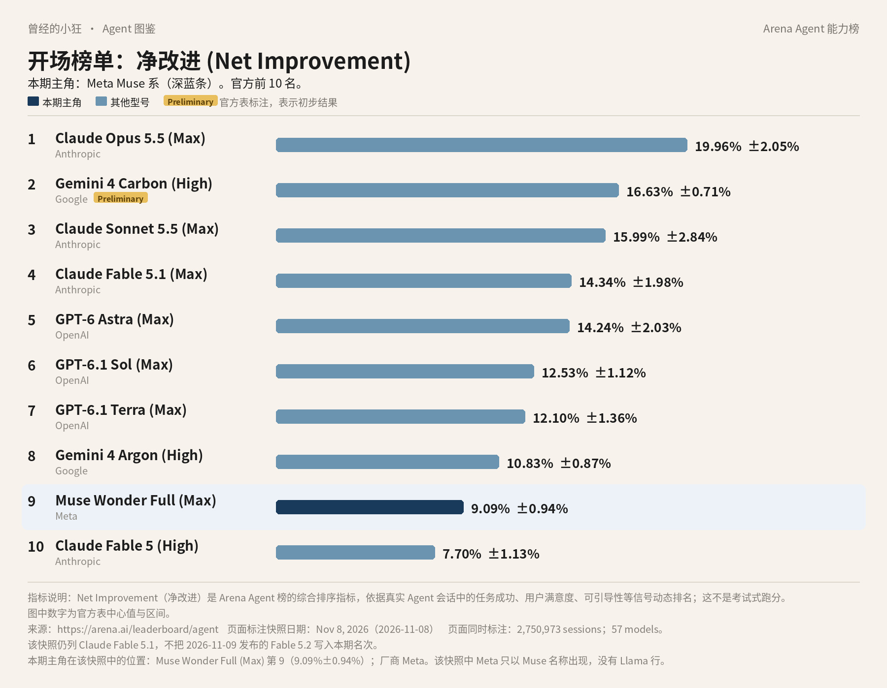
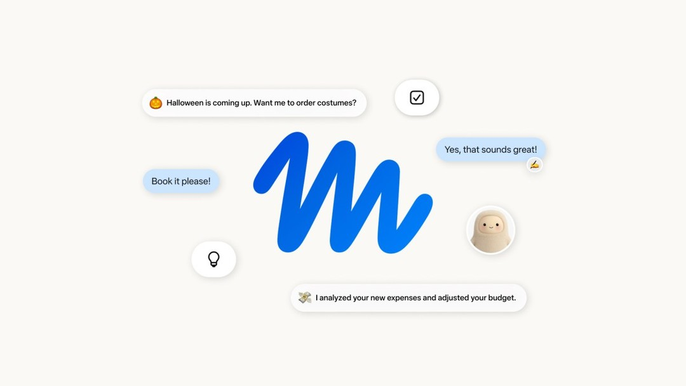
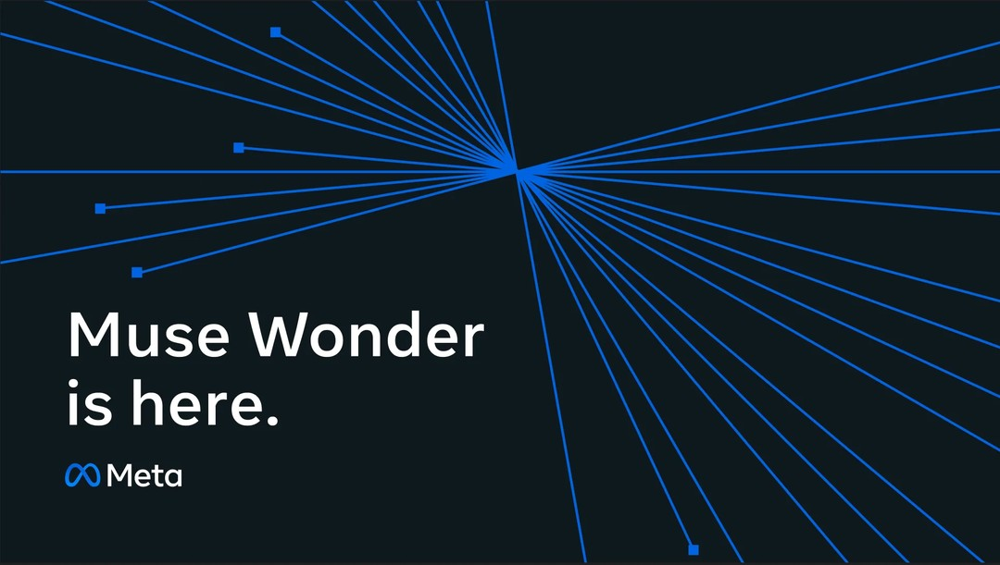
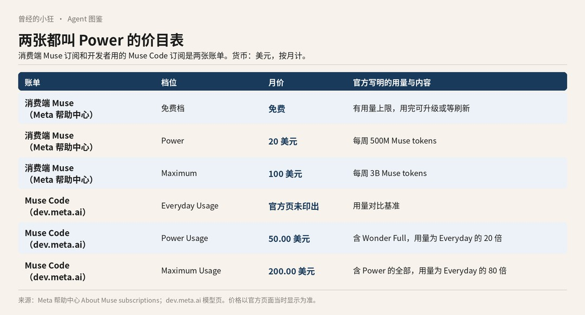

# 成稿包：《Agent 图鉴》第 7 篇 · Meta Muse 系（小白向）

> 按 2026-11-11 连载要求写成公众号成稿。榜图使用 Arena Agent 综合榜 2026 年 11 月 8 日快照，全系列统一，不换新数。署名：刀哥。合集：Agent 与大模型。
>
> 口径：据官方资料整理，无实测口吻。正文不加核对说明式口气。

---

## 1. 标题备选（3 个）

1. **【建议主标题】榜上第 9 名叫 Muse Wonder Full，但你下载的未必是它**
2. Meta 这回不叫 Llama：先把 Muse 的三层分清楚
3. 消费端 Muse、Muse Code、Model API，不是同一张账单

---

## 2. 作者

刀哥

---

## 3. 一句摘要

同一份 11 月 8 日 Arena Agent 榜上，Meta 只以 Muse 名称出现，最高是第 9 名 Muse Wonder Full。这篇把消费端 Muse、Muse Code、Meta Model API 三层分开讲，并写明两张同名价目表和官方已写清的地区限制。

---

## 4. 完整正文（可直接发表）

曾经的小狂 · Agent 图鉴 第 7 篇

# 榜上第 9 名叫 Muse Wonder Full，但你下载的未必是它

提到 Meta，很多人第一反应还是 Llama。但这张 2026 年 11 月 8 日的 Arena Agent 综合榜上，没有 Llama 这一行。Meta 只以 Muse 的名字出现，最高排到第 9。

这张榜看的不是传统那种刷题跑分。Arena 的 Agent 榜，看的是真实会话里，一个助手把事情做完之后，综合表现到底好了多少。指标叫净改进，英文是 Net Improvement。图上是同一份 11 月 8 日快照，一共记了 2,750,973 场会话、57 个模型。数据来自 arena.ai/leaderboard/agent。第 2 名 Gemini 4 Carbon (High) 带官方 Preliminary 标注，表示初步结果。Claude Fable 5.2 未进入本期快照，图里也不写。

深蓝那一条就是本期要讲的：第 9 名 Muse Wonder Full (Max)，厂商栏写作 Meta，净改进 **9.09%±0.94%**。同快照里，Meta 还有另外几行，都叫 Muse，不叫 Llama：第 19 名 Muse Spark 1.3 (Max)，2.21%±0.84%；第 22 名 Muse Wonder (Max)，1.93%±1.32%。再往后还有 Spark 的更早版本，净改进已经是负数，后文再分开看。

第 9 名只是这份快照里的净改进名次，不是购买资格。更关键的是：榜上这个名字，和你手机里可能下载到的那个 Muse，并不是同一层东西。

## 先把「系」拆成三层

出品方是 Meta。官方现在至少有三层，都挂着 Muse 的名字，却不是同一个入口，也不是同一张价目表。

**第一层是消费端个人 Agent 应用 Muse。**站点是 muse.ai，手机上的应用名是 Muse from Meta，也可以在 WhatsApp 里对话。2026 年 9 月 8 日的新闻稿把一句话说得很直白：Muse 是个人 AI Agent。它不只回答问题，还会把事情做完。行业里说的 Agent，简单讲就是：你给出目标，它自己拆步骤、连续做下去，尽量把事做完。发布时写明，消费端由 Muse Spark 驱动。同一篇新闻稿还说，Muse Wonder 很快会为 Muse 中的体验提供能力，并先向订阅者推送。也就是说，到 2026 年 10 月 12 日 Wonder 发布时，消费端主力仍可能是 Spark，Wonder 是滚动接入。不要把 Llama 写成这层应用的官方底座。官方 Muse 与 Wonder 页面，并没有把 Muse 说成 Llama 微调。

*Meta 新闻稿《Introducing Muse》官方分享图。图片来源：about.fb.com/news/2026/09/introducing-muse-personal-ai-agent*

**第二层是 Muse Code**，面向开发者的编程和 Agent 产品，可以订阅，也可以按量使用。**第三层是 Meta Model API**，站点在 dev.meta.ai，按量调用模型。

三层都跟 Meta 有关，但你下载应用、订编程套餐、在自己的程序里调接口，走的不是同一扇门。后面讲价格，以及能不能用到 Wonder Full，都要先认准自己站在哪一层。

## 普通人碰到的，是消费端 Muse

普通人打开 muse.ai，或在 iOS、Android 上安装官方应用，也可以在 WhatsApp 里对话。WhatsApp 是消费端 Muse 的一个入口，不是另外一层产品。官方称，对大多数人需要的功能免费，想做更多可订阅。

发布时的说法是：正在美国的 iOS、Android 和 muse.ai 推出，并将登陆 AI 眼镜。帮助中心写得更谨慎：Muse 与订阅仍在有限测试，并非所有地区都有。中国大陆是否提供，官方页面没有给出可直接引用的结论，也不能用美国发布去推断。

新闻稿写到的能力包括：发邮件、订旅行、打开浏览器、填表、代为协商。关闭应用后，它可以继续工作。敏感动作，比如发邮件、付款，需要你批准。支付可以走 Stripe 的 Link，用一次性卡，不向 Muse 暴露真实卡号。Shop Pay 和 1Password，官方写的是即将到来或规划中，不要理解成已经全面上线。

安全设计也写在同一批官方材料里。消费端 Muse 跑在专用安全虚拟机 Muse Secure VM 上，每用户一套独立云端环境。另有独立的 Sentinel agent 审批出网请求。官方写：Muse 看不到密码和支付方式；敏感动作需确认；有完整审计追踪；连接与权限可自选；可退出用互动训练模型；对话与虚拟机数据不进入 Meta 广告系统。计划中的 Muse Confidential VM 由用户持有密钥，Meta 也无法读取，官方写「今年晚些时候」。官方写的是「今年晚些时候」，这里不写成已经提供。

消费端订阅是一张单独的价目表，出处是 Meta 帮助中心 About Muse subscriptions。免费档有用量上限，用完可以升级，或者等刷新。更细的免费额度数字，官方页面没有完整印出，这里不写。Power 是每月 20 美元，每周 500M Muse tokens。Maximum 是每月 100 美元，每周 3B Muse tokens。token 是计费和容量的单位，你可以先把它理解成用了多少文字量。注意，这和后面 Muse Code 里也叫 Power、Maximum 的套餐，不是同一张账单。

## 开发者碰到的，是另外两层

写程序、改仓库、把模型接到自己的工具里，走的是 Muse Code 或 Meta Model API。开发者接口包括 Responses、Chat Completions 和 Messages。

模型家族里，几个名字容易混。Muse Wonder（调用名 muse-wonder-1.0）官方文档写成：Meta 目前最强的模型，面向复杂软件工程和长程 Agent 工作。它仍标 preview。输入可以是文本、图像、视频、音频和 PDF，输出是文本；上下文长度是 1,048,576 tokens。推理强度从 minimal 到 max，默认是 max。官方特别强调：**在 Model API 上把 reasoning 设为 max，并不会换成 Wonder Full**。

Muse Wonder Full（调用名 muse-wonder-full-1.0）是更高能力的变体。**它只在 Muse Code 订阅的 Power Usage 与 Maximum Usage 计划中提供，不在 Model API 按量开放。**榜上第 9 名写的就是 Wonder Full (Max)。你在 API 里把推理开到最大，买到的仍是 Wonder，不是 Wonder Full。

*Meta 开发者博客《Introducing Muse Wonder and Muse Wonder Full》配图。图片来源：dev.meta.ai/resources/blog/build-with-muse-wonder*

Muse Spark 有 1.3、1.2、1.1 等版本，是较便宜的推理模型。消费端发布时，把它称为当时最强、用于真实 Agent 工作的模型。Model API 上，Spark 1.3 和 1.2 还有 Contributor 折扣变体。Muse Ember 官方建议用来做低成本子任务，按输入是否超过 20 万 tokens 分两档计价。API 里还有 Muse Image（每张 0.01 美元）、Muse Voice Transcribe（每小时音频 0.18 美元），以及 Segment Anything Model 3.1。

官方记载的能力包括：多文件改仓库并验证；长达数小时的规划、委派子 Agent、并行工具调用、故障恢复。开发者可用原生 computer use 工具：API 文档强调用截图驱动桌面，模型页还写到浏览器、桌面和移动，范围以当时文档为准。研究博客里出现过 Active Memory、Active Focus。也可以把 Wonder 接到 Codex 或 Claude Code，那是把模型接到已有编程工具，不等于消费端应用变成了这些工具。以上都出自官方说明，并非上手实测。

2026 年 10 月 12 日的研究博客宣布推出 Muse Wonder 与 Muse Wonder Full，并称它们在个人与专业 Agent 任务上交付 state-of-the-art 表现。这是公司表述，不是第三方评测结论。

有一条区域限制写得很明确：**Muse Wonder 与 Wonder Full 目前在韩国不可用**，Model API 与 Muse Code 都一样。

## 第 9 名要放回它自己的那一层

看榜的人很容易产生一种错觉：第 9 名既然写着 Muse Wonder Full，下载一个叫 Muse 的应用，大概就能用到它。按官方现有的分层，这个推论不成立。消费端发布时由 Spark 驱动，Wonder 向订阅者滚动接入；Wonder Full 只在 Muse Code 的 Power Usage 与 Maximum Usage 里提供。下载应用到的，和榜上第 9 名，不是自动对应的同一层。

同快照里的另外几行也要分开看。第 22 名是 Muse Wonder (Max)，和第 9 名的 Wonder Full 不是同一行；第 19 名是 Muse Spark 1.3 (Max)。第 47 名 Muse Spark 1.1、第 49 名 Muse Spark 1.2 (xHigh) 的净改进已是负数，分别是 -7.86%±0.67% 和 -8.02%±0.85%。这些是板上的模型配置名，不能直接当成手机应用当前的版本号。消费端发布时，官方只说由 Spark 驱动，它和 Spark 1.3、Wonder Full 是什么关系，官方没有写明。

## 两张都叫 Power 的价目表

先说 Muse Code 订阅，出处是 dev.meta.ai 的模型页，货币是美元。Power Usage 每月 50.00 美元，含 Wonder Full，用量为 Everyday Usage 的 20 倍。Maximum Usage 每月 200.00 美元，含 Power 的全部，用量为 Everyday 的 80 倍。Everyday Usage 是对比基准，官方页上没有完整印出可直接引用的月价。

Model API 按量价是 Standard mode、每百万 tokens、美元：Muse Wonder 为缓存输入 0.20、输入 4.00、输出 20.00；Spark 1.3/1.2/1.1 的 Standard 为 0.15、1.25、4.25；Spark Contributor（1.3 / 1.2）为 0.002、0.10、0.20。Ember 在输入不超过 20 万 tokens 时是 0.004、0.10、0.50，超过则为 0.012、0.30、1.50。Wonder 在 Model API 只有 Standard，没有 Contributor。联网搜索另计 2.50 美元 / 1,000 次查询。

Standard mode 下，内容不用于训练 Meta 模型。Muse Code 订阅默认是 Contributor mode，用量更多，并允许用内容训练，可以在设置中关闭。

把两张表放在一起看，就会发现同名套餐差得很远：消费端 Muse 的 Power 是每月 20 美元，Muse Code 的 Power Usage 是每月 50 美元；消费端 Maximum 是每月 100 美元，Muse Code 的 Maximum Usage 是每月 200 美元。买之前先分清，你订的是手机里的 Muse，还是给开发者的 Muse Code。

*自制信息图：消费端 Muse 与 Muse Code 两张价目表对照。数据来自 Meta 帮助中心与 dev.meta.ai。*

## 能用、不能用，按官方写的来

「将登陆 AI 眼镜」是发布时的官方表述，不写成已经全面登陆。有限测试、并非所有地区都有，才是帮助中心对现状的写法。中国大陆能不能用，官方页面没有可直接引用的结论，这里不加判断。Wonder 本身仍标 preview。

公司还有安全与对齐方面的声明，包括对 CBRN 和网络滥用的防护。那是公司主张，没有在这篇里写成已被第三方全面背书。

先记住分层再看榜：普通人走消费端 Muse，开发者走 Muse Code 或 Model API。榜上第 9 名属于后一层的 Wonder Full，不会随下载应用自动到来。

---

## 5. 配图清单

- `images/01-arena-agent-top10-muse.jpg`：开场榜图（Arena Agent 综合榜，2026 年 11 月 8 日快照）。深蓝条为本期主角 Muse Wonder Full (Max)，第 9 名。前十内已有该行，图下不必另加行。

---

本轮新增正文配图（2026-11-11）：

- `images/02-muse-consumer.jpg`（官方图）：放在正文「第一层是消费端个人 Agent 应用 Muse…」一段之后。图注：Meta 新闻稿《Introducing Muse》官方分享图。图片来源：about.fb.com/news/2026/09/introducing-muse-personal-ai-agent 来源：页面 https://about.fb.com/news/2026/09/introducing-muse-personal-ai-agent/；原图 https://about.fb.com/wp-content/uploads/2026/09/Introducing-Muse_-Personal-AI-Agent_SocialShare.jpg?w=1200。
- `images/03-muse-wonder-dev.jpg`（官方图）：放在正文「Muse Wonder Full（调用名 muse-wonder-full-1.0）…」一段之后。图注：Meta 开发者博客《Introducing Muse Wonder and Muse Wonder Full》配图。图片来源：dev.meta.ai/resources/blog/build-with-muse-wonder 来源：页面 https://dev.meta.ai/resources/blog/build-with-muse-wonder；原图 https://lookaside.fbsbx.com/elementpath/media/?media_id=1600449048207342&version=1791763451&transcode_extension=webp。
- `images/04-muse-two-power-tables.jpg`（自制信息图）：放在正文「把两张表放在一起看…」一段之后。图注：自制信息图：消费端 Muse 与 Muse Code 两张价目表对照。数据来自 Meta 帮助中心与 dev.meta.ai。 来源：自制信息图，数据出处见图注。

## 6. 来源清单

1. https://arena.ai/leaderboard/agent（Arena Agent 综合榜，2026 年 11 月 8 日快照）
2. https://about.fb.com/news/2026/09/introducing-muse-personal-ai-agent/
3. https://research.meta.ai/blog/muse-wonder
4. https://dev.meta.ai/docs/muse-wonder
5. https://dev.meta.ai/models/muse-wonder
6. https://dev.meta.ai/docs/pricing-rate-limits
7. https://dev.meta.ai/resources/blog/build-with-muse-wonder
8. https://www.meta.com/help/subscriptions/1021145227643680/
9. https://www.meta.com/help/superintelligence/1331373868832401/

---

## 7. 事实缺口（交稿时标明，不写入发表正文）

- Muse Code 的 Everyday Usage 具体美元月价，简报未完整读出，正文未填写。
- 消费端 Muse 在中国大陆是否提供：未核实，正文未推断。
- 计划中的 Muse Confidential VM 到 2026-11-11 是否已上线：未核实，正文未写成已提供。
- Shop Pay、1Password 官方仍为即将到来或规划中，未写成已全面上线。
- 消费端 Wonder 向订阅者滚动接入的当前进度，简报只提供到发布日表述，正文未写成已经全面切换。

## 本轮改动记录（2026-11-11，补图单 + 修改单）

- 删除署名：article.html 末尾「署名：刀哥」一行已删；md 完整正文标题下的署名行「刀哥」与正文末尾「署名：刀哥」已删（文件头元信息与「作者」一节保留）。
- 新增正文配图 3 张，位置与图注见配图清单；文中对应位置以 Markdown 图片加斜体图注标出。
- 过程话 #7-1（整句删除「这里不写一个数字。」）：原句「官方页上没有完整印出可直接引用的月价，这里不写一个数字。」→ 新句「官方页上没有完整印出可直接引用的月价。」。
- 过程话 #7-2（口径句改写）：原句「这些都是官方说明，不是我上手后的判断。」→ 新句「以上都出自官方说明，并非上手实测。」。
- 过程话 #7-3（口径句改写，保留事实口径）：原句「消费端发布时只写了由 Spark 驱动，没有写成「等于 Spark 1.3」或「已经换成 Wonder Full」。」→ 新句「消费端发布时，官方只说由 Spark 驱动，它和 Spark 1.3、Wonder Full 是什么关系，官方没有写明。」。
