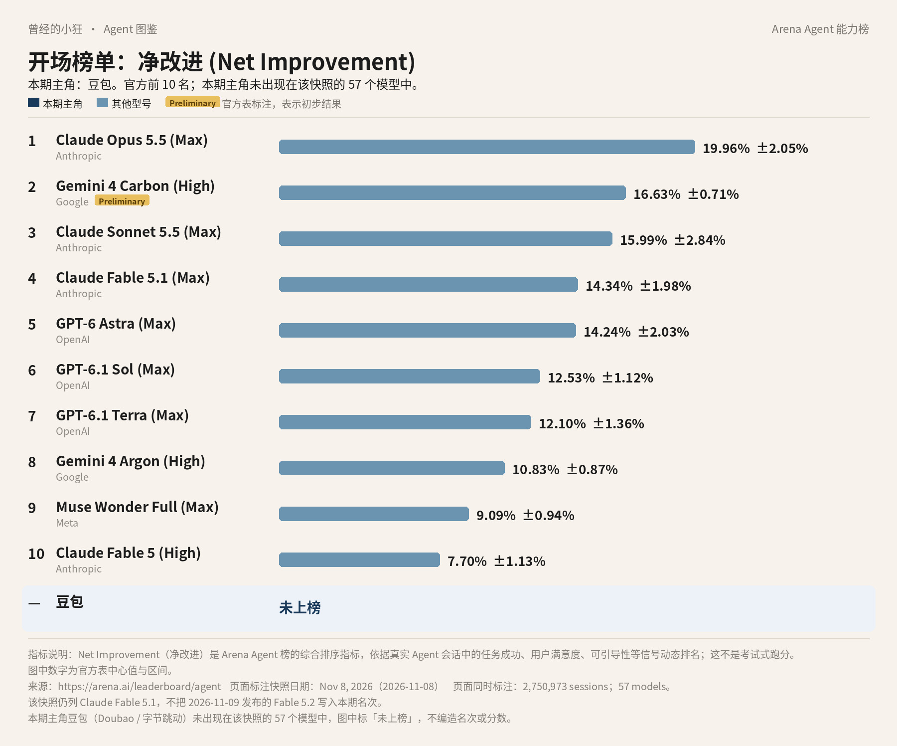
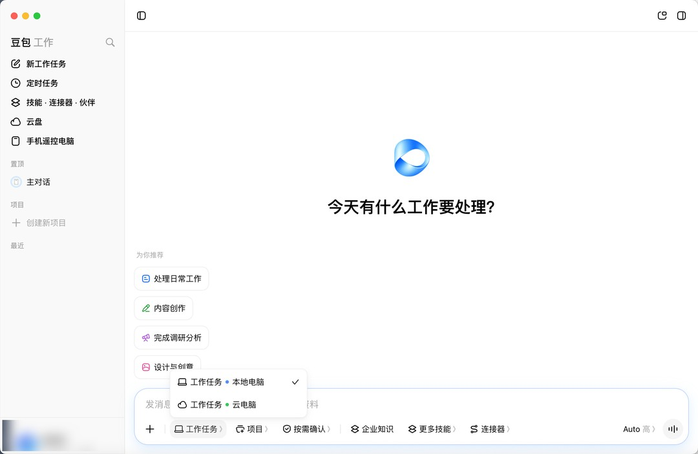
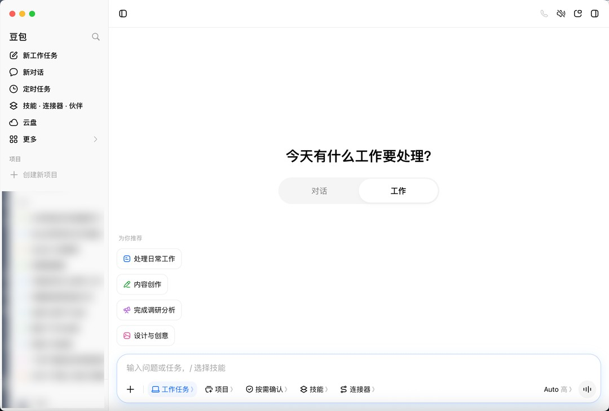
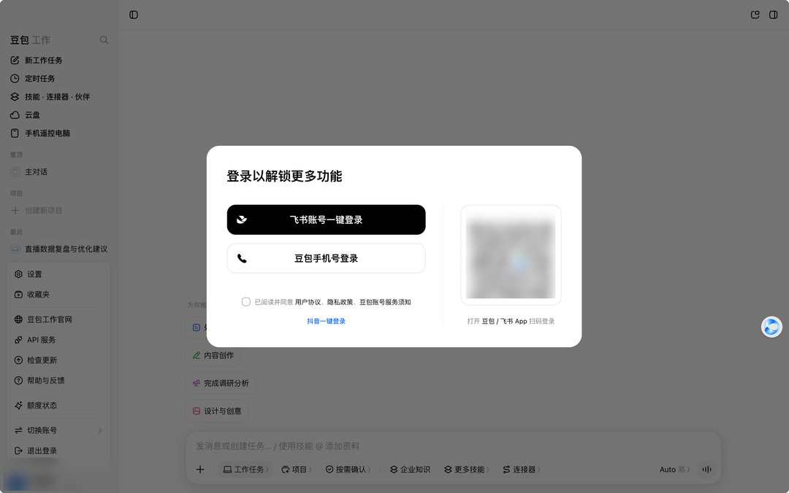

# 成稿包：《Agent 图鉴》第 8 篇 · 豆包（字节跳动）（小白向）

> 按 2026-11-11 连载要求写成公众号成稿。榜图使用 Arena Agent 综合榜 2026 年 11 月 8 日快照，全系列统一，不换新数。署名：刀哥。合集：Agent 与大模型。
>
> 口径：据官方资料整理，无实测口吻。正文不加核对说明式口气。

---

## 1. 标题备选（3 个）

1. **【建议主标题】这张全球 Agent 榜上没有豆包，先把产品和名次分开看**
2. 豆包是聊天和创作，豆包工作才是把任务做完的台子
3. 未上榜不等于没有产品：豆包和豆包工作怎么分开用

---

## 2. 作者

刀哥

---

## 3. 一句摘要

同一份 11 月 8 日 Arena Agent 榜的 57 个模型里，没有豆包、字节或 Seed。这篇先如实写「未上榜」，再把豆包与 2026 年 8 月发布的豆包工作分开讲，团队价按官网抄录，个人档标价标明未核实。

---

## 4. 完整正文（可直接发表）

曾经的小狂 · Agent 图鉴 第 8 篇

# 这张全球 Agent 榜上没有豆包，先把产品和名次分开看

这份连载每篇开头都放同一张榜。今天要先说一句不太好看的实话：本期主角不在这张榜上。

图上仍是 Arena 的 Agent 综合榜，2026 年 11 月 8 日快照。它看的不是传统刷题跑分，而是真实会话里，一个助手把事情做完之后，综合表现好了多少。指标叫净改进，英文是 Net Improvement。一共记了 2,750,973 场会话、57 个模型。数据来自 arena.ai/leaderboard/agent。第 2 名 Gemini 4 Carbon (High) 带官方 Preliminary 标注，表示初步结果。Claude Fable 5.2 未进入本期快照，图里也不写。

前十里没有豆包。把 57 个官方模型名和厂商栏逐行看完，也没有 Doubao、豆包、ByteDance、字节、Seed，或 Seed 系列模型。所以这张图只在前十之下加了一行，标**「未上榜」**。未上榜的意思很具体：这份 57 个模型的板上，没有它。**不要给它编一个名次，也不要把底下的 Seed2.1 理解成已经有一个 Arena Agent 名次。**

榜上看不到，不等于产品不存在。今天要讲的，是字节跳动做的豆包，以及同一品牌下后来单独拿出来的豆包工作。

## 先分清两个名字

豆包是面向个人的通用对话、搜索与创作应用，站点是 doubao.com，也有 App 和电脑版。出品方是字节跳动。底下的模型由 ByteDance Seed 团队研发；开发者要按量调用，走的是火山引擎里的火山方舟。

豆包工作是同一品牌下、面向个人、团队和企业的智能体工作平台。飞书 2026 年 8 月 24 日的官方介绍写：「豆包工作，是豆包品牌下面向个人、团队和企业的智能体工作平台。」它要做的事情，是把豆包从一个对话和内容生成工具，变成能够围绕目标持续执行、调用工具并交付成果的 Agent。这里的 Agent，指的就是：你给出目标，它拆步骤、调用工具，连续做下去，最后交出可用的成果。

*飞书官方介绍文配图：豆包工作的任务界面。图片来源：feishu.cn/content/article/7677519271848610746*

**两个名字只差两个字，入口却不一样。**聊天、搜索、写文案，用豆包就够。要把一件更长的办公任务做完，官方把这条路放在了豆包工作上。

## 2026 年，它是怎么多出「工作」这一层的

模型这边，Seed 团队先有自己的发布节奏。2026 年 2 月 14 日的 Seed2.0，曾在豆包 App 的「专家」模式上线。2026 年 6 月 23 日的 Seed2.1，在豆包电脑版或 App 的「办公任务」模式上线。官方把 Seed2.1 写成面向真实生产力的 Agent，强调通用 Agent、代码工程交付、多模态基础能力，并提到 Computer-Use Agent 方向的优化，包括手机界面，以及在图形界面动作和非图形界面动作之间切换。这是模型能力声明。产品层能不能操作浏览器和电脑，要以豆包工作自己的产品说明为准，不要直接划等号。

2026 年 8 月，豆包工作正式发布。它是原「豆包企业版」的升级形态。飞书里原先叫 Aily 的能力，已更名为「豆包工作伙伴」，成为豆包工作的核心能力之一。新华网 8 月 25 日转述官方发布，称它是「面向生产力场景推出的全新 Agent 产品与品牌」。下面的能力说明，优先按飞书和豆包帮助中心的原文来写。

官方描述里，豆包工作可以做：复杂任务拆解与执行；搜索与深度研究；文档、PPT、表格；定点 AI 编辑；数据分析；图像与视频；在线应用生成；**在授权范围内的浏览器与电脑操作**；企业知识问答；定时任务；以及技能、连接器、工作伙伴。图像和视频还可以按任务调用 Seedance（视频，2.0 / 2.5）和 Seedream（图像，5.0）。飞书文写，Seed 2.1 负责理解、规划、工具调用。成果可以继续编辑，也可以回到飞书里协作。用飞书入口时，个人数据与企业数据隔离，并继承飞书权限。

以上都是官方的产品说明，并非实测结论。火山方舟当前价目中可以看到 doubao-seed-2.1-pro、doubao-seed-2.1-turbo、doubao-seed-2.1-lite，以及 2.0 系列等调用名。写给普通人看时，主角仍是豆包和豆包工作；模型名只用来说明底下跑什么，不拿来充当榜上的名次。

## 三个入口，两套账号

要进豆包工作，官方给了三条路：独立的 PC 客户端；豆包里的工作入口；飞书内的入口。飞书里看到的「飞书里的豆包」，不是另一个产品。独立端目前只有 PC，移动端主要靠豆包和飞书。打开 doubao.com 或豆包 App，用「办公任务」等入口，也可以进去。

已经在用豆包聊天的人，可以从 App 或网页里的工作入口过去，不必先把它理解成另一个完全陌生的品牌。需要独立工作台、并且有电脑的人，可以下载豆包工作的 PC 客户端；官方写独立端目前只有 PC，手机上主要还是靠豆包和飞书。已经在用飞书的团队，可以从飞书内的入口使用，但功能范围由企业管理员控制，和 PC 端也不完全一致。三条路指向的是同一个豆包工作，不是三套互不相干的产品。

*飞书官方介绍文配图：在豆包客户端里切到「工作」，就能发起工作任务。图片来源：feishu.cn/content/article/7677519271848610746*

登录可以用豆包账号，也可以用飞书账号。两套账号的数据范围不同，而且相互隔离。不要假定两边的数据会自动合成一份。选哪套账号登录，会决定你看到的数据范围。

*飞书官方介绍文配图：豆包工作的登录窗口，可选飞书账号或豆包手机号登录。图片来源：feishu.cn/content/article/7677519271848610746*

帮助中心还写了隐私方面的原则：不主动记录身份证、家庭住址、银行卡、密码等；视频通话等隐私画面不记录；记忆按用户或智能体隔离。团队订阅写明，企业数据不用于模型训练。

技能、连接器和「工作伙伴」，是官方写在能力清单里的名字。「工作伙伴」由原来的飞书 Aily 更名而来，被写成豆包工作的核心能力之一。技能和连接器用于扩展和对接，具体能接哪些系统，以产品里当时提供的清单为准，这里不另编目录。定时任务、企业知识问答也出现在官方描述里：前者按时间执行，后者在飞书权限内查询企业知识。这些能力都要在授权和权限范围里使用。

开发者如果要把模型接到自己的系统里，走火山方舟调用 Seed / Doubao 模型；也可以看豆包开放平台的 Agents API，文档里有会话、事件、产物（文档、文件、图像、视频、链接）以及子 Agent 等说明，更新到 2026 年 10 月 21 日。Seed 官方另有一个开发工具入口叫 TRAE，不是这篇消费端介绍的重点。

## 团队价能对上，个人档的标价这次对不上

豆包工作的团队和企业价，印在 www.doubao.com/work/pricing 上，货币是人民币。

团队订阅 1 席起售。按年是每席每月 166 元，合计每席每年 1,988 元；按月是每席每月 198 元。页上还有「2,000 点 / 席 / 月」的限时加赠，属于促销，时限以当时页面为准。团队档写明含高峰优先；工作任务升到 2.1 Pro，并内置前沿三方模型；更多定时任务与办公、音视频额度；可加购用量套餐以解锁 Seedance 2.0 / 2.5；企业数据不用于训练；还有 SSO、审计、1 TB 企业存储（可扩容）等。

企业订阅 100 席起售。席位不含用量，需另购用量套餐；存储从 15 TB 起，合规与治理更完整。具体席位单价页上没有印出开放数字，需看商务或控制台。

豆包的个人订阅，帮助中心证实存在「标准版 / 加强版 / 高级版」，可以连续包月或包年，并引导自助购买。发布时有过「免费领取 30 天订阅权益」，每种账号类型限领一次，需客户端 V2.25 或更高。**至于这三档具体多少人民币，官方定价页上没有稳定印出可直接引用的数字。**个人档要花多少钱，只能以当时打开的定价页或客户端订阅页为准。

开发者若走火山方舟，价格按人民币、每百万 tokens 计。官方模型价格页上，常规在线推理的摘录是：doubao-seed-2.1-pro（输入长度 0 到 1024 千 token）输入 6.00 元，缓存命中 1.20 元，缓存存储每百万 token 每小时 0.017 元，输出 30.00 元；doubao-seed-2.1-turbo（0 到 256 千）输入 3.00 元，缓存命中 0.60 元，输出 15.00 元；doubao-seed-2.1-lite（0 到 1024 千）输入 0.80 元（另有音频输入 12.00 元），缓存命中 0.16 元（音频 2.40 元），输出 2.70 元。低优或批量档如有不同单价，以方舟价格页当期表为准。

## 未上榜，只说明这份榜没收录它

豆包和豆包工作面向中文用户，由字节跳动在国内运营。具体功能、年龄或地区限制，仍以应用商店和隐私政策为准，不宜据此认定为「仅限大陆」。

回到开头那张图。Arena 这份综合榜，列的是进入该快照的 57 个模型配置。榜上的名字是模型名和厂商栏，不是所有消费级应用的商标名录。豆包是应用，豆包工作是工作平台，底下的 Seed 系列是模型。这份快照的 57 行里，这几个名字都没有出现。所以我们只标「未上榜」，既不给豆包编一个「大约第几」，也不把 Seed2.1 的产品发布，理解成它已经在这份 Agent 榜上占了一席。

未上榜不是考试不及格，也不是说 Seed2.1 没有能力声明。它只说明：在 2026 年 11 月 8 日这份 57 个模型的 Agent 综合榜上，没有豆包或 Seed 的一行。要用它聊天，走豆包；要把任务做完，走豆包工作。名次没有，产品还在。

---

## 5. 配图清单

- `images/01-arena-agent-top10-doubao.jpg`：开场榜图（Arena Agent 综合榜，2026 年 11 月 8 日快照）。前十之下加行，对本期主角标「未上榜」，不编造名次或分数。

---

本轮新增正文配图（2026-11-11）：

- `images/02-doubao-work-home.jpg`（官方图）：放在正文「豆包工作是同一品牌下、面向个人、团队和企业的智能体工作平台…」一段之后。图注：飞书官方介绍文配图：豆包工作的任务界面。图片来源：feishu.cn/content/article/7677519271848610746 来源：页面 https://www.feishu.cn/content/article/7677519271848610746；原图 https://p1-hera.feishucdn.com/tos-cn-i-jbbdkfciu3/hera-doc/SWb8bYwWqogBuzxL5wec4IfQnnb.png~tplv-jbbdkfciu3-image:0:0.image。
- `images/03-doubao-app-work-tab.jpg`（官方图）：放在正文「已经在用豆包聊天的人…」一段之后。图注：飞书官方介绍文配图：在豆包客户端里切到「工作」，就能发起工作任务。图片来源：feishu.cn/content/article/7677519271848610746 来源：页面 https://www.feishu.cn/content/article/7677519271848610746；原图 https://p1-hera.feishucdn.com/tos-cn-i-jbbdkfciu3/hera-doc/OllPbFAs2oeKIPxpTeqcZCnFnlh.png~tplv-jbbdkfciu3-image:0:0.image。
- `images/04-doubao-work-login.jpg`（官方图）：放在正文「登录可以用豆包账号，也可以用飞书账号…」一段之后。图注：飞书官方介绍文配图：豆包工作的登录窗口，可选飞书账号或豆包手机号登录。图片来源：feishu.cn/content/article/7677519271848610746 来源：页面 https://www.feishu.cn/content/article/7677519271848610746；原图 https://p1-hera.feishucdn.com/tos-cn-i-jbbdkfciu3/hera-doc/Y3hCbGatdo9VB5xFQT5ceczNnqc.png~tplv-jbbdkfciu3-image:0:0.image。

## 6. 来源清单

1. https://arena.ai/leaderboard/agent（Arena Agent 综合榜，2026 年 11 月 8 日快照）
2. https://www.feishu.cn/content/article/7677519271848610746
3. https://www.doubao.com/work/pricing
4. https://www.doubao.com/work/docs/zh-cn/articles/805094220666-faqs
5. https://www.doubao.com/work/docs/zh-cn/articles/598547584144-team-and-enterprise
6. https://research.doubao.com/zh/blog/seed2-1-officially-released-advancing-ai-productivity
7. https://seed.bytedance.com/seed2_1
8. https://ark.volcengine.com/region:cn-beijing/docs/model-pricing
9. https://research.doubao.com/zh/blog/seed-2-0-official-launch?view_from=content_recommend
10. https://open.doubao.com/document/uAjLw4CM/ukTMukTMukTM/doubao/agent-v1/session-event/event-overview

---

## 7. 事实缺口（交稿时标明，不写入发表正文）

- 豆包个人订阅「标准版 / 加强版 / 高级版」的具体人民币标价未核实，正文未采用外界报道数字。
- 豆包工作企业订阅的席位单价，官方定价页未印出开放数字，正文未填写。
- 新华网转述中关于授权后操作浏览器和电脑、长时间任务调用云电脑、关机后继续、手机远程看电脑等细节，简报提示最好再对照当前客户端或帮助中心，正文未当作已核实的产品说明展开。
- 新华网所称「办公智能体能力与云端基准测试」认证属新闻转述，正文未写入。
- 未上榜仅针对 2026-11-08 Arena Agent 综合榜 57 个模型；不据此给 Seed2.1 编造名次。

## 本轮改动记录（2026-11-11，补图单 + 修改单）

- 删除署名：article.html 末尾「署名：刀哥」一行已删；md 完整正文标题下的署名行「刀哥」与正文末尾「署名：刀哥」已删（文件头元信息与「作者」一节保留）。
- 新增正文配图 3 张，位置与图注见配图清单；文中对应位置以 Markdown 图片加斜体图注标出。
- 过程话 #8-1（口径句改写）：原句「这些都是产品说明，不是我实测后的结论。」→ 新句「以上都是官方的产品说明，并非实测结论。」。
- 过程话 #8-2（整句删除「这里不写一个价。」）：原句「官方定价页上没有稳定印出可直接引用的数字，这里不写一个价。」→ 新句「官方定价页上没有稳定印出可直接引用的数字。」。
- 过程话 #8-3（整句删除「这里不编一个价格。」）：原句「需看商务或控制台，这里不编一个价格。」→ 新句「需看商务或控制台。」。
- 过程话 #8-4（删除「也不补一套海外条款。」，同句的「这里不额外写成」改为读者向口径）：原句「仍以应用商店和隐私政策为准，这里不额外写成「仅限大陆」，也不补一套海外条款。」→ 新句「仍以应用商店和隐私政策为准，不宜据此认定为「仅限大陆」。」。
