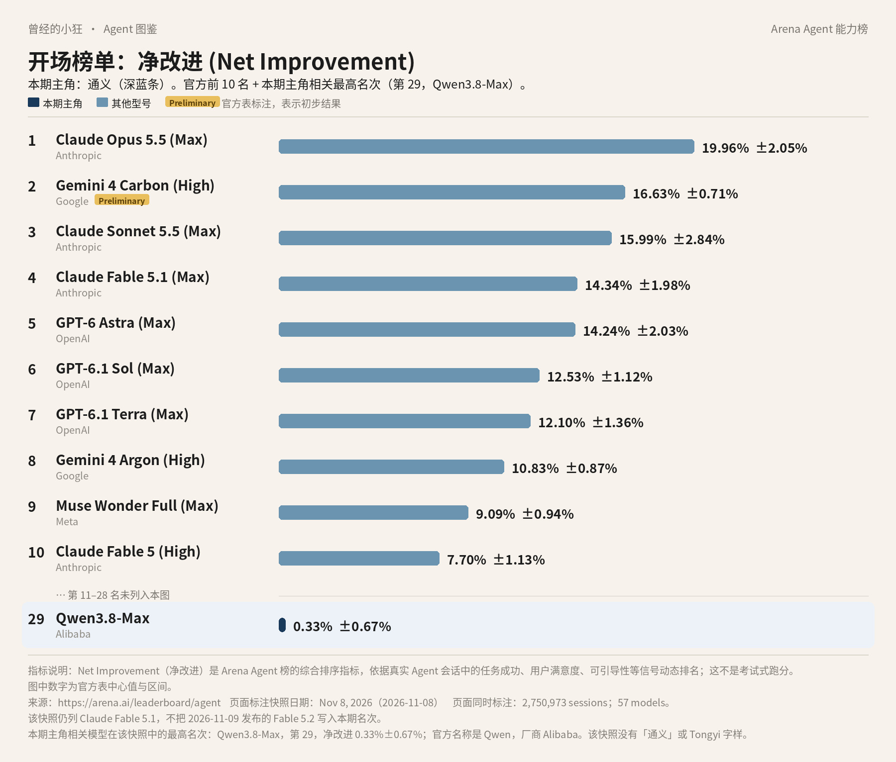

# 成稿包：《Agent 图鉴》第 9 篇 · 通义 / 千问 / Qwen（小白向）

> 按 2026-11-11 连载要求写成公众号成稿。榜图使用 Arena Agent 综合榜 2026 年 11 月 8 日快照，全系列统一，不换新数。署名：刀哥。合集：Agent 与大模型。
>
> 口径：据官方资料整理，无实测口吻。正文不加核对说明式口气。

---

## 1. 标题备选（3 个）

1. **【建议主标题】通义、千问、Qwen，其实是三块牌子**
2. 榜上写的是 Qwen 第 29，助手叫千问，干活走千问办公
3. 先认门牌再进门：Qwen 模型、千问助手、千问办公

---

## 2. 作者

刀哥

---

## 3. 一句摘要

同一份 11 月 8 日 Arena Agent 榜上，阿里最高是第 29 名 Qwen3.8-Max，官方名称是 Qwen，不是「通义」。这篇把 Qwen 模型、消费端千问、千问办公（QwenWork）三块牌子分开讲，消费会员价未写入，北京 API 原价按帮助中心抄录。

---

## 4. 完整正文（可直接发表）

曾经的小狂 · Agent 图鉴 第 9 篇

# 通义、千问、Qwen，其实是三块牌子

刀哥

你要是随口问一句「通义现在怎么样」，对面可能指三个不同的东西。有人说的是模型，有人说的是聊天助手，有人说的是办公平台。三个名字经常被揉在一起，这篇就把它们分开。

先看和前面几篇同一张榜。Arena 的 Agent 综合榜，2026 年 11 月 8 日快照，指标是净改进，英文是 Net Improvement，看的是真实会话里，一个助手把事情做完之后，综合表现好了多少。一共 2,750,973 场会话、57 个模型。数据来自 arena.ai/leaderboard/agent。第 2 名 Gemini 4 Carbon (High) 带官方 Preliminary 标注，表示初步结果。Claude Fable 5.2 未进入本期快照，图里也不写。

前十里没有今天的主角。因为不在前十，这张图在前十之下另加了一行：第 29 名 Qwen3.8-Max，厂商栏写作 Alibaba，净改进 **0.33%±0.67%**。这是该系在这份快照里最高的一行。要注意，**榜上的官方名称是 Qwen，不是「通义」，也不是「Tongyi」。**同快照里还有几行 Qwen，分数已经是负数，比如第 40 名 Qwen3.8-27B（-4.60%±0.86%）、第 41 名 Qwen3.8-Flash-Next（-4.66%±0.75%），以及更早的 3.7 系列，图里没有另画。

第 29 名只是这份快照里的净改进名次。更需要先讲清的，是名字。

## 三块牌子，先认门牌再进门

出品方是阿里巴巴、阿里云和通义实验室。日常口语里的「通义」，常常把下面三块牌子说成一个。

**第一块是 Qwen，也就是通义千问模型。**这是阿里巴巴的大模型系列，当前旗舰之一是 Qwen3.8-Max。开发者通过阿里云百炼等调用 API，也有开源权重计划。今天这张榜上出现的，就是这一层。

**第二块是千问**，消费端的官方 AI 助手，站点是 www.qianwen.com。官网写：「千问是阿里官方AI助手，提供最强Qwen大模型体验的第一入口。」它支持 AI 搜索、网页总结、AI PPT、AI 生图、录音纪要等，有网页、Windows / macOS 客户端和手机 App。历史上常称「通义千问」，现在消费品牌在官网上作「千问」。

**第三块是千问办公**，英文名 QwenWork。这是阿里巴巴在 2026 年 8 月 3 日前后推出的一站式 AI 办公和 Agent 平台，网页版在 qwenwork.cn/app，覆盖桌面端、网页端，并接入钉钉。

另外还有 chat.qwen.ai 这样的 Qwen 聊天或研究入口，以及开源框架 Qwen-Agent。阿里云百炼里还有托管 Agent、通义 UI Agent 等企业能力，那是另一套文档里的产品，不要默认等于千问 App，也不要直接写成千问办公的同名功能。

模型、助手、办公平台，门口挂的不是同一块牌子。

## 第一块牌子：Qwen 模型

2026 年 8 月 3 日，阿里云新闻稿把 Qwen3.8-Max 写成「Qwen系列迄今最强大的模型」。这是公司表述。同一篇还写：它是 2.4 万亿参数的 MoE 模型，激活 950 亿参数；上下文长度是 100 万 token；支持视觉多模态；API 经百炼开放。MoE 的意思，可以先简单理解成：模型体量很大，但每次推理只激活其中一部分。token 仍是计费和容量单位，100 万 token 的上下文，意思是一次能「看进去」的内容可以非常长。新闻稿里还写「模型权重计划于下周发布」，实际是否已开源、开到哪一版，以当时的开源页面为准，这里不把计划写成已经完成的事实。

帮助中心的模型页把能力写得更具体。调用名是 qwen3.8-max，另有快照 qwen3.8-max-0902，也写作 qwen3.8-max-2026-09-02。输入可以是图像、文本、视频，输出是文本；支持思考模式、工具调用、结构化输出、前缀续写、上下文缓存。北京地域支持联网搜索与批量推理；部分海外地域对这两项的支持不同，要看模型页。官方还写：编程与办公能力有提升，适用于法律、金融、设计等；支持超长文档与长视频语义解析，以及长程任务的自主规划与迭代。快照 0902 的说明是：编码更深、协作智能体增强、视觉理解增强，并延续 100 万上下文、思考模式与工具生态。

同一篇 8 月 3 日新闻稿里，公司还引用过当时的 Arena 名次，例如 Text Arena、Vision Arena、Frontend Code Arena 上的名次。那是当时的公司引用，而且会过时。本系列开头统一用 2026 年 11 月 8 日这份 Agent 综合榜，正文不以 8 月的文字榜名次冒充当前总榜。

开发者走百炼调用时，要注意北京与新加坡、法兰克福、弗吉尼亚、东京、香港等地的价格和功能差异。qwen3.8-max 的原价，帮助中心写明不含限时优惠，以控制台活动为准，货币是人民币、按每百万 tokens 计。华北 2（北京）及其他多个「全球」部署域：输入 12 元，输出 36 元；输入缓存命中 1.5 元；显式缓存创建 15 元，显式缓存命中 1 元。Batch File 是输入 6 元、输出 18 元；Batch Chat 在北京是输入 12 元、输出 36 元。新加坡以及美国部署范围档更贵：输入 14.988 元，输出 44.965 元；输入缓存命中 1.874 元；显式缓存创建 18.736 元，显式缓存命中 1.274 元。价格按页面原币种抄录，不另换算成美元。该模型在已列地域不支持调优。

## 第二块牌子：千问助手

普通人日常打开的，通常是千问，不是百炼控制台。入口是 qianwen.com、官方客户端和手机 App。官网把千问写成阿里官方 AI 助手，用来助力工作、学习、生活。

它更像一个对话助手，再附上一些办公小工具：搜索、网页总结、AI PPT、生图、录音纪要、划词小窗等。这些小工具能减轻日常工作，但官方并没有把千问助手写成和千问办公同一套「对话即交付」的平台。PC 客户端下载页的配置里曾见到版本号 2.3.1，安装包文件名带 260227，也就是 2026 年 2 月 27 日的构建，未必是最新，具体以下载页当时提供的版本为准。配置里还出现过鸿蒙相关字段。

千问消费会员在官网上有权益中心 www.qianwen.com/equity。该页是动态应用，页面上没有稳定印出可直接引用的价目，这里不写会员价，以当时打开的权益中心为准。

消费端千问明显面向中国用户：中文站，和钉钉、阿里云是同一套日常环境。国际开发者若要调模型，走的是百炼的海外地域。不要把「中国用户能用千问」理解成全球统一的同一套订阅。

## 第三块牌子：千问办公

要把一件更长的办公任务做完，官方把这条路放在千问办公上。帮助中心（更新到 2026 年 11 月 10 日）写：千问办公是阿里巴巴全新推出的一站式 AI 办公平台，不止于对话，更注重交付。用户仅需一句话，即可完成数据分析、PPT 生成、视频剪辑、网页搭建等复杂任务，直接获得可用成果。这里的「交付」，指的就是交出还能继续用的成品，而不是只给一段回复。行业里把这种连续拆步骤、调用工具、把事做完的能力叫 Agent。

入口在 qwenwork.cn/app、桌面端，以及钉钉工作台。网页版可以用钉钉账号或手机号登录。桌面端可直接读本地磁盘文件并写回。

官方写到的能力包括：由旗舰模型驱动；全链路交付文档、表格、PPT、代码、网页和多媒体；多端与钉钉；个人云盘、即时通讯、技能、连接器；可交互网页，并可连接数据库（网页版与钉钉已支持，客户端写的是即将开放）；云端定时任务，并可推到钉钉等渠道；以及浏览器自动化。**浏览器自动化目前仅客户端支持**，可以点击、输入、采集。企业后台、权限分层、用量可控，帮助中心有原则说明，细则没有全部展开。

新闻稿写，用户也可以在千问办公上体验 Qwen3.8-Max。模型页和新闻稿里还有公司内部案例，例如 16 天的自主工程项目。那属于公司主张，不是这篇里的独立评测。

千问办公的个人版、团队版具体多少钱，这次没能从帮助中心抓取到完整价目。宣传语不是价表。和千问消费会员一样，这里不编价格，以当时的定价页或控制台为准。

## 三种走错门的情况

第一种，把榜上的 Qwen 直接叫成「通义第 29 名」。厂商栏写的是 Alibaba，模型名写的是 Qwen3.8-Max。通义是人们口头上的统称，也出现在实验室和模型系列的叫法里，但它不是这行的官方登记名。第二种，打开 qianwen.com，以为已经进入千问办公。千问是消费端助手，搜索、总结、PPT、生图、录音纪要这些小工具在这里；要把更长的任务交付成可继续用的文档、网页或定时结果，官方把入口放在 qwenwork.cn/app、桌面端和钉钉工作台。第三种，在百炼里看到托管 Agent 或通义 UI Agent，就以为那是千问 App 里的同名按钮。那是企业侧另一套文档里的能力，没有在这篇里写成和千问办公自动等同。

千问办公的端也不完全一样，值得单独记。网页版和钉钉已经支持可交互网页，并可连接数据库；客户端写的是即将开放。浏览器自动化则反过来，目前仅客户端支持。桌面端可以读本地磁盘文件并写回，这是网页版没有被写成同等能力的一点。选端的时候，先看自己要的是本地文件、浏览器自动操作，还是钉钉里的协作，再决定走网页还是客户端。

chat.qwen.ai 是又一个 Qwen 聊天或研究入口，和 qianwen.com 上的千问助手、qwenwork.cn 上的千问办公，都不是同一块牌子。开源的 Qwen-Agent 是给开发者的框架，也不是消费端应用。把门牌看清楚，比把所有入口都叫成「通义」要省事。

## 认准门牌，再决定走哪一条路

用千问聊天、做搜索和小结，走 qianwen.com 就行。要用 Agent 把分析、PPT、网页或定时任务做完，走千问办公。要把 Qwen3.8-Max 接到自己的系统里，走阿里云百炼，并分清北京价和海外地域价。榜上那一行，记的是模型名 Qwen，不是助手名「千问」，也不是平台名「千问办公」。

三个名字经常被随口说成「通义」。分开写，是为了少走错门。

署名：刀哥

---

## 5. 配图清单

- `images/01-arena-agent-top10-tongyi.jpg`：开场榜图（Arena Agent 综合榜，2026 年 11 月 8 日快照）。前十之下加行：第 29 名 Qwen3.8-Max（Alibaba，0.33%±0.67%）。榜上官方名是 Qwen，无「通义」或「Tongyi」字样。

---

## 6. 来源清单

1. https://arena.ai/leaderboard/agent（Arena Agent 综合榜，2026 年 11 月 8 日快照）
2. https://www.qianwen.com/
3. https://www.qianwen.com/download
4. https://help.aliyun.com/zh/qwenwork/product-overview/
5. https://qwenwork.cn/app
6. https://www.alibabacloud.com/zh/press-room/alibaba-unveils-qwen3-8-max?_p_lc=1
7. https://help.aliyun.com/zh/model-studio/qwen3-8-max
8. https://www.alibabagroup.com/zh-CN/document-2021039099929952256

---

## 7. 事实缺口（交稿时标明，不写入发表正文）

- 千问消费会员价未核实（权益中心为动态页，外界常见的 19 / 49 / 128 元档未采用）。
- 千问办公个人版 / 团队版完整价目未核实，正文未填写。
- 2026-08-03 新闻稿所称「模型权重计划于下周发布」，是否已落地、开到哪一版，以开源页为准，正文未写成既成事实。
- PC 客户端下载页所见 2.3.1（构建 260227）可能不是最新，正文已说明以下载页为准。
- 未把 8 月新闻稿中的 Text / Vision / Frontend Code Arena 名次写成当前总榜。
- 百炼托管 Agent、通义 UI Agent 未写成千问 App 或千问办公的同名功能。
