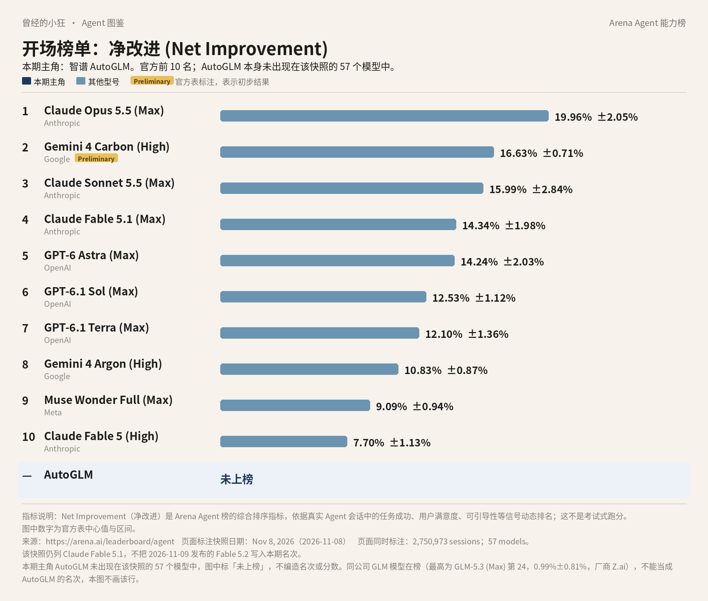

# 成稿包：《Agent 图鉴》第 10 篇 · 智谱 AutoGLM

> 据官方资料与 Arena Agent 榜 2026 年 11 月 8 日快照整理。署名：刀哥。合集：Agent 与大模型。

---

## 标题备选

1. 【建议主标题】榜上没有它：智谱 AutoGLM 是来替你点屏幕的
2. 它不在 Arena 综合榜上：AutoGLM 的云手机和云电脑怎么用
3. 一句指令，两台云设备：先认识智谱 AutoGLM

---

## 作者

刀哥

---

## 一句摘要

AutoGLM 是智谱做的 GUI Agent：用自然语言指挥云端手机和云端电脑去点屏幕、跑 App 和网页任务。它本身未出现在 2026 年 11 月 8 日这份 Arena Agent 综合榜上；同公司的 GLM-5.3 在榜，但不能当成 AutoGLM 的名次。iOS 应用标示免费，云设备是否另收费，定价页上没有可直接引用的价表，正文未写价格。

---

## 完整正文

曾经的小狂  ·  Agent 图鉴 第 10 篇

# 榜上没有它：智谱 AutoGLM 是来替你点屏幕的

刀哥

很多 Agent 是在对话框里想、在工具里算。智谱这一边，还有一条更具体的路：让它替你去点屏幕。

全系列每篇开头，都先放同一张全球 Agent 前十图。数据是 Arena 的 Agent 综合榜，指标叫「净改进」：看真实会话里，一个助手把事情做完之后，综合表现到底好了多少。它不是把模型拉去考一张卷，再按正确率排座次。图上是 2026 年 11 月 8 日那一版快照，一共记了 2,750,973 场会话、57 个模型。数据来自 arena.ai/leaderboard/agent。第 2 名 Gemini 4 Carbon (High) 带官方 Preliminary 标注，表示初步结果。这份快照里没有 Claude Fable 5.2，因为它是第二天才发布的。

*全球 Agent 前十（Arena Agent 榜 · 净改进，2026 年 11 月 8 日快照）。本期主角 AutoGLM 未上榜，图下已单独标出，不加名次。数据来源：arena.ai/leaderboard/agent。Fable 5.2 未进入本期快照。*

你看完这张图会发现：前十里没有 AutoGLM。表下多出来的那一行，写的也不是名次和分数，而是「未上榜」。这不是漏画了。这份快照的 57 个官方模型名里，既没有 AutoGLM，也没有 ChatGLM。

同一家公司、同一份榜上，倒是有 GLM 编排模型，厂商栏写作 Z.ai，最高的一行是第 24 名 GLM-5.3 (Max)，净改进 0.99%±0.81%。那是 GLM，不是 AutoGLM。两者不要混成一个产品，更不要把第 24 名安到 AutoGLM 头上。

这份榜记的是模型在真实 Agent 会话里的净改进。AutoGLM 是一个要去操作屏幕的产品，官方模型名里又没有它，所以图上只能标「未上榜」。未上榜不等于不能用，只说明这份综合榜没有把 AutoGLM 收成一行。

今天要讲的，就是这个没有出现在综合榜上的产品：智谱 AutoGLM。它要解决的问题，和聊天模型不完全是同一件事。

## 它要替你点的，是云上的屏幕

出品方是智谱 AI，公司全称北京智谱华章科技股份有限公司。产品站是 autoglm.zhipuai.cn，公司站是 zhipuai.cn。App Store 上的开发者名写作 Beijing Knowledge Atlas Technology Joint Stock Company Limited。

中国区 App Store 的官方简介把话说得很直：AutoGLM 是一款 Agent 智能体产品，通过远程操作云设备，自动完成移动端 App 操作、跨 App 交互和网页任务。它为每位用户准备了一台智能体手机和一台智能体电脑，都部署在云端的数据中心。你只需一句自然语言指令，它就能在云设备上打开 App、浏览网页、点外卖、订酒店、制作 PPT 和网页、生成视频，甚至在多个 App 之间协同操作。无需安装、无需连接，任务都在云端执行，不占用你自己的手机或电脑资源，也不打断你正在做的事。

你可以先这样理解：你自己的手机继续聊天、看视频、回消息；另一台在云端的手机，按你刚才那句话去打开应用、来回切换、把流程走完。官方举例里有点外卖、订酒店、做 PPT 和网页、生成视频。这些是商店简介里的示例任务，不是我替它保证每一次都能做完、做成什么样。

这一点，和「把你正在用的手机交给它去点」不是同一件事。云设备在数据中心，任务不占用你手头的那台机器，也不打断你正在做的操作。官方简介把「无需安装、无需连接」写得很靠前，依据的就是这层隔离。

这里有两个词值得先分开。Agent，就是你会先说一个目标，它再自己拆步骤、连续做下去的助手。GUI Agent 更窄一点：它面对的不是一份接口清单，而是屏幕上的按钮、输入框、弹窗，要像人一样去点、去滑、去输入。云设备的意思是，被操作的那台手机或电脑，不在你手里，而在数据中心里。

早期研究页 zhipuai.cn/zh/autoglm 曾把 AutoGLM 定义为 ChatGLM 家族中面向 GUI 的基础 Agent，场景以 Web 浏览器和 Android 为代表。那是研究发表时的定位。研究页上的基准数字，是当时的实验结果，不能当成 2026 年 11 月这款消费产品的成绩，这里也不引用那些分数。它只帮助说明一件事：这个产品从一开始，就是朝「看屏幕、点屏幕」这条路去的，而不是再做一个通用对话框。

## 消费端和开源，是两扇门

普通人要试用，路径比较短。App Store 上的 AutoGLM 标示为免费，需 iOS 15 或以上。商店写明仅适用于 iPhone。登录之后，你是对云端手机或云电脑下指令，不是把你自己那台正在用的手机交出去。电脑端可通过官方下载页体验，地址是 autoglm.zhipuai.cn/htdocs/download.html。网页或其他客户端的现网入口文案，以打开该页时的说明为准。

商店的版本记录里，2.0.20（7 月 9 日，结合后续版本时间线应为 2026 年）写了「新增 AutoClaw 移动端入口」。AutoClaw 是什么、能做什么，以产品里的说明为准。不要想当然地把它等同于开源项目 OpenClaw。

开发者还有另一扇门。2025 年 12 月 8 日，公司发文开源了 Open-AutoGLM：核心模型、Phone Use 框架与工具链、50 多个高频中文 App 的 Demo，以及 Android 适配层。模型是 MIT 许可证，代码是 Apache-2.0，仓库示例在 github.com/zai-org/Open-AutoGLM。走这条路，是在自己的环境里做 Phone Use，而不必把真实手机交给云端。

同一篇文章回顾了产品怎么走过来的：2024 年 10 月 25 日，发布了可在真机跑完完整链路的 AutoGLM，当时被称为具备 Phone Use 的 Agent；2025 年有 AutoGLM 2.0，并转向云手机。文章还写明：主动放弃操作微信等离用户隐私较近的 App。这是开源文章里的安全取向。消费端现在是否仍完全不碰微信，我没有写成一句可引用的现网规则，这里不替产品打包票。

先在真机上把完整链路跑通，再把主场转到云手机，中间隔着安全和隐私上的考虑。开源文章把 Phone Use 做大之后会碰到的敏感面写得很直：微信、支付、相册。它给出的办法，不是宣布这些问题已经消失，而是把控制权交回使用方，并用开源和私有化部署来承接。消费端那条云设备的路，和开源这条自建的路，由此分开。

文档站另有 AutoGLM-Phone 等多语言模型资料，面向开发者和开源部署。那和消费端的云设备，不是同一个入口。

开源文章里还写过一类能力叙事：把自然语言拆成可回放的点击、滑动、输入，并处理弹窗、广告、网络波动。安全取向上，是把 Agent 放进与真实世界隔离的云手机，动作可回放、可审计、可干预。这些是公司自己的表述，不是我上手之后的体验。

和前面几篇里那种「在对话框里调用工具」相比，GUI Agent 多出来的难点，往往不在把句子写漂亮，而在屏幕是会变的。弹窗、广告、网络波动，开源文章把它们写成这条链路必须处理的情况。官方能写到「可回放」，正是因为操作被拆成了一步一步的界面动作，而不只是一次接口调用。

「可回放、可审计、可干预」也可以说得更直白。回放，是事后还能把点击、滑动、输入重新看一遍；审计，是这些动作留下记录，供人检查；干预，是过程中你仍可以插手，而不是把一台设备彻底交给它自行决定。消费端云设备是否把这三项都做完整，仍以产品里实际提供的查看与中断能力为准，我不当成已经全部兑现。

这也决定了这篇该怎么读。你要问的不是「它在综合榜排第几」，而是：指令下给哪一台设备，哪些应用它声称可以动，哪些近隐私的应用它曾经明确放弃，以及云设备这一层今天怎么收费。前三个，公开材料里有线索；最后一个，这次还写不死。

## App 是免费的，云设备怎么收费还不能写死

App Store 这一栏写得很清楚：免费。开源仓库按 MIT 和 Apache-2.0 使用，遵守各自许可证即可。

云端手机、云电脑是否长期免费，有没有次数限制或订阅档，智谱定价页上没有一份与 AutoGLM 对应、可直接引用的价表，这里不写一个价格。不要把它理解成「云设备永久免费」，也不要按别的产品去猜套餐价。开通前，以产品内和官方定价说明为准。

## 若要试用，只走官方入口

若你在中国区 App Store，可以搜 AutoGLM，或按商店页打开。先确认系统是 iOS 15 或以上，并看到免费标价，再决定是否登录试用。电脑端先打开官方下载页 autoglm.zhipuai.cn/htdocs/download.html，不要从非官方来源下载安装包。开发者若要在自有环境里做 Phone Use，再去 GitHub 上的 Open-AutoGLM 仓库，并先读 MIT 与 Apache-2.0 的许可说明。

登录之后，指令是下给云端设备的。不要默认它已经获得了你本机里的微信、支付或相册权限。能做到哪一步，以当时产品里实际可操作的应用和权限提示为准。

## 它明确不想碰的地方

商店年龄分级是 16+。隐私说明会收集标识符，以及未与身份关联的位置、联系信息、使用数据、诊断等，具体以商店当期隐私标签为准。

开源文章特别强调：Phone Use 一旦做大，会碰到微信、支付、相册等敏感面，因此把控制权交给使用方的私有化部署。这也是为什么会有 Open-AutoGLM 这条路。

中国大陆这边，产品有中文站，国内 App Store 也在架。海外是否同步提供，官方页没有写明，我不写成已经在海外同步上架，也不写成只在国内能用。

商店评论里有人提到连接稳定性、速度、无障碍问题，也有人希望适配 iPad。那是用户反馈，不是官方规格，不能当成普遍结论。

AutoGLM 适合先了解的人，大概是这样两类：想用一句话让云端设备去完成点外卖、订酒店、做材料这类操作，并且能接受 App 免费、但云设备是否另计费还要看产品内说明的人；或者想在自己的环境里做 Phone Use，愿意按开源许可证使用 Open-AutoGLM 的开发者。

有几种情况，先不必按这篇去下判断。如果你主要想要一个聊天模型，并比较它在综合榜上的名次，请去看 GLM 那条线，不要拿这篇的未上榜去推断 GLM-5.3。如果你必须在自己的 iPad 上装官方 App，商店写明仅适用于 iPhone，评论里的期望不能当成已经适配。如果你假定云设备一定长期免费，现有公开材料支撑不了这句，不要按这句话去规划用量。

如果你要的是一个通用聊天模型，并把它在 Arena 综合榜上的名次当成选品依据，那这篇的主角对不上。GLM 聊天和编排是另一条产品线。AutoGLM 要讲的，是它能不能在屏幕上把一步一步的操作做完。产品入口和说明会变，开通前再打开官方下载页和商店页看一眼。

署名：刀哥

---

## 来源清单

- https://arena.ai/leaderboard/agent
- https://arena.ai/blog/agent-arena-methodology
- https://apps.apple.com/cn/app/autoglm/id6748391183
- https://autoglm.zhipuai.cn/htdocs/download.html
- https://www.zhipuai.cn/zh/research/145
- https://www.zhipuai.cn/zh/autoglm
- https://github.com/zai-org/Open-AutoGLM
- https://www.zhipuai.cn/

---

## 事实空缺（审稿用，不进入公众号正文）

- 云端手机、云电脑是否长期免费，以及有无次数限制或订阅档：智谱定价页上没有与 AutoGLM 对应、可直接引用的价表，正文未写价格。
- 消费端当前是否仍完全不操作微信：开源文章有「主动放弃」的表述，现网帮助中心规则未写成可直接引用的一句，正文未下结论。
- 海外是否同步提供：官方页没有写明，正文未下结论。
- 电脑端、网页端现网入口的准确文案：资料简报记载 autoglm 首页曾抓取超时，正文只指向官方下载页，不以过时文案为准。
- AutoClaw 的产品细节：商店版本说明只写「新增移动端入口」，不以开源 OpenClaw 去等同。
