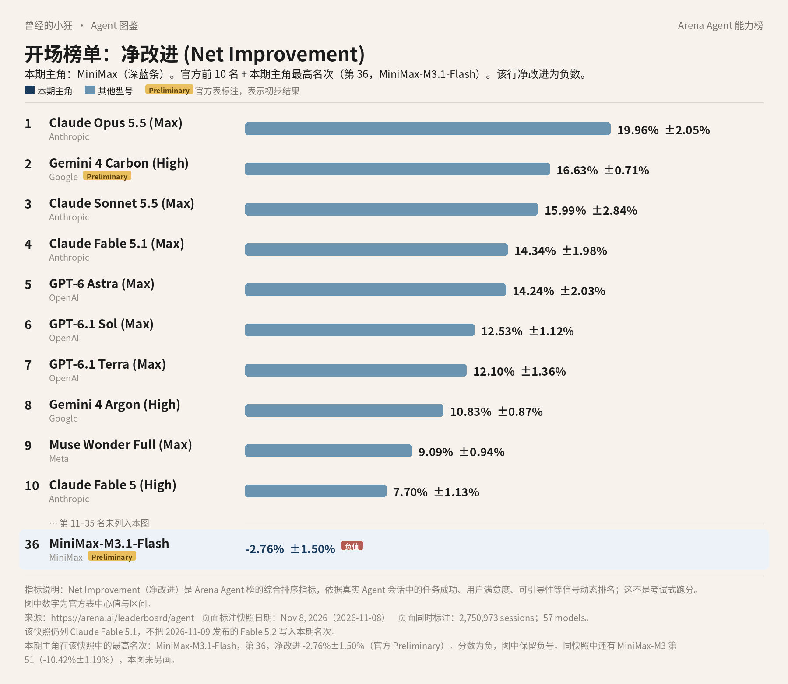
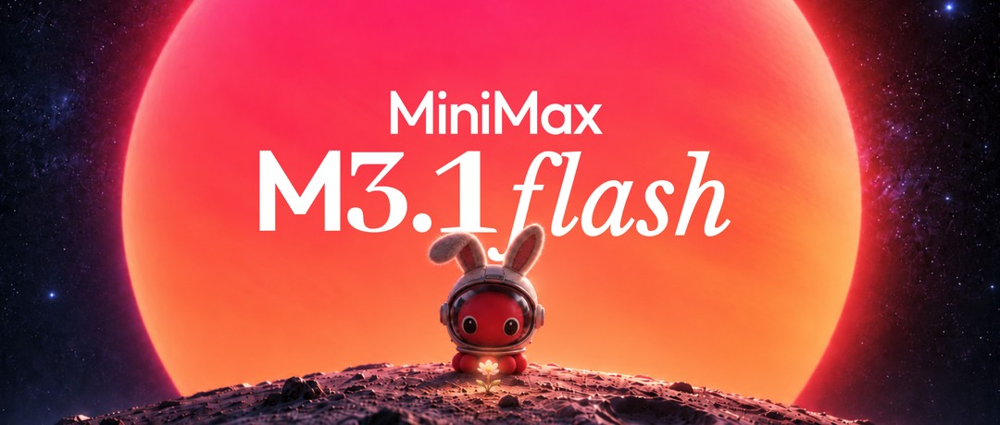
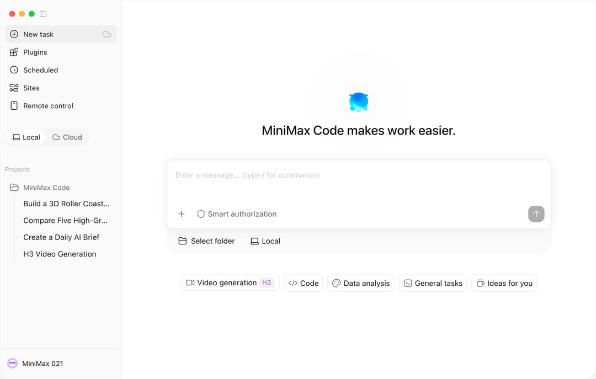
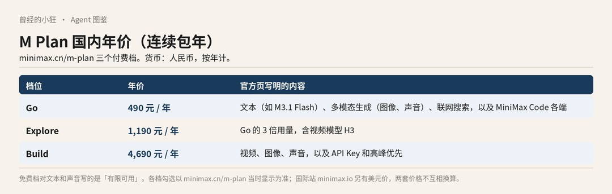

# 成稿包：《Agent 图鉴》第 11 篇 · MiniMax / 海螺

> 据官方资料与 Arena Agent 榜 2026 年 11 月 8 日快照整理。署名：刀哥。合集：Agent 与大模型。

---

## 标题备选

1. 【建议主标题】这份快照里它是负数：先认识 MiniMax 和海螺
2. MiniMax-M3.1-Flash 净改进是负的，先把产品和价目看清楚
3. 国内一份价、国际一份价：MiniMax 现在怎么进门

---

## 作者

刀哥

---

## 一句摘要

在 2026 年 11 月 8 日这份 Arena Agent 综合榜快照里，MiniMax 最高一行是第 36 名 MiniMax-M3.1-Flash，净改进 −2.76%±1.50%，且为初步结果。这不是道德判决。文本旗舰是 M3.1 Flash，视频和图像走 MiniMax-H3 系列，个人入口是 M Plan 与 MiniMax Code。国内和国际两套标价，不要换算；国内 Explore 每年 1,190 元（连续包年），用量是 Go 的 3 倍，含视频模型 H3。

---

## 完整正文

曾经的小狂  ·  Agent 图鉴 第 11 篇

# 这份快照里它是负数：先认识 MiniMax 和海螺

先说一个不太好听的数字。在 2026 年 11 月 8 日这份 Arena Agent 综合榜快照里，MiniMax 最高的一行，净改进是负数。

*全球 Agent 前十，并在表下加出第 36 名 MiniMax-M3.1-Flash（Arena Agent 榜 · 净改进，2026 年 11 月 8 日快照）。该行净改进为 −2.76%±1.50%，官方标 Preliminary。数据来源：arena.ai/leaderboard/agent。Fable 5.2 未进入本期快照。*

这张图和全系列其他篇是同一份数据：Arena 的 Agent 综合榜，指标叫「净改进」，看的是真实会话里，一个助手把事情做完之后，综合表现到底好了多少。一共记了 2,750,973 场会话、57 个模型。数据来自 arena.ai/leaderboard/agent。第 2 名 Gemini 4 Carbon (High) 带官方 Preliminary 标注，表示初步结果。Claude Fable 5.2 是快照第二天才发布的，没有进这期名次。

前十里没有 MiniMax。因为不在前十，图在表下另加了一行，写的是真实名次，不是编出来的座位：第 36 名 MiniMax-M3.1-Flash，净改进 −2.76%±1.50%。请把前面那个减号看清楚。它不是一个很小的正数，而是低于这条榜用来比较的基线。官方还标了 Preliminary，表示初步结果。表里没有「海螺」两个字，厂商栏写的是 MiniMax。

同一份快照里还有第 51 名 MiniMax-M3，净改进 −10.42%±1.19%。这一行没有画进开场图，正文里提一句就够。

官方页在百分数后面给出的 ±，是 95% 置信区间。就 MiniMax-M3.1-Flash 这一行来说，中心值是 −2.76%，把区间算进去，上沿仍在零以下。它还带官方 Preliminary 标注，会话数是 13,089，比同表里许多行要少。第 51 名 MiniMax-M3 的会话数是 44,355。这些都是读这两行时可以一并看见的事实，不必额外发挥。

负的净改进，只是这份快照里的这个指标。它不是道德判决，也不是「不能用」的资格审查。下面仍按产品来讲：这家公司现在把入口放在哪里，文本、视频和图像各叫什么名字，国内和国际各怎么标价。

## 海螺这个名字，和现在的产品线

出品方是 MiniMax。国内站是 minimax.cn，国际站是 minimax.io。消费和开发入口包括 M Plan、MiniMax Code，以及开放平台 API。

人在中国大陆，消费入口走 minimax.cn，开发者价目走 platform.minimax.cn；国际站点覆盖的市场，走 minimax.io 和 platform.minimax.io。两套账户不要混用，两套价格也不要互相换算。价目按原币种分开写。

很多人是先记住「海螺」或 Hailuo 这个名字的，尤其是在视频和图像这一侧。历史模型 Hailuo 2.3、2.3Fast、02 现在仍作为 legacy 出现。当前旗舰视频模型，官方名已经是 MiniMax-H3。介绍页写它支持文生、图生、首尾帧和多模态参考，分辨率有 768P 和 2K，时长 4 到 15 秒，每秒 24 帧。另有 H3-Highspeed、H3-Lite、H3-Max、H3-Regeneration。图像这边，是 MiniMax-H3-Image，以及 Highspeed。语音有 speech-2.8-hd、turbo 等。音乐付费 API 从 2026 年 8 月 20 日起，不再对新增用户开放。

H3 这一侧，官方写的能力可以先说成几句人话。文生，是从文字生成视频；图生，是从图片生成；首尾帧，是你先给定开头和结尾的画面，再让它补中间；多模态参考，是同时拿多种材料作参照。分辨率和时长不是可以随意拉长的，介绍页写的就是 768P 或 2K，4 到 15 秒，每秒 24 帧。

文本这一侧，当前主推的是 MiniMax-M3.1-Flash。平台模型页把它写成：前沿多模态编程模型，有 1M 上下文，思考深度可调。1M 上下文，可以先理解成一次能「看进去」的内容可以非常长；思考深度可调，就是这次要它想得深一点还是快一点，可以改。它和视频模型 H3 不是同一条产品线，只是同属于 MiniMax 现在对外提供的能力。MiniMax-M3 仍列在模型介绍里，国内价目还有 M3 的标准档和优先档。

还有两个容易混在一起的词。公司博客里的 Computer Use，说的是模型去操作电脑界面。M Plan 功能表里的远程控制、内置浏览器、SSH，说的是 MiniMax Code 这套应用按套餐提供的能力。名字相近，并不等于每一档订阅都自动包含博客里提到的全部 Computer Use 场景。仍以套餐对比表为准。

2026 年 10 月 19 日的公司博客，把 M3.1 Flash 定位为下一代 Flash 模型，并称在 Agent 任务、编码、Computer Use 和网络安全上有「代际」提升；还称在线推理速度约提升至近三倍，使用成本降低 70%。这些都是相对其前代的公司主张。Computer Use，指的是让模型去操作电脑界面，而不只是在对话框里回答。

*MiniMax M3.1 Flash 官方博客题图。图片来源：minimax.io/blog/minimax-m31f*

同一篇博客还写，更推智力上限的 Pro「稍后也会到来」。是否已经发布，已打开的官方页面没有写明，不写成已经上线。

所以现在对外主推的文本旗舰，仍应写成 M3.1 Flash，而不是把还没在官方页确认上线的 Pro 提前写进产品菜单。M3 还在价目和模型介绍里，但它不是这篇里的主推型号。视频和图像若仍按「海螺 2.3」去找，会找到 legacy，当前旗舰名是 MiniMax-H3 和 MiniMax-H3-Image。

## 两条进门的路

普通人可以订阅 M Plan。官方把它写成面向个人的订阅：统一提供文本（例如 M3.1 Flash），以及图像、视频、语音等能力，具体看套餐；并且包含官方 Agent 应用 MiniMax Code。MiniMax Code 有网页、桌面、TUI，也有 iOS 和 Android。登录即可用，不必另配 API Key。下载页是 agent.minimax.io/download。也可以走网页和移动端，不一定先装桌面客户端。

*MiniMax Code 下载页官方分享图：桌面端界面。图片来源：agent.minimax.io/download*

功能表里出现过：定时任务、网站部署、项目、技能、精选插件、联网搜索、远程控制、内置浏览器、SSH、记忆、工作助理、自定义 Agent。各档勾选并不相同。不要默认每一档都有视频，也不要默认每一档都给 API Key。

开发者走开放平台，按量调用。国内是 platform.minimax.cn，国际是 platform.minimax.io。Build 档还会提供 API Key，官方写可接入 Claude Code、Codex、Workbuddy、Cursor、OpenCode 等。

选路时可以先问自己两件事。你是要在官方应用里让 Agent 写代码、跑任务，还是要在自己的程序里按量调用？前者走 M Plan 和 MiniMax Code，登录即可，不必先配密钥；后者走开放平台。你需要的是文本，还是连视频、图像、声音一起要？不是每一档都把这些能力打包进来，对比表要看对应站点上的勾选，不要用其中一档的能力去推断所有档。

## 国内一份价，国际另一份价

国内站和国际站是两套定价，一套用人民币，一套用美元。不要把人民币价直接换成美元，也不要用国内年价去推国际月价。

国内开放平台（platform.minimax.cn/docs/pricing/overview）里，MiniMax-M3.1-Flash 是：输入 1.00 元 / 百万 tokens，输出 4.00 元，缓存读取 0.10 元。token 是计费和容量的单位，可以先把它理解成「用了多少文字量」。MiniMax-M3 另有不超过 512k、超过 512k，以及「永久五折」后的标准价，还有 1.5 倍的优先档，具体数字以价目页为准。视频 H3 按分辨率和秒计价，例如 MiniMax-H3 输出 2K 为每秒 0.80 元，768P 为每秒 0.50 元；输入视频，以及超出免费张数的图片，另计。服务端 web_search 是每次 0.03 元。

国际 API 按 M3.1 Flash 博客与国际定价概述：每百万 tokens 是 0.15 美元输入、0.60 美元输出、0.015 美元缓存输入。

国内 M Plan 页（minimax.cn/m-plan）上，连续包年写了「立省 2 月」。Go 现价是每年 490 元，划线价 588 元，含文本如 M3.1 Flash、多模态生成（图像、声音）、联网搜索，以及 MiniMax Code 各端。页上对 Go 的描述，没有把视频列为该项核心；对比表里视频模型 H3 的勾选，以页面为准。Build 是每年 4,690 元，划线价 5,628 元，含视频、图像、声音，以及 API Key 和高峰优先。Explore 是每年 1,190 元（连续包年），用量是 Go 的 3 倍，并含视频模型 H3。页上还出现「购买积分」，示例是 30 元对应 4,489 积分，规则以页内说明为准。免费档对文本和声音写的是「有限可用」。

*自制信息图：M Plan 国内三档年价（连续包年）。数据来自 minimax.cn/m-plan。*

国际 M Plan（minimax.io/m-plan）里，Go 是每年 220 美元，划线价 264 美元。Explore 和 Build 的完整美元月价，这次没有全部读出，以国际页为准。

## 公司自己报过的成绩，和这份榜不是同一回事

公司博客在谈 Agent、编码、Computer Use、网络安全时，附带过一组分数，例如 OSWorld V2 61.7、ALE 29.6、DeepSWE v1.1 73.7%、CyberGym 82%。必须把它们读成「MiniMax 称」或「公司博客」，并记住板名。其中「在中国模型中排名第一」，是公司对 OSWorld V2 与 ALE 的表述，不要升格成总榜第一。

官方还称，日常输出可达每秒 200 多个 token，P50 在每秒 170 个以上。这也是公司自己的说法。

M Plan 和 MiniMax Code 里，按套餐还可能有内置浏览器、远程控制、定时任务、自定义 Agent、SSH 等。博客曾写模型权重「稍后发布」；是否已经放出，以当时的开源页面为准，不写成已经放出。

公司博客里的 OSWorld V2、ALE、DeepSWE、CyberGym，和 Arena 这份综合榜，不是同一套考法，也不能互相替代。博客分数要连「MiniMax 称」、板名一起读；Arena 上的负数，也只对这份快照里的净改进负责。两套数字都不必改写成「所以很好」或「所以不能用」。

还有几件不要想当然的事。国内站和国际站的账户、定价、合规可能不同，不要混用。中国大陆用户可走 minimax.cn，国际用户走 minimax.io；实名、发票、支付限制以各站条款为准。音乐 API 已经对新增用户关闭。把 Arena 第 36 名的负数读成「不能买」，或读成「其实已经很好，只差一点点」，都不准确。它就是这份快照里的净改进。产品会改价、改默认模型和改套餐勾选，开通或调用前，再打开对应站点的价目页看一眼。

---

## 配图清单（本轮新增正文配图，2026-11-11）

- `images/02-minimax-m31-flash.jpg`（官方图）：放在正文「2026 年 10 月 19 日的公司博客，把 M3.1 Flash 定位为…」一段之后。图注：MiniMax M3.1 Flash 官方博客题图。图片来源：minimax.io/blog/minimax-m31f 来源：页面 https://www.minimax.io/blog/minimax-m31f；原图 https://file.cdn.minimax.io/public/bc2536f3-7fc2-4037-93e3-256ab44c0599.jpg。
- `images/03-minimax-code-desktop.jpg`（官方图）：放在正文「普通人可以订阅 M Plan…」一段之后。图注：MiniMax Code 下载页官方分享图：桌面端界面。图片来源：agent.minimax.io/download 来源：页面 https://agent.minimax.io/download；原图 https://cdn.hailuo.ai/mavis-chat/prod-web-va-0.1.258/_next/static/media/mini-code-static-en.e28e2756.png。
- `images/04-minimax-mplan-cn.jpg`（自制信息图）：放在正文「国内 M Plan 页（minimax.cn/m-plan）上…」一段之后。图注：自制信息图：M Plan 国内三档年价（连续包年）。数据来自 minimax.cn/m-plan。 来源：自制信息图，数据出处见图注。

## 来源清单

- https://arena.ai/leaderboard/agent
- https://arena.ai/blog/agent-arena-methodology
- https://www.minimax.io/blog/minimax-m31f
- https://platform.minimax.io/docs/guides/models-intro
- https://platform.minimax.cn/docs/pricing/overview
- https://platform.minimax.io/docs/pricing/overview
- https://www.minimax.cn/m-plan
- https://www.minimax.io/m-plan
- https://agent.minimax.io/download
- https://www.minimax.cn/

---

## 事实空缺（审稿用，不进入公众号正文）

- （本轮已补）国内 M Plan 的 Explore 档：每年 1,190 元（连续包年），用量为 Go 的 3 倍，含视频模型 H3，依据刀哥 2026-11-11 在 minimax.cn/m-plan 页面的现场核对。该页价格为动态渲染，静态抓取读不到数字；页内 FAQ 可印证「Explore 用量为 Go 的 3 倍」「Explore、Build 含视频模型 H3」。正文不写划线价；Explore 月价仍未写。
- 国际 M Plan 的 Explore、Build 完整美元月价：页上没有完整印出可直接引用的数字，正文未写。
- 更推智力上限的 Pro 是否已发布：博客写「稍后也会到来」，已打开的官方页面没有写明，正文未写成已经上线。
- 模型权重是否已放出：博客写「稍后发布」，正文未写成已经放出。
- MiniMax-M3 各档的精确 token 价：简报只给出不超过 512k、超过 512k、「永久五折」和 1.5 倍优先档的结构，正文指向价目页，不编具体数字。
- 国内 Go 档对比表中视频模型 H3 是否勾选：页上 Go 描述未把视频列为该项核心，勾选以页面为准，正文不擅自写死。

## 本轮改动记录（2026-11-11，补图单 + 修改单）

- 删除署名：article.html 末尾「署名：刀哥」一行已删；md 完整正文标题下的署名行「刀哥」与正文末尾「署名：刀哥」已删（文件头元信息与「作者」一节保留）。
- 新增正文配图 3 张，位置与图注见配图清单；文中对应位置以 Markdown 图片加斜体图注标出。
- 修改单 #4（补 Explore 年价与权益）：原句「Explore 这一档是存在的，页上没有稳定印出可直接引用的年价或月价，请直接打开该页抄录。」→ 新句「Explore 是每年 1,190 元（连续包年），用量是 Go 的 3 倍，并含视频模型 H3。」。
