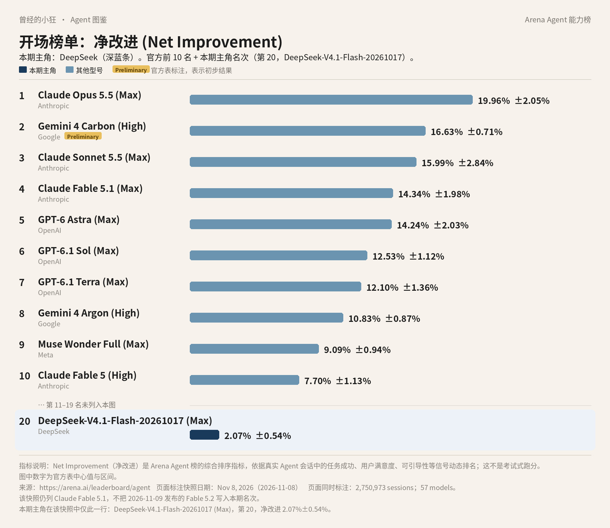
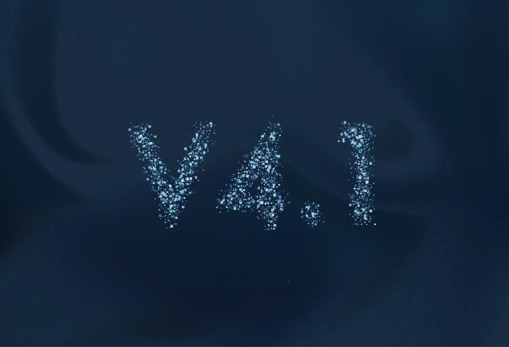
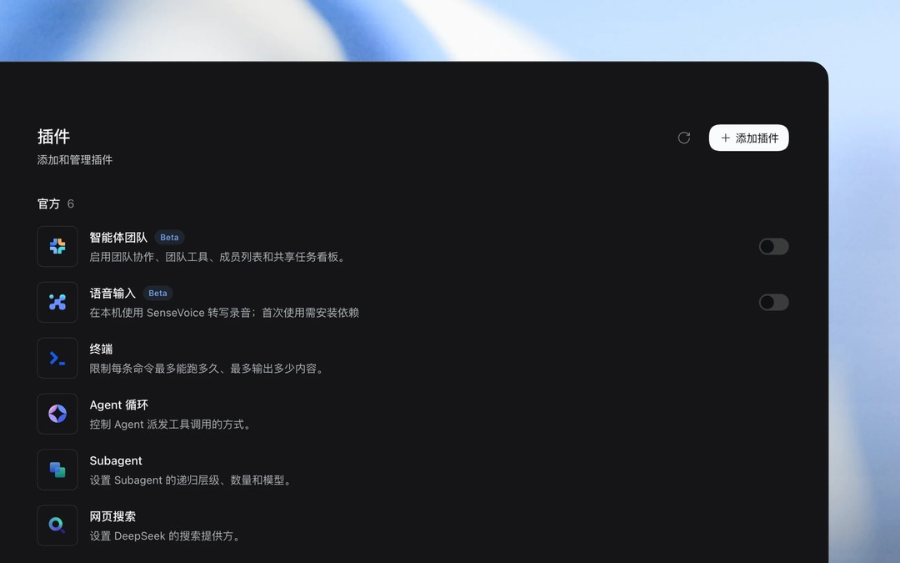
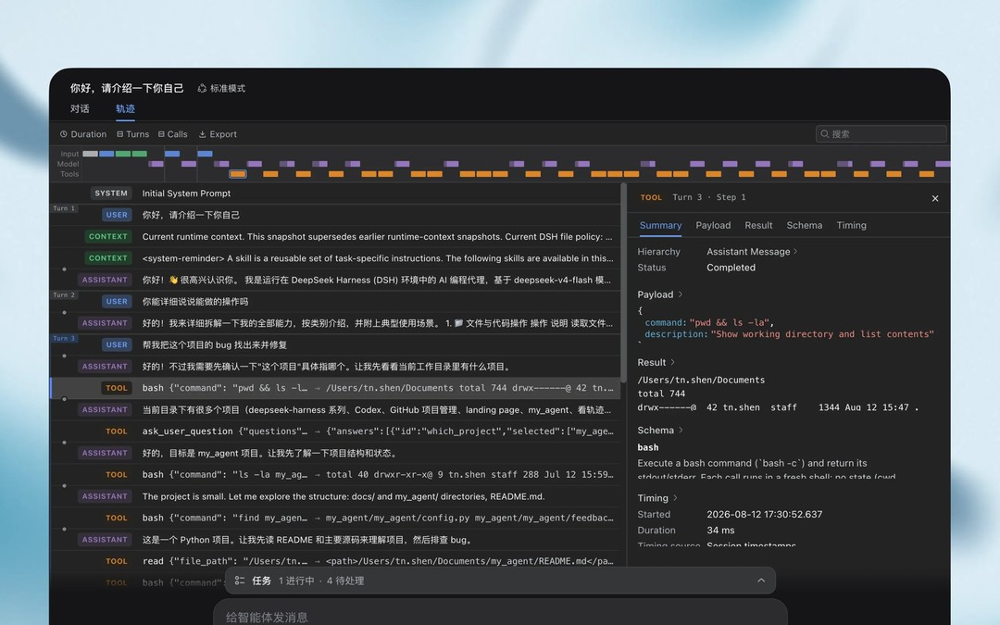

# 成稿包：《Agent 图鉴》第 12 篇 · DeepSeek / 深度求索

> 据官方资料与 Arena Agent 榜 2026 年 11 月 8 日快照整理。署名：刀哥。合集：Agent 与大模型。

---

## 标题备选

1. 【建议主标题】榜上只有一行：DeepSeek 的 Flash、Pro 和 Harness
2. 第 20 名是 Flash：DeepSeek 现在怎么用、调用怎么计价
3. V4-Pro 还在，消费订阅未标价：把 DeepSeek 这一版说清楚

---

## 作者

刀哥

---

## 一句摘要

在 2026 年 11 月 8 日这份 Arena Agent 综合榜快照里，DeepSeek 只有一行：第 20 名 DeepSeek-V4.1-Flash-20261017 (Max)，净改进 2.07%±0.54%。日常聊天走网页或官方 App；连续做事看 DeepSeek Harness；调用按美元峰谷计价。V4-Pro 仍单独提供，但不支持视觉。消费端订阅价未在首页印出。

---

## 完整正文

曾经的小狂  ·  Agent 图鉴 第 12 篇

# 榜上只有一行：DeepSeek 的 Flash、Pro 和 Harness

到这一篇，连载快收尾了。DeepSeek 你大概不陌生：网页能打开，App 也能下，很多人已经拿它聊过天、问过事。今天不把它写成一部通史，只把 2026 年秋天这一版说清楚：榜上现在站着哪一行，Flash 和 Pro 是什么关系，想连续做事该走哪扇门，调用又怎么计费。

还是先看全系列同一张榜。Arena 的 Agent 综合榜，指标叫「净改进」，看真实会话里一个助手把事情做完之后，综合表现到底好了多少。2026 年 11 月 8 日这份快照，记了 2,750,973 场会话、57 个模型。数据来自 arena.ai/leaderboard/agent。第 2 名 Gemini 4 Carbon (High) 带官方 Preliminary 标注，表示初步结果。Claude Fable 5.2 未进入本期快照。

*全球 Agent 前十，并在表下加出第 20 名 DeepSeek-V4.1-Flash-20261017 (Max)（Arena Agent 榜 · 净改进，2026 年 11 月 8 日快照）。该行净改进为 2.07%±0.54%。数据来源：arena.ai/leaderboard/agent。Fable 5.2 未进入本期快照。本快照仅此一行 DeepSeek。*

前十里没有 DeepSeek。图在表下加的那一行，是这份快照里它唯一的一行：第 20 名 DeepSeek-V4.1-Flash-20261017 (Max)，净改进 2.07%±0.54%。没有单独的 V4 非 Flash，也没有 R2 出现在这期表上。第 20 名只是这个指标在这份快照里的位置，不是购买资格，也不是考试分数。

这一行还带了 20261017 这个日期，对应 2026 年 10 月 17 日那次更新。会话数是 78,504。官方把 V4.1 Flash 写成新结构系列里最小的一款，这份榜上出现的也正是它。它在榜上，并不自动等于「最小的反而全面超过 Pro」。官方在发布博客里主张，Flash 在一些基准上超越包括 V4 Pro 在内的旗舰，那是公司自己的表述；Arena 这份快照里并没有单独列出 V4 Pro，也就无从在这张表上比较两者。

## 聊天入口你大概已经见过

出品方是杭州深度求索人工智能基础技术研究有限公司，官网是 www.deepseek.com。普通人打开网页版，或到 download.deepseek.com 下载官方 App，就可以对话、使用深度思考和智能搜索。这是一家中国公司，中文官网在，国内的 ICP 和经营许可信息也在，网页与 App 对国内用户是正式入口。不要把它写成「无法在中国使用」。海外应用商店是否上下架，官方页没有写成一句总规则，这里也不自行断言。

官网头条写：DeepSeek V4.1 Flash 现已更新至 V4.1-Flash-1017 版本，项目开发能力提升显著，更低成本、更快速度完成任务；新增 API 支持网页搜索与抓取。

消费端网页和 App 是否收费、有没有会员档，官网首页没有印出消费订阅价。不要按传闻去写免费额度。能打开网页或装上官方 App，只说明入口在；有没有会员档，仍以账户里当时的说明为准。

## Flash 是小的那款，Pro 还在

当前主更新是 DeepSeek-V4.1-Flash-1017，API 名是 deepseek-flash。2026 年 10 月 17 日的更新日志宣布了这次升级，网页端与 App 已同步，调用方式和价格不变。旧的调用名 deepseek-v4-flash、deepseek-v4-flash-vision-exp 会路由到 V4.1 Flash，并按 Flash 的价格计。

2026 年 9 月 10 日的发布博客标题是「DeepSeek V4.1 Flash：更强、更快、更普惠」。官方称，这是新模型结构系列中最小尺寸的那一款，具备原生多模态视觉理解。公司技术说明里的结构是：5520 亿参数的 MoE，也就是混合专家模型，官方写作 Causal-Encoder-Decoder，输入激活 80 亿、输出激活 160 亿。混合专家的大意是：不是每一次推理都把全部参数用上，而是按需要激活其中一部分。官方还称，在基准测试中超越包括 DeepSeek V4 Pro 在内的多款旗舰。这是公司主张，不是这份 Arena 榜的结论。

*DeepSeek V4.1 Flash 发布博客题图。图片来源：deepseek.com/news/deepseek-v4-1-flash*

另一件容易记错的事：DeepSeek-V4-Pro 并没有从定价页上消失。API 名是 deepseek-v4-pro，定价页版本写作 DeepSeek-V4-Pro-0813，上下文同样是 1M，最大输出 384K。官方对比表写明：它不支持 Vision。2026 年 9 月 10 日的更新日志说，应要求在 9 月 14 日后继续提供 V4 Pro API，「计费方式保持不变；如有变动将另行通知」。不要再用「已经全部路由到 Flash」那种过时理解。那只是 9 月 10 日博客里一度宣布、随后又在更新日志里改口的方案。对接时以定价页和更新日志的现行写法为准。

两个模型都支持非思考和思考，默认是思考。官方定价页还列出 JSON、Tool Calls、Responses API、Anthropic API、Chat Prefix Completion（Beta）；FIM 只在非思考模式里提供。Flash 有 Vision，Pro 没有。1M 上下文，可以先理解成一次能「看进去」的内容可以非常长；384K 则是一次最多能写出多长。

思考和非思考，也可以先说成两种用法。思考，是先花更多步骤把问题想清楚再答，官方把这一档设为默认；非思考，是更直接地给出结果。FIM 只在非思考模式里提供，可以先理解成：根据前后已有的代码或文本，去补中间缺的那一段。不常用到补全的人，不必一上来就记这个缩写。

开发者可以走 api.deepseek.com（OpenAI 格式），或 api.deepseek.com/anthropic，模型名用 deepseek-flash 或 deepseek-v4-pro。另外还有独立的 Search / Fetch API。官方还提到，合作伙伴 WorkBuddy（含 CodeBuddy）与 OpenCode 已接入 V4.1 Flash。

选型号时可以先记三句。只是聊天、看图、在网页或 App 里问事，走消费端即可，当前主更新就是 V4.1-Flash-1017。在自己的产品里调用，走 API，模型名写 deepseek-flash 或 deepseek-v4-pro。若任务需要视觉，按官方对比表应选 Flash；若你明确要继续用 V4 Pro 的 API，它仍在，只是没有 Vision，计费也按 Pro 自己的价。旧调用名会被路由到 Flash，并按 Flash 价计，不要靠旧名字去调用 Pro。

## 要把事情连续做完，看 Harness

聊天是消费端最熟的入口。若想把模型接到本地工作区，做成可扩展的 Agent，官方给出的是 DeepSeek Harness。产品页把它写成开源、开放测试的 Agent 运行框架，口号是「一切皆插件」，技术上基于 Cordis。可以是桌面应用，也可以作为网页启动。面向日常工作、写代码、查证资料、后台任务，以及安装或由对话生成插件。它仍是预览版，核心插件与基础 API 会持续迭代。官网推荐配合 V4.1-Flash-1017 使用 Harness 0.2.1-rc.1 或以上。站点是 www.deepseek.com/harness/，代码仓库是 github.com/deepseek-ai/deepseek-harness。

*DeepSeek Harness 产品页配图：插件管理页面，列出官方插件和添加插件的入口。图片来源：deepseek.com/harness*

「一切皆插件」可以先理解成：主程序本身是一个架子，能力和工具以插件的方式装上去，也可以在对话里生成。预览版的意思是，它还在迭代，官方自己也写了核心插件和基础 API 会继续改。重要结果仍要你自己看过，不要默认预览版已经能代替你做完所有步骤。

产品页的演示和说明里，出现过文档处理、表格、写代码、搜索查证、定时任务、插件扩展、子 Agent 等能力。这些是产品说明，并非实测。

*DeepSeek Harness 产品页配图：运行轨迹视图，显示时间线、工具调用记录和执行详情。图片来源：deepseek.com/harness*

公司在 2026 年 10 月 17 日的更新中，报告过一组基准，板名包括 HLE、Terminal-Bench 4.0、DeepSWE v1.1 等，并写明了部分测试所用的工具和 harness：例如 Terminal-Bench 4.0 用的是 Claude Code，DeepSWE 用的是 Mini-SWE-V2。引用这些时，要带上日期、板名、是否用工具、用了哪套 harness，并标明是 DeepSeek 官方报告。

V4.1 Flash 的发布博客曾谈开源与推理适配，并欢迎大规模部署联系。1017 这次更新是否已经放出权重，本次没有确认，不写成已经开源完毕。

## 调用按峰谷计价

API 文档以美元 / 百万 tokens 标价，而且分闲时和高峰。闲时是高峰的一半。高峰时段按官方写法是：UTC 周一至周五 01:00 至 04:00，以及 06:00 至 10:00，中国法定节假日除外；其余时间为闲时，包括周末，以及中国法定节假日全天。换到北京时间（UTC+8），就是周一至周五 09:00 至 12:00，以及 14:00 至 18:00 为高峰，同样不包括中国法定节假日。token 仍是计费单位，可以先理解成「用了多少文字量」。

同一条调用，闲时按高峰一半计。对 deepseek-flash 来说，输出价就是闲时每百万 tokens 0.60 美元，高峰 1.20 美元；缓存命中还会再低一截。规划大批量调用时，把时区看清楚，比只记「晚上更便宜」要稳妥。高峰落在北京时间工作日的上午和下午各一段，并不是所有夜晚都自动算闲时，也不是所有白天都算高峰。

具体价目是：deepseek-flash 缓存命中闲时 0.003 美元、高峰 0.006 美元；缓存未命中闲时 0.15 美元、高峰 0.30 美元；输出闲时 0.60 美元、高峰 1.20 美元；并发上限 2500。deepseek-v4-pro 缓存命中闲时 0.022 美元、高峰 0.044 美元；缓存未命中闲时 0.66 美元、高峰 1.32 美元；输出闲时 1.98 美元、高峰 3.96 美元；并发上限 500。Search 和 Fetch 是每 1,000 次成功请求 0.75 美元。

Search 和 Fetch 是另一笔账，按每 1,000 次成功请求计，不并进上面那张按百万 tokens 计的表。网页端的智能搜索，和 API 里的搜索、抓取，不要自动看成同一套开关，细节以接口文档为准。

官网有透明度中心和漏洞反馈入口，细节要点开对应页面再引用，这里不展开。

把这一篇收束一下：同一份榜上，DeepSeek 现在只有 Flash 这一行，排在第 20。日常聊天走网页或官方 App；要把模型接到工作区里连续做事，看 DeepSeek Harness；开发者调用走 API，价格按峰谷算。V4-Pro 仍单独提供，只是没有视觉能力。消费端有没有订阅档，首页没有印出来。

《Agent 图鉴》写到第 12 篇，这一辑就收在这里。产品会改价、改默认模型、改入口名字。你要开通或调用前，再打开官网和定价页看一眼。

---

## 配图清单（本轮新增正文配图，2026-11-11）

- `images/02-deepseek-v4-1-flash.jpg`（官方图）：放在正文「2026 年 9 月 10 日的发布博客标题是…」一段之后。图注：DeepSeek V4.1 Flash 发布博客题图。图片来源：deepseek.com/news/deepseek-v4-1-flash 来源：页面 https://www.deepseek.com/news/deepseek-v4-1-flash/；原图 https://www.deepseek.com/images/blog/deepseek-v4-1-flash/cover.webp。
- `images/03-deepseek-harness-plugins.jpg`（官方图）：放在正文「聊天是消费端最熟的入口…」一段之后。图注：DeepSeek Harness 产品页配图：插件管理页面，列出官方插件和添加插件的入口。图片来源：deepseek.com/harness 来源：页面 https://www.deepseek.com/harness/；原图 https://www.deepseek.com/harness/images/feat-plugins-zh.webp。
- `images/04-deepseek-harness-trace.jpg`（官方图）：放在正文「产品页的演示和说明里…」一段之后。图注：DeepSeek Harness 产品页配图：运行轨迹视图，显示时间线、工具调用记录和执行详情。图片来源：deepseek.com/harness 来源：页面 https://www.deepseek.com/harness/；原图 https://www.deepseek.com/harness/images/feat-trace-zh.webp。
- `images/01-arena-agent-top10-deepseek.jpg`：本轮重绘。数据与比例不变，长名称行把条形下移一行，「DeepSeek-V4.1-Flash-20261017 (Max)」标签不再被深色条遮挡。

## 来源清单

- https://arena.ai/leaderboard/agent
- https://arena.ai/blog/agent-arena-methodology
- https://www.deepseek.com/
- https://www.deepseek.com/news/deepseek-v4-1-flash/
- https://api-docs.deepseek.com/quick_start/pricing/
- https://api-docs.deepseek.com/zh-cn/updates.md
- https://www.deepseek.com/harness/
- https://www.deepseek.com/download/
- https://www.deepseek.com/transparency/
- https://github.com/deepseek-ai/deepseek-harness

---

## 事实空缺（审稿用，不进入公众号正文）

- 消费端网页、App 是否收费，以及有无会员档：官网首页未印出消费订阅价，正文未写会员价。不要编造免费额度。
- V4.1-Flash-1017 更新是否已放出模型权重：已查阅材料未确认，正文未写成已经放出。
- 2026 年 10 月 17 日更新中报告的基准分数：简报只列出板名和所用 harness，未给出具体分数，正文不补数字。
- 思考强度档位 low / high / max 是否仍适用于 V4.1 Flash：简报要求按当期文档确认，正文只写非思考与思考（默认思考）。
- 海外网络或应用商店上下架情况：官方未写成总规则，正文不自行断言。

## 本轮改动记录（2026-11-11，补图单 + 修改单）

- 删除署名：article.html 末尾「署名：刀哥」一行已删；md 完整正文标题下的署名行「刀哥」与正文末尾「署名：刀哥」已删（文件头元信息与「作者」一节保留）。
- 新增正文配图 3 张，位置与图注见配图清单；文中对应位置以 Markdown 图片加斜体图注标出。
- 开场榜图 01 重绘，只改版式，数据不变。
- 过程话 #12-1（整句删除）：原句「这里不把未写明的分数补上去。」→ 删除。
- 过程话 #12-2（整句删除「这里不编。」）：原句「首页没有印出来，这里不编。」→ 新句「首页没有印出来。」。
- 过程话 #12-3（口径句改写）：原句「这些是产品说明，不是我的实测。」→ 新句「这些是产品说明，并非实测。」。
