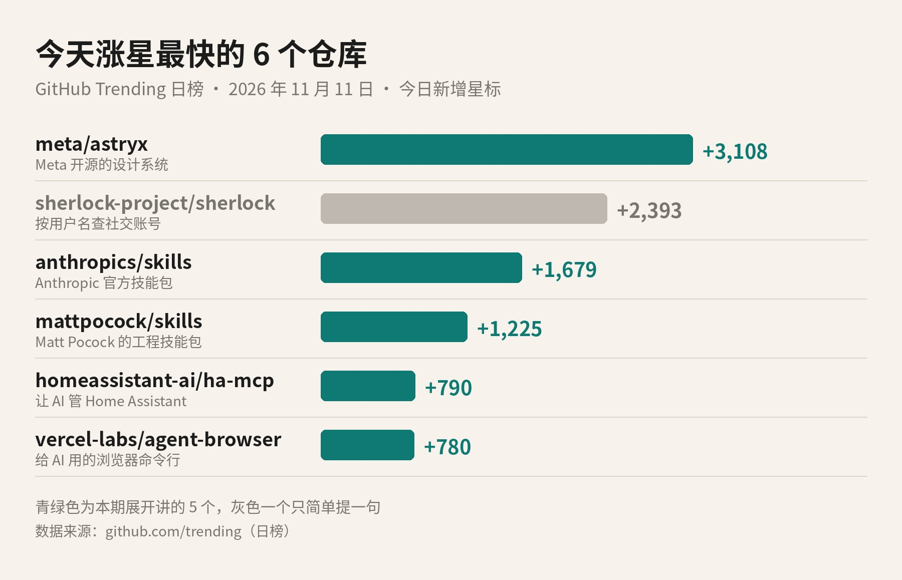
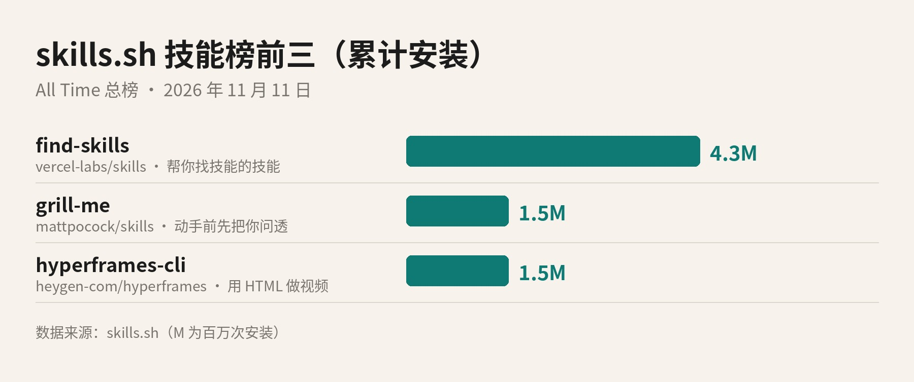

# 2026-11-11 GitHub 热门日报

## 标题备选

1. Meta 把用了八年的设计系统开源了，一天涨了 3,108 颗星
2. 今天 GitHub 上很火的，是一堆写给 AI 看的说明书
3. GitHub 热门日报：Meta 开源 Astryx，技能包继续霸榜

## 正文

今天 GitHub 上涨星最快的项目，来自 Meta。一个叫 Astryx 的仓库，一天多了 3,108 颗星。

更有意思的是跟在它后面的几位。好几个都不是给人直接用的软件，而是写给 AI 看的「说明书」，或者递给 AI 的工具。今天就挑 5 个，加上技能榜前三，一个一个讲。

*GitHub Trending 日榜 · 今日新增星标。青绿色为本期展开讲的 5 个。数据来源：github.com/trending*

### 先把几个词说清楚

GitHub，你可以理解成程序员放代码的地方，有点像代码界的网盘加朋友圈。每个项目叫一个「仓库」。看到喜欢的仓库，可以点一下 Star，也就是星标，差不多等于收藏加点赞。

GitHub 自己有一张热门榜，叫 Trending。日榜上每个项目旁边都写着「今天新增了多少颗星」。这张榜的排序规则官方没公开，也不完全按涨星多少排，所以上面那张图，我是按「今日新增」这一栏重新排的。

还有一个今天会反复出现的词：Agent。说白了就是会动手的 AI。它不只陪你聊天，还能读代码、改文件、开网页、调用工具，一步一步把事情做完。今天榜上这一串项目，几乎都在围着它转。

### 第一名：Meta 的设计系统 Astryx

先说「设计系统」是啥。做网页或者 App 的时候，按钮、输入框、表格、弹窗、配色、字号，这些东西每个页面都要用。设计系统就是把它们提前做成一整套现成的零件，再配上规矩，谁来搭页面，拼出来的风格都统一。

Astryx 的 README 里说，这套东西在 Meta 内部长了八年，是公司里用得最多、规模最大的设计系统，撑起了 13,000 多个应用。现在它开源出来，有 150 多个组件，带品牌主题、深色模式、现成模板，还有一个命令行工具。它基于 React 19 和 StyleX，目前还标着 Beta，也就是测试版。

它最想让人记住的一点，是**人和 Agent 用同一套**。官方的说法是：接口、文档和命令行是一起设计的，人和 AI 助手按同一份参考来搭界面。以后你让 AI 帮你写页面，它查的说明，就是你自己查的那一份。

许可证是 MIT，主要语言是 TypeScript。许可证就是这份代码的使用规矩，MIT 属于很宽松的一种，个人和商用都可以，保留原来的版权声明就行。

### 第三、四名：两个「技能包」仓库

跳过灰色那条，先讲第三、第四名，因为它俩是同一类东西：Skill，我叫它技能包。

技能包其实就是一个文件夹。里面放一份叫 SKILL.md 的说明，写清楚这件事该怎么做，有时再配几个脚本和素材。AI 遇到对口的活，就把这份说明翻出来照着做。你可以把它想成给新同事准备的操作手册：手册写得好，新人第一天就能上手。

第三名是 anthropics/skills，Anthropic 官方的技能包仓库，今天涨了 1,679 颗星，总星数已经 19 万多。里面有做设计、写音乐这类偏创意的，有测试网页、搭 MCP 服务器这类偏技术的，也有写公司通稿、套品牌规范这类办公用的。Claude 处理 Word、PDF、PPT、Excel 文件时背后用的那几个技能，也放在里面当参考。

这个仓库整体没有挂统一的许可证标签。README 里说，其中很多技能是 Apache 2.0 开源的，具体以每个文件夹为准。它还专门写了一句免责：这些技能是拿来演示和学习的，用在要紧的事情上之前，先在自己的环境里测一遍。

第四名是 mattpocock/skills，作者 Matt Pocock，今天涨了 1,225 颗星。仓库的名字很直白：Skills for Real Engineers，给真正写工程的人用的技能。他说这些是自己每天干活在用的，而且特意强调不是 vibe coding，也就是那种凭感觉让 AI 随便写的写法。许可证是 MIT。

他最受欢迎的一个技能叫 grill-me，直译是「拷问我」。用法是：动手之前，先让 AI 把你问个底朝天，一轮一轮问清楚你到底想做什么，每个问题还附上它建议的答案。作者的判断是，AI 干活跑偏，最常见的原因是双方没对齐。这套技能 Claude Code、Codex、GitHub Copilot、Gemini CLI 都能装，其他工具也可以用后面要讲的 npx skills 来装。

### 第五名：让 AI 帮你管智能家居的 ha-mcp

这一个要先认识两个名字。Home Assistant 是一个开源的智能家居中控，能把灯、空调、窗帘、各种传感器接到一个地方统一管。MCP 全称 Model Context Protocol，官方把它比作 AI 应用的 USB-C 接口：一种公开标准，让 AI 能用统一的方式接上外部的系统和工具。

homeassistant-ai/ha-mcp 就是这样一个接口。装上以后，Claude、ChatGPT 这类 AI 助手就能帮你配置 Home Assistant、写自动化规则。比如你说一句「晚上十点以后有人走过走廊，就把灯调暗」，让它去设置。它今天涨了 790 颗星，许可证 MIT，主要语言是 Python，README 上的徽章写着一共 87 个工具。

安装要 Home Assistant 2026.8 或更新的版本，通过 HACS 装。HACS 是 Home Assistant 社区的插件商店。到了 2026.11 版，可以直接在设置里的 Marketplace 搜 HA-MCP。

有一点值得多看一眼。它要用管理员权限来动你家的设备，README 给了两种做法，更稳妥的一种是**单独给它建一个管理员账号，只允许本地访问**。它还特意提醒，走这条路时别把你自己的账号密码填进去。家里的门锁和摄像头也接在上面的话，这一步别省。

### 第六名：给 AI 用的浏览器 agent-browser

vercel-labs/agent-browser 来自 Vercel Labs，今天涨了 780 颗星。它是一个命令行工具，给 AI 一个能一条命令一条命令操控的浏览器。

它的思路很朴素。AI 先跑一次 snapshot，拿到一份精简的文字版页面，每个按钮、链接都带一个编号，比如 @e1。AI 想点哪个，就说点哪个编号，点完再看一眼页面确认结果，然后接着下一步。浏览器在命令之间一直开着，所以每一步都只是一条很短的命令。

它用 Rust 写成，许可证是 Apache-2.0，默认用的是 Chrome for Testing，也就是谷歌给自动化测试准备的那版 Chrome。它在下面要讲的技能榜上也排第四，累计安装 150 万次。

顺带说一句灰色那条。第二名 sherlock 是个 2018 年就有的老项目，输入一个用户名，它去 400 多个社交网站帮你查有没有这个账号，今天涨了 2,393 颗星。它跟 AI 关系不大，这期就不展开了。

### 技能榜前三：skills.sh

刚才说了技能包，那去哪儿找技能包？有个网站叫 skills.sh，首页自称开放的 Agent 技能生态。上面的技能，一行命令 npx skills add 就能装进你的 AI 工具里。它的总榜按累计安装次数排，今天前三名和昨天一样。

*skills.sh All Time 总榜前三，按累计安装次数。数据来源：skills.sh*

第一名 find-skills，430 万次安装，来自 vercel-labs/skills。它是一个「帮你找技能的技能」：你问 AI「这件事怎么做」「有没有现成的技能」，它就去技能库里搜，找到了再帮你装。vercel-labs/skills 这个仓库本身，就是那条 npx skills 命令，README 写着支持 OpenCode、Claude Code、Codex、Cursor，另外还有 75 个工具。许可证 MIT，用 TypeScript 写。

第二名 grill-me，150 万次，就是上面 Matt Pocock 那个「先把你问透」。一个今天涨星第四的仓库，同时在技能榜排第二，装的人确实不少。

第三名 hyperframes-cli，也是 150 万次，来自 HeyGen 的 heygen-com/hyperframes。HyperFrames 是一个免费开源的框架，把 HTML、CSS、图片音视频素材和动画，渲染成 MP4 视频。这个技能教 AI 怎么用它的命令行：新建项目、预览、调时间线、本地或云端渲染。仓库许可证 Apache-2.0，主要语言 TypeScript。它的技能说明里写着，启动时会发一条使用统计，可以关掉，介意的话装之前看一眼。

### 如果只记三句

第一，今天涨星第一的是 Meta 开源的设计系统 Astryx，一天 3,108 颗星，主打人和 AI 用同一套零件搭界面。

第二，技能包还在热。Anthropic 官方的 anthropics/skills 和 Matt Pocock 的 mattpocock/skills 一起进了今天涨星前四，skills.sh 总榜前三也没变。

第三，把 AI 接进浏览器、接进智能家居的工具，也在往上走。**权限给多大，你自己定。**

开源项目更新很快，装之前，还是打开它的 GitHub 页面，看一眼最新的 README。

署名：刀哥

## 来源清单

- https://github.com/trending?since=daily
- https://github.com/meta/astryx
- https://astryx.atmeta.com
- https://github.com/anthropics/skills
- https://github.com/mattpocock/skills
- https://github.com/homeassistant-ai/ha-mcp
- https://modelcontextprotocol.io/docs/getting-started/intro
- https://github.com/vercel-labs/agent-browser
- https://skills.sh/
- https://github.com/vercel-labs/skills
- https://github.com/heygen-com/hyperframes
- https://github.com/sherlock-project/sherlock
