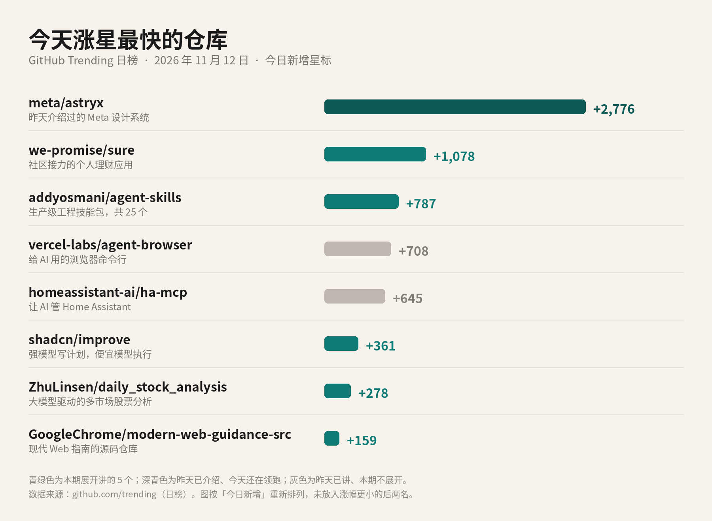
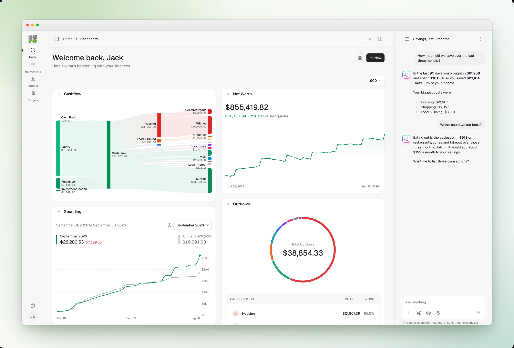
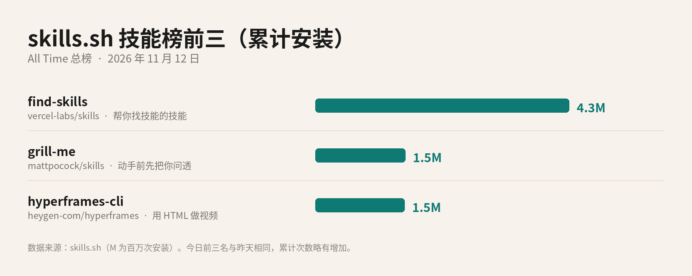

# 2026-11-12 GitHub 热门日报

## 标题备选

1. 一个停更的理财应用，被社区接力回来了，今天涨了 1,078 颗星
2. 今天 GitHub 上，除了继续领跑的 Astryx，还有这 5 个新面孔
3. GitHub 热门日报：Sure 一天涨 1,078 星，技能包又有新玩法

## 正文

昨天领跑的 Meta 设计系统 Astryx，今天还在第一。仓库一天又多了 2,776 颗星，总星数到了约 2.5 万。它的来历昨天讲过，今天不再展开。

更值得看的是后面冒出来的新面孔。一个社区接力的理财应用一天涨了 1,078 颗星；技能包这边，也有两套新的用法。今天就挑 5 个还没细说过的，加上技能榜前三，接着讲。

*GitHub Trending 日榜 · 今日新增星标。青绿色为本期展开讲的 5 个；深青色是昨天介绍过、今天还在领跑的 Astryx；灰色是昨天已讲、本期不重复展开的。数据来源：github.com/trending*

GitHub 日榜的排序规则官方没公开，也不完全按涨星多少排，所以上面这张图，我还是按「今日新增」这一栏重新排的。

### 涨星第二：社区接力的理财应用 Sure

今天涨星第二的，不是又一个技能包，而是一个给人用的理财应用，叫 Sure，仓库是 we-promise/sure，一天涨了 1,078 颗星。

它的前身叫 Maybe Finance。社区这份 README 里写，原团队在 2021 到 2022 年做了一款个人理财和财富管理应用，中间还一度做过付费托管。后来生意没走通，2023 年年中停了开发，接着把代码开源。官方仓库后来也停更了。现在这个 Sure，就是社区把它叉出来继续养的版本，网站在 sure.am。

它能看现金流、净资产和花销，也可以自己用 Docker 搭一套，在浏览器、桌面端、手机端用，还留了给接口和 AI 助手接的口子。

许可证是 AGPLv3，比常见的 MIT 要严一些。简单说：你可以免费用、也可以改，但如果改完之后拿去给别人在网上用，一般也要把改过的源码公开。名字这边有个注意：Maybe 是原公司的商标，所以这个社区版本改叫 Sure，分叉时也不能再用 Maybe 这个名字和原来的标识。

*Sure 官方 README 中的控制台截图，展示的是演示数据。来源：github.com/we-promise/sure*

家里的账单和账户会进这套系统，自己搭的话，把数据放在自己能管住的地方更稳妥。

### 涨星第三：Addy Osmani 的 25 个工程技能

addyosmani/agent-skills 今天涨了 787 颗星，总星数约 11.6 万。作者是 Addy Osmani，这组技能包的定位写得很清楚：给 AI 编码助手用的生产级工程技能。

整包一共 25 个技能，其中 9 个斜杠命令按开发流程排好：先把需求问清楚，再写说明、拆计划、写代码、跑测试、做审查，最后发布。命令分别是 /spec、/plan、/build、/test、/constraints、/review、/webperf、/code-simplify、/ship。仓库还写了一个 /build auto：计划你点头一次，后面的任务就按测试驱动的方式接着做完，遇到失败或风险步骤会停下来。

安装用那条常见的 npx skills add addyosmani/agent-skills。README 写着能装进 70 多种支持这一格式的 AI 工具，包括 Claude Code、Cursor、Codex、GitHub Copilot、Cline。许可证是 MIT，主要语言是 JavaScript。项目主页在 skills.addy.ie。

### 让最强模型只负责想，便宜模型去干活：shadcn/improve

做 shadcn/ui 的那位 shadcn，也放了一个技能包，仓库就叫 improve，今天涨了 361 颗星。

它的想法很干脆：把最费脑子的活留给最强的模型——看懂代码库、判断哪些值得做、写出说明；真正改代码，交给更便宜的模型。**这个技能自己不动你的源代码，它的产品就是一份份计划。**

用法是在项目里跑 /improve。它会把仓库摸一遍，从正确性、安全、性能、测试、技术债等 9 个方向查出问题，列成一张表，你点哪些，它就做成计划。每份计划会写进 plans/ 目录，里面带上具体文件路径、现在的代码摘录、用什么命令验收，以及不对的时候该停下来的条件。你可以把计划交给别的 AI 去执行，也可以用 /improve execute 让它派一个便宜模型，在一份隔离的工作副本里改，改完再对照计划验收。合不合并，还是你说了算。

安装同样是 npx skills add shadcn/improve，许可证 MIT。

### 用大模型给自选股出每日看板：daily_stock_analysis

ZhuLinsen/daily_stock_analysis 今天涨了 278 颗星，总星数已经约 7 万。它是一个用大模型做股票分析的系统，覆盖 A 股、港股、美股，以及日股、韩股、台股和 ETF，每天自动生成「决策仪表盘」，并能推到企业微信、飞书、Telegram、Discord、Slack 或邮箱。

官方推荐的用法，是把仓库 Fork 到自己的 GitHub 账号下，用 GitHub Actions 定时跑。README 写着这样不用自己买服务器，五分钟就能部署。这也是它分叉数量特别多的原因之一，目前叉出去的副本有约 5.7 万个。要跑起来，至少得自己配一个大模型的 API Key，模型调用本身通常不是免费的。也可以在本地或用 Docker 部署。主要语言是 Python，许可证 MIT。

有一句必须说清楚。仓库自己的免责声明写了：这个项目只供学习和研究，不构成任何投资建议。大模型生成的买卖点、评分和风险提示，不能当成下单依据。

### 浏览器厂商给 AI 写的现代 Web 指南

今天榜上还有一个来头不小的源码仓库：GoogleChrome/modern-web-guidance-src，一天涨了 159 颗星。它是 Modern Web Guidance 的源码和生产仓库，对外给大家装的是 GoogleChrome/modern-web-guidance，文档在 Chrome 开发者网站上。

这套东西由 Chrome、Edge、Firefox 和 MDN 团队一起维护，也面向社区投稿。要解决的问题很具体：编码用的 AI 经常写出过时的写法，因为训练数据里全是旧代码；很多现在浏览器已经原生支持的能力，它还在用又厚又老的办法实现。

这套指南覆盖 250 项现代 Web 能力，包括视图转场、容器查询、原生对话框，以及无障碍和性能相关的接口。装好之后，可以用命令行搜索指南、按编号取说明，也可以扫一遍代码里的旧写法。安装命令是 npx modern-web-guidance@latest install。代码许可证是 Apache-2.0，指南内容是 CC-BY 4.0。

它会收集匿名使用信息，用来改进工具，包括安装次数、调用它的 AI 名称、取了哪条指南，以及 AI 发出的搜索词，不会收集你的原始提问。不想被统计的话，把环境变量 DISABLE_TELEMETRY 设成 1 即可。

### 技能榜前三：还是昨天那三位

技能包去哪儿找，还是那个 skills.sh。总榜按累计安装次数排，今天前三名和昨天一样，只是数字又涨了一点。

*skills.sh All Time 总榜前三，按累计安装次数。数据来源：skills.sh*

第一名还是 find-skills，约 432 万次，来自 vercel-labs/skills，帮你在技能库里搜索并安装。第二名 grill-me，约 154 万次，是 Matt Pocock 那个「动手前先把你问透」。第三名 hyperframes-cli，约 152 万次，教 AI 用 HeyGen 的 HyperFrames 把网页和素材渲成视频。

### 如果只记三句

第一，Astryx 今天还在领跑，又加了 2,776 颗星。新面孔里涨得最快的是社区接力的理财应用 Sure，一天 1,078 颗星。

第二，技能包还在出新玩法。Addy Osmani 的 25 个工程技能按开发流程排好了命令；shadcn 的 improve 则让最强模型只负责写计划，便宜模型去执行。

第三，用大模型做股票分析的项目很热闹，但仓库自己也写了：只供学习研究，不构成投资建议。**别把生成的买卖点直接拿去下单。**

开源项目更新很快，装之前，还是打开它的 GitHub 页面，看一眼最新的 README。

署名：刀哥

## 来源清单

- https://github.com/trending?since=daily
- https://github.com/meta/astryx
- https://github.com/we-promise/sure
- https://sure.am
- https://github.com/addyosmani/agent-skills
- https://skills.addy.ie
- https://github.com/shadcn/improve
- https://github.com/ZhuLinsen/daily_stock_analysis
- https://github.com/GoogleChrome/modern-web-guidance-src
- https://github.com/GoogleChrome/modern-web-guidance
- https://developer.chrome.com/docs/modern-web-guidance
- https://skills.sh/
- https://github.com/vercel-labs/skills
- https://github.com/mattpocock/skills
- https://github.com/heygen-com/hyperframes
- https://github.com/vercel-labs/agent-browser
- https://github.com/homeassistant-ai/ha-mcp
