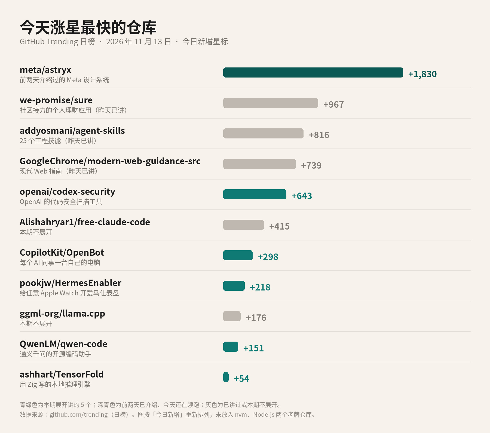
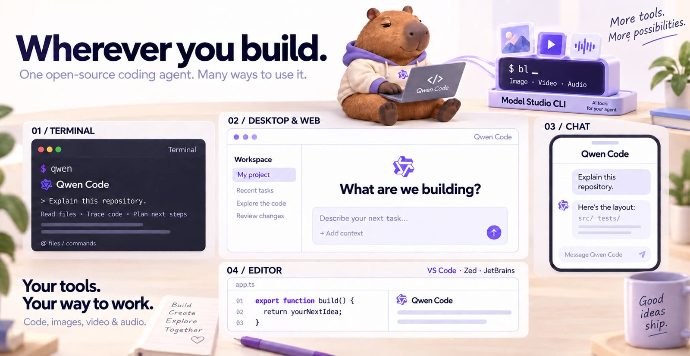
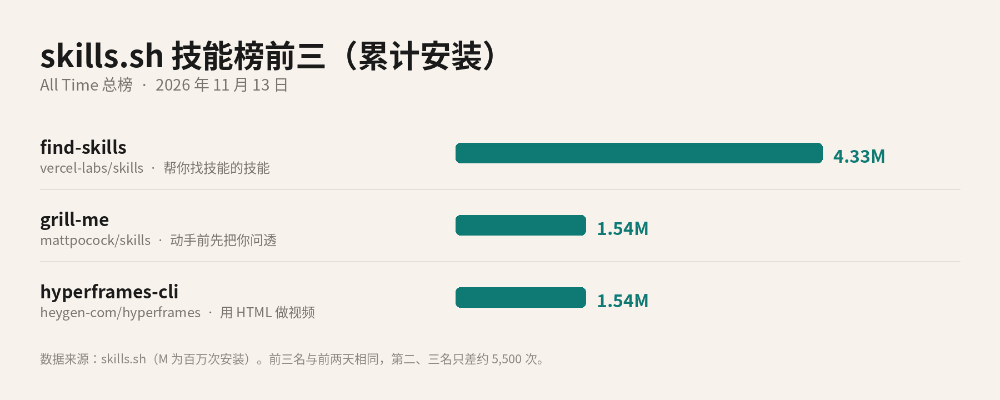

# 2026-11-13 GitHub 热门日报

## 标题备选

1. OpenAI 开源了一个找漏洞的工具，今天涨了 643 颗星
2. GitHub 热门日报：让 AI 帮你查漏洞、给 AI 同事配电脑，还有爱马仕表盘
3. 今天 GitHub 上的 5 个新面孔：从代码安全到本地跑模型

## 作者

刀哥

## 正文

Meta 的设计系统 Astryx，今天还在涨星第一，一天又多了 1,830 颗星。排在后面的 Sure、Addy Osmani 的技能包、Chrome 的现代 Web 指南，昨天都讲过了，今天不再重复。

今天往下翻，新面孔不少：OpenAI 放出来一个找漏洞的工具，有人给每个 AI 同事配了一台电脑，阿里的编码助手出了 1.0 预览版，还有一个让普通 Apple Watch 用上爱马仕表盘的小项目。挑 5 个讲讲。

*GitHub Trending 日榜 · 今日新增星标。青绿色为本期展开讲的 5 个；深青色是前两天介绍过、今天还在领跑的 Astryx；灰色是已讲过或本期不展开的。数据来源：github.com/trending*

### OpenAI 的找漏洞工具：Codex Security

openai/codex-security 今天涨了 643 颗星，总星数约 1.2 万。这是 OpenAI 官方仓库，放的是 Codex Security 的命令行工具和 TypeScript 开发包，用途就一个：帮你在代码里找安全漏洞、查清楚、再修掉。

用法有三种。在 Codex 里装上它的安全插件，直接用一句话让它扫仓库；在终端里装命令行，跑 cs scan .；或者写进自动化流程，用开发包或 GitHub Actions 在每次提交时扫。

它不只是列一串疑似问题。扫描可以只看某几个目录，也可以只看某次提交改了什么；扫完会存一份报告，写明证据和没覆盖到的范围。之后可以让它验证某个发现是不是真的、生成补丁、检查已有的修复有没有修对，还能起草 SECURITY.md 安全策略。发现的问题可以推到 Linear、Jira 或 GitHub 里跟踪。

上手要先登录，命令是 cs login；在持续集成里跑，则要配 OpenAI 的 API Key。环境要求是 Node.js 22.13 以上，以及 Python 3.10 以上。许可证 Apache-2.0。

### 每个 AI 同事一台自己的电脑：OpenBot

CopilotKit/OpenBot 今天涨了 298 颗星，总星数约 1.16 万。做它的 CopilotKit，也是 AG-UI 协议的发起方，这是一套让 AI 智能体和前端界面对话的开放协议。

OpenBot 的说法是「AI 同事」：每个 Bot 有自己的浏览器、文件和工具，像一台独立的电脑。**每一步操作执行前要先定下来，执行完会留下记录**，要往外发东西时，会停下来等你点头，你也可以随时接手。

模型可以自己选，OpenAI、Claude、Gemini，或者任何兼容 OpenAI 接口的开源模型都行；已经在别的平台上跑的智能体，也能通过 AG-UI 接进来。个人可以直接下载 Mac 或 Windows 安装包，前端和基于 Docker 的后端打包在一个应用里，不用开终端；团队可以部署在自己的 Kubernetes 上。面向企业的 OpenBot for Business 目前还在申请内测。许可证 MIT。

### 阿里的编码助手出了 1.0 预览版：Qwen Code

QwenLM/qwen-code 今天涨了 151 颗星，总星数约 3 万。它是通义千问团队的开源编码助手，最早住在终端里，现在已经扩展到编辑器插件、桌面应用、网页界面，以及 Telegram、钉钉、微信、飞书这些聊天工具里。

*Qwen Code 官方 README 中的宣传图。来源：github.com/QwenLM/qwen-code*

这次的新闻是 Qwen Code 1.0 预览版。README 写的是，1.0 把 Qoder 的智能体框架能力和 Qwen Code 合在一起开源了。Qoder 是阿里另一款 AI 编程产品。预览版在单独的分支里，目前主线的安装说明还是给正式版用的。

它自带记忆、技能、子智能体和多智能体协作，也支持 MCP。模型不绑死，OpenAI、Anthropic、Gemini 和通义千问的接口都能接，也能连本地的 Ollama 或 vLLM，用的时候还能切换。登录可以用千问的 Plus 或 Pro 订阅，也可以填自己的 API Key。许可证 Apache-2.0。

### 让普通 Apple Watch 用上爱马仕表盘：HermesEnabler

pookjw/HermesEnabler 今天涨了 218 颗星，总星数约 1,500。它做的事很简单：把原本只有爱马仕款 Apple Watch 才有的表盘，打开给其他 Apple Watch 用。

*HermesEnabler 官方 README 中的效果图。来源：github.com/pookjw/HermesEnabler*

但它不是 App Store 里的应用。要从发布页下载安装包，用 Sideloadly 这类工具侧载到 iPhone 上，再装到手表里；也可以自己用 Xcode 编译。目前只支持 watchOS 27.0 到 27.3 beta 1。

**它会改动手表的系统配置文件 MobileGestalt。**README 特别提醒：删应用之前，一定要先在应用里把备份恢复回去；每次更新要用同一个 Bundle ID 和同一个 Apple ID，不然备份可能丢。作者原话是：风险自负。主要语言是 Objective-C，许可证 MIT。

### 用 Zig 写的本地推理引擎：TensorFold

ashhart/TensorFold 今天只涨了 54 颗星，总星数约 1,900，但思路挺有意思：一个用 Zig 语言写的单文件程序，在苹果芯片和英伟达显卡上直接跑大模型，自己读模型文件、自己分词、直接调 Metal 或 CUDA，**不需要装 Python，也不需要 MLX**。

Mac 上用 Homebrew 一条命令就能装，Linux 上下载发布包即可，需要较新的英伟达驱动。跑起来之后，它对外提供和 OpenAI 一样的接口，也兼容 Anthropic Messages 接口，现有的客户端基本可以直接连。还有一个本地网页界面，可以挑模型、跑模型、聊天。

它在协作上也有点新意。仓库要求贡献者的 AI 编码助手先读一份专门写好的技能说明再动代码，并用作者另做的 Agent Traffic Control 登记要做的事，免得几个 AI 同时改同一块。许可证 Apache-2.0；模型权重各有各的许可证。

### 技能榜前三：还是那三位

skills.sh 总榜按累计安装次数排，前三名和前两天一样。

*skills.sh All Time 总榜前三，按累计安装次数。数据来源：skills.sh*

第一名 find-skills，约 433 万次，来自 vercel-labs/skills，帮你在技能库里搜索并安装。第二名 grill-me，约 154 万次，是 Matt Pocock 那个「动手前先把你问透」。第三名 hyperframes-cli，也是约 154 万次，教 AI 用 HeyGen 的 HyperFrames 把网页和素材渲成视频。第二、三名之间只差约 5,500 次，排名随时可能换。

### 如果只记三句

第一，OpenAI 开源了 Codex Security 的命令行和开发包，能扫漏洞、验证发现、生成补丁，今天涨了 643 颗星。

第二，AI 智能体正在往「有自己的电脑、每步留痕、关键处等你点头」的方向走，OpenBot 是今天榜上最典型的一个。

第三，爱马仕表盘的项目好玩，但要侧载、要改系统配置。**动手前先备份，删应用前先恢复。**

开源项目更新很快，装之前，还是打开它的 GitHub 页面，看一眼最新的 README。

## 来源清单

- https://github.com/trending?since=daily
- https://github.com/meta/astryx
- https://github.com/openai/codex-security
- https://developers.openai.com/codex/security
- https://github.com/CopilotKit/OpenBot
- https://open.bot
- https://github.com/ag-ui-protocol/ag-ui
- https://github.com/QwenLM/qwen-code
- https://github.com/QwenLM/qwen-code/tree/v1.0.0-preview
- https://qwenlm.github.io/qwen-code-docs/1.x/zh/users/overview/
- https://github.com/pookjw/HermesEnabler
- https://github.com/ashhart/TensorFold
- https://github.com/ashhart/ATC
- https://skills.sh/
- https://github.com/vercel-labs/skills
- https://github.com/mattpocock/skills
- https://github.com/heygen-com/hyperframes
