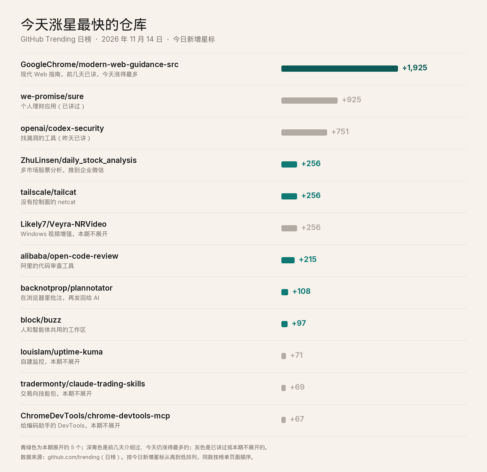
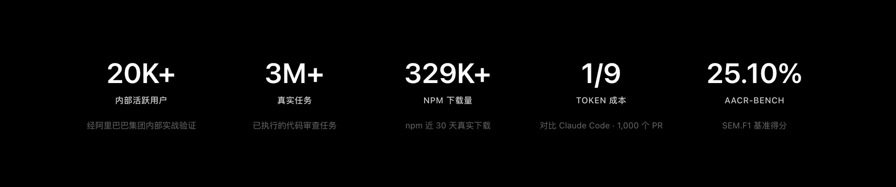
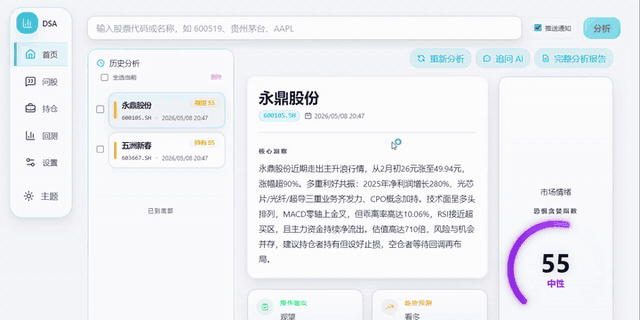
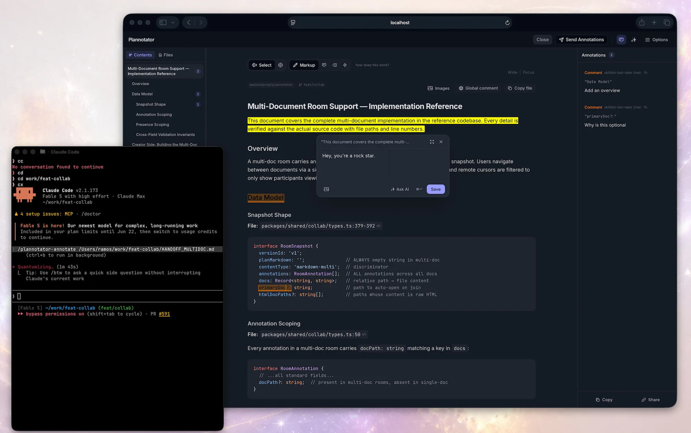
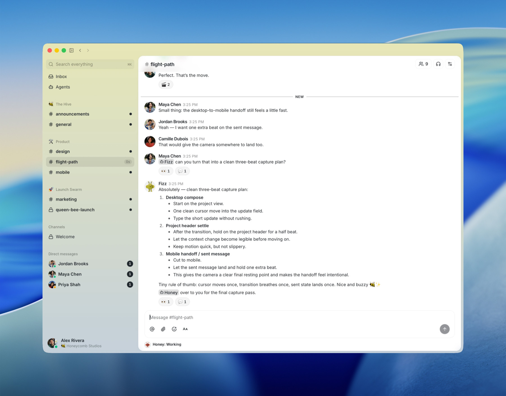
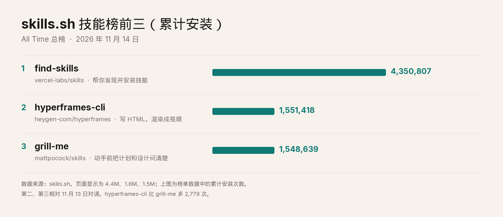

# 2026-11-14 GitHub 热门日报

## 标题备选

1. 技能榜第二和第三对调了，阿里的代码审查工具也在涨
2. GitHub 热门日报：没有账号也能加密连上，自选股分析会推到企业微信
3. 不用 Tailscale 账号，两台电脑之间也能拉一条加密隧道

## 作者

刀哥

## 正文

Chrome 团队那个让编码助手跟上 Web 最佳实践的仓库，今天又涨了 1,925 颗星，仍是日榜上新增最多的。个人理财应用 Sure 涨了 925 颗星。昨天讲过的 Codex Security 涨了 751 颗星。这三件前几天都讲过，今天不再展开。Meta 的 Astryx 今天不在日榜上。

新面孔里挑五个：阿里开源的代码审查工具 Open Code Review，Tailscale 做的 Tailcat，ZhuLinsen 的股票智能分析系统，在浏览器里批注再发回给 AI 的 Plannotator，还有 Block 的工作区 Buzz。

同一天涨了 256 颗星的，还有 Likely7/Veyra-NRVideo。它是 Windows 上的实时视频增强播放器，能做超分辨率、降噪、HDR 和补帧，也能接采集卡，以及 PS5、Xbox 和 PC 串流。需要 Windows 11 x64 和 DirectX 12，当前版本 2.1.5，许可证 GPL-3.0。README 写，截至 2026 年 11 月 8 日，便携安装包累计下载 79,332 次，计的是下载次数，不是独立用户。限制说明里有一句值得记住：社区运行时不是厂商认证，也还不是完整的官方 DLSS 5 集成。

*GitHub Trending 日榜，按今日新增星标从高到低。青绿色为本期展开的 5 个；深青色是前几天介绍过、今天仍涨得最多的仓库；灰色是已讲过或本期不展开的。数据来源：https://github.com/trending?since=daily*

### 阿里内部用了两年的审查工具：Open Code Review

alibaba/open-code-review 今天涨了 215 颗星，总星数 50,636。仓库的主要语言是 Go，许可证 Apache-2.0。

它是一个 AI 代码审查的命令行工具。简体中文 README 写：前身是阿里集团内部的官方 AI 代码审查助手，过去两年服务了数万开发者，识别了数百万个代码缺陷。配好一个模型端点就能用。官方宣传图上的数字是：内部活跃用户 2 万以上，已执行的代码审查任务 300 万以上，近 30 天 npm 下载 32.9 万以上。

*Open Code Review 中文 README 中的宣传图。来源：https://github.com/alibaba/open-code-review*

它读 Git diff，把变更文件交给一个会调用工具的智能体，写出精确到行的审查意见。智能体可以读完整文件、搜索仓库、对照其他改动，不只是扫一眼 diff。没有合适 diff 的时候，命令 ocr scan 可以整份文件地审，用来看不熟悉的目录。

和把审查交给通用编程助手、再加一段技能提示相比，它把流程拆开。**哪些文件必须审、规则怎么匹配，由程序保证，不交给模型临场发挥。** 相关文件会捆成一组，例如中英文两份 properties 会一起审；每一组是一个上下文隔开的子任务，变更很大时也不容易漏文件。模型负责的是判断，以及临时去翻上下文。中文 README 写，同一个底层模型下，它的准确率（Precision，报出来的问题里有多少是真问题）和 F1 更高，token 大约只有通用智能体的九分之一，审查也更快，但召回率更低。这是它写明的取舍：宁可漏掉一些真问题，也要少报误报。宣传图把这九分之一标成对比 Claude Code 的 1,000 个 PR，并把 AACR-Bench 的 SEM.F1 写成 25.10%。这套基准来自 50 个热门开源仓库里的 200 个真实 Pull Request，覆盖 10 种语言，由 80 多位资深工程师交叉标注，一共 1,505 个缺陷。

安装命令是 npm install -g @alibaba-group/open-code-review，装完用 ocr。需要 Git 2.41 或更高版本。配置截图里的内置服务商包括阿里云百炼、Anthropic、百度千帆、DeepSeek、Kimi、MiniMax、OpenAI、腾讯混元、火山方舟、小米 MiMo 和智谱，也可以自己加端点。它能接到 Claude Code、Codex、Cursor、Kimi Code 和 OpenCode。还有一种委托模式：文件怎么选、规则怎么解析，仍由它来；模型调用走你正在用的编程助手，不用再配一把 OCR 自己的密钥。仓库简介里还写了内置的多语言规则，点名了空指针、线程安全、XSS 和 SQL 注入。

### 不用 Tailscale 账号的 netcat：Tailcat

tailscale/tailcat 今天涨了 256 颗星，总星数 9,465。Go 写的，许可证 BSD 3-Clause。仓库自己的一句话是：像 netcat，走 Tailscale 的数据面，不走控制面。

数据面是两台机器之间的 WireGuard 加密隧道。连接先从 DERP 中继起步，用来打通 NAT；能直连的时候，再升成点对点的 UDP。Tailcat 不经过 Tailscale 的账号和控制服务器。一边启动后会得到一串短地址，你用任何方式把这串地址交给对方，对方拿它连上来。流量端到端加密。

不需要 Tailscale 账号，也不需要管理员权限。它不改系统的路由表和 DNS，是一个用户态的命令行，也是一个 Go 库。默认用的是一套免费、限速的 DERP 中继，地图在 tailcat.dev/derpmap.json，也可以自己搭中继。

用法像把管道拉到另一台机器上：一边等着，一边把标准输入送过去。也可以把本机端口暴露出去，或在这边把那边的端口映到本地，再用浏览器打开。文件可以单向投放，也可以只读共享一个目录。还有测速。浏览器里有一个实验性演示，是编译成 WebAssembly 的 Tailcat，地址在 tailscale.github.io/tailcat，目前只能走 DERP 中继，还不能打洞直连。

SSH 有两种。一种核对授权公钥，公钥可以来自本机的 authorized_keys，也可以临时去拉某个 GitHub 账号的公钥。另一种是 tailcat serve no-auth-ssh，不做客户端认证。README 的警告是：**这时地址本身就是凭证。** 谁拿到这串地址，谁就以运行服务的那个用户身份得到 shell。只在私下渠道传递，不要公开，也不要写进 DNS 的 TXT 记录。

Linux、macOS、Windows 都能装。Linux 有预编译二进制、deb、rpm、Snap 和容器镜像，macOS 可以用 Homebrew，Windows 可以用 Scoop，也有 Nix。

### 每个工作日把自选股分析推出去：股票智能分析系统

ZhuLinsen/daily_stock_analysis 今天涨了 256 颗星，总星数 71,619，fork 57,289。Python 写的，许可证 MIT，需要 Python 3.10 以上。README 里的中文名是股票智能分析系统。

你给它一份自选股，它按天拉行情、K 线、技术指标、新闻和基本面，让大模型写成决策报告，再推送到企业微信、飞书、Telegram、Discord、Slack 或邮箱。市场写了 A 股、港股、美股、日股、韩股、台股，也包括 ETF。README 同时写明，不同市场的数据源和能做到哪一步并不一样。

报告的栏目包括核心结论、评分、趋势、买卖点位、风险警报、催化因素，以及一张操作检查清单。本地还有网页工作台，地址是本机的 8000 端口，可以手动分析、看任务进度和历史报告、做回测、管持仓。配好任意一家模型的 API Key 之后，网页里可以多轮追问。README 写了 15 种内置策略，举例有均线、缠论、波浪、多头趋势、热点、事件驱动、成长质量和预期重估。

*股票智能分析系统 README 中的 Web 工作台预览。画面里的个股是项目自带的演示，不是实时行情。来源：https://github.com/ZhuLinsen/daily_stock_analysis*

比较省事的跑法，是 fork 到自己的 GitHub，用 Actions 定时执行。README 说这样不必自己准备服务器，默认每个工作日 18:00（北京时间）跑，非交易日默认不跑。本机也可以克隆之后用 pip 装依赖，运行 python main.py，或者用 Docker。

行情默认走 AkShare、Baostock、YFinance 这些免费源，可以不配密钥就跑。README 也写了，免费源会遇到限流、接口变动和网络波动，稳定性不保证。要更稳，再去配 Tushare、Longbridge 这类需要 token 的源。模型一侧可以接 Gemini、兼容 OpenAI 的接口（包括 DeepSeek 和通义千问）、Claude，以及本地的 Ollama。

作者在仓库末尾写了一句声明：**本项目仅供学习和研究使用，不构成任何投资建议。**

### 在计划上画一笔，发回给 AI：Plannotator

backnotprop/plannotator 今天涨了 108 颗星，总星数 10,465。TypeScript 写的。许可证是 Apache-2.0 或 MIT，可以任选其一。

它是一个在本机浏览器里打开的审阅界面，挂在你已经在用的编程助手上。README 点名的有 Claude Code、Codex、Copilot CLI、Gemini CLI、OpenCode、Kiro、Droid、Amp、DeepSeek Harness 和 Pi。助手交出计划、说明文档，或者改完一段代码，界面就打开。你划词、评论，再把意见送回去，让它接着改。

*Plannotator 官方 README 中的批注界面。来源：https://github.com/backnotprop/plannotator*

看代码时，可以审本地还没提交的改动，也可以贴一个 GitHub Pull Request 或 GitLab 合并请求的链接。版本管理写了 Git，也写了 GitButler、Jujutsu 和 Perforce。

较新的一块叫 Plannotator Inbox，一个本地窗口。几个助手可以继续干活，同时把问题、文件和要你拍板的东西留在这里。你点一个答案，或者在文件上批注，再按发送。回复回到当初提问的那个会话，等待的时候不会把会话占住。Inbox 也写了可以接个人助理，名单是 Grok Bot、Muse、Hermes 和 OpenClaw。

隐私方面，README 写它不收集使用统计。计划、diff、批注、草稿和配置默认留在本机。会把内容送出去的情况，README 举了这些：你让它去抓一个网页、去取 GitHub 或 GitLab 上的评审、把问题发给你自己配置的模型，以及你主动把链接分享出去。

macOS、Linux 和 WSL 用一条 curl 安装脚本，Windows 用 PowerShell。只想要命令行、不改各个助手的配置时，可以加 --minimal。

### 人和智能体待在同一间房间：Buzz

block/buzz 今天涨了 97 颗星，总星数 37,300。Rust 写的，许可证 Apache-2.0。出品方是 Block，也就是做 Square 和 Cash App 的那家公司。

Buzz 是一个可以自己架设的工作区，人和 AI 智能体在同一批房间里。底下是 Nostr 中继：一条消息、一个表情、一步工作流、一次审查通过、一条 git 事件，都是同一份日志里的签名事件。谁发的，人还是程序，结构一样，都能审计。

智能体在这里是频道成员。README 写它们有自己的密钥、自己的成员身份、自己的审计记录，而不是借你的账号去说话。

*Buzz 官方 README 中的频道界面。来源：https://github.com/block/buzz*

已经能用的，README 列了中继、频道、帖子和回复、私信、画布、媒体、搜索和审计日志，加上桌面客户端，以及给智能体用的命令行 buzz-cli。桌面端在另一个仓库 block/buzz-app。工作流用 YAML 写，可以由消息、表情、定时或 webhook 触发。Git 事件用的是 Nostr 的 NIP-34，也带了 Git 仓库托管。移动端（iOS 和 Android）标的是还在接入。推送通知还在「有想法、代码还没写完」那一栏。

本地把中继跑起来，需要 Docker。工具链可以用 Hermit 准备好；也可以自己装 Rust 1.88 以上、Node.js 24 以上、pnpm 10 和 just。不想自己管机器的话，README 提供了部署到 Railway 的按钮。

### 技能榜：第二和第三对调了

skills.sh 的总榜按累计安装次数排。前三名还是那三个，顺序变了。昨天排第二的 grill-me，今天落到第三；hyperframes-cli 升到第二。

*skills.sh All Time 总榜前三，按累计安装次数。第二、第三相对 11 月 13 日对调。数据来源：https://skills.sh/*

第一名仍是 find-skills，来自 vercel-labs/skills，累计安装 4,350,807 次。它做的事很窄：你说想做某件事、问有没有现成的技能，它就到技能库里找，并用 npx skills 帮你装上。

第二名 hyperframes-cli，来自 heygen-com/hyperframes，1,551,418 次。这个仓库的简介是「写 HTML，渲染成视频，给智能体用」。技能本身教 AI 使用它的命令行：建项目、检查画面、改时间线、预览、渲染。命令行需要 Node.js 22 以上，以及 FFmpeg。

第三名 grill-me，来自 mattpocock/skills，1,548,639 次。官方描述是一场不肯放过你的访谈，用来把计划和设计问清楚。

第二名只比第三名多 2,779 次。总榜页面上会显示成 4.4M、1.6M 和 1.5M，第二和第三看起来差了一截，累计次数其实仍贴在一起。

### 如果只记三句

第一，阿里的 Open Code Review 把「哪些文件必须审、规则怎么套」交给程序，模型负责判断和补上下文。今天涨了 215 颗星。

第二，Tailcat 不用 Tailscale 账号，也能在两台机器之间拉一条 WireGuard 隧道。不开认证的 SSH 里，地址本身就是凭证，拿到地址就等于拿到 shell。

第三，技能榜第二和第三对调了，hyperframes-cli 以 2,779 次超过 grill-me。每日股票分析可以把报告推到企业微信，作者写了，只供学习研究，不构成投资建议。

开源项目更新很快。真要装之前，打开它的 GitHub 页面，看一眼最新的 README。

## 来源清单

- https://github.com/trending?since=daily
- https://github.com/GoogleChrome/modern-web-guidance-src
- https://github.com/we-promise/sure
- https://github.com/openai/codex-security
- https://github.com/alibaba/open-code-review
- https://github.com/alibaba/open-code-review/blob/main/docs/i18n/README.zh-CN.md
- https://open-codereview.ai
- https://www.npmjs.com/package/@alibaba-group/open-code-review
- https://huggingface.co/datasets/Alibaba-Aone/aacr-bench
- https://github.com/tailscale/tailcat
- https://tailcat.dev/derpmap.json
- https://tailscale.github.io/tailcat/
- https://github.com/ZhuLinsen/daily_stock_analysis
- https://github.com/Likely7/Veyra-NRVideo
- https://github.com/backnotprop/plannotator
- https://plannotator.ai
- https://github.com/block/buzz
- https://github.com/block/buzz-app
- https://skills.sh/
- https://skills.sh/vercel-labs/skills/find-skills
- https://skills.sh/heygen-com/hyperframes/hyperframes-cli
- https://skills.sh/mattpocock/skills/grill-me
- https://github.com/vercel-labs/skills
- https://github.com/heygen-com/hyperframes
- https://github.com/mattpocock/skills
