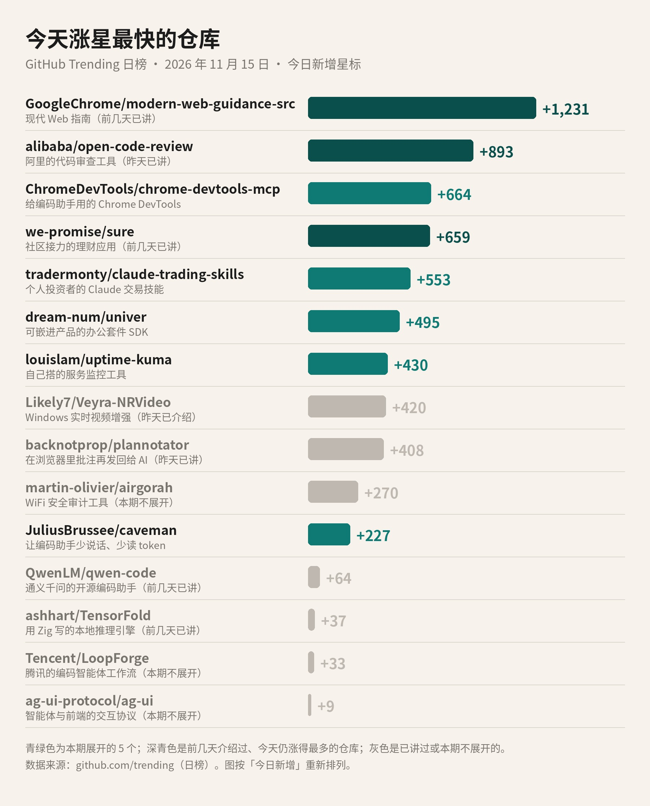
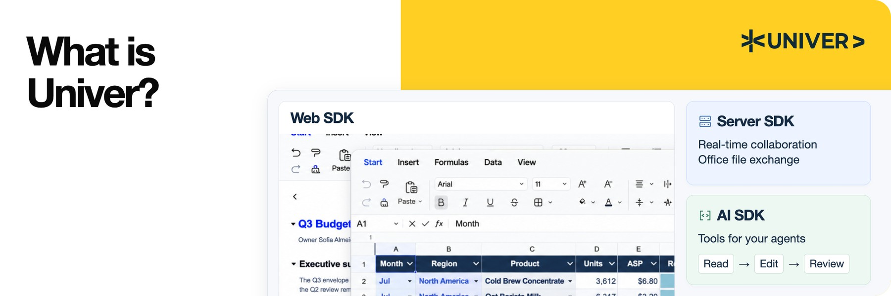
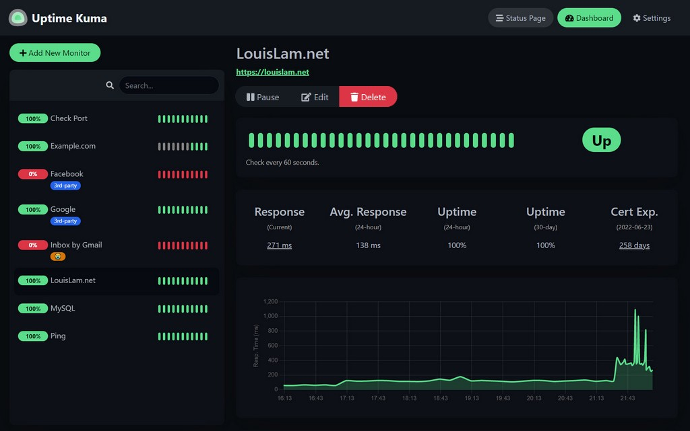
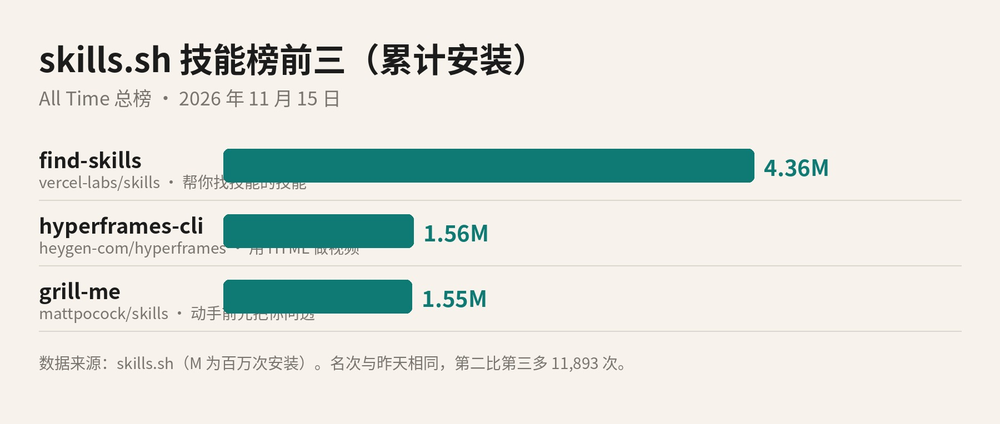

# 2026-11-15 GitHub 热门日报

## 标题备选

1. Chrome 给编码助手接上了官方 DevTools，今天涨了 664 颗星
2. GitHub 热门日报：让 AI 调试现场的 Chrome，还能把表格嵌进自己的产品
3. 浏览器厂商给 AI 开了 DevTools 的门，Caveman 还在教模型少说话

## 作者

刀哥

## 正文

Chrome 团队那个让编码助手跟上 Web 最佳实践的仓库，今天又涨了 1,231 颗星，仍是日榜上新增最多的。昨天讲过的阿里 Open Code Review 涨了 893 颗星。个人理财应用 Sure 涨了 659 颗星。这几件前几天都讲过，今天不再展开。

新面孔里挑五个：Chrome 官方给编码助手用的 DevTools 接口，一套给个人投资者用的 Claude 交易技能，可嵌进自己产品的办公套件 SDK Univer，自己搭的服务监控工具 Uptime Kuma，还有那个让 AI 少说话的 Caveman。

同一天还涨了 420 颗星的 Likely7/Veyra-NRVideo，昨天已经介绍过：它是 Windows 上的实时视频增强播放器，README 写明社区运行时不是厂商认证，也还不是完整的官方 DLSS 5 集成。今天不再展开。

*GitHub Trending 日榜，按今日新增星标从高到低。青绿色为本期展开的 5 个；深青色是前几天介绍过、今天仍涨得最多的仓库；灰色是已讲过或本期不展开的。数据来源：https://github.com/trending?since=daily*

### 给编码助手用的官方 DevTools

ChromeDevTools/chrome-devtools-mcp 今天涨了 664 颗星，总星数 56,315。这是 Chrome 开发者工具团队的官方仓库，主要语言是 TypeScript，许可证 Apache-2.0。文档在 developer.chrome.com/docs/devtools/agents。

它让编码助手控制并检查一个正在运行的 Chrome 浏览器，可以当 MCP 服务用，也可以当命令行用。README 点名了 Antigravity、Claude、Cursor 和 Copilot。底层用 Puppeteer 做自动化，能录性能追踪、看网络请求、截图，还能读带源码映射的控制台报错。

上手是在 MCP 客户端里配一条 `npx` 命令，跑 `chrome-devtools-mcp@latest`。包里还带了 7 个技能，教助手怎么用这些工具做无障碍检查、Cookie 调试、优化 Largest Contentful Paint、找内存泄漏。Claude Code、VS Code / Copilot、Gemini CLI 可以用插件一次装上服务和技能。环境要求是 Node.js 的长期支持版，以及当前稳定版或更新的 Chrome。官方只保证支持 Google Chrome 和 Chrome for Testing，其他 Chromium 内核浏览器不保证能用。

有两件要记住。第一，它会把浏览器实例里的内容暴露给 MCP 客户端，能检查、调试、改里面的数据，**别在这个浏览器里打开你不想让助手看到的个人或敏感信息。** 第二，Google 默认会收集使用统计，包括调用是否成功、延迟和环境信息，启动时加上 `--no-usage-statistics` 可以关掉；性能工具还可能把追踪地址发给 Google 的 CrUX 接口，可用 `--no-performance-crux` 关掉。这套统计和 Chrome 浏览器自己的用量统计是分开的。

### 给个人投资者用的 Claude 交易技能

tradermonty/claude-trading-skills 今天涨了 553 颗星，总星数 4,827。主要语言是 Python，许可证 MIT。文档站在 tradermonty.github.io/claude-trading-skills。

作者写，这是给时间不够用的个人投资者准备的工作流工具包，用的是 Claude 的技能格式。核心不是把买卖交给 AI，而是把看盘、管风险、写交易计划、记账和复盘的流程搭起来。定位是长期投资、ETF 和分红股打底，行情合适时再做有纪律的波段，不是全自动交易，也不是信号服务。仓库的技能目录里列了 74 个技能，并打包成 6 组技能套件：市场状态、核心组合、分红收益、波段机会、交易记忆、策略研究。新手可以从「每天 15 分钟看盘」或「每周复盘长期组合」这类现成工作流开始，也有一条不需要付费行情接口的入门路径，只用公开的 CSV、图表截图和本地文件。

**仓库自己的免责声明写得很清楚：只供学习、研究和改进流程，不构成投资建议，也不是信号服务或下单通道。** 交易有亏本金的风险，回测和 AI 生成的分析不能保证未来结果。买卖、仓位、税务和券商操作，都是你自己的责任。

### 把办公套件嵌进自己的产品：Univer

dream-num/univer 今天涨了 495 颗星，总星数 24,506。网站在 univer.ai。许可证要分清楚：这个仓库提供的是 Web SDK 的核心架构和引擎，按 Apache-2.0 开源；商业模块另行分发和授权。

它要解决的是：在你自己的产品里做出一套办公能力，给人和已经在跑的智能体用，数据和权限还在你这边。整套 Office SDK 分三块。Web SDK 是基础，管内容模型、编辑、渲染、公式，以及给应用调用的接口；Server SDK 补实时协作、编辑历史和文件导入导出；AI SDK 把办公能力接到已有的智能体和工作流上。这个开源仓库覆盖的是 Web SDK 核心，以及表格和文档的编辑能力。产品家族还覆盖演示文稿、关系表、画布和 PDF，其中幻灯片和画布目前是单独分发的商业产品。开源和商业的分界，以官网的功能对比页为准。

*Univer 官方 README 中的介绍图，标出了 Web SDK、Server SDK 和 AI SDK。来源：https://github.com/dream-num/univer*

把开源的表格编辑器嵌进页面，官方快速开始是 `pnpm add @univerjs/presets @univerjs/preset-sheets-core`。智能体也可以走同一套开源接口，模型和工具编排由你的应用自己管。

### 自己搭一套监控：Uptime Kuma

louislam/uptime-kuma 今天涨了 430 颗星，总星数 94,245。这是一个很常见的自托管监控工具，许可证 MIT，主要语言是 JavaScript。能盯 HTTP(s)、TCP、Ping、DNS、WebSocket、Docker 容器等，支持状态页、证书信息、双重验证，以及 Telegram、Discord、Slack、邮件等 90 多种通知渠道，最短间隔 20 秒。

*Uptime Kuma 官方 README 中的控制台截图。来源：https://github.com/louislam/uptime-kuma*

最省事的办法是用 Docker 跑起来，服务默认听在 3001 端口。README 特别提醒：Google 搜索靠前的 uptimekuma.co 不是官方网站，作者控制不了那个站，建议按 GitHub 仓库里的安装说明来。数据目录也不要放在 NFS 这类网络文件系统上。

### 让编码助手少说话：Caveman

JuliusBrussee/caveman 今天涨了 227 颗星，总星数已经 120,082。主要语言是 Go，许可证 Apache-2.0。安装命令是 `npx @caveman-ai/cli@latest`，需要 Node.js 22.13 以上，README 写能对接 30 多种编码助手。

它要做的事很简单：让助手说得更短、读得更少，代码和报错原文不动。仓库把它分成六块，安装后默认都开，包括缩短回答、压缩助手读到的日志和表格、按问题难度选模型和力度，以及把重复写的脚本留下来再用。只想要语体、不要代理层的话，可以用 `npx skills add JuliusBrussee/caveman -g`。

数字要分开看。语体那个例子里，同一句 React 重渲染的解释，普通回答是 63 个 token，`/caveman` 是 20。Adobe Research 的 CAVEWOMAN 论文引用了这个仓库，报告说按这种风格输出，在八个模型上成本降到约 1.4 到 2.4 倍。JetBrains 做了 86 个真实编程任务的对照，结论是质量没有可测到的损失。仓库自己测的「读得更少」，是整段会话的输入 token 少 33.2%，并写明这是 2026 年 8 月的旧引擎结果，而且 HTML 还压不了。README 顶端「比 Codex 便宜 21%、比 Claude Code 便宜 14%」是作者 2026 年 11 月用标价自己跑的，测法写在 caveman.so/code。

技能本身在你的机器上跑，默认不外发内容；命令行默认会收集用量统计，包括命令、token 数、一个随机安装编号、系统和 IP，不含提示词和代码，可用 `caveman telemetry off` 或环境变量 `DO_NOT_TRACK=1` 关掉。Auto 路由要先登录，才会把问题发到 Caveman Cloud。

### 技能榜前三：还是昨天那三位

skills.sh 总榜按累计安装次数排，前三名和昨天一样。

*skills.sh All Time 总榜前三，按累计安装次数。数据来源：https://skills.sh/*

第一名还是 find-skills，累计 4,364,205 次，来自 vercel-labs/skills，帮你在技能库里搜索并安装。第二名 hyperframes-cli，累计 1,564,650 次，教 AI 用 HeyGen 的 HyperFrames 把网页和素材渲成视频。第三名 grill-me，累计 1,552,757 次，是 Matt Pocock 那个「动手前先把你问透」。第二名比第三名多 11,893 次，比昨天拉开了一些。总榜页面上会显示成 4.4M、1.6M 和 1.6M，后两名看起来一样，累计次数其实还差着一万多次。

### 如果只记三句

第一，Chrome 官方把 DevTools 给了编码助手，能看现场浏览器、录性能、读控制台，今天涨了 664 颗星。**别在这个浏览器里打开敏感页面。**

第二，Univer 把表格和文档以开源 SDK 的形式嵌进自己的产品；交易技能包能帮你搭复盘流程，但不是投资建议。

第三，Caveman 还在教助手少说话、少读 token，总星数已经超过 12 万。

开源项目更新很快。真要装之前，打开它的 GitHub 页面，看一眼最新的 README。

## 来源清单

- https://github.com/trending?since=daily
- https://github.com/GoogleChrome/modern-web-guidance-src
- https://github.com/alibaba/open-code-review
- https://github.com/we-promise/sure
- https://github.com/Likely7/Veyra-NRVideo
- https://github.com/ChromeDevTools/chrome-devtools-mcp
- https://developer.chrome.com/docs/devtools/agents
- https://www.npmjs.com/package/chrome-devtools-mcp
- https://github.com/tradermonty/claude-trading-skills
- https://tradermonty.github.io/claude-trading-skills/
- https://github.com/dream-num/univer
- https://univer.ai
- https://univer.ai/compare/
- https://docs.univer.ai/
- https://github.com/louislam/uptime-kuma
- https://github.com/JuliusBrussee/caveman
- https://docs.caveman.so/caveman
- https://caveman.so/code
- https://arxiv.org/abs/2606.24083
- https://blog.jetbrains.com/ai/2026/07/speak-to-ai-agents-like-cavemen-tosave-tokens/
- https://skills.sh/
- https://skills.sh/vercel-labs/skills/find-skills
- https://skills.sh/heygen-com/hyperframes/hyperframes-cli
- https://skills.sh/mattpocock/skills/grill-me
- https://github.com/vercel-labs/skills
- https://github.com/heygen-com/hyperframes
- https://github.com/mattpocock/skills
