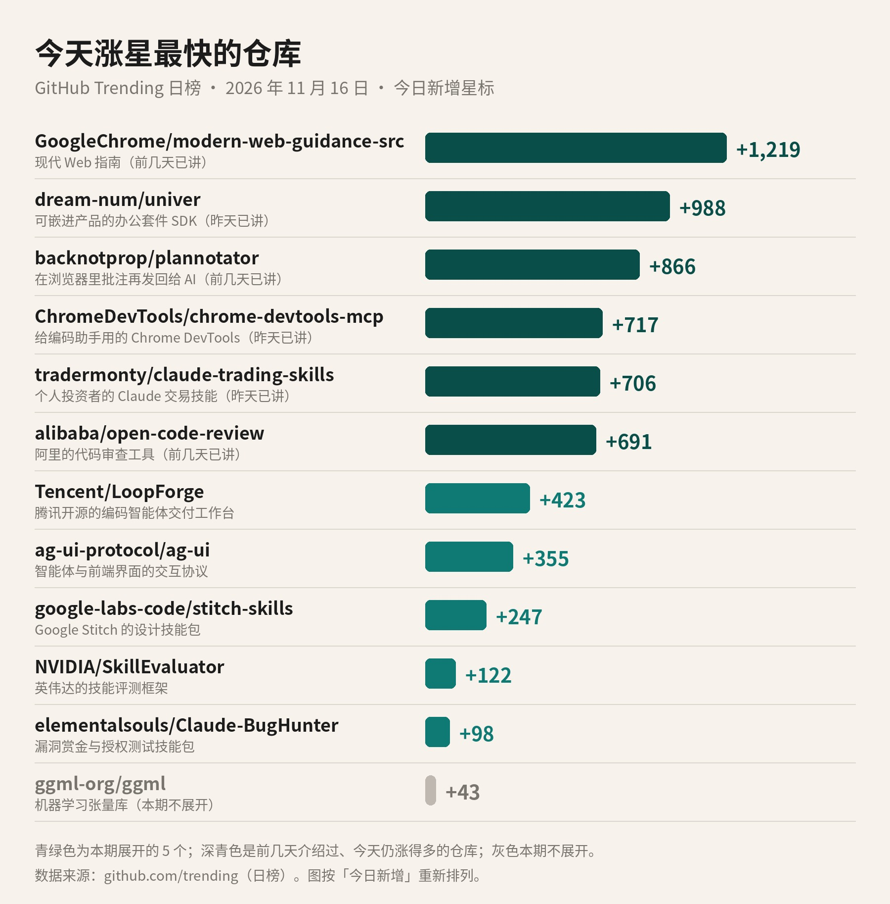
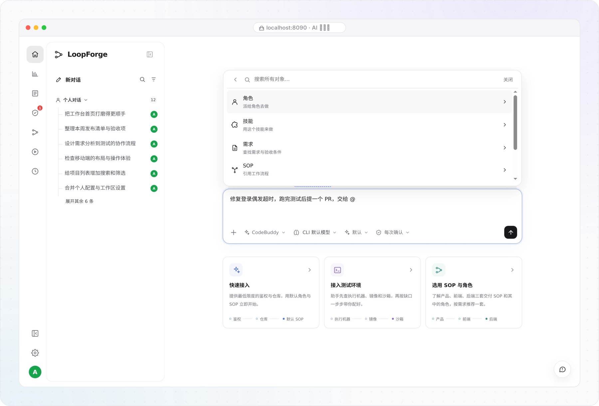
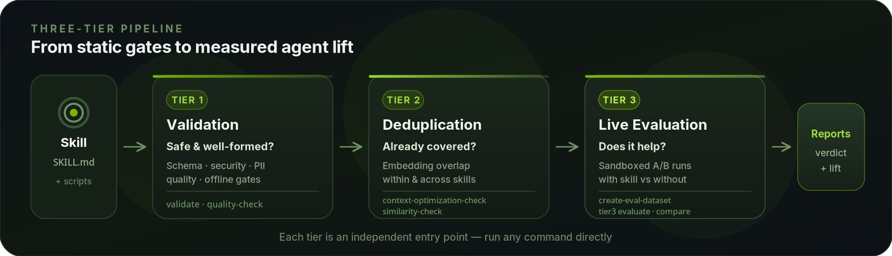
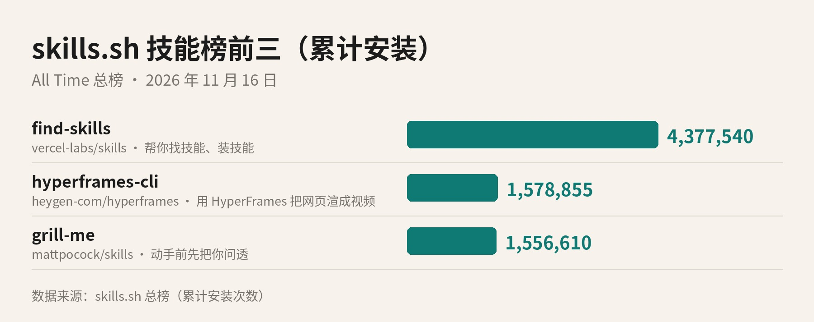

# 2026-11-16 GitHub 热门日报

## 标题备选

1. 腾讯开源 LoopForge：让编码智能体按流程交活，一天涨了 423 颗星
2. GitHub 热门日报：编码智能体要有流程，技能也要有体检
3. 从协议到体检：今天 GitHub 上的智能体基础设施

## 作者

刀哥

## 正文

日榜上新增最多的，还是 Chrome 团队那个让编码助手跟上 Web 最佳实践的仓库，今天涨了 1,219 颗星。昨天讲过的 Univer 涨了 988 颗星，前几天讲过的 Plannotator 涨了 866 颗星，Chrome DevTools MCP、Claude 交易技能包和阿里的 Open Code Review 也都还在七百颗上下。这几件前几天都讲过，今天不再展开。

新面孔里挑五个：腾讯开源的编码智能体交付工作台 LoopForge，让智能体接进前端界面的 AG-UI 协议，Google Stitch 的设计技能包，英伟达给技能做体检的 SkillEvaluator，还有一套做漏洞赏金和授权测试的 Claude 技能包。

*GitHub Trending 日榜，按今日新增星标从高到低。青绿色为本期展开的 5 个；深青色是前几天介绍过、今天仍涨得多的仓库；灰色本期不展开。数据来源：https://github.com/trending?since=daily*

### 让编码智能体按流程交活：LoopForge

Tencent/LoopForge 今天涨了 423 颗星，总星数 1,501。昨天它在日榜上只涨了 33 颗。主要语言是 Go，README 写的许可证是 MIT，网站在 loopforge.cn。

它是一个自托管的工作台，让团队用编码智能体交付软件。用法有两种。一种是在聊天里跟 Main Bot 说需求，它按需开一个 Docker 沙箱，拉下你的仓库，把活分给规划、实现、评审、测试这些角色，最后提一个 PR。另一种是把跑通的做法存成 SOP，也就是由智能体、脚本和人工审批节点串起来的固定流程，下一个需求按同样的步骤走，审批环节是内置的。

真正写代码的是现成的编码智能体命令行，README 列了十个：CodeBuddy、Codex、Claude Code、OpenCode、Cursor CLI、Antigravity、Kimi Code、Pi、DeepSeek Harness 和 ZCode。每个角色可以单独选执行器和模型，内置角色默认用 CodeBuddy。LoopForge 自己补的是角色、沙箱、检查点和历史记录。

*LoopForge 官方 README 中的聊天工作台示意图：输入需求，用 @ 选角色、技能、需求或 SOP，再选执行器、模型和权限模式。来源：https://github.com/Tencent/LoopForge*

上手是克隆仓库后运行 `./start.sh`，安装脚本会检查 Docker、Compose、Python 3 和 curl。新账号自带一个演示项目，里面有一条只含脚本和人工审批的 SOP，不填模型密钥也能跑通看看。不想搭服务的，可以用 LoopForge Local，在目标项目里运行 `npx -y loopforge-cli@latest install claude`，再在 Claude Code 里用 `/start-devflow` 发需求。

部署前要注意两点。服务默认监听所有网卡的 8090 端口，第一个注册的账号就是管理员，README 建议管理员账号建好之前只放行你自己的 IP，对外开放前配好 HTTPS。另外，默认安装通过宿主机的 Docker socket 起沙箱，**这等于能控制宿主机的 Docker，所以它面向的是彼此信任的团队，不是给陌生人共用的多租户隔离。**

### 把智能体接进前端界面：AG-UI

ag-ui-protocol/ag-ui 今天涨了 355 颗星，总星数 17,874，昨天只涨了 9 颗。许可证 MIT，文档在 docs.ag-ui.com。它由 CopilotKit 发起，前几天讲 OpenBot 时提到过。

它是一套开放的、基于事件的协议，规定智能体后端怎么和用户眼前的应用对话。智能体运行时发出约 16 种标准事件，前端照着收；传输方式不限，SSE、WebSocket、webhook 都行。README 把它放在三层协议里说明：MCP 给智能体接工具，A2A 让智能体之间通信，AG-UI 把智能体带进用户界面。它管的是流式聊天、前后端状态双向同步、生成式界面、前端工具调用和人工介入这类事。

接入面已经很宽。README 列出 LangGraph、CrewAI、Microsoft Agent Framework、Google ADK、AWS Strands Agents、Mastra、Pydantic AI、LlamaIndex、Claude Agent SDK 等框架都已支持，OpenAI Agents SDK 的集成还在做。社区 SDK 覆盖 Kotlin、Go、Dart、Java、Rust、Ruby、C++ 和 .NET。想先看效果，可以去 dojo.ag-ui.com 的演示站；新建项目是 `npx create-ag-ui-app my-agent-app`。

### Google Stitch 的设计技能包

google-labs-code/stitch-skills 今天涨了 247 颗星，总星数 9,304。许可证 Apache-2.0。它是给 Google Stitch 用的一组智能体技能，遵循 Agent Skills 开放标准，README 写能配合 Codex、Antigravity、Gemini CLI、Claude Code、Cursor，OpenCode 需要手动装。

仓库里有 15 个技能，分成三个插件。设计类管把代码转成设计稿、生成设计、管理设计系统，以及从前端源码里提取 DESIGN.md、从运行中的网页导出静态 HTML、把本地素材传进 Stitch 项目。构建类把 Stitch 的设计稿转成 React 组件或 React Native 组件，也有 Remotion、shadcn/ui 和 Vite 看板相关的技能。工具类包括把模糊的界面想法改写成 Stitch 好用的提示词，以及一句话生成多页网站的 stitch-loop。

用之前要先配好 Stitch MCP 服务，这些技能都依赖它。Claude Code 可以用 `npx plugins add google-labs-code/stitch-skills --scope project --target claude-code` 装进当前项目，Cursor 把 target 换成 cursor 就行。

### 给技能做体检：NVIDIA SkillEvaluator

NVIDIA/SkillEvaluator 今天涨了 122 颗星，总星数 1,696。许可证 Apache-2.0，Python 3.12 到 3.14，文档在 docs.nvidia.com/skills/skillevaluator，配套有一篇 arXiv 论文和英伟达开发者博客。它是英伟达 Verified Skills 流水线的一部分。

技能装得越来越多，它回答两个问题：这个技能写得合不合格，装上以后对任务到底有没有帮助。检查分三层。第一层查格式、安全、隐私信息和兼容性，第二层查技能内部和技能之间的内容是否重复，第三层在沙箱里让智能体带着技能和不带技能各跑一遍，比较结果。

*SkillEvaluator 官方 README 中的三层评测示意图：验证、去重、实际运行对比，最后出报告。来源：https://github.com/NVIDIA/SkillEvaluator*

最低成本的入口是 `pip install skillevaluator`，再跑 `skillevaluator validate ./my-skill --tiers 1`，不需要 API 密钥。README 里自带的示例技能，静态质量分是 86.2 分（B），默认及格线 70 分。第三层要模型接口、支持的智能体和 Docker 沙箱，模型和托管沙箱可能产生费用。也可以用 `skillevaluator ci init` 在每次 PR 时自动检查改过的技能，或者用 `npx skills add NVIDIA/SkillEvaluator` 把它装成技能，直接问助手「我的技能写得怎么样」。

### 漏洞赏金用的 Claude 技能包：Claude-BugHunter

elementalsouls/Claude-BugHunter 今天涨了 98 颗星，总星数 6,457。作者是做漏洞赏金和生成式 AI 安全研究的 Sachin Sharma。代码部分是 MIT，技能方法论、字典和文档按 CC BY 4.0。

按 README 的说法，它是一套给 Claude Code 用的漏洞挖掘和外部红队技能包：83 个技能、15 个斜杠命令，整理自 681 份公开披露的 HackerOne 报告，覆盖 24 类常见漏洞，从侦察、排定攻击面、测试、验证一直到写报告。技能按话题自动加载，也能装到 OpenCode、Codex CLI、Hermes Agent 和 Antigravity 上。

**README 写明，只能用在你自己拥有、或有书面授权测试的资产上**，比如漏洞赏金项目的范围内资产、渗透测试合同、CTF 题目和自己的服务器。提交前有一道七问检查，会问目标在不在范围内。它也提醒，Anthropic 的模型默认会拦截漏洞利用和攻击工具开发类请求，正规做授权测试的人可以申请 Anthropic 的网络安全验证计划。

### 技能榜前三：还是那三位

skills.sh 总榜按累计安装次数排，前三名和前几天一样。

*skills.sh All Time 总榜前三，按累计安装次数。数据来源：https://skills.sh/*

第一名 find-skills，累计 4,377,540 次，来自 vercel-labs/skills，帮你在技能库里搜索并安装。第二名 hyperframes-cli，累计 1,578,855 次，教 AI 用 HeyGen 的 HyperFrames 把网页和素材渲成视频。第三名 grill-me，累计 1,556,610 次，是 Matt Pocock 那个「动手前先把你问透」。第二名比第三名多 22,245 次，差距比昨天的 11,893 次又拉大了不少。

### 如果只记三句

第一，腾讯的 LoopForge 把编码智能体放进固定流程和人工审批里，十种命令行都能当执行器；**自己部署时注意端口和 Docker 权限。**

第二，AG-UI 管的是智能体和用户界面之间的那一层，和 MCP、A2A 是互补关系。

第三，技能越装越多，英伟达给了一个能先体检、再比效果的工具；Stitch 和 BugHunter 则是两个垂直方向的技能包。

开源项目更新很快。真要装之前，打开它的 GitHub 页面，看一眼最新的 README。

## 来源清单

- https://github.com/trending?since=daily
- https://github.com/GoogleChrome/modern-web-guidance-src
- https://github.com/dream-num/univer
- https://github.com/backnotprop/plannotator
- https://github.com/ChromeDevTools/chrome-devtools-mcp
- https://github.com/tradermonty/claude-trading-skills
- https://github.com/alibaba/open-code-review
- https://github.com/Tencent/LoopForge
- https://loopforge.cn
- https://github.com/ag-ui-protocol/ag-ui
- https://docs.ag-ui.com/
- https://dojo.ag-ui.com/
- https://github.com/google-labs-code/stitch-skills
- https://stitch.withgoogle.com/docs/mcp/setup
- https://github.com/NVIDIA/SkillEvaluator
- https://docs.nvidia.com/skills/skillevaluator/
- https://arxiv.org/abs/2608.20614
- https://developer.nvidia.com/blog/evaluating-ai-agent-skill-performance-with-nvidia-skillevaluator/
- https://github.com/elementalsouls/Claude-BugHunter
- https://skills.sh/
- https://skills.sh/vercel-labs/skills/find-skills
- https://skills.sh/heygen-com/hyperframes/hyperframes-cli
- https://skills.sh/mattpocock/skills/grill-me
