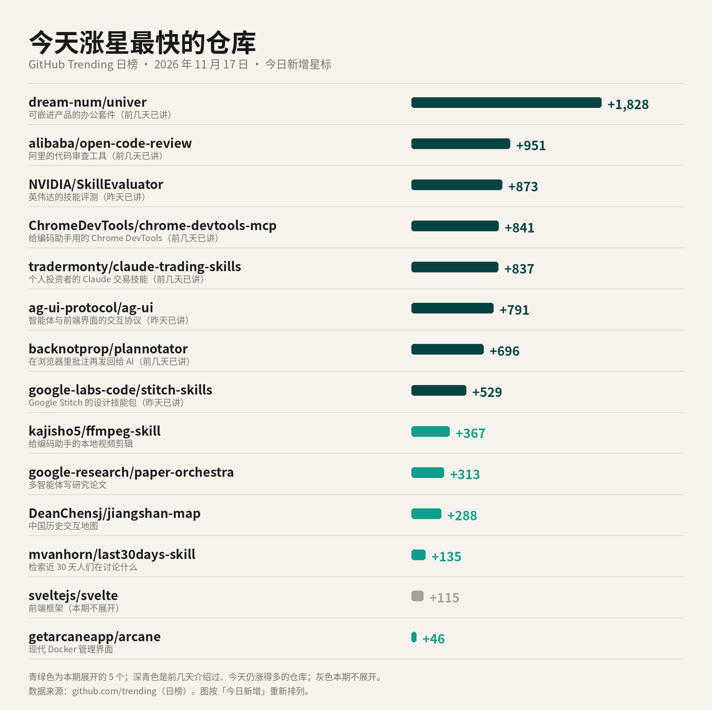
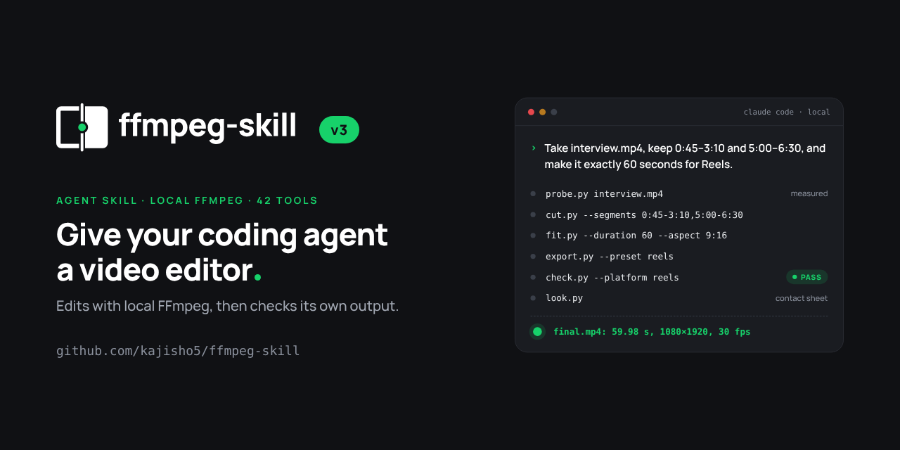
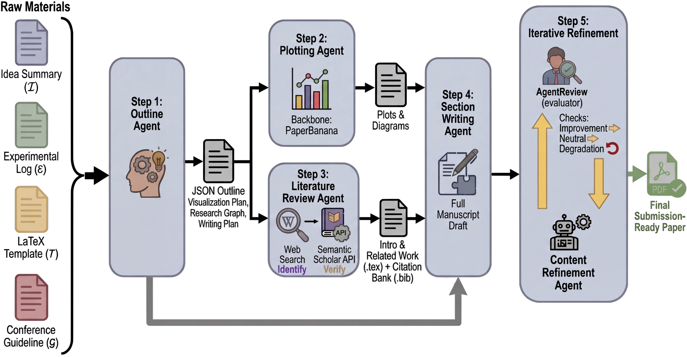
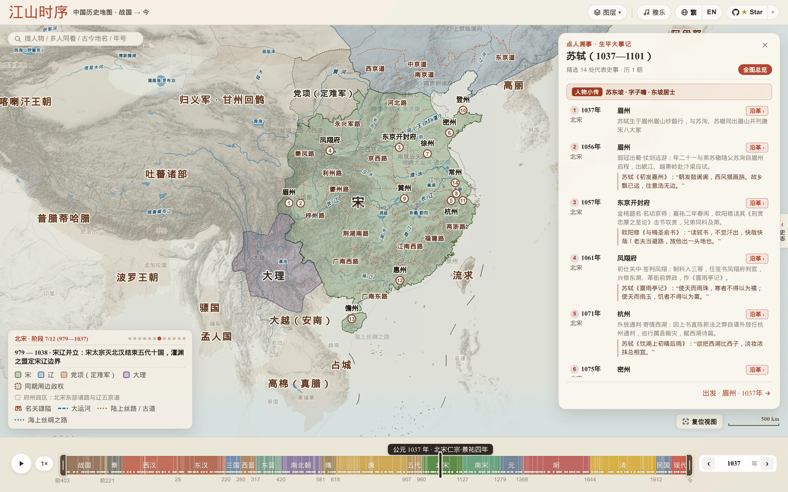
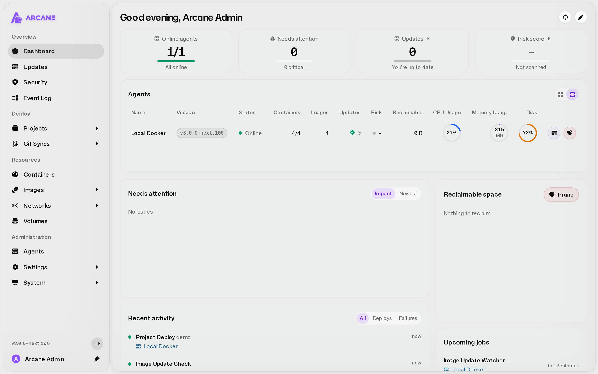
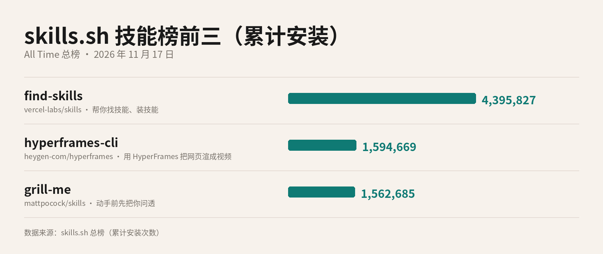

# 2026-11-17 GitHub 热门日报

## 标题备选

1. 拖动时间轴看两千四百年：江山时序今天涨了 288 颗星
2. GitHub 热门日报：本地剪视频、写论文，还有一张中国历史地图
3. 编码助手可以在本机剪视频了，这个仓库今天涨了 367 颗星

## 作者

刀哥

## 正文

日榜上新增最多的，是前几天讲过的 Univer，今天涨了 1,828 颗星，昨天日榜上是 988 颗。阿里的 Open Code Review 涨了 951 颗星。昨天讲过的 SkillEvaluator 涨了 873 颗星，昨天日榜上是 122 颗。Chrome DevTools MCP 涨了 841 颗星，Claude 交易技能包涨了 837 颗星，AG-UI 涨了 791 颗星，Plannotator 涨了 696 颗星，Stitch 技能包涨了 529 颗星。这些前几天都讲过，今天不再展开。

新面孔里挑五个：给编码助手用的本地视频剪辑技能 ffmpeg-skill，Google Cloud AI Research 的论文写作框架 PaperOrchestra，能拖时间轴看中国历史疆域的江山时序，按近 30 天讨论做检索的 last30days，还有一套 Docker 管理界面 Arcane。

*GitHub Trending 日榜，按今日新增星标从高到低。青绿色为本期展开的 5 个；深青色是前几天介绍过、今天仍涨得多的仓库；灰色本期不展开。数据来源：https://github.com/trending?since=daily*

### 给编码助手一台本地剪辑台：ffmpeg-skill

kajisho5/ffmpeg-skill 今天涨了 367 颗星，总星数 6,745。许可证 MIT。Python 3.10 及以上，只用标准库。网站在 kajisho5.github.io/ffmpeg-skill。

它给 Claude Code、Cursor、Codex，以及任何能读 SKILL.md 的助手，一套留在本机的剪辑流程。先用 ffprobe 看清文件，再剪，再检查成片。仓库里有 42 个工具，覆盖剪切、拼接、去静音、改时长和画幅、字幕、响度、导出检查。主流程不需要 API 密钥，素材也不上传。本机要先有 FFmpeg 6.1 或更新的版本。

安装是 `npx ffmpeg-skill`，然后跑 `npx ffmpeg-skill doctor`，看这台机器缺不缺滤镜。macOS 上 README 建议装 ffmpeg-full，普通的 Homebrew ffmpeg 可能没有字幕滤镜。MCP 默认只列出 12 个常用工具，免得把上下文塞满；环境变量 `FFMPEG_SKILL_MCP_FULL=1` 会把 42 个都列出来，没列出来的也能按名字调用。工具不覆盖原始文件，成片是新文件。

它负责剪、量、导出。剪哪一段、字幕写什么，由你或前面的助手决定，工具不会为了塞进画面去改你写好的字幕。要是用语音自动生成字幕，需要另外装一个本地语音引擎，音频还是留在本机。

*ffmpeg-skill 官方 README 中的产品图：本地 FFmpeg、42 个工具，右侧是 README 快速开始里那条把访谈收成 Reels 的命令示例。来源：https://github.com/kajisho5/ffmpeg-skill*

### 把实验记录收成论文：PaperOrchestra

google-research/paper-orchestra 今天涨了 313 颗星，总星数 1,529。许可证 Apache-2.0，安装说明用的是 Python 3.11。作者是 Yiwen Song、Yale Song、Tomas Pfister、Jinsung Yoon，单位写的是 Google Cloud AI Research。论文编号 arXiv:2604.05018，项目页在 yiwen-song.github.io/paper_orchestra。

它收的是还没成文的材料：想法和实验记录，再加上会议的 LaTeX 模板。流水线分成大纲、文献、分节写作、打磨和绘图。文献会检索、排序，再写进正文，最后交一份按模板排好的 LaTeX 稿。

*PaperOrchestra 官方 README 中的流程示意图：原材料进入大纲、绘图和文献，再写成文稿并打磨。来源：https://github.com/google-research/paper-orchestra*

**README 写明，它不是 Google 官方支持的产品。** 用来生成论文的数据集不在这个仓库里，作者说会另行发布。要用哪个模型，就在 `.env` 里填对应的密钥：Gemini 走 Vertex 或 `GEMINI_API_KEY`，OpenAI 走 `OPENAI_API_KEY`；文献检索可以填 Semantic Scholar 的密钥。仓库里带了会议模板，例如 `templates/cvpr2025`，也可以自己加一套。

命令行是 `python paper_writing_cli.py`，指定原材料目录、LaTeX 模板目录和输出目录。想先看界面，frontend 目录里有一个 Streamlit 演示。

### 拖动时间轴看两千四百年：江山时序

DeanChensj/jiangshan-map 今天涨了 288 颗星，总星数 6,730。主要语言是 JavaScript。代码和项目自己整理的数据按 GPL-3.0 发布。在线演示在 deanchen.me/jiangshan-map，打开就是简体中文。

它是一张可交互的中国历史地图，从公元前 403 年三家分晋画到今天。README 写覆盖 18 个历史时期、两千四百余年。拖动时间轴，疆域、州郡、黄河河道、运河和海岸线跟着年份变。点开一座古城，能看它在这些时期里的沿革。搜一个人，比如苏轼，地图会按他的行迹一站站走，旁边是年表。

*江山时序官方中文 README 中的界面图：点人溯事打开苏轼的生平行迹，地图停在北宋。来源：https://github.com/DeanChensj/jiangshan-map*

也可以嵌进自己的网页，地址后面加上 `embed=1`。公众号正文里放不了 iframe，把链接发出去就行。仓库还带一个不依赖 npm 的本地 MCP，用 Node 跑 `scripts/mcp_server.js`，三个工具分别查地点、查人物、搜全图，模型不用自己猜经纬度。

**图上的历史疆界是示意性的大致范围，不能当成测绘边界来引用。** 郡、州、府这一层边界来自 CHGIS，不在 GPL-3.0 里，只供非商业和教学使用，不要再分发。

本地打开不用构建：克隆后运行 `python3 -m http.server 8000`。用 Docker 则是 `docker compose up -d --build`，浏览器访问 localhost:8008。

### 近 30 天人们在讨论什么：last30days

mvanhorn/last30days-skill 今天涨了 135 颗星，总星数 68,133。许可证 MIT。今天的新增不多，仓库本身已经很大，仍在日榜上。

对助手说 `/last30days`，后面跟一个话题：一个人、一家公司、一个产品，或把两个东西放在一起比。它去搜最近这段时间里，人们实际在讨论、在投票、在下注的内容，收成一份简报。README 写，Reddit、Hacker News、Polymarket 和 GitHub 不用配置就能查。X 要官方 API 密钥或浏览器登录，YouTube 要本机有 yt-dlp，小红书要本机跑着已登录的服务。配了哪些，能查到的源就不一样。

Claude Code 可以用 `/plugin marketplace add mvanhorn/last30days-skill`，再装上插件。Cursor、Codex、Gemini CLI 这些，用 `npx skills add mvanhorn/last30days-skill -g`。

默认跑在你自己的机器上，简报写到文档目录里的 Last30Days。只有在你配了推理模型的密钥时，话题和检索到的片段才会送到那个模型做相关性打分；不配的话，用本地打分。

### 一个容器管 Docker：Arcane

getarcaneapp/arcane 今天涨了 46 颗星，总星数 8,735，是这张日榜上新增最少的一个。主要语言是 Go，许可证 BSD-3-Clause。网站在 getarcane.app，main 分支是 v3。官网写它一直免费。

它是浏览器里的 Docker 管理界面。容器的启动和停止、Compose 项目、镜像、卷、网络、日志和资源曲线，都在这一页里。也可以在别的机器上装一个 agent，从这一处管过去。官网的功能列表里还有镜像漏洞扫描和 REST API。

*Arcane 官方 README 中的 v3 浅色仪表盘。来源：https://github.com/getarcaneapp/arcane*

官方安装是一个容器。镜像用 `ghcr.io/getarcaneapp/manager:latest`，端口 3552，环境变量里要填 `ARCANE_ENCRYPTION_KEY`。**官方的 compose 示例会挂载宿主机的 Docker socket，能登录这个界面的人，就能管理这台机器上的 Docker。**

### 技能榜前三：还是那三位

skills.sh 总榜按累计安装次数排，前三名和昨天一样。

*skills.sh All Time 总榜前三，按累计安装次数。数据来源：https://skills.sh/*

第一名 find-skills，累计 4,395,827 次，来自 vercel-labs/skills，帮你在技能库里搜索并安装。第二名 hyperframes-cli，累计 1,594,669 次，教 AI 用 HeyGen 的 HyperFrames 把网页和素材渲成视频。第三名 grill-me，累计 1,562,685 次，是 Matt Pocock 那个「动手前先把你问透」。第二名比第三名多 31,984 次，昨天这个差距是 22,245 次。

### 如果只记三句

第一，ffmpeg-skill 把 42 个本地 FFmpeg 工具交给编码助手，素材留在本机，成片是新文件。

第二，江山时序把战国到今天放进一张可拖动的地图，看的时候记住疆界是示意。PaperOrchestra 能把实验记录收成 LaTeX 稿，README 写明它不是 Google 官方支持的产品，数据集也还没放进仓库。

第三，last30days 去看最近人们在讨论什么，Reddit 和 GitHub 可以直接查；Arcane 用一个容器管自己的 Docker，登录进去就能管理这台机器上的 Docker。

开源项目更新很快。真要装之前，打开它的 GitHub 页面，看一眼最新的 README。

## 来源清单

- https://github.com/trending?since=daily
- https://github.com/dream-num/univer
- https://github.com/alibaba/open-code-review
- https://github.com/NVIDIA/SkillEvaluator
- https://github.com/ChromeDevTools/chrome-devtools-mcp
- https://github.com/tradermonty/claude-trading-skills
- https://github.com/ag-ui-protocol/ag-ui
- https://github.com/backnotprop/plannotator
- https://github.com/google-labs-code/stitch-skills
- https://github.com/kajisho5/ffmpeg-skill
- https://kajisho5.github.io/ffmpeg-skill/
- https://github.com/google-research/paper-orchestra
- https://yiwen-song.github.io/paper_orchestra/
- https://arxiv.org/abs/2604.05018
- https://github.com/DeanChensj/jiangshan-map
- https://deanchen.me/jiangshan-map/
- https://github.com/mvanhorn/last30days-skill
- https://github.com/getarcaneapp/arcane
- https://getarcane.app
- https://github.com/sveltejs/svelte
- https://skills.sh/
- https://skills.sh/vercel-labs/skills/find-skills
- https://skills.sh/heygen-com/hyperframes/hyperframes-cli
- https://skills.sh/mattpocock/skills/grill-me
