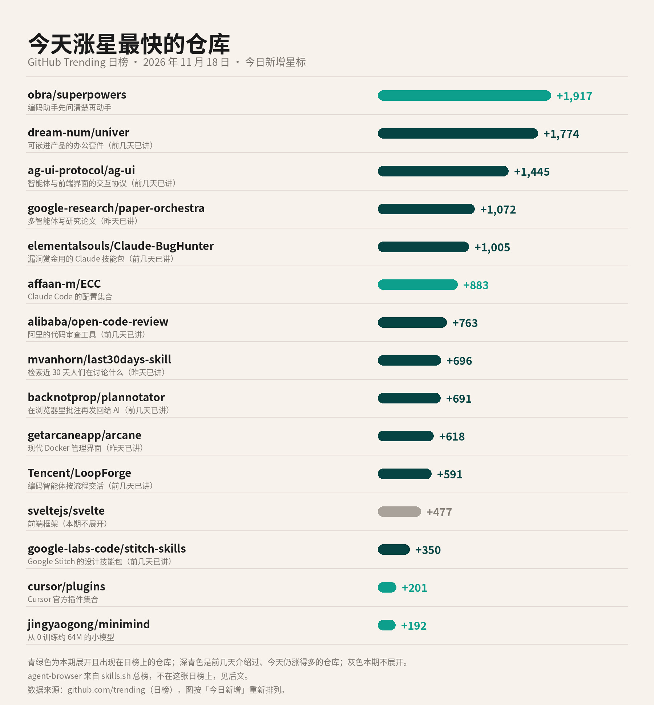
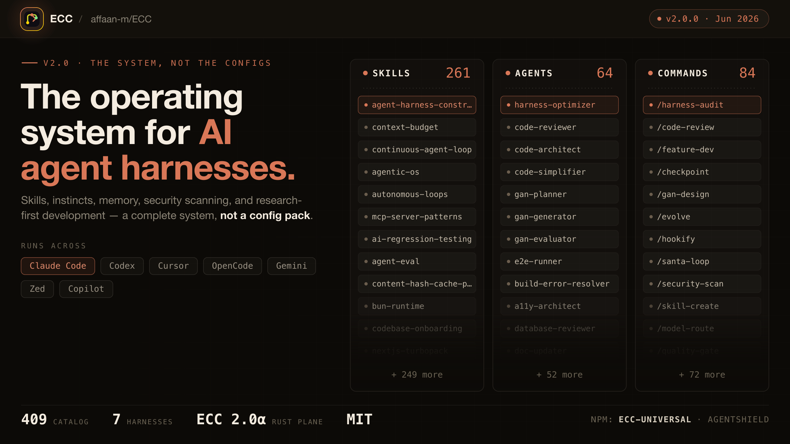
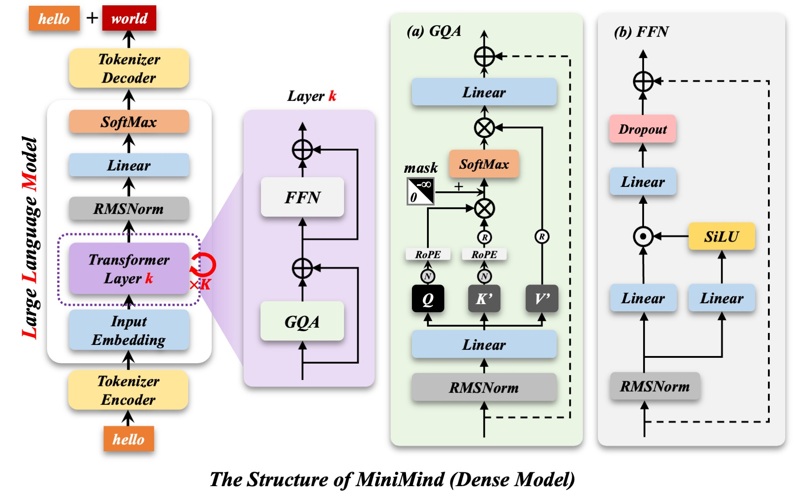
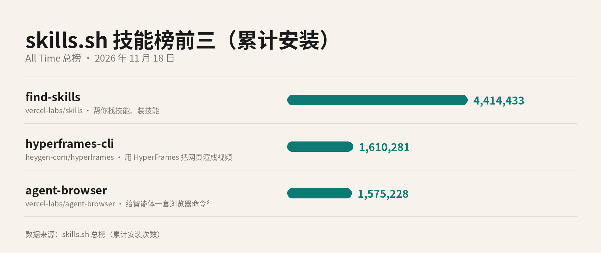

# 2026-11-18 GitHub 热门日报

## 标题备选

1. 编码助手先问清楚再动手：Superpowers 今天涨了 1,917 颗星
2. GitHub 热门日报：一天涨了近两千星的开发方法，技能榜第三名也换了
3. skills.sh 第三名换成了 agent-browser，Superpowers 一天涨了 1,917 颗星

## 作者

刀哥

## 正文

日榜上，前几天讲过的项目今天还在涨。新增最多的是 Univer，涨了 1,774 颗星。AG-UI 涨了 1,445 颗星。昨天讲过的 PaperOrchestra 涨了 1,072 颗星，总星数 3,013。昨天日榜上是 313 颗，总星数是 1,529。Claude-BugHunter 涨了 1,005 颗星。阿里的 Open Code Review 涨了 763 颗星。昨天讲过的 last30days 涨了 696 颗星。Plannotator 涨了 691 颗星。昨天讲过的 Arcane 涨了 618 颗星。LoopForge 涨了 591 颗星。Stitch 技能包涨了 350 颗星。这些今天不再展开。

新面孔里挑五个：编码助手的一套开发方法 Superpowers，今天涨了 1,917 颗星；Claude Code 的配置集合 ECC；skills.sh 总榜升到第三的 agent-browser；Cursor 官方插件仓库；还有从 0 训练约 64M 小模型的 MiniMind。

*GitHub Trending 日榜，按今日新增星标从高到低。青绿色为本期展开且出现在日榜上的仓库；深青色是前几天介绍过、今天仍涨得多的仓库；灰色本期不展开。agent-browser 来自 skills.sh 总榜，不在这张日榜上，见后文。数据来源：https://github.com/trending?since=daily*

### 编码助手先问清楚再动手：Superpowers

obra/superpowers 今天涨了 1,917 颗星，总星数 319,339。主要语言是 Shell。许可证 MIT，版权声明是 Copyright 2025 Jesse Vincent。作者是 Jesse Vincent，站点在 primeradiant.com，发布说明在 blog.fsck.com/2025/10/09/superpowers。

README 把它写成一套建在可组合技能上的编码助手软件开发方法。助手看到你要做东西时，不先写代码，先问你真正要做什么。规格写出来以后，分成几块交给你确认，再写实现计划。你说开始，它走 subagent-driven-development。

基本流程是 7 步：brainstorming，using-git-worktrees，writing-plans，然后是 subagent-driven-development 或 executing-plans，接着 test-driven-development（RED-GREEN-REFACTOR），requesting-code-review，最后 finishing-a-development-branch。README 写，助手在做任何任务之前都会检查有没有相关技能。这些流程是必须走的，不是建议。

技能库分成 Testing、Debugging、Collaboration、Meta。例如 test-driven-development、systematic-debugging、verification-before-completion、diagnosing-superpowers、brainstorming、writing-plans、using-superpowers。

安装要按手里的工具分开装。Claude Code 用 `/plugin install superpowers@claude-plugins-official`，官方市场在 claude.com/plugins/superpowers。也可以先 `/plugin marketplace add obra/superpowers-marketplace`，再 `/plugin install superpowers@superpowers-marketplace`。Cursor 在 Agent 对话里输入 `/add-plugin superpowers`，或在插件市场搜 superpowers。Codex、Gemini CLI、GitHub Copilot CLI 也能装，命令在 README 里。

### 一套 Claude Code 配置：ECC

affaan-m/ECC 今天涨了 883 颗星，总星数 305,509。主要语言是 JavaScript。许可证 MIT，版权声明是 Copyright 2026 Affaan Mustafa。仓库里有中文 README，网站在 ecc.tools。

README 自述，这是来自 Anthropic 黑客马拉松获胜者的一套 Claude Code 配置：技能、本能、记忆、持续学习、安全扫描，以及研究优先的开发模式。Claude Code、Codex、Cursor、OpenCode、Gemini 都能用。中文 README 的目录写明有 36 个专用子智能体。

*ECC 英文 README 中的官方首页图。来源：https://github.com/affaan-m/ECC*

Claude Code 的装法是先 `/plugin marketplace add https://github.com/affaan-m/ECC`，再 `/plugin install ecc@ecc`。**已经走插件安装的，不要再跑 `./install.sh --profile full`，也不要跑 `npx ecc-universal install --profile full`。** 同一批技能会被再复制到用户目录，造成重复。插件这条路如果需要 rules，只手动复制要用的那几份 `rules/`。

也可以 `npm install -g ecc-universal`。仓库里还有安全审计 AgentShield，以及统一记忆库，命令是 `ecc memory`。

### 让智能体一步步开浏览器：agent-browser

vercel-labs/agent-browser 今天不在 GitHub 日榜上。它进本期，是因为 skills.sh 总榜升到第三，累计安装 1,575,228 次。仓库总星数 52,376，Fork 3,663。主要语言是 Rust，许可证 Apache-2.0。文档在 agent-browser.dev。这是 Vercel Labs 的产品，npm 包名是 agent-browser。

它是装在本机的 Rust 命令行，让智能体一条命令一条命令地驱动浏览器。`snapshot` 把当前页面收成一段紧凑文本，元素带 `@e1` 这样的引用。智能体对着引用操作，再 snapshot 一次，核对结果。浏览器在两条命令之间保持打开。

安装可以 `npm install -g agent-browser`，然后 `agent-browser install`。第一次会下载 Chrome for Testing。Homebrew 是 `brew install agent-browser`，同样再跑一次 `agent-browser install`。也可以不装全局，直接 `npx agent-browser open example.com`。

README 里的快速开始是 open，接着 `snapshot -i`，然后 `click @e1`，`get url`，`close`。页面导航了，或者 DOM 变了，要重新 snapshot。目标被挡住、被禁用，或者不在视口里，click 会失败，不会假装成功。

默认引擎是 Chrome for Testing。要用已经开着的 Chrome，加 `--cdp`。`--engine` 可以换成 Lightpanda 或 Obscura。MCP 用 `agent-browser mcp` 起。技能是 `npx skills add vercel-labs/agent-browser`，装上去的是一个很薄的存根，助手会再去跑 `agent-browser skills get core`，这样指令和当前 CLI 版本一致。macOS 支持 ARM64 和 x64，Linux 支持 ARM64 和 x64，Windows 支持 x64。

### Cursor 官方插件仓库

cursor/plugins 今天涨了 201 颗星，总星数 16,903。主要语言是 TypeScript。README 写明许可证是 MIT。

这是 Cursor 的官方插件规范，也是官方插件集合。每个插件是仓库根目录下的一个独立文件夹，里面有 `.cursor-plugin/plugin.json`。根目录的 `.cursor-plugin/marketplace.json` 列出全部插件。

README 的插件表里列了 139 个。其中有 Cursor 自己的 teaching、thermos、create-plugin、ralph-loop、orchestrate、cursor-sdk、origin-apps，也有 Gmail、GitHub、Playwright、Lark（飞书）这类第三方集成。

这是官方市场仓库，在 Cursor 里按插件名搜。

### 从 0 训练一个约 64M 的小模型：MiniMind

jingyaogong/minimind 今天涨了 192 颗星，总星数 65,980。主要语言是 Python，许可证 Apache-2.0。中文 README 是主文档。在线体验在 modelscope.cn/studios/gongjy/MiniMind。模型合集在 huggingface.co/collections/jingyaogong/minimind。

它从 0 开始训练一个规模大约 64M 的超小语言模型，模型结构和完整训练链路都开源。核心算法用 PyTorch 原生实现，不靠第三方的高层封装。

**README 里的「2 小时」，是 SFT 阶段在单张 NVIDIA 3090 上跑完 1 个 epoch 的实测耗时；「3 块钱」是这一时段的 GPU 租用成本。不是从零把整个 64M 模型训完只要 2 小时。**

主线是 minimind-3，日期写着 2026.04.01，Dense 大约 64M。minimind-3-moe 大约 198M-A64M。结构主线对齐 Qwen3 和 Qwen3-MoE，并且去掉了 shared expert。更早还有 minimind2。

*MiniMind 官方仓库中的 Dense 模型结构图。来源：https://github.com/jingyaogong/minimind*

覆盖的训练有 Pretrain、SFT、LoRA、RLHF-DPO、RLAIF（PPO、GRPO、CISPO）、Tool Use、Agentic RL 和蒸馏。仓库里带了兼容 OpenAI API 的服务端，也有 Streamlit WebUI。旁边还有 MiniMind-V、MiniMind-O 这些拓展仓库。

### 技能榜前三：第三名换成了 agent-browser

skills.sh 总榜按累计安装次数排。第一名和第二名没变，第三名换成了 agent-browser。

*skills.sh All Time 总榜前三，按累计安装次数。第三名是 agent-browser。数据来源：https://skills.sh/*

第一名 find-skills，累计 4,414,433 次，来自 vercel-labs/skills，帮你在技能库里搜索并安装。第二名 hyperframes-cli，累计 1,610,281 次，教 AI 用 HeyGen 的 HyperFrames 把网页和素材渲成视频。第三名 agent-browser，累计 1,575,228 次，给智能体一套可以逐步驱动的浏览器命令行，上面已经写过。第二名比第三名多 35,053 次。昨天第二名比第三名多 31,984 次，昨天的第三名还是 grill-me。

昨天的第三名 grill-me，昨天累计 1,562,685 次，今天是 1,568,616 次，排到第五。第四名是 hyperframes，累计 1,573,792 次。agent-browser 比 grill-me 多 6,612 次。

### 如果只记三句

第一，Superpowers 让编码助手先问清楚要做什么，规格确认后再写计划。这些流程是必须走的。今天它涨了 1,917 颗星。

第二，ECC 已经用插件装过，就不要再跑 full 安装，同一批技能会复制两份。agent-browser 升到了 skills.sh 总榜第三，用命令行一步步驱动浏览器，点不到的元素不会报成功。

第三，cursor/plugins 的 README 插件表里列了 139 个，在 Cursor 里按名字搜。MiniMind 从 0 训练大约 64M 的小模型；README 里的 2 小时，是单张 3090 上 SFT 的 1 个 epoch，不是全程。

开源项目更新很快。真要装之前，打开它的 GitHub 页面，看一眼最新的 README。

## 来源清单

- https://github.com/trending?since=daily
- https://github.com/dream-num/univer
- https://github.com/ag-ui-protocol/ag-ui
- https://github.com/google-research/paper-orchestra
- https://github.com/elementalsouls/Claude-BugHunter
- https://github.com/alibaba/open-code-review
- https://github.com/mvanhorn/last30days-skill
- https://github.com/backnotprop/plannotator
- https://github.com/getarcaneapp/arcane
- https://github.com/Tencent/LoopForge
- https://github.com/google-labs-code/stitch-skills
- https://github.com/obra/superpowers
- https://primeradiant.com
- https://blog.fsck.com/2025/10/09/superpowers/
- https://claude.com/plugins/superpowers
- https://github.com/affaan-m/ECC
- https://github.com/affaan-m/ECC/blob/HEAD/README.zh-CN.md
- https://ecc.tools
- https://github.com/vercel-labs/agent-browser
- https://agent-browser.dev
- https://github.com/cursor/plugins
- https://github.com/jingyaogong/minimind
- https://www.modelscope.cn/studios/gongjy/MiniMind
- https://huggingface.co/collections/jingyaogong/minimind
- https://github.com/sveltejs/svelte
- https://skills.sh/
- https://skills.sh/vercel-labs/skills/find-skills
- https://skills.sh/heygen-com/hyperframes/hyperframes-cli
- https://skills.sh/vercel-labs/agent-browser/agent-browser
- https://skills.sh/heygen-com/hyperframes/hyperframes
- https://skills.sh/mattpocock/skills/grill-me
