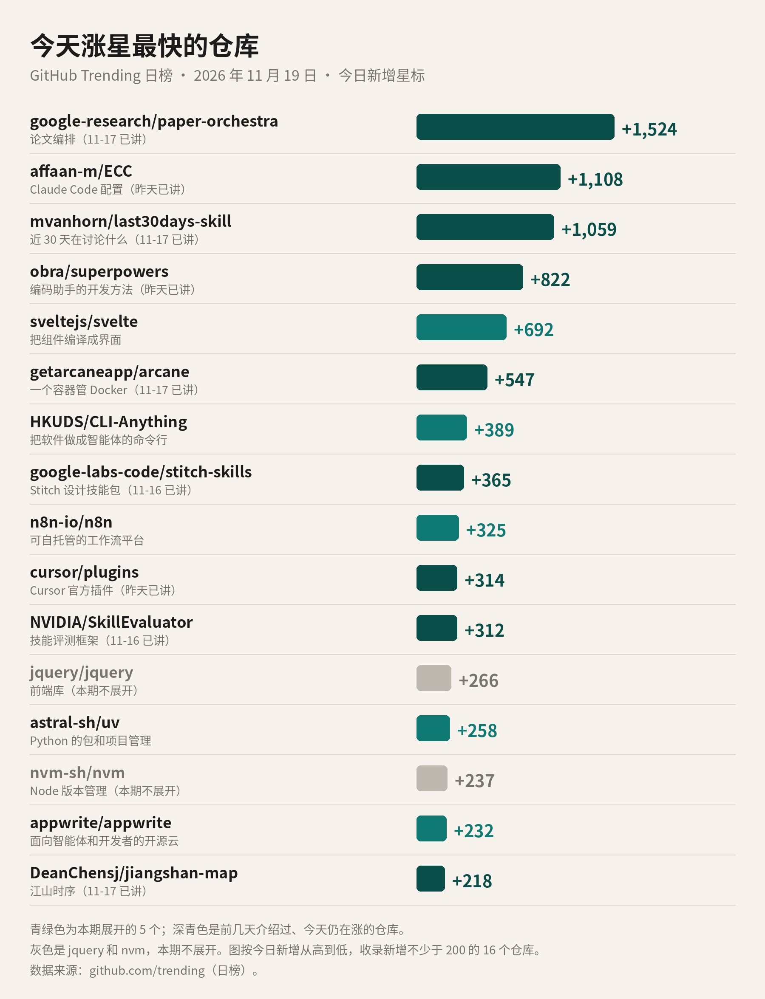
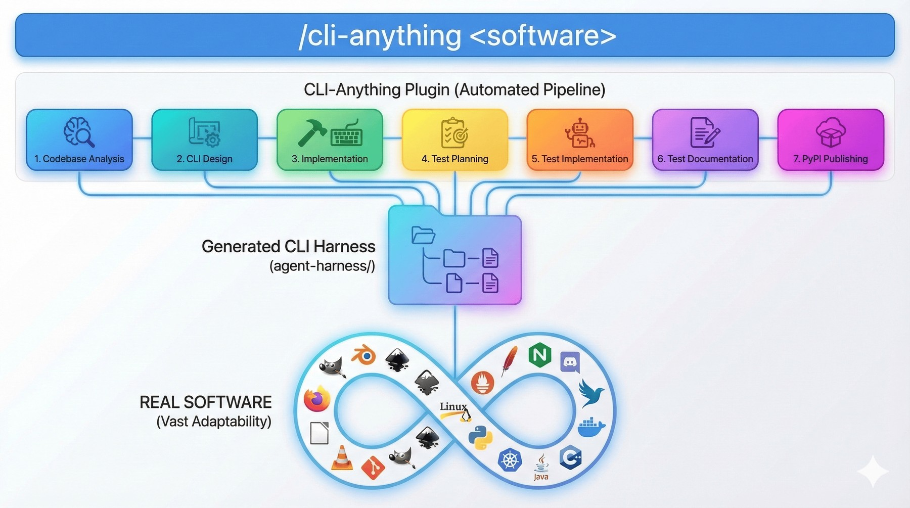
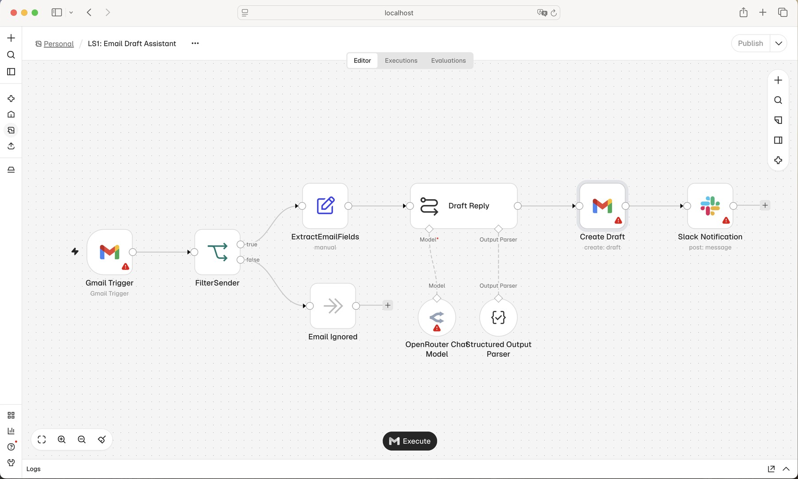
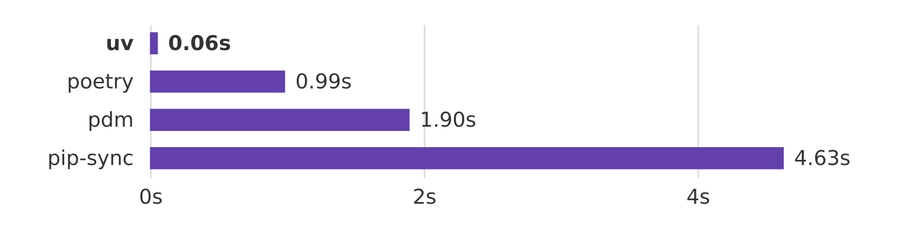
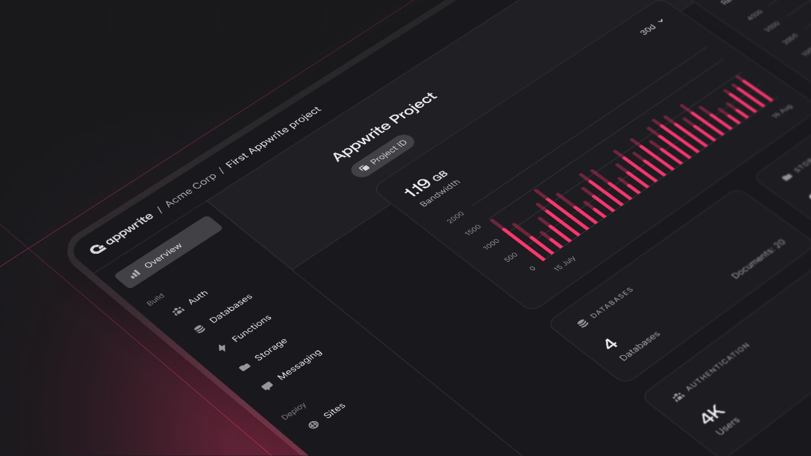
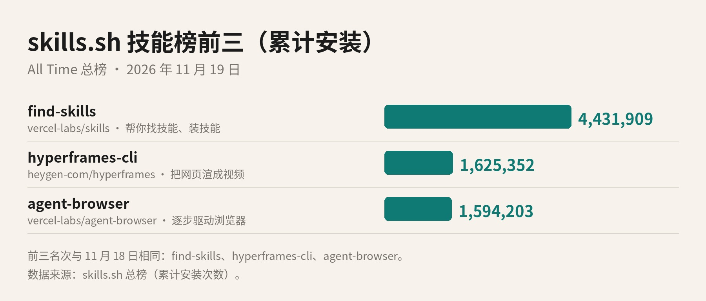

# 2026-11-19 GitHub 热门日报

## 标题备选

1. 把现成软件收成命令行：CLI-Anything 今天涨了 389 颗星
2. GitHub 热门日报：n8n 不能按普通开源来用，Svelte 今天涨了 692 颗星
3. 技能榜前三没变，Svelte 今天涨了 692 颗星

## 作者

刀哥

## 正文

日榜上，前几天讲过的项目今天还在涨。新增最多的是 PaperOrchestra，涨了 1,524 颗星，总星数 4,293。11 月 17 日讲它的时候，日榜上是 313 颗，总星数是 1,529。昨天讲过的 ECC 涨了 1,108 颗星。11 月 17 日讲过的 last30days 涨了 1,059 颗星。昨天讲过的 Superpowers 涨了 822 颗星。11 月 17 日讲过的 Arcane 涨了 547 颗星。11 月 16 日讲过的 Stitch 技能包涨了 365 颗星。昨天讲过的 cursor/plugins 涨了 314 颗星。11 月 16 日讲过的 SkillEvaluator 涨了 312 颗星。11 月 17 日讲过的江山时序涨了 218 颗星。这些今天不再展开。

今天单独写五个：把已有软件收成智能体能调用的命令行，CLI-Anything，涨了 389 颗星；把界面编译成 JavaScript 的 Svelte，涨了 692 颗星；工作流平台 n8n，涨了 325 颗星；Python 的包和项目管理器 uv，涨了 258 颗星；面向智能体和开发者的开源云 Appwrite，涨了 232 颗星。

*GitHub Trending 日榜，按今日新增星标从高到低，收录今日新增不少于 200 的 16 个仓库。青绿色为本期展开的 5 个：Svelte、CLI-Anything、n8n、uv、Appwrite。深青色是前几天介绍过、今天仍在涨的仓库。灰色是 jquery 和 nvm，本期不展开。数据来源：https://github.com/trending?since=daily*

### 把现成软件收成命令行：CLI-Anything

HKUDS/CLI-Anything 今天涨了 389 颗星，总星数 59,749。主要语言是 Python，许可证 Apache-2.0。口号是 Making ALL Software Agent-Native。主页 clianything.cc 是 CLI-Hub。技术报告在 arXiv:2606.03854，题目是 CLI-Anything: Towards Agent-Native Computer Use，作者是 Yuhao Yang、Tianyu Fan、Chao Huang。

**仓库 2026 年 3 月 8 日创建。最新正式版 v0.4.0 发在 6 月 25 日。GitHub 上最后一次推送是 9 月 22 日。**

已经做好的命令行，从 CLI-Hub 装。`pip install cli-anything-hub`，然后 `cli-hub install <名字>`。cli-hub 的 setup.py 写明 Python 3.10 及以上。要给一份现成代码库新做命令行，走 README 那张架构图里的七段流水线：分析代码库，设计命令行，实现，规划测试，写测试，写测试文档，发到 PyPI。生成出来的是一个 Python 命令行，去调这个软件自己的接口，输出 JSON。

*CLI-Anything 官方 README 中的架构示意图。来源：https://github.com/HKUDS/CLI-Anything*

v0.4.0 的发行说明写，这一版加上了 `cli-hub matrix` 这组命令，按任务把一整套 CLI 一次装好，并新增了 30 个 CLI。README 文末写，有 18 个专业软件的演示。

### 编译器做界面：Svelte

sveltejs/svelte 今天涨了 692 颗星，总星数 89,620。主要语言是 JavaScript，许可证 MIT。网站在 svelte.dev。README 的那句是 web development for the rest of us。文档首页写，它是构建网页界面的框架，用编译器把 HTML、CSS 和 JavaScript 写成的声明式组件，收成精简的 JavaScript，由这份 JavaScript 去更新 DOM。整站应用用配套的 SvelteKit。

最新编译器版本是 svelte@5.58.0，11 月 18 日发布。新增的两处都在开发期：渲染栈的 render 记录带上 snippet 的名字，以及记下元素是哪个组件实例渲染的，给 Svelte 开发工具用。其余是修复，还有编译和服务端渲染的性能改动。

峰会官网和 10 月 1 日的官方月报都写，Svelte Summit 在卢布尔雅那，11 月 19 日到 20 日，给 Svelte 过十周年。讲者名单里有 Svelte 的作者 Rich Harris。

配套框架 SvelteKit 的当前大版本是 3，10 月 1 日宣布。公告里写到的结构变化包括：配置改放到 vite.config.ts，不再是 svelte.config.js；`$lib` 改成 `#lib`。升级命令是 `npx sv migrate sveltekit-3 --tasks all --confirm`。同一篇公告写，remote functions 还没准备好。要用它，得开着 Async Svelte，而 Async Svelte 目前还要 experimental 开关。

### 工作流可以自托管，许可先看清楚：n8n

n8n-io/n8n 今天涨了 325 颗星，总星数 211,077。主要语言是 TypeScript。仓库描述是 Fair-code workflow automation platform with native AI capabilities。网站在 n8n.io。README 把它写成做 AI 智能体和工作流的平台：画布上搭，也能写 JavaScript、Python 和 npm 包。可以自托管，也可以用云。README 写能连 1500 多个集成，模板有 9,000 多个。名字来自 nodemation，读作 n-eight-n。创始人 Jan Oberhauser 把这段写在 README 里。

许可证按仓库 LICENSE.md，名称是 Sustainable Use License，版本 1.0。README 写它是 fair-code，另有一份 n8n Enterprise License。**你只能在自己的内部业务里使用或修改，或者用于非商业和个人用途。分发给别人，或提供给别人用，必须免费，而且只能用于非商业目的。** 这份许可不可再许可，也不可转让。文件名或目录名里带 `.ee` 的源码不在 Sustainable Use License 里，要有一份有效的 n8n Enterprise License，条款在 LICENSE_EE.md。master 以外的分支，LICENSE.md 写明不授权。

自托管可以用官方安装脚本，或 Docker，编辑器在 localhost:5678。云在 app.n8n.cloud。README 写，企业许可用来换额外功能和支持。

*n8n 官方 README 中的编辑器截图。来源：https://github.com/n8n-io/n8n*

README 写，模型可以接 OpenAI、Anthropic、Google，或开源模型。MCP 有两个方向。实例自己带 MCP 服务器，云和自托管都能开，入口在 Settings 里的 Instance-level MCP，需要实例所有者或管理员。连上之后，客户端可以搜工作流、操作你标成可用的工作流、触发和测试，也能创建和修改工作流与数据表。文档写，构建和修改工作流从 n8n 2.13.0 开始提供。另一头，工作流里的 MCP Client 节点去调外部 MCP 服务器上的工具。要给 AI Agent 当工具用，用的是 MCP Client Tool 节点。

默认不是把实例里的工作流全部交出去。先打开实例级 MCP，再逐个把工作流标成 Available in MCP。search_workflows 是例外：当前用户有权查看的工作流它都能搜到预览，但不是完整数据。你打开给 MCP 的那些工作流，连上的客户端都能看见，不能按客户端再切一层；用户自己的权限还在。execute_workflow 默认跑已发布的版本。文档另写，从 2.36.0 起可以打开「新建的工作流自动暴露」，默认关着，只影响打开之后新建的工作流，而且这个设置还在逐步推出。自托管要把 MCP 整个拿掉，设 `N8N_DISABLED_MODULES=mcp`。

11 月 18 日的 stable 标签是 n8n@2.48.5。发行说明里大多是修复，另有公共 API 速率限制变更时的审计事件，以及 n8n Assistant 分类实验的 v3。同一天，1.x 维护版发了 1.123.98。

### 一个命令管 Python 的包和版本：uv

astral-sh/uv 今天涨了 258 颗星，总星数 92,220。主要语言是 Rust。README 写许可证二选一，Apache-2.0 或 MIT，由使用者选。文档在 docs.astral.sh/uv。出品方是 Astral，同一家还做 Ruff 和 ty。

README 把它定义成极快的 Python 包和项目管理器，用 Rust 写成。一个工具盖住 pip、pip-tools、pipx、poetry、pyenv、twine、virtualenv 这些事：管项目和统一锁文件、跑单文件脚本、安装 Python 版本、运行发在 PyPI 上的命令行工具。README 写它比 pip 快 10 到 100 倍，对照放在仓库的 BENCHMARKS.md。FAQ 写它已经稳定，可以上生产。macOS、Linux、Windows 都能装。本机没有 Rust 或 Python 也能装，macOS 和 Linux 用官方的 curl 脚本。读音 README 写成 you-vee。

*uv 官方 README 中的 SVG 示意图，转成 PNG。暖缓存下安装 Trio 的依赖。图上是 uv 0.06 秒、poetry 0.99 秒、pdm 1.90 秒、pip-sync 4.63 秒。来源：https://github.com/astral-sh/uv*

最新版是 0.13.9，11 月 17 日发布。发行说明放在 Preview features 下的有两项：项目环境支持 PEP 832 的 `.venv` 重定向文件；`http2-keep-alive` 用来关掉还挂着请求、但已经没有响应的 HTTP/2 连接。性能上，锁文件把重复的环境标记条件抽出来，文件更小，读得更快。修复里有一条：索引如果用别的包名宣传一个 wheel，直接拒绝。从源码编译 uv 的最低 Rust 版本升到 1.98。

### 给智能体和开发者的开源云：Appwrite

appwrite/appwrite 今天涨了 232 颗星，总星数 58,228。主要语言是 TypeScript，许可证 BSD-3-Clause。网站在 appwrite.io。仓库描述和 README 的定义是同一句：面向智能体和开发者的开源云。README 进一步写，它是 MCP、面向智能体的平台，用来做应用、做规模。有托管云，也可以在自己的机器上自托管。

README 列出的产品是 Auth、Databases、Storage、Functions、Sites、Messaging、Firewall、Realtime，再加上 MCP。Auth 管邮箱、短信、OAuth、匿名会话和 magic URL。数据库可以用 Appwrite 自己的，也可以用托管的 PostgreSQL 和 MySQL。Storage 有压缩、加密、图片变换和权限。Functions 跑在隔离的运行时里。Sites 从 Git 部署静态、SSR 和 CSR 前端。Messaging 统一发邮件、短信和推送。Firewall 做流量规则、滥用控制和边缘安全。Realtime 订阅项目里的事件。接口有 REST、WebSocket 和 GraphQL。

云在 cloud.appwrite.io。README 写 Cloud 有免费档，要扩容再用付费档。MCP 在云上是附带的，不用在本机再装一份。托管地址是 https://mcp.appwrite.io/ ，用 OAuth，不用自己建 API key。README 写可以接到 Cursor、Claude Code、Codex。自托管实例用另一份本地 MCP 服务器。

自托管需要 Docker。**README 写，安装向导只听 20080 端口，并且只发布在本机。终端会打出一个一次性密钥。远程机器用 SSH 隧道连 127.0.0.1:20080，不要把这个端口公开到所有网卡。** 最新自托管版本是 2.7.3，11 月 17 日发布，是 2.7 的维护补丁：基础镜像换成 appwrite/base 2.2.12，executor 换成 openruntimes/executor 1.3.5，用来清掉镜像里已公开的漏洞发现。从 2.7.2 升上来不用改表结构。README 里的安装示例还写着镜像 tag `2.7.2`。

*Appwrite 官方 README 顶部的控制台图。来源：https://github.com/appwrite/appwrite*

### 技能榜前三：名次没变

skills.sh 总榜按累计安装次数排。前三名没变，还是 find-skills、hyperframes-cli、agent-browser。

*skills.sh All Time 总榜前三，按累计安装次数。名次与 11 月 18 日相同，仍是 find-skills、hyperframes-cli、agent-browser。数据来源：https://skills.sh/*

第一名 find-skills，累计 4,431,909 次，来自 vercel-labs/skills，帮你在技能库里搜索并安装。昨天是 4,414,433 次。第二名 hyperframes-cli，累计 1,625,352 次，来自 heygen-com/hyperframes，教 AI 用 HeyGen 的 HyperFrames 把网页和素材渲成视频。昨天是 1,610,281 次。第三名 agent-browser，累计 1,594,203 次，昨天是 1,575,228 次。昨天已经展开讲过，今天不单写。它给智能体一套可以逐步驱动的浏览器命令行。

第二名比第三名多 31,149 次。昨天这个差距是 35,053 次，略缩。第四名是 hyperframes，累计 1,589,375 次，昨天是 1,573,792 次。第五名 grill-me，累计 1,574,474 次，昨天是 1,568,616 次。agent-browser 比 grill-me 多 19,729 次，昨天这个差距是 6,612 次。

### 如果只记三句

第一，CLI-Anything 把现成软件收成智能体能调用的命令行。仓库 3 月 8 日就建了，最新版 v0.4.0 发在 6 月 25 日，最后一次推送是 9 月 22 日。今天它涨了 389 颗星。

第二，n8n 能自托管，也能用官方云。Sustainable Use License 只覆盖你自己的内部业务，或非商业、个人使用；给别人用必须免费且非商业。`.ee` 源码要企业许可。实例级 MCP 默认不会交出全部工作流。

第三，Svelte 是编译器框架，最新版 5.58.0。峰会官网写，11 月 19 日到 20 日在卢布尔雅那过十周年。uv 0.13.9 里的 PEP 832 和 http2-keep-alive 标在 Preview features 下。Appwrite 的官方定义是面向智能体和开发者的开源云，安装向导只绑本机 20080。

开源项目更新很快。真要装之前，打开它的 GitHub 页面，看一眼最新的 README。

## 来源清单

- https://github.com/trending?since=daily
- https://github.com/google-research/paper-orchestra
- https://github.com/affaan-m/ECC
- https://github.com/mvanhorn/last30days-skill
- https://github.com/obra/superpowers
- https://github.com/getarcaneapp/arcane
- https://github.com/google-labs-code/stitch-skills
- https://github.com/cursor/plugins
- https://github.com/NVIDIA/SkillEvaluator
- https://github.com/DeanChensj/jiangshan-map
- https://github.com/jquery/jquery
- https://github.com/nvm-sh/nvm
- https://github.com/HKUDS/CLI-Anything
- https://clianything.cc/
- https://hkuds.github.io/CLI-Anything/
- https://arxiv.org/abs/2606.03854
- https://github.com/HKUDS/CLI-Anything/releases/tag/v0.4.0
- https://github.com/sveltejs/svelte
- https://svelte.dev
- https://svelte.dev/docs/svelte/overview
- https://github.com/sveltejs/svelte/releases/tag/svelte%405.58.0
- https://svelte.dev/blog/whats-new-in-svelte-october-2026
- https://svelte.dev/blog/sveltekit-3-is-here
- https://sveltesummit.com/
- https://github.com/n8n-io/n8n
- https://github.com/n8n-io/n8n/blob/master/LICENSE.md
- https://github.com/n8n-io/n8n/blob/master/LICENSE_EE.md
- https://n8n.io
- https://faircode.io
- https://app.n8n.cloud/login
- https://docs.n8n.io
- https://docs.n8n.io/connect/connect-to-n8n-mcp-server
- https://docs.n8n.io/integrations/builtin/core-nodes/n8n-nodes-langchain.mcpclient
- https://github.com/n8n-io/n8n/releases/tag/n8n%402.48.5
- https://github.com/astral-sh/uv
- https://github.com/astral-sh/uv/blob/main/LICENSE-APACHE
- https://github.com/astral-sh/uv/blob/main/LICENSE-MIT
- https://docs.astral.sh/uv
- https://github.com/astral-sh/uv/blob/main/BENCHMARKS.md
- https://github.com/astral-sh/uv/releases/tag/0.13.9
- https://github.com/appwrite/appwrite
- https://appwrite.io
- https://cloud.appwrite.io/
- https://mcp.appwrite.io/
- https://appwrite.io/docs/advanced/self-hosting/mcp
- https://github.com/appwrite/appwrite/releases/tag/2.7.3
- https://skills.sh/
- https://skills.sh/vercel-labs/skills/find-skills
- https://skills.sh/heygen-com/hyperframes/hyperframes-cli
- https://skills.sh/vercel-labs/agent-browser/agent-browser
- https://skills.sh/heygen-com/hyperframes/hyperframes
- https://skills.sh/mattpocock/skills/grill-me
