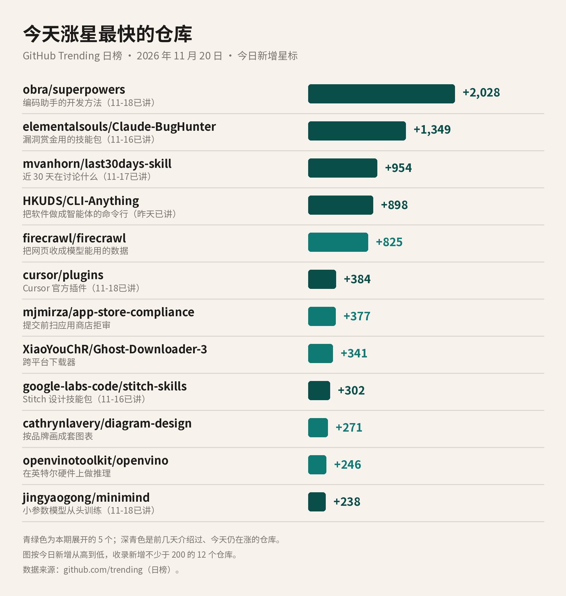
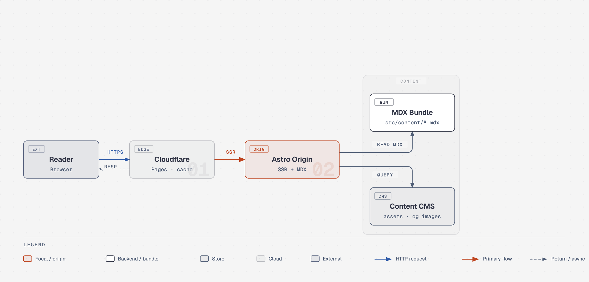
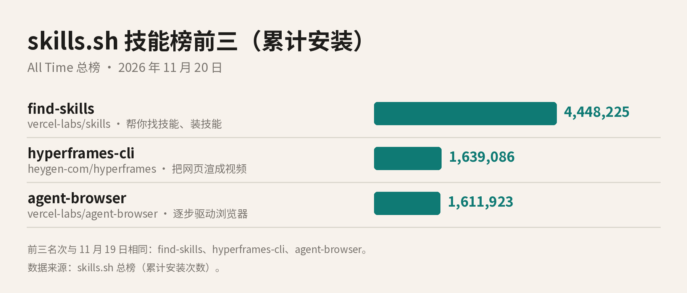

# 2026-11-20 GitHub 热门日报

## 标题备选

1. 网页交给模型之前先过一遍：Firecrawl 今天涨了 825 颗星
2. GitHub 热门日报：Firecrawl 按 AGPL 授权，合规手册要看收入门槛
3. 技能榜前三没变，Superpowers 今天涨了 2,028 颗星

## 作者

刀哥

## 正文

日榜上，前几天讲过的项目今天还在涨。新增最多的是 Superpowers，涨了 2,028 颗星，总星数 322,088。11 月 18 日讲它的时候，日榜上是 1,917 颗，总星数是 319,339。昨天的日榜上它涨了 822 颗。11 月 16 日讲过的 Claude-BugHunter 涨了 1,349 颗星，总星数 12,550，那天日榜上是 98 颗。11 月 17 日讲过的 last30days 涨了 954 颗星，总星数 70,805。讲它的时候日榜上是 135 颗，总星数是 68,133，昨天的日榜上是 1,059 颗。昨天讲过的 CLI-Anything 涨了 898 颗星，总星数 60,572。昨天是 389 颗，总星数 59,749。11 月 18 日讲过的 cursor/plugins 涨了 384 颗星，总星数 17,566。11 月 16 日讲过的 Stitch 技能包涨了 302 颗星，总星数 10,722。11 月 18 日讲过的 MiniMind 涨了 238 颗星，总星数 66,878。这些今天不再展开。

今天单独写五个：把网页收成模型能读的材料，Firecrawl，涨了 825 颗星；提交前先扫 App Store 和 Google Play 拒审的 app-store-compliance，涨了 377 颗星；一个应用接下常见下载的 Ghost Downloader，涨了 341 颗星；让智能体按你的品牌画图的 diagram-design，涨了 271 颗星；在英特尔硬件上做推理的 OpenVINO，涨了 246 颗星。

*GitHub Trending 日榜，按今日新增星标从高到低，收录今日新增不少于 200 的 12 个仓库。青绿色为本期展开的 5 个：Firecrawl、app-store-compliance、Ghost-Downloader-3、diagram-design、OpenVINO。深青色是前几天介绍过、今天仍在涨的仓库。数据来源：https://github.com/trending?since=daily*

### 三种跑法，许可先看清楚：Firecrawl

firecrawl/firecrawl 今天涨了 825 颗星，总星数 204,241。主要语言是 TypeScript。网站在 firecrawl.dev。仓库描述是 Knowledge infrastructure to make your agents smarter。这个仓库放的是 Firecrawl Local，和可以自己架的服务器，再加上三种用法都能接的 SDK。

许可证以仓库 LICENSE 为准，主体是 GNU Affero General Public License v3.0，也就是 AGPL-3.0。README 写，SDK 和一部分界面组件是 MIT。**AGPL 和 MIT、Apache 不是一回事：你改了这份程序，又让别人通过网络来用你改过的服务，就要向这些用户提供对应源码。**

README 把用法分成三路。

Firecrawl Local 在你自己的机器上跑。一个二进制，把网页收成 markdown，也能当成 MCP 服务器，并在本机开 API。安装是 `cargo install firecrawl-local`，要有 Rust 和 C 编译器。静态页面没有浏览器也能抓。需要 JavaScript 的页面，用机器上已经装着的 Chrome 或 Chromium。PDF 和 Office 文档在本机解析。`serve` 在 3002 端口提供 v2 API，本机这些路由不用 API key。MCP 要 Node.js 22 或更新。`init` 会去找本机的 Claude Code、Claude Desktop、Cursor、Windsurf、Gemini CLI 和 Codex，把 Local 加进去，改配置之前先备份。

Firecrawl Cloud 在 firecrawl.dev。Local 能做的事它也能做，另外有搜索、Alexandria、Interact 和 Agent。README 的对照表写，结构化 JSON、摘要、截图和浏览器动作在云上。搜索即使从 Local 发起，也走云。不登录也能调，有次数限制，登录之后算进你的账号。单页如果本机打不开，默认改由云去取，结果里标 `source` 为 `firecrawl-cloud`。要全程留在本机，设 `FIRECRAWL_CLOUD=off`。

自托管是把 `apps/api` 里的完整服务器用 Docker Compose 跑起来，旁边是 Redis、PostgreSQL 和浏览器服务。更大的部署可以看仓库里的 Kubernetes 清单和 Helm chart。README 写，Alexandria 跑在云上，自托管的服务器不含它。

Alexandria 是云上的数据供应商库。README 写有 550 多个供应商。发现工具不另收费，真正调用按那个工具标的额度扣。

定价在 firecrawl.dev/pricing。免费档每月 1,000 额度，0 美元，不需要信用卡。Hobby 月付 19 美元，每月 5,000 额度。Standard 月付 99 美元，每月 100,000 额度。搜索和抓取页面共用这一池额度。再往上还有 Growth、Scale，以及按需报价的 Enterprise。README 另写 Keyless：不注册、不用 API key，额度也是每月 1,000，官方 MCP、命令行和 API 能直接用。

最新打了标签的正式版是 v2.11.0，6 月 19 日发布。

默认遵守 robots.txt。README 写，尊重目标网站自己的规则，是使用者的事。

### 提交之前先拦住拒审：app-store-compliance

mjmirza/app-store-compliance 今天涨了 377 颗星，总星数 1,853。主要语言是 Shell。可读版在 mjmirza.github.io/app-store-compliance。仓库 6 月 6 日创建。当前版本 2.4.0，11 月 15 日发布。VERSION 文件写着 2.4.0。拒审模式和监管期限两份数据的 version 字段也是 2.4.0，更新日期都是 11 月 15 日。

这不是 MIT，也不是 Apache。整仓，文档、数据、脚本、技能和守卫，用的是 OpenRoots Agent License 2.3，SPDX 名是 LicenseRef-OpenRoots-ORA-2.3。仓库里的 LICENSE 是一份指针，生效文本在 openroots.org/licenses/ora/2.3/legalcode.txt。README 写明，上面没有再叠一层 MIT 或知识共享。

**个人、非营利、学校、政府，不看规模，可以免费使用、修改和分发。公司年总收入在 2,000 万美元及以下，也可以免费商用。** 这个门槛每年 1 月按通胀调整。过线之后，只对用到这份手册的产品、超出门槛的那部分收入收 0.5%，一年封顶 25 万美元，按季自己申报。过线之前的不补缴。用在你自己的智能体里、改它、拿它给你自己的客户做事，各档都允许。把它重新包装成你卖的那份产品，要另签书面协议。用这份仓库训练模型不在许可里，任何档都要另拿 Compute 许可。给人读、给搜索引擎收录，不受这条限制。这份许可不会过一段时间自动换成别的许可证。8 月 24 日之前发布的，代码仍是 MIT，内容仍是 CC BY 4.0。8 月 24 日到 27 日之间的发布按 OpenRoots Agent License 1.0。8 月 27 日以后按 2.3。

它做的事，是在你把应用交给 App Store 或 Google Play 之前先扫一遍。守卫发现严重拒审风险，就拦住提交命令。也可以只读文档和数据，不装钩子。安装要 git 和 bash。除了 Claude Code，其他工具还要 python3。README 列了能装进去的工具，其中包括 Cursor、Codex、Gemini CLI 和 GitHub Copilot。扫不到的，README 也写了：开发者账号是否还有效，协议有没有点完，商店页面上的声明和后台里的数据用途。这些要人去看。

数字以仓库里的数据文件为准。`data/rejection-patterns.json` 有 123 条拒审模式：严重 38 条，高 65 条，中 20 条。按平台分，苹果 61 条，谷歌 43 条，两边都算的 13 条，web 6 条。`data/detection-recipes.json` 里有 113 条检测命令。`data/regulatory-deadlines.json` 有 107 条监管期限。守卫每次跑都会带上期限检查。单独看，用 `scripts/deadline-checker.py`，它打出滚动 90 天窗口里的期限。

2.4.0 的发行说明写，这一版补上了几条以前能绕过守卫的上传路径：`helm-asc`、`asc` 命令行，以及 Codemagic 的 `app-store-connect publish`。新检查里有一条标成严重：Android 正式包的清单把 `android:debuggable` 设成 true。另外有 iOS 部署目标低于 13、只用 IPv4 的网络接口、HealthKit 配上 iCloud，以及 `abiFilters` 带了 32 位却没有 arm64。

### 一个应用接下常见下载：Ghost Downloader

XiaoYouChR/Ghost-Downloader-3 今天涨了 341 颗星，总星数 12,734。主要语言是 Python。网站在 gd.xychr.com。仓库描述的英文是 The only downloader you need，中文是下载器的集大成者。版权声明是 Copyright 2023-2026 XiaoYouChR。

许可证是 GPL-3.0。这是 copyleft：把程序或改过的版本再发给别人，要沿用 GPL-3.0，并给出对应源码。

README 写，它想用一个应用盖住常见下载：HTTP、磁力链和 BT、FTP、M3U8、MPEG-DASH、eD2k。YouTube 和 Bilibili 可以选片段、画质和字幕，也能下播放列表和多 P。GitHub 和 HuggingFace 带镜像加速。浏览器扩展跟着视频走，桌面端接过下载，登录状态带着走。命令行 `ghd` 从设置里安装，能探链接、加任务、暂停和等待结束。另有一套和 aria2 兼容的 RPC，下载进行中可以改 URL、请求头或代理。

平台按 README 的表：Windows 10 及以上，macOS 13.0 及以上，Linux 要 glibc 2.35 及以上，Android 9.0 及以上。桌面有 x86_64 和 arm64，Android 是 arm64-v8a。README 警告，Qt 6.6 及以上不再支持没有 AVX 指令的 CPU。

*Ghost Downloader 官方 README 中的产品图。来源：https://github.com/XiaoYouChR/Ghost-Downloader-3*

最新正式版是 v4.5.10，11 月 19 日发布。发行说明写，因为作者学业，往后更新会没那么勤。这一版加上阿拉伯语、马来语和土耳其语。翻译改到 Crowdin 上管，没译的回退英文。Linux 包默认带上 fcitx5 输入法。修了升到 4.5.9 之后界面语言卡在中文的问题。m3u8 功能包 1.3.0 把字幕改成单独的文件，默认关着。BT 引擎只在要用的时候启动，空闲 5 分钟后退出。

路线图还写着两件没做完的事：插件 API 还没公开。Feature Packs 已经能用，接口还在收稳。

### 让智能体按你的品牌画图：diagram-design

cathrynlavery/diagram-design 今天涨了 271 颗星，总星数 68,637。主要语言是 HTML，许可证 MIT。网站在 diagramdesign.dev。作者是 Cathryn Lavery。插件清单里的版本是 2.6.168，11 月 19 日由仓库的自动发版写进 manifest。GitHub Releases 上没有正式版标签，版本记在 `.claude-plugin/plugin.json`，变更记在 CHANGELOG.md。

它是一份智能体技能。你用普通话说要一张什么图，它选类型，写成一个自包含的 HTML 文件，里面是 SVG，双击就能打开。没有构建步骤，也不依赖外部图片。README 现文写 51 种图，每种三个静态变体：minimal light、minimal dark、full-editorial。图库里每种一个编号，从 01 到 51。变体和示例沿用同一个编号，后面加字母。

安装命令是 `npx skills add cathrynlavery/diagram-design`。README 写，它能装进读 Agent Skills 的宿主，包括 Cursor、Claude Code、Codex、Qoder、GitHub Copilot、Gemini CLI。Claude Code 也可以走插件市场，用 `/plugin marketplace add cathrynlavery/diagram-design`。README 写，官方构建只来自这个仓库。别的名字挂出来的清单，是非官方副本。

设计规则 README 收在一段里：一种强调色，一张图里 1 到 2 个焦点，1 像素细线，不要阴影，圆角最大 10 像素。坐标、宽度和间距都要能被 4 整除。三种字体：标题用 Instrument Serif，节点名用 Geist，技术标注用 Geist Mono。默认配色是近黑加橘色。也可以让它从你的网站取色和字体。

不适合的场合，README 自己写了。图要放进 Git、每个迭代都改，用 Mermaid，因为它能 diff，GitHub 也能直接渲染。一句话就能说清的，别画。清单用表格或项目符号。它可以读入 draw.io、Mermaid、Excalidraw 或 PlantUML，再按这套样式重画，并导出 PNG 或 SVG。

仓库的 PRIVACY.md 写，它没有自己的服务器，也不做遥测，LittleMight 收不到你的使用数据。生成的图在浏览器里打开时，字体会向 Google Fonts 请求，请求里没有图的内容。可以去掉这行字体引用，改用系统字体。

*diagram-design 官方 README 中的 Architecture 示例。来源：https://github.com/cathrynlavery/diagram-design*

### 在英特尔硬件上跑推理：OpenVINO

openvinotoolkit/openvino 今天涨了 246 颗星，总星数 11,568。主要语言是 C++，许可证 Apache-2.0。文档在 docs.openvino.ai。README 的定义是：优化和部署深度学习模型的开源工具包。它做的是推理。模型在别处训练好，拿到这里来转换，再部署跑起来。

README 写，模型可以来自 PyTorch、TensorFlow、ONNX、Keras、PaddlePaddle、JAX/Flax。转成它自己的格式之后，部署时可以不再带着原来的框架。接口有 C++、Python、C 和 Node.js，另有 GenAI API。Python 包装是 `pip install -U openvino`。生成式那一支是配套的 OpenVINO GenAI，安装说明在文档里，不在这一条命令里。

能跑在哪些机器上，README 和 2026 文档的系统要求是同一范围：CPU 包括 x86 和 ARM，GPU 是英特尔的核显和独显，加速器是英特尔 NPU。GPU 和 NPU 的驱动不在安装包里，要自己装。系统要求写了 Windows 10 和 11、若干 Linux 发行版，以及 macOS 12.6 及以上。macOS 这一段写的是 ARM64。

最新正式版是 2026.4.1，10 月 1 日发布。发行说明里，ONNX 前端的 `GroupQueryAttention` 补上了因果注意力和部分旋转位置编码，用来覆盖更多大语言模型。NPU 上修了一处崩溃：英特尔酷睿 Ultra 系列 3 在 Windows 上，配某些 NPU 驱动可能意外退出。说明里点名的驱动版本是 32.0.100.4300、32.0.100.4509 和 32.0.100.4512，并建议碰到这个问题的，从 2026.2、2026.3 或 2026.4 升到 2026.4.1。

README 写，OpenVINO 会收集性能和使用数据，可以直接收，也可以经 Google Analytics 4。可以随时关掉，命令是 `opt_in_out --opt_out`。

### 技能榜前三：名次没变

skills.sh 总榜按累计安装次数排。前三名没变，还是 find-skills、hyperframes-cli、agent-browser。

*skills.sh All Time 总榜前三，按累计安装次数。名次与 11 月 19 日相同，仍是 find-skills、hyperframes-cli、agent-browser。数据来源：https://skills.sh/*

第一名 find-skills，累计 4,448,225 次，来自 vercel-labs/skills，帮你在技能库里搜索并安装。昨天是 4,431,909 次。第二名 hyperframes-cli，累计 1,639,086 次，来自 heygen-com/hyperframes，教 AI 用 HeyGen 的 HyperFrames 把网页和素材渲成视频。昨天是 1,625,352 次。第三名 agent-browser，累计 1,611,923 次，昨天是 1,594,203 次。昨天已经展开讲过，今天不单写。它给智能体一套可以逐步驱动的浏览器命令行。

第二名比第三名多 27,163 次。昨天这个差距是 31,149 次，略缩。第四名是 hyperframes，累计 1,603,737 次。第五名 grill-me，累计 1,580,222 次。agent-browser 比 grill-me 多 31,701 次，昨天这个差距是 19,729 次，拉开了。

### 如果只记三句

第一，Firecrawl 今天涨了 825 颗星，总星数 204,241。主体许可是 AGPL-3.0。本地能抓、能爬、能列链接。搜索和 Alexandria 在云上，自托管不含 Alexandria。免费档每月 1,000 额度。

第二，app-store-compliance 不是 MIT。OpenRoots Agent License 2.3 下，年收入 2,000 万美元及以下的公司，以及个人、非营利、学校、政府，可以免费商用。训练模型要另拿许可。数据文件里是 123 条拒审模式、107 条监管期限。今天它涨了 377 颗星。

第三，技能榜前三没变，第二名只比第三名多 27,163 次。Ghost Downloader 最新版 v4.5.10 是昨天发的，许可证 GPL-3.0。diagram-design 的 README 现文是 51 种图。OpenVINO 2026.4.1 做的是推理，许可证 Apache-2.0。

开源项目更新很快。真要装之前，打开它的 GitHub 页面，看一眼最新的 README。

## 来源清单

- https://github.com/trending?since=daily
- https://github.com/obra/superpowers
- https://github.com/elementalsouls/Claude-BugHunter
- https://github.com/mvanhorn/last30days-skill
- https://github.com/HKUDS/CLI-Anything
- https://github.com/cursor/plugins
- https://github.com/google-labs-code/stitch-skills
- https://github.com/jingyaogong/minimind
- https://github.com/firecrawl/firecrawl
- https://github.com/firecrawl/firecrawl/blob/main/LICENSE
- https://github.com/firecrawl/firecrawl/blob/main/SELF_HOST.md
- https://firecrawl.dev
- https://www.firecrawl.dev/pricing
- https://docs.firecrawl.dev
- https://docs.firecrawl.dev/contributing/self-host
- https://alexandria.firecrawl.dev
- https://github.com/firecrawl/firecrawl/releases/tag/v2.11.0
- https://github.com/mjmirza/app-store-compliance
- https://github.com/mjmirza/app-store-compliance/blob/main/LICENSE
- https://mjmirza.github.io/app-store-compliance/
- https://openroots.org/licenses/ora/2.3
- https://openroots.org/licenses/ora/2.3/legalcode.txt
- https://github.com/mjmirza/app-store-compliance/blob/main/data/rejection-patterns.json
- https://github.com/mjmirza/app-store-compliance/blob/main/data/detection-recipes.json
- https://github.com/mjmirza/app-store-compliance/blob/main/data/regulatory-deadlines.json
- https://github.com/mjmirza/app-store-compliance/releases/tag/v2.4.0
- https://github.com/XiaoYouChR/Ghost-Downloader-3
- https://github.com/XiaoYouChR/Ghost-Downloader-3/blob/main/LICENSE
- https://gd.xychr.com/
- https://gd.xychr.com/en/docs/
- https://github.com/XiaoYouChR/Ghost-Downloader-3/releases/tag/v4.5.10
- https://github.com/cathrynlavery/diagram-design
- https://github.com/cathrynlavery/diagram-design/blob/main/LICENSE
- https://github.com/cathrynlavery/diagram-design/blob/main/PRIVACY.md
- https://github.com/cathrynlavery/diagram-design/blob/main/CHANGELOG.md
- https://diagramdesign.dev
- https://cathrynlavery.github.io/diagram-design/
- https://github.com/openvinotoolkit/openvino
- https://github.com/openvinotoolkit/openvino/blob/master/LICENSE
- https://docs.openvino.ai
- https://docs.openvino.ai/2026/about-openvino/release-notes-openvino/system-requirements.html
- https://docs.openvino.ai/2026/about-openvino/additional-resources/telemetry.html
- https://github.com/openvinotoolkit/openvino/releases/tag/2026.4.1
- https://skills.sh/
- https://skills.sh/vercel-labs/skills/find-skills
- https://skills.sh/heygen-com/hyperframes/hyperframes-cli
- https://skills.sh/vercel-labs/agent-browser/agent-browser
- https://skills.sh/heygen-com/hyperframes/hyperframes
- https://skills.sh/mattpocock/skills/grill-me
