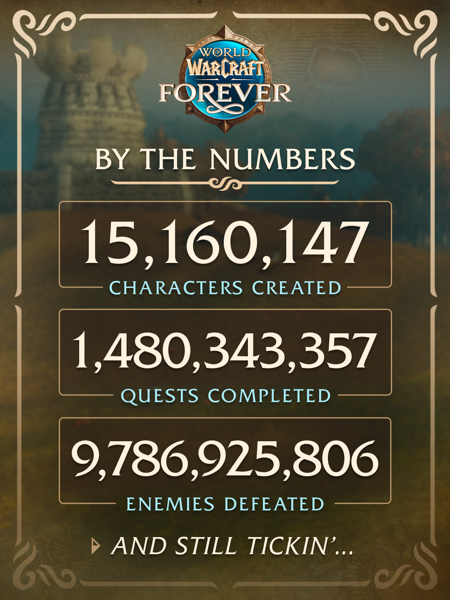
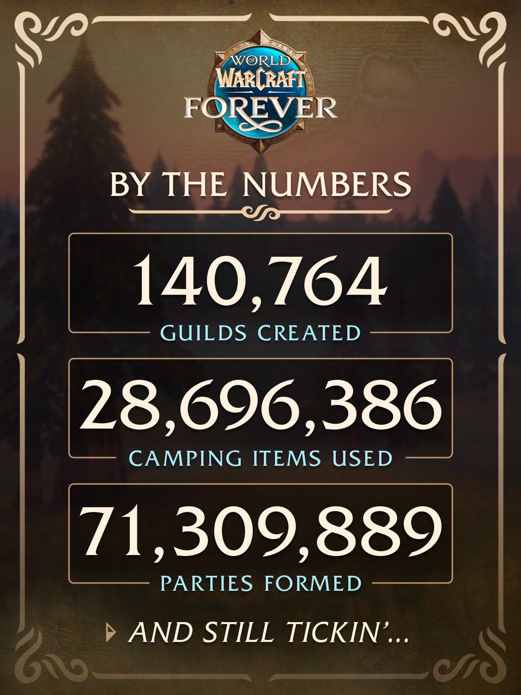
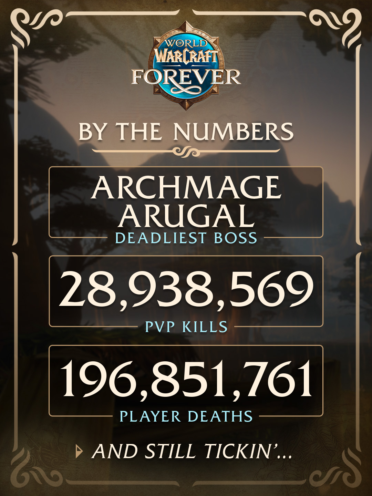

<!-- 站内稿；slug: hotfixes-nov-17-and-stats；作者：刀哥；皮肤见 site-page.html -->

# 11 月 17 日热修：黑石塔上层恢复难度、Soulforge 改法强；附官方角色数据

本周跑黑石塔上层，别再按异常低难度的状态排队。暴雪 11 月 17 日热修修正了敌人血量和伤害，同时调整睡袋、圣骑士装备、专业和一批任务。官方 X 账号另发了创建角色等数据：15,160,147 是角色数，不是玩家人数。本文把热修按用途归类，再把数据图和周活跃说法的统计边界说清。

## 先看黑石塔上层：这是修复低数值，不是新公布一套数值

- Upper Blackrock Spire 的敌人生命值和伤害显著低于预期，这次已修正。开发说明说，目的在于把黑石塔上层拉回预定难度，需要完整且认真配合的队伍。没有公布血量、伤害各上调多少，也没有给首领逐项数值。[〔官方 11-17 · Dungeons〕](https://news.blizzard.com/en-us/article/24315281/wow-forever-hotfixes-november-17-2026)

- 站内《副本专区》仍按「黑石塔上层 58–60、10 人本」介绍。攻略准备按站内队伍口径来，不从「full complement」这几个字再推导新的上限。本周周常正好要击败这里的达基萨斯将军；组周常队时，把难度恢复这一条提前说清。[〔站内副本专区〕](https://4evrcore.cn/wp/instances/)[〔周常任务文本〕](https://nether.wowhead.com/forever/tooltip/quest/96075)

- 这条只针对黑石塔上层，不等于黑石塔下层和黑石深渊同步加强。官方没有给这些副本一套新的通关时间，也没有保证这周只跑一次就够，别把路线规划写成收益承诺。[〔官方范围〕](https://news.blizzard.com/en-us/article/24315281/wow-forever-hotfixes-november-17-2026)

## 睡袋与职业：摆放更直观，增益和触发回到正常状态

- 舒适的睡袋不再允许角色骑在坐骑上睡觉；现在可以像放猎人陷阱一样选择具体摆放位置；进入效果范围会出现 Resting 光环，方便确认自己有没有站在范围内。公告没有在这批里更改经验加成或叠层速度。[〔Camping〕](https://news.blizzard.com/en-us/article/24315281/wow-forever-hotfixes-november-17-2026)[〔站内中文名〕](https://4evrcore.cn/wp/cozy-sleeping-bag/)

- Might of Stormwind 与 Warchief's Blessing 死亡后应正确移除，也不再施加给非玩家单位。萨满的 Flurry 不应再被风怒图腾的额外攻击错误消耗层数。这里只收 11 月 17 日的直接修复，不重写 11 月 16 日风怒和牧师调整。[〔Classes〕](https://news.blizzard.com/en-us/article/24315281/wow-forever-hotfixes-november-17-2026)

## 装备：Soulforge 官方定位已明确，手套异常数字仍不能补

- Soulforge Armor 现在提供法术强度，替代力量。官方特别注明这是坦克用的升级地下城套装，开发方向是让圣骑士坦克更偏重法强来造成伤害。国服本次尚无对应译文，站内也沿用 Soulforge，本文不另造套装中文名。[〔Items · Paladin〕](https://news.blizzard.com/en-us/article/24315281/wow-forever-hotfixes-november-17-2026)

- 站内旧稿按维护后的物品记录写「整体转向神圣骑治疗向」，还列了逐件智力与法强；本次官方说明和那个编辑判断存在冲突。本文只转述这次新清单的坦克定位，旧页不改。不能把旧稿手套「智力待核」补成某个夸张数字：新官方清单没有给手套智力，也没有重列八件属性。[〔站内已定稿〕](https://4evrcore.cn/wp/soulforge-darkmoon-item-changes/)[〔官方新清单〕](https://news.blizzard.com/en-us/article/24315281/wow-forever-hotfixes-november-17-2026)

- Whiteout Staff 和 Crackling Staff 调整为相同属性：25 耐力、25 智力，以及原文所写的「74 Spell Power from Weapon damage」。这里保留该来源表述，不擅自改写成武器每秒伤害或额外叠加的第二份法强。[〔Items〕](https://news.blizzard.com/en-us/article/24315281/wow-forever-hotfixes-november-17-2026)

- Escape Plan 的射程和伤害已修正，但清单没列数值；暗影牧师现在可以拿 Night Watchman's Torch。两件物品中文名没有在本次国服页和站内查到，保留原名。[〔Items〕](https://news.blizzard.com/en-us/article/24315281/wow-forever-hotfixes-november-17-2026)

## 专业与任务：受影响的人先回头试这几处

- 遭劫的板条箱：部分转换流程曾给出已经废弃的交付物，现在受影响玩家可以正常交箱领奖。Bronze Mace 改成装备绑定，因而也能加入幻化收藏；Craftsman's Writ: Golden Scale Gauntlets 在可交付时会正确指向 NPC。[〔Professions〕](https://news.blizzard.com/en-us/article/24315281/wow-forever-hotfixes-november-17-2026)[〔站内板条箱叫法〕](https://4evrcore.cn/wp/merchants-favor-guide/)

- The Old Ways 现在通过物品授予 Orcish War Leggings 配方。完成任务却没拿到、或后来弄丢配方的，可以去附近锻造小屋找 Sumi 补领。Cultivation 对 Mageroyal 的异常修复；Her World 用的 Wildflowers 只会在接了任务时被草药追踪显示。[〔Blacksmithing / Herbalism〕](https://news.blizzard.com/en-us/article/24315281/wow-forever-hotfixes-november-17-2026)

- The Battle for Alterac Valley 系列任务现在要求 58 级才能接；战歌峡谷起始房间内不能再上坐骑。屏蔽名单在退出游戏后不再丢失，三种武器大师专精的界面错误也修了。[〔PvP / User Interface〕](https://news.blizzard.com/en-us/article/24315281/wow-forever-hotfixes-november-17-2026)

- 辛德拉相关修复包括：Powering the Pylons 的修理目标与附近队员共享；Heart of Crystal 的 Depleted Crystal Heart 对队内所有人掉落；Spectral Iron Ore 可被矿工追踪、刷新更快；部分怪物施法频率下调，Summon Undead Ravager 可打断。官方未给刷新率或频率百分比。[〔Quests · Shen’dralas〕](https://news.blizzard.com/en-us/article/24315281/wow-forever-hotfixes-november-17-2026)[〔国服既有辛德拉译名〕](https://wow.blizzard.cn/news/24315281/index.html)

- Agamaggan's Blood 不再标为地下城任务，可在剃刀高地外的精英区域完成；盗贼 The Manor, Ravenholdt 的信件也可重新从 Mathias Shaw 处取得。Reagent Economy 随机失效的问题已修复。这里按会改变跑法的修复摘录，其余个别怪物卡岩石、地图任务标记等见完整清单。[〔Quests / Legacy〕](https://news.blizzard.com/en-us/article/24315281/wow-forever-hotfixes-november-17-2026)

## 官方数据：创建了多少角色，不等于来了多少人

- 官方 @Warcraft 于北京时间 11 月 18 日 08:00 发布三张「By the numbers」图。数字是累计事件，不是去重人数：创建角色 15,160,147；完成任务 1,480,343,357；击败敌人 9,786,925,806。不要写成「1,516 万玩家」或把任务总数四舍五入成超过 15 亿。[〔官方数据图 1〕](https://x.com/Warcraft/status/2122842235263680581)

- 另外两张图给出：创建公会 140,764；使用露营物品 28,696,386；组建队伍 71,309,889；PvP 击杀 28,938,569；玩家死亡 196,851,761。最致命首领为 Archmage Arugal。这里没有提供首领击杀玩家的具体次数，也没有地区、职业或国服占比。[〔官方数据图 2 / 3〕](https://x.com/Warcraft/status/2122842235263680581)

- Holly Longdale 于 08:03 补充的原话是「#WoWForever has more people playing weekly than we've seen in World of Warcraft in 15 years!」。主语确实是 #WoWForever，比较对象是过去 15 年的 World of Warcraft。可以转述为她称无限服周游玩人数超过这个比较范围内的水平；不能倒写为已经公布整个 WoW 当前周活总数，更不能给无限服填一个周活数字。[〔本人原帖〕](https://x.com/TheWindstalker/status/2122843024791314913)

- 两则帖文都没公布去重方法、精确统计起止、是否包含特定地区，也没给周活绝对值。三张图虽在开服约两周时发布，图文没有标完整统计窗口，所以本文不用「恰好两周」算人均死亡或付费玩家规模。[〔数据帖〕](https://x.com/Warcraft/status/2122842235263680581)[〔周活原帖〕](https://x.com/TheWindstalker/status/2122843024791314913)

来源：[https://x.com/Warcraft/status/2122842235263680581](https://x.com/Warcraft/status/2122842235263680581)，2026-11-18 08:00（Asia/Shanghai）。

来源：[https://x.com/Warcraft/status/2122842235263680581](https://x.com/Warcraft/status/2122842235263680581)，2026-11-18 08:00（Asia/Shanghai）。

来源：[https://x.com/Warcraft/status/2122842235263680581](https://x.com/Warcraft/status/2122842235263680581)，2026-11-18 08:00（Asia/Shanghai）。

## 国服状态与核对日期

- 国际服新清单按 11 月 17 日归档；新闻站发布时间为北京时间 11 月 18 日 11:23，Kaivax 第 12 楼为 11:24。发布时间不等于每项修正精确部署时刻。[〔新闻站〕](https://news.blizzard.com/en-us/article/24315281/wow-forever-hotfixes-november-17-2026)[〔蓝帖第 12 楼〕](https://us.forums.blizzard.com/en/wow/t/2403040/12)

- 国服页面现查：标题仍写「11 月 6 日」，但正文已列到「2026 年 11 月 12 日」，不能只看旧标题就说内容停在 11 月 6 日。本次 11 月 17 日条目尚未在该页找到；国服是否已生效，不据此断言。数据核对：2026 年 11 月 19 日（Asia/Shanghai）。[〔国服在线修正〕](https://wow.blizzard.cn/news/24315281/index.html)
