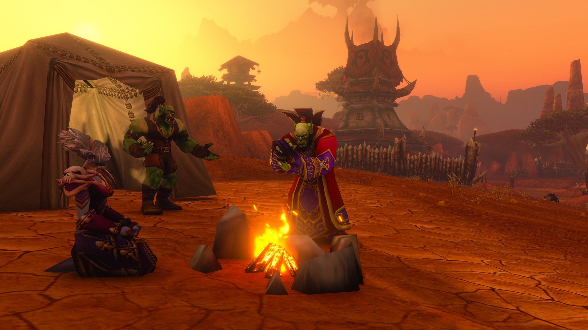

<!-- 仅网站成稿；slug: dungeon-reset-limit-nov-20；作者：刀哥；数据核对：2026-11-21（Asia/Shanghai） -->

# 地下城每小时重置并进入上限从 10 次降至 5 次：11 月 20 日热修要点

这次改的是每个地下城“重置并进入”的次数上限，不是角色迈过传送门的进出动作次数。同批还修复职业交互、黑石塔卡柱与任务问题；Stormshroud Armor 三件套则同时下调触发率与单次回能。

图源：[暴雪热修通用营地头图，不是限制机制截图](https://worldofwarcraft.blizzard.com/en-us/news/24315281/wow-forever-hotfixes-november-19-2026)。本地文件为下载原始 JPEG，未重编码。

## 先把“5 次”说准确

- 暴雪原文：Players can now reset and enter each dungeon a maximum of 5 times per hour (was 10). 即每小时对每个地下城重置并进入的上限，现为 **5 次**，此前为 **10 次**。这句话没有把普通出门、回本、断线重连逐项定义为一次。 [[官方原文]](https://us.forums.blizzard.com/en/wow/t/2403040/14)

- 因此，“每小时只能进出 5 次”不是这条公告的准确改写。单纯离开后再回到同一进度，是否另耗次数；限制按角色还是账号计算；整点还是滚动计时；不同地下城是否另有共享上限——官方这条没有展开，全部待核，不用旧版本经验补空白。 [[来源]](https://worldofwarcraft.blizzard.com/en-us/news/24315281/wow-forever-hotfixes-november-19-2026)

- 这是访问频率规则，不是新的击杀经验公式。不要由此推导一次副本的经验、掉落必定减少，也不要把两种机制揉成“每小时只能打 5 趟且经验如何变化”的结论。规划队伍时，优先把要做的任务集中在一次正常路线内；这只是行程建议，不是规避限制的方法。

## 职业：修复交互，不等于另开一轮全面调平

- 潜行者战斗系：Blade Flurry 现在会正确让 Shank 的伤害击中额外目标。公告没有列出新伤害倍率，不能写成 Shank 伤害上调多少。 [[来源]](https://us.forums.blizzard.com/en/wow/t/2403040/14)

- 术士恶魔学识：修复先把 Demonic Aegis 效果快照进 Demon Armor 或 Demon Skin、再洗掉天赋仍保留效果的问题。官方后一句写的是“Demonic Aegis and Demon Skin are removed when your talents are unlearned.”，本稿不擅自把其中名称改成另一个法术；中文名与实际移除对象如需逐项对应，仍应在客户端核对。 [[来源]](https://us.forums.blizzard.com/en/wow/t/2403040/14)

## Stormshroud Armor 三件套：两个参数都降低

- 近战攻击触发回能的几率由 **4% 降为 3%**；单次恢复能量由 **30 降为 18**。这是两项同时调整，不能只报其中一项，或者把 18 写成技能消耗。 [[物品项]](https://us.forums.blizzard.com/en/wow/t/2403040/14)

- 公告没有给出特定职业的实战覆盖率、每分钟触发次数或整套伤害变化。不同战斗条件下的收益需要实测，本篇不换算成“必降多少 DPS”。

## 副本、任务与界面：本次还有这些修复

- 黑石塔：修复一根石柱卡住冒险者的问题。奥格瑞玛：Mayhoa Skyhoof 的眼睛不再异常发光。两者都是问题修复，没有公布额外战斗数值。 [[来源]](https://us.forums.blizzard.com/en/wow/t/2403040/14)

- Summit of Eternity 的 Toron Rockhoof 修好了熔炉与铁砧，现在应可用于锻造和熔炼。新地名及 NPC 中文名未在本批国服公告核定，保留原文。 [[来源]](https://us.forums.blizzard.com/en/wow/t/2403040/14)

- 辛特兰：做 Witch Doctor Ti’ik 任务的队伍击杀目标时，会掉落多份任务头颅；没有给出每队固定几份。菲拉斯：已在 Perfect Yeti Hide 任务中时，不应再次掉落启动该任务的同名物品。 [[来源]](https://us.forums.blizzard.com/en/wow/t/2403040/14)

- 塔纳利斯：The Dunemaul Compound 目标 Gor’marok 刷新更快，未给出秒数。河林：Dunston Willis 不再于 Dunston Checks Out 中途跑走。寻找队伍界面：修复部分玩家看到的队伍数量低于预期的问题，非承诺任何时段都有更多队伍。 [[来源]](https://us.forums.blizzard.com/en/wow/t/2403040/14)

## 发布时间与国服口径

- 本批官方小标题为 **November 20, 2026**；Kaivax 第 14 楼发布于北京时间 **2026 年 11 月 21 日 08:18**（Asia/Shanghai）。给定新闻 URL 尾部仍是 november-19，但活页标题与正文已更新，引用时以正文日期为准。 [[来源]](https://us.forums.blizzard.com/en/wow/t/2403040/14) [[来源]](https://worldofwarcraft.blizzard.com/en-us/news/24315281/wow-forever-hotfixes-november-19-2026)

- 国服在线修正页现查正文最新日期仍为 **11 月 12 日**，尚未列出本批；这只是公告收录状态，不证明国服游戏一定没有部署。本文按国际服英文公告报道，不替国服宣布具体生效时刻。 [[来源]](https://wow.blizzard.cn/news/24315281/index.html)
