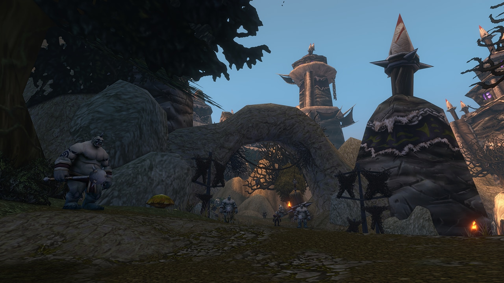

<!-- 仅网站成稿；slug: kroldok-compound-key-shortcut；作者：刀哥；数据核对：2026-11-21（Asia/Shanghai） -->

# 克罗多克要塞近路钥匙：先拿铸件，再备 4 厚皮与 12 铁锭

Krol’dok Compound Key 用于要塞内部近路，不是副本入口门禁。先从 Tunk 的铸件启动任务，再回河林交材料；已经拿到钥匙的队伍，可按两道门的地标找到通往监工莫格的路线。

图源：[国服官方副本前瞻，克罗多克要塞环境原图；不是近路标记地图](https://wow.blizzard.cn/news/24301455/index.html)。本地文件为下载原始 JPEG，未重编码。

## 进本前，先确认这趟是做任务还是走近路

- 副本沿用站内确定中文名**克罗多克要塞**，区域为**河林**；现站攻略列建议等级段 **40–45**、**5 人**。这不是本篇重新核定的硬性入本等级。站内明确入口无钥匙门禁，本篇新钥匙开启的是内部近路，两件事不矛盾。 [[站内定稿]](https://4evrcore.cn/wp/kroldok-stronghold/)

- 第一次来、还要做其他 Boss 或任务的队伍，不要为赶尾王直接删掉路线。开打前先问队友是否缺铸件、任务目标或其他首领；近路是已有钥匙后的选择，不是全清攻略的替代品。

## 先找 Tunk，拿到克罗多克铸件再接任务

- 按两家攻略的共同线索，Tunk 在本内锻造区域、阿什卡附近（站内名“驯兽师阿什卡”，外站称 War Handler Ashka，称号对应待核）；其掉落 Krol’dok Moulding，站内已定名为**克罗多克铸件**。这是“物品启动任务”，不是看见 NPC 就保证每人都有任务。数据库存在两个阵营版本，不能把两个掉落实体当成两种都要交的材料。 [[详细任务页]](https://www.icy-veins.com/wow-forever/krol-dok-stronghold-quests) [[部落物品]](https://www.wowhead.com/forever/item=267137) [[联盟物品]](https://www.wowhead.com/forever/item=267138)

- 先确认铸件已经进包，再点击启动 Krol’dok Moulding。部落版本目标是去 Rog’mar 找人，联盟版本目标是去 Farholde Keep 找人；Tunk 是否每人必掉、任务物品如何分配，本稿没有实装验证，不引用数据库样本掉率保证人人一趟拿到。 [[来源]](https://www.wowhead.com/forever/quest=94973) [[来源]](https://www.wowhead.com/forever/quest=94980)

## 回河林交材料：阵营分开，数量相同

- **部落**：到河林 Rog’mar 找 **Kreza Darkthorn**，交铸件后接 **Key Ingredients**。任务明确要求 **Thick Leather（厚皮）× 4** 与 **Iron Bar（铁锭）× 12**。 [[部落目标]](https://www.wowhead.com/forever/quest=94974)

- **联盟**：到河林 Farholde Keep 找 **Alphonse Dumas**，接对应的 **Key Ingredients**；同样交 **厚皮 × 4** 和 **铁锭 × 12**。NPC 与聚落尚未在站内口径或官方中文中核定，留原文，不现造中文名。 [[联盟目标]](https://www.wowhead.com/forever/quest=94981)

- 任务链的钥匙奖励为 **Krol’dok Compound Key**。物品提示是拾取绑定、唯一；不要推成账号共享、可交易给队友，或说整队人人自动解锁。可提前带好材料，减少交任务时补货的往返，但实际先后仍要依次接交。 [[来源]](https://www.wowhead.com/forever/news/unlock-a-dungeon-shortcut-in-wow-forever-with-the-compound-key-383890) [[钥匙物品]](https://www.wowhead.com/forever/item=267089)

## 拿钥匙后，按这条地标链走

- **第一段：**到**暮光指挥官扎尔莫克**（Twilight Commander Zarmok）身后，找到可用钥匙开启的门。此处使用站内 Boss 中文名，不另译。 [[来源]](https://www.wowhead.com/forever/news/unlock-a-dungeon-shortcut-in-wow-forever-with-the-compound-key-383890) [[来源]](https://4evrcore.cn/wp/kroldok-stronghold/)

- **第二段：**往最初 Tunk 所在位置的左侧路径，找到 **Krol’dok Gate**，再开这道门。这里的“左侧”以原报道的 Tunk 地标为准，不是从任何朝向看都向左；若与现场地形不符，停下来对地图，不盲拉怪。 [[来源]](https://www.wowhead.com/forever/news/unlock-a-dungeon-shortcut-in-wow-forever-with-the-compound-key-383890)

- **第三段：**穿门后顺路走，报道所述**监工莫格**（Overlord Mugg）在路径左边。钥匙让队伍选择内部路线，不是传送、不保证零战斗，也没有核实盗贼开锁可以替代。 [[来源]](https://www.wowhead.com/forever/news/unlock-a-dungeon-shortcut-in-wow-forever-with-the-compound-key-383890) [[来源]](https://4evrcore.cn/wp/kroldok-stronghold/)

## 经验、掉落与站内旧页：哪些不能写满

- 外站提到任务链约 **7,000** 总经验，但没有在本稿所核数据库目标提示中取得可对应等级的完整奖励依据，因此不把它列作保底收益。尾王特定掉落也不保证出现，更不据此推荐无限刷本赚钱。 [[经验说法仅线索]](https://www.wowhead.com/forever/news/unlock-a-dungeon-shortcut-in-wow-forever-with-the-compound-key-383890)

- 现站《克罗多克要塞》仍写铸件对应任务未公布、两把钥匙用途未知；《门禁与钥匙总览》也仍把相关用途列为待核。本篇记录新任务与近路线索，旧页不改；尤其不把 Compound Key 擅自等同于旧页的“克罗多克大门钥匙”或“克罗多克食人魔钥匙”。 [[来源]](https://4evrcore.cn/wp/kroldok-stronghold/) [[来源]](https://4evrcore.cn/wp/attunements-keys/)

- 这条近路来自攻略与物品/任务数据库交叉核查，不是刀哥现场实跑录像。两门精确坐标、开门是否只需一名队员持有、钥匙是否有特殊消耗条件，以及本服实际地图路径，留待现场核验。
