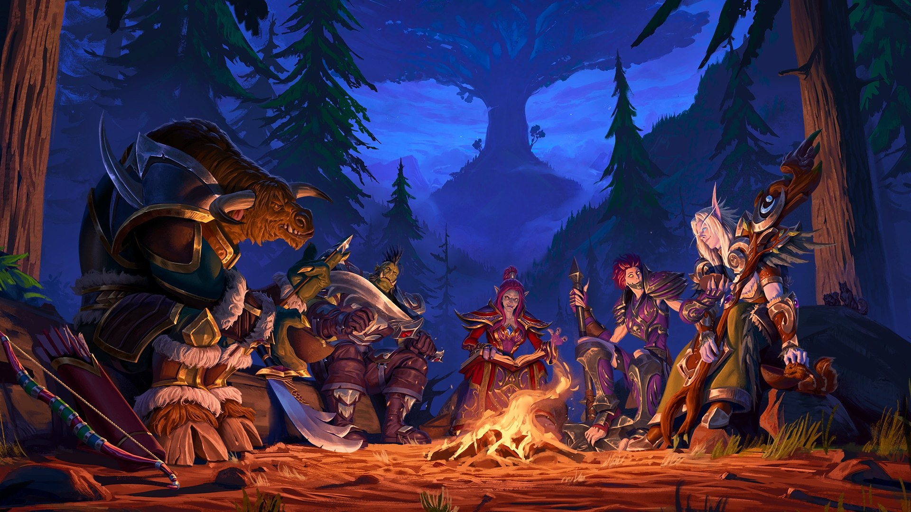

<!-- 仅网站成稿；slug: witherbark-gong-cave；作者：刀哥；数据核对：2026-11-21（Asia/Shanghai） -->

# 阿拉希枯木洞穴敲锣指南：有精英、有一次性任务，不是无限经验点

枯木洞穴里的锣可以触发一场精英遭遇。值得留意的是可能掉落的任务启动护腕；但启动物并非必掉，任务不是可重复经验来源，数据库样本比例也不能当真实掉率。

图源：[暴雪无限服上线通用宣传图；非套装外观、非洞穴路线截图](https://news.blizzard.com/en-us/article/24315820/world-of-warcraft-forever-now-live)。本地文件为下载原始 JPEG，未重编码。

## 先找洞穴，不把通用配图当路线地图

- Icy Veins 报道的位置在**阿拉希高地南部**，枯木村后方洞穴，入口约 **67.5, 80.9**。这是二手攻略的近似坐标，未做国服角色现场测点；进入前先确认地图区域与洞口，不照着任意一张宣传图找路。 [[来源]](https://www.icy-veins.com/wow-forever/news/a-secret-cave-with-a-familiar-mini-boss-has-been-found-in-wow-forever/)

- 报道说联盟与部落都可到这里参与遭遇，原因是区域可进入；但“能打怪”不等于两阵营能接同一个交付任务。后文把遭遇参与和任务资格分开，不把可到达写成任务通用。 [[来源]](https://www.icy-veins.com/wow-forever/news/a-secret-cave-with-a-familiar-mini-boss-has-been-found-in-wow-forever/)

## 准备枯木棒槌，再到洞内深处的大锣

- 洞中的枯木巨魔有机会掉落 **Witherbark Mallet**。官方国服在线修正已经用名**枯木棒槌**，本稿采用该中文名；物品使用文字为敲响枯木之穴的锣。不要把棒槌当成装备武器栏才能互动的要求，现有攻略只要求在背包中。 [[官方中文]](https://wow.blizzard.cn/news/24315281/index.html) [[物品]](https://www.wowhead.com/forever/item=216483) [[来源]](https://www.icy-veins.com/wow-forever/news/a-secret-cave-with-a-familiar-mini-boss-has-been-found-in-wow-forever/)

- 拿到棒槌后向洞内深处找到大锣，再互动触发。Icy Veins 描述会出现 **2 个 Witherbark Champion** 与 **1 个 Witherbark Goliath**；这组数量是媒体现场描述，不是本稿亲测。触发前清理撤退通道、让队友就位，别把敲锣当免费领奖按钮。 [[来源]](https://www.icy-veins.com/wow-forever/news/a-secret-cave-with-a-familiar-mini-boss-has-been-found-in-wow-forever/)

- 棒槌是否会消耗、多久可再次敲锣、每位队员是否都要携带，以及是否存在其他互动限制，现有已核材料没有完整说明，全部待核。不能由物品写“唯一”推成可以无限触发。 [[来源]](https://www.wowhead.com/forever/item=216483)

## Witherbark Goliath 是 35 级精英，先看队伍再开

- 数据库将 **Witherbark Goliath** 列为 **35 级精英**，媒体也强调其近战伤害很高。本篇未找到确定的本服中文名，保留原文，不现造译名。 [[来源]](https://www.wowhead.com/forever/npc=218032) [[来源]](https://www.icy-veins.com/wow-forever/news/a-secret-cave-with-a-familiar-mini-boss-has-been-found-in-wow-forever/)

- 稳妥做法是带同伴，事先说清谁接住精英、谁照顾治疗与额外敌人。战力不足时跳过没有损失；不写任何职业稳单刷、不报未经验证的血量或秒伤，也不保证等级到了就能硬打。

- 参与者还要注意野外争夺与额外引怪风险。即使一场顺利，也不能推出之后每次触发都安全，更不能拿遭遇可重开替代任务可重复的证据。

## 护腕启动的是巢穴中的巨人，任务收益只算一次

- 可能掉落的 **Goliath’s Wristguards** 是任务启动物，不是必掉装备。物品记录明确链接到 **The Giant in the Den**（任务 **92707**），启动物标需求等级 **30**；国服官方修正已经将该任务写为**巢穴中的巨人**，这里沿用。 [[来源]](https://www.wowhead.com/forever/item=253711) [[来源]](https://www.wowhead.com/forever/quest=92707) [[来源]](https://wow.blizzard.cn/news/24315281/index.html)

- 任务目标提示是把护腕交给**落锤镇的 Drum Fel**。这说明交付并非在洞口；NPC 中文名与联盟能否接取/交付本版本，尚未独立核定，因此不给联盟写一个不存在的完整任务路线。联盟可以打遭遇的报道，也不足以证明这份部落交点任务对联盟开放。 [[交付目标]](https://www.wowhead.com/forever/quest=92707) [[来源]](https://www.icy-veins.com/wow-forever/news/a-secret-cave-with-a-familiar-mini-boss-has-been-found-in-wow-forever/)

- Icy Veins 明确称这项任务**不可重复**，护腕也只是有机会掉落。没有核到可对应等级的精确经验数，本稿不列“每次多少经验”，更不写成无限经验农场。国服 **11 月 12 日**还修复过棒槌不可用、导致该任务无法推进的问题；旧故障信息不能当现在必定仍坏。 [[来源]](https://www.icy-veins.com/wow-forever/news/a-secret-cave-with-a-familiar-mini-boss-has-been-found-in-wow-forever/) [[来源]](https://wow.blizzard.cn/news/24315281/index.html)

## 掉落可以留意，别把样本比例和市价写成承诺

- 报道另提 **Formula: Enchant Gloves – Skinning**、绿装及其他物资。这里只记录“报道列为可能掉落”，未得到官方完整掉落清单；不要由此给出保底收益，或预设自己服务器拍卖价格。 [[来源]](https://www.icy-veins.com/wow-forever/news/a-secret-cave-with-a-familiar-mini-boss-has-been-found-in-wow-forever/)

- 本文刻意不引用媒体的棒槌百分比，也不引用数据库护腕样本比例：它们不是官方公布的真实掉率，不能算“平均几趟必出”。若只缺一次任务进度，把自己能否接、护腕是否已拿到、是否已完成任务三件事检查清楚，比按收益数字反复清洞更有用。

- 本包没有可确认出处的官方洞内路线截图；用官方通用宣传图作封面并明确标注，不用 Wowhead 或 Icy Veins 截图冒充实测。
